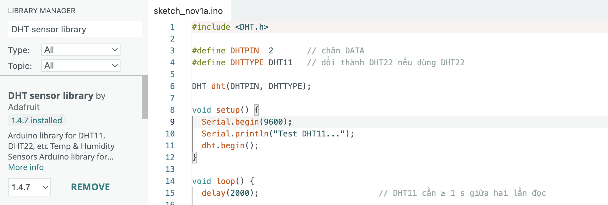
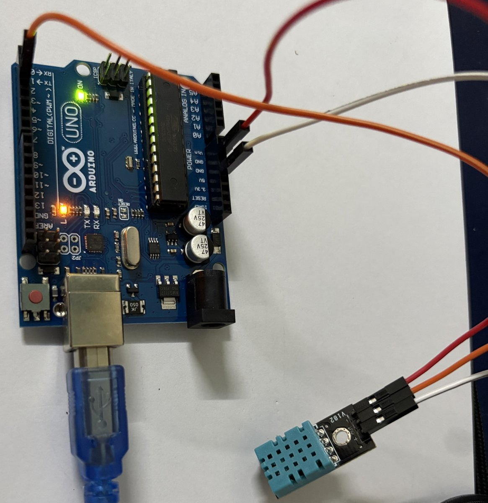
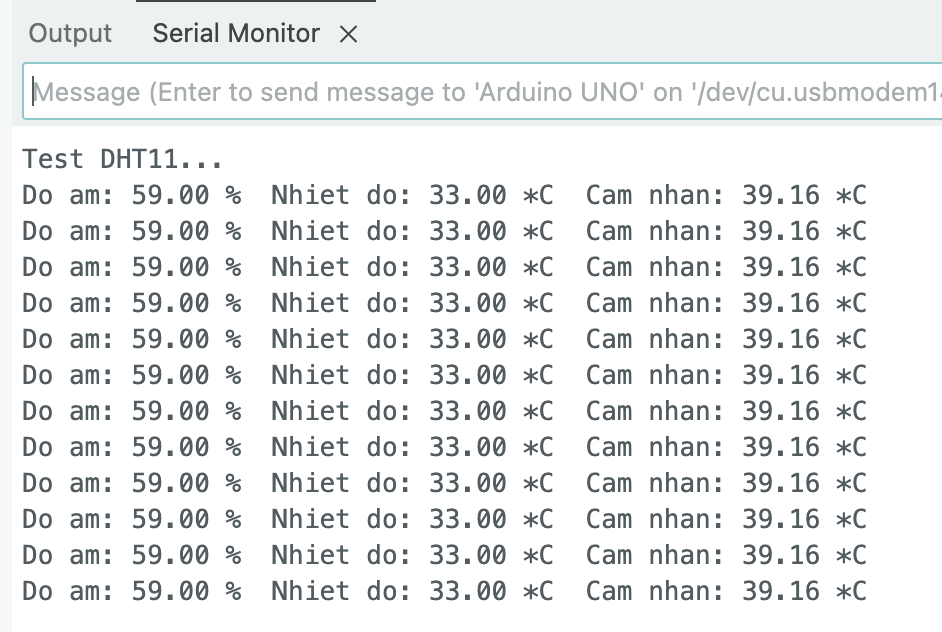

# Lab 3 · Cảm biến nhiệt độ – độ ẩm DHT11

> Đọc nhiệt độ và độ ẩm từ DHT11 bằng Arduino Uno, in ra Serial Monitor rồi hiển thị lên LCD 1602 I²C của [Lab 2](lcd-i2c.md).

## DHT11 là gì

**DHT11** là cảm biến số đo **nhiệt độ** và **độ ẩm tương đối** trong cùng một vỏ nhựa xanh. Bên trong có một phần tử đo ẩm kiểu điện dung, một nhiệt điện trở NTC và một vi xử lý nhỏ. Vi xử lý này đổi tín hiệu analog thành số rồi gửi về Arduino qua **một dây dữ liệu**.

| Thông số | DHT11 | DHT22 (để so sánh) |
|---|---|---|
| Nhiệt độ | 0–50 °C, sai số ±2 °C | −40–80 °C, ±0,5 °C |
| Độ ẩm | 20–90 %RH, sai số ±5 % | 0–100 %RH, ±2–5 % |
| Độ phân giải | 1 °C, 1 % | 0,1 °C, 0,1 % |
| Tần số đọc tối đa | 1 lần/giây | 1 lần/2 giây |
| Điện áp | 3,3–5 V | 3,3–5 V |

DHT11 rẻ và đủ dùng cho bài thực hành, nhưng **không đo được dưới 0 °C** và kết quả chỉ là số nguyên.

### Giao thức 1 dây

DHT11 không dùng I²C mà dùng giao thức riêng trên một dây `DATA`:

1. Arduino kéo `DATA` xuống LOW ít nhất **18 ms** để "đánh thức" cảm biến, rồi thả ra.
2. DHT11 trả lời bằng một xung LOW 80 µs rồi HIGH 80 µs.
3. Cảm biến gửi **40 bit**: 8 bit độ ẩm nguyên + 8 bit độ ẩm thập phân + 8 bit nhiệt độ nguyên + 8 bit nhiệt độ thập phân + 8 bit **checksum**. Mỗi bit bắt đầu bằng LOW 50 µs; sau đó HIGH ~26 µs là bit `0`, HIGH ~70 µs là bit `1`.
4. Checksum bằng tổng 4 byte đầu (lấy 8 bit thấp). Sai checksum nghĩa là dữ liệu bị nhiễu, phải bỏ.

Thời gian tính bằng micro giây nên phải đọc bằng thư viện, không tự viết bằng `digitalRead()` trong `loop()`.

## Module và chân

Kit dùng loại **module 3 chân** mạch đen, in mã `V182`. Cảm biến DHT11 (vỏ xanh, 4 chân) được hàn sẵn lên mạch. Mặt sau có vài linh kiện dán nhỏ, trong đó có điện trở kéo lên cho chân `DATA`, nên không cần mắc thêm điện trở ngoài.

::: {layout-ncol=2}


:::

Nhìn mặt trước (mặt có cảm biến xanh), chân header từ trên xuống là:

| Chân module | Nối vào Uno | Ghi chú |
|---|---|---|
| `+` | `5V` | Chân trên cùng |
| `out` | `D2` | Chân giữa. Chân digital bất kỳ cũng được, nhớ sửa `DHTPIN` |
| `−` | `GND` | Chân dưới cùng |

Lật sang mặt sau thì thứ tự nhãn bị đảo ngược. Luôn đọc nhãn ở mặt đang nhìn, đừng nhớ theo vị trí. Module của hãng khác có thể xếp chân khác (ví dụ `out` ở ngoài cùng). Nếu dùng cảm biến DHT11 trần (4 chân, không có mạch) thì chân 3 bỏ trống và phải tự mắc điện trở 10 kΩ từ `DATA` lên `5V`.

Dùng 3 sợi dây **đực – cái** tách từ cáp dẹt: đầu cái chụp vào chân module, đầu đực cắm vào header Uno, không cần breadboard. Nếu làm tiếp phần LCD thì `5V` và `GND` phải chia cho hai module. Uno chỉ có một chân `5V`, nên dùng breadboard làm thanh nguồn chung (hoặc lấy `5V` từ header ICSP).

## Cài thư viện

**Tools → Manage Libraries…**, tìm `DHT sensor library` → cài **DHT sensor library** by Adafruit. IDE sẽ hỏi cài thêm thư viện phụ thuộc **Adafruit Unified Sensor**, chọn **Install All**.

Gõ đúng tên đầy đủ `DHT sensor library` vào ô tìm kiếm. Nếu chỉ gõ `DHT sensor`, kết quả xếp theo thứ tự chữ cái nên các thư viện không liên quan hiện lên trước (`AM2302-Sensor-Pi-Pico` cho Pi Pico, `AM232X` cho cảm biến I²C AM2320…). Đừng cài nhầm những thư viện này.

{width=100%}

## Code

### Test 1 – đọc ra Serial Monitor

Mở **Serial Monitor** ở 9600 baud:

```cpp
#include <DHT.h>

#define DHTPIN  2       // chân DATA
#define DHTTYPE DHT11   // đổi thành DHT22 nếu dùng DHT22

DHT dht(DHTPIN, DHTTYPE);

void setup() {
  Serial.begin(9600);
  Serial.println("Test DHT11...");
  dht.begin();
}

void loop() {
  delay(2000);                         // DHT11 cần ≥ 1 s giữa hai lần đọc

  float h = dht.readHumidity();
  float t = dht.readTemperature();     // °C; readTemperature(true) cho °F

  if (isnan(h) || isnan(t)) {          // NaN = đọc lỗi (sai dây, sai chân, checksum)
    Serial.println("Loi doc DHT11!");
    return;
  }

  float hic = dht.computeHeatIndex(t, h, false);  // nhiệt độ cảm nhận

  Serial.print("Do am: ");
  Serial.print(h);
  Serial.print(" %  Nhiet do: ");
  Serial.print(t);
  Serial.print(" *C  Cam nhan: ");
  Serial.print(hic);
  Serial.println(" *C");
}
```

**"Cảm nhận" là gì.** `computeHeatIndex()` tính **chỉ số nóng bức** (*heat index*): nhiệt độ mà cơ thể *cảm thấy* khi xét cả độ ẩm. Mồ hôi bay hơi để làm mát da, nhưng không khí càng ẩm thì mồ hôi càng khó bay hơi, nên người thấy nóng hơn số đo trên nhiệt kế. Ví dụ 32 °C với độ ẩm 70 % cho cảm giác khoảng 40 °C. Thư viện dùng công thức hồi quy của Cục Thời tiết Mỹ (NOAA). Chỉ số này có ý nghĩa khi trời nóng (từ khoảng 27 °C) và ẩm (từ 40 %RH trở lên). Phòng mát hoặc khô thì giá trị "cảm nhận" xấp xỉ, thậm chí thấp hơn, nhiệt độ thật. Tham số `false` nghĩa là đầu vào và kết quả tính bằng °C (`true` là °F).

**Cách kiểm tra cảm biến chạy đúng:**

- Số đo phòng thường khoảng 25–33 °C và 50–80 %RH (ở Việt Nam).
- **Hà hơi** vào cảm biến: độ ẩm tăng vọt lên 85–95 % trong vài giây, rồi tụt dần.
- **Nắm tay** quanh cảm biến khoảng 30 giây: nhiệt độ tăng 1–3 °C.
- Số chỉ nhảy theo bước 1 (vì DHT11 chỉ có độ phân giải số nguyên), in ra `28.00` chứ không phải `28.37`.

### Test 2 – hiển thị lên LCD 1602 I²C

Ghép với mạch [Lab 2](lcd-i2c.md): LCD vẫn ở `A4`/`A5`, DHT11 ở `D2`.

```cpp
#include <Wire.h>
#include <LiquidCrystal_I2C.h>
#include <DHT.h>

#define DHTPIN  2
#define DHTTYPE DHT11

LiquidCrystal_I2C lcd(0x27, 16, 2);
DHT dht(DHTPIN, DHTTYPE);

void setup() {
  lcd.init();
  lcd.backlight();
  dht.begin();
  lcd.print("Dang doc DHT11");
}

void loop() {
  delay(2000);

  float h = dht.readHumidity();
  float t = dht.readTemperature();

  lcd.setCursor(0, 0);
  if (isnan(h) || isnan(t)) {
    lcd.print("Loi doc DHT11!  ");
    lcd.setCursor(0, 1);
    lcd.print("                ");
    return;
  }

  lcd.print("Nhiet do: ");
  lcd.print(t, 0);       // 0 chữ số thập phân
  lcd.print((char)223);  // ký tự độ ° trong ROM HD44780
  lcd.print("C  ");

  lcd.setCursor(0, 1);
  lcd.print("Do am:    ");
  lcd.print(h, 0);
  lcd.print(" %   ");
}
```

`(char)223` là ký hiệu `°` có sẵn trong bảng ký tự của chip HD44780, không cần `createChar`.

## Mô phỏng

**Tinkercad không có DHT11 hay DHT22**: tìm trong thư viện linh kiện sẽ không ra. Cảm biến nhiệt độ duy nhất Tinkercad có là **TMP36**, và không có cảm biến độ ẩm nào. Có hai cách mô phỏng:

**Cách 1: Wokwi (giữ nguyên code DHT).** [wokwi.com](https://wokwi.com) có linh kiện **DHT22** chạy được thư viện Adafruit. Tạo project *Arduino Uno*, thêm *DHT22*, nối `VCC` → `5V`, `SDA` (chân dữ liệu) → `D2`, `GND` → `GND`, rồi dùng code Test 1 và đổi một dòng:

```cpp
#define DHTTYPE DHT22   // Wokwi chỉ có DHT22
```

Bấm vào cảm biến lúc đang chạy sẽ hiện thanh kéo để chỉnh nhiệt độ và độ ẩm. Code chạy trên Wokwi thì nạp vào DHT11 thật được ngay, chỉ cần đổi lại `DHT11`.

**Cách 2: Tinkercad với TMP36 (chỉ đo nhiệt độ).** TMP36 có 3 chân: `+Vs` → `5V`, `Vout` → `A0`, `GND` → `GND`. Đây là cảm biến analog, nên code khác hẳn DHT11:

```cpp
void setup() {
  Serial.begin(9600);
}

void loop() {
  int raw = analogRead(A0);              // 0–1023
  float v = raw * 5.0 / 1024.0;          // đổi ra volt
  float t = (v - 0.5) * 100.0;           // TMP36: 0,5 V tại 0 °C, 10 mV/°C
  Serial.print("Nhiet do: ");
  Serial.print(t);
  Serial.println(" *C");
  delay(1000);
}
```

Nếu cần một giá trị "độ ẩm" giả để thử phần hiển thị LCD, có thể thay bằng một **biến trở** nối vào `A1` và dùng `map(analogRead(A1), 0, 1023, 20, 90)`.

## Ảnh thực tế

{width=80%}

| Chân module | Chân Arduino Uno | Màu dây trong ảnh |
|---|---|---|
| `+` | `5V` (hàng POWER) | trắng |
| `out` | `D2` (hàng DIGITAL) | cam |
| `−` | `GND` (hàng POWER, ngay dưới `5V`) | đỏ |

Ảnh chụp với board xoay ngược 180°, nên hàng POWER nằm bên phải và nhãn chân bị lộn ngược. Màu dây chỉ là màu có sẵn trong bộ cáp. Ở đây dây **đỏ là GND**, ngược với quy ước đỏ = nguồn, nên phải nhìn chân cắm chứ đừng nhìn màu dây.

**Lần chạy đầu bị lỗi.** Serial Monitor in `Loi doc DHT11!` liên tục. Nguyên nhân là dây đỏ (`−`) cắm nhầm vào `Vin`, nằm sát cạnh `GND`. Khi cấp nguồn bằng USB, `Vin` có điện áp gần 5 V, nên hai chân nguồn của module gần như ngang áp và module không có điện. Module không nóng, không hỏng, nên rất khó nhận ra. Chuyển dây đỏ sang `GND` là đọc được ngay.

Kết quả Test 1 trên Serial Monitor (9600 baud):

{width=80%}

Một vài nhận xét về kết quả:

- **33 °C, 59 %RH**: nằm trong khoảng bình thường của một phòng không bật điều hoà ở Việt Nam.
- Số đo in ra là `33.00` và `59.00`, phần thập phân luôn bằng 0. Đây là độ phân giải 1 °C / 1 % của DHT11, không phải lỗi.
- Các dòng giống hệt nhau vì nhiệt độ và độ ẩm phòng thay đổi chậm hơn bước 1 đơn vị trong vài chục giây. Muốn thấy số nhảy thì hà hơi vào cảm biến, hoặc nắm tay quanh nó.
- **Cảm nhận 39,16 °C**: phòng 33 °C với độ ẩm 59 % cho cảm giác nóng như 39 °C. Giá trị này có phần thập phân vì được *tính* từ hai số nguyên trên, chứ cảm biến không đo trực tiếp.

## Lỗi hay gặp

| Hiện tượng | Nguyên nhân / cách xử lý |
|---|---|
| Luôn in `Loi doc DHT11!` (NaN) | Sai thứ tự chân (đọc lại nhãn trên module), cắm `DATA` khác chân `DHTPIN`, lỏng dây, hoặc thiếu pull-up khi dùng cảm biến trần |
| Luôn NaN, dây đúng thứ tự, module không nóng | Dây `−` cắm nhầm vào `Vin` (sát cạnh `GND` trên hàng POWER) — module không có điện. Chuyển sang `GND` |
| Thỉnh thoảng lỗi, đa số đọc được | Đọc nhanh quá (< 1 s), dây dài hoặc nhiễu — tăng `delay`, bỏ qua lần đọc lỗi |
| Lỗi biên dịch `Adafruit_Sensor.h: No such file` | Chưa cài **Adafruit Unified Sensor** |
| Số đo sai hẳn (ví dụ độ ẩm 1 %, nhiệt độ 0) | Khai báo nhầm `DHT22` cho cảm biến DHT11 hoặc ngược lại |
| Module nóng lên | Cắm ngược `VCC`/`GND` — rút điện ngay |
| Nhiệt độ cao hơn thực tế 1–2 °C | Đặt sát board/LCD bị tỏa nhiệt, hoặc tay chạm vào — để cảm biến cách xa và chờ ổn định vài phút |
