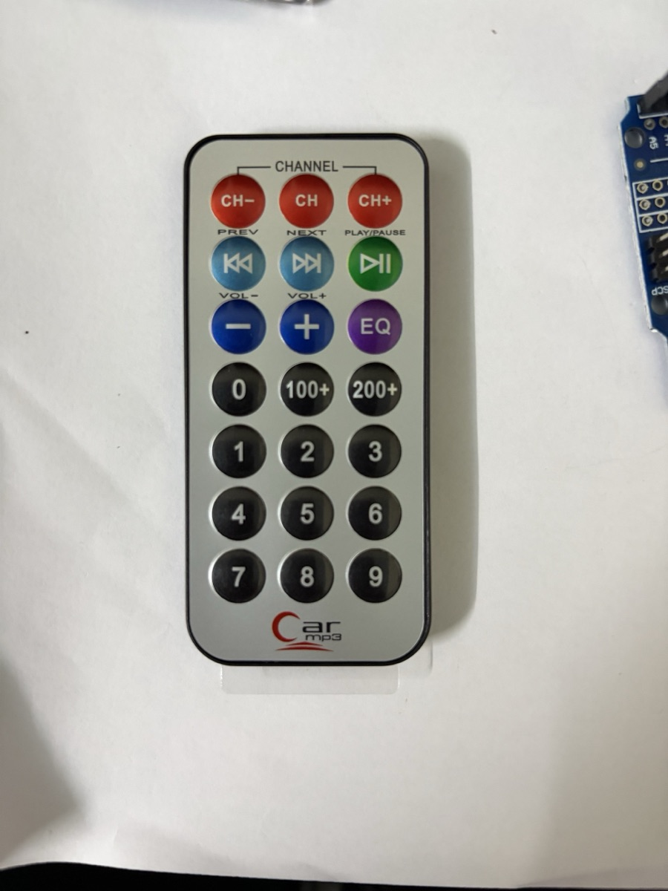
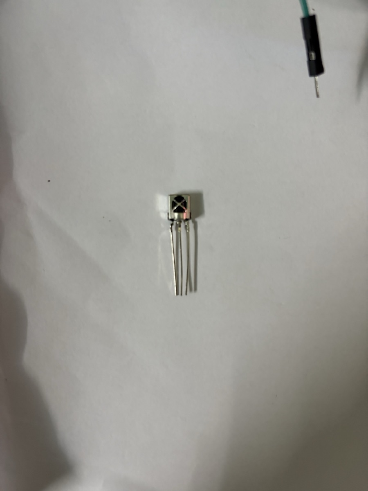
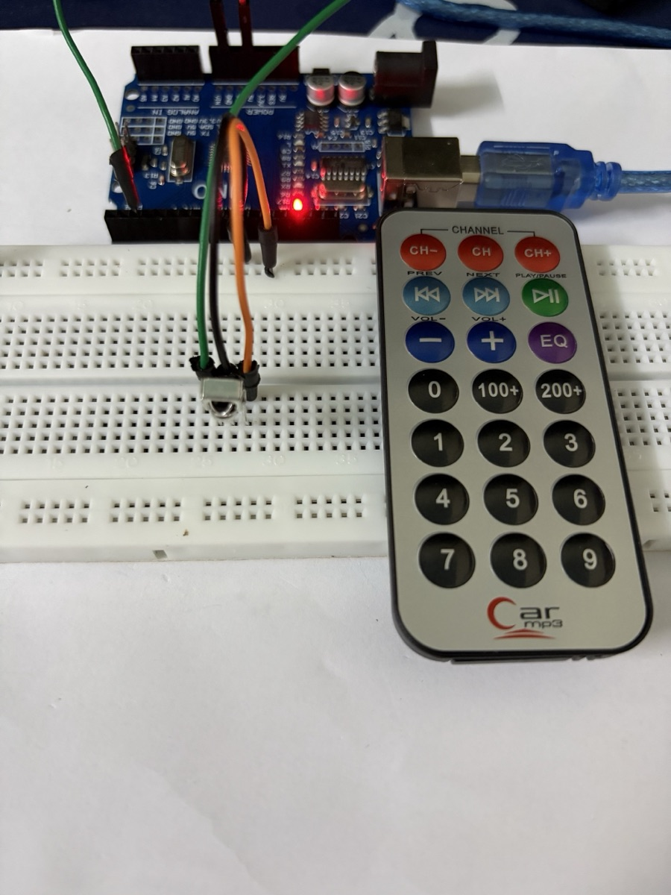

# Lab 8 · Hồng ngoại: remote IR + mắt thu VS1838B và cảm biến tránh vật cản FC-51

> Dùng hai linh kiện hồng ngoại trong kit với Arduino Uno: **remote + mắt thu VS1838B** để nhận lệnh từ xa (đọc mã phím, bật tắt và chỉnh độ sáng LED), và **cảm biến FC-51** để phát hiện vật cản. Cuối lab ghép hai phần thành "công tắc đèn 2 cách": bật đèn bằng remote hoặc bằng cách vẫy tay. Điểm chính của lab là thấy cùng là hồng ngoại nhưng có hai cách dùng hoàn toàn khác nhau.

## Hồng ngoại và hai cách dùng

**Hồng ngoại** (IR – *infrared*) là ánh sáng có bước sóng dài hơn ánh sáng đỏ, mắt người không thấy. Các linh kiện trong kit đều dùng bước sóng khoảng **940 nm**. Camera điện thoại thấy được bước sóng này: nhìn đầu remote qua camera rồi bấm phím sẽ thấy một chấm sáng tím nhấp nháy.

Ba linh kiện của lab chia thành **hai hệ độc lập**:

| | Hệ 1: điều khiển từ xa | Hệ 2: phát hiện vật cản |
|---|---|---|
| Linh kiện | Remote (phát) + mắt thu VS1838B (thu) | FC-51 (tự phát, tự thu) |
| Ánh sáng phát ra | **Nhấp nháy 38 kHz**, bật tắt theo mã | **Liên tục**, không mã hóa |
| Thông tin mang theo | Mã phím (nhiều giá trị) | Có / không có vật (0 hoặc 1) |
| Tầm hoạt động | 5–8 m | 2–30 cm (chỉnh bằng biến trở) |
| Arduino đọc bằng | Thư viện `IRremote` giải mã | `digitalRead()` |

**Hai hệ không dùng lẫn được với nhau.** FC-51 không có mạch lọc 38 kHz nên không đọc được mã remote. Ngược lại, VS1838B chỉ nhận ánh sáng nhấp nháy 38 kHz nên không thấy ánh sáng liên tục của FC-51. Cái duy nhất xảy ra là chĩa remote vào FC-51 có thể làm nó **báo nhầm có vật** (thử ở Phần B).

### Vì sao remote cần sóng mang 38 kHz

Trong phòng có rất nhiều hồng ngoại "nền": ánh nắng, bóng đèn sợi đốt, cơ thể người. Nếu remote chỉ bật một tia sáng liên tục, mắt thu không phân biệt được với ánh sáng nền. Vì vậy remote **bật tắt LED 38 000 lần mỗi giây** trong lúc gửi một bit. Bên trong VS1838B có bộ lọc chỉ cho tần số quanh 38 kHz đi qua, rồi tách sóng mang ra, trả về Arduino một chuỗi xung sạch:

```
LED remote   |||||||||||______|||||______|||||||||||______   ← nhấp nháy 38 kHz theo từng bit
OUT VS1838B  ‾‾|___________|‾‾‾‾‾‾|_____|‾‾‾‾‾‾|__________|  ← đã tách sóng mang, mức LOW khi có tín hiệu
```

Chân `OUT` của mắt thu **nghỉ ở mức HIGH**, xuống `LOW` khi có tín hiệu 38 kHz.

### Giao thức NEC

Remote trong kit dùng giao thức **NEC**, phổ biến nhất trên remote giá rẻ. Mỗi lần bấm phím, remote gửi một **khung 32 bit**:

| Phần | Độ dài | Ý nghĩa |
|---|---|---|
| Xung mở đầu | 9 ms sáng + 4,5 ms tắt | Báo hiệu bắt đầu khung |
| Địa chỉ | 8 bit + 8 bit đảo | Loại thiết bị (remote kit là `0x00`) |
| Lệnh | 8 bit + 8 bit đảo | **Mã phím**, đây là giá trị code cần đọc |
| Bit kết thúc | 562 µs | |

Bit `0` và bit `1` khác nhau ở độ dài khoảng tắt sau mỗi xung (562 µs hoặc 1,69 ms). Phần "đảo" là bản sao lật bit để kiểm tra lỗi.

Nếu tay **giữ phím quá khoảng 110 ms**, remote không gửi lại cả khung mà gửi một **khung lặp** (*repeat*) ngắn, cứ 110 ms một lần. Thư viện báo khung này bằng cờ `IRDATA_FLAGS_IS_REPEAT`. Gần như lần bấm nào cũng sinh ra ít nhất một khung lặp, nên code phải bỏ qua cờ này, nếu không thì một lần bấm bị tính thành hai, ba lần.

## Linh kiện trong kit

### Remote "Car MP3" 21 phím

{width=45%}

- Remote mỏng, dùng **pin cúc CR2025**, LED hồng ngoại nằm ở cạnh đầu remote.
- **Lần đầu dùng phải rút miếng nhựa trong suốt** thò ra ở đầu remote phía dưới. Miếng nhựa này cách điện pin khi vận chuyển, chưa rút thì remote không phát.
- Giao thức **NEC**, địa chỉ `0x00`. Bảng mã phím ở [Phần A](#bảng-mã-phím-remote-car-mp3).

### Mắt thu VS1838B

{width=40%}

Kit có mắt thu **trần** (không gắn trên board), loại có **vỏ kim loại** bọc ngoài để chống nhiễu. Bên trong đã có sẵn photodiode, mạch khuếch đại, bộ lọc 38 kHz và tách sóng, nên Arduino chỉ cần đọc một chân.

**Sơ đồ chân:** nhìn **thẳng vào mặt có dấu X / mắt tròn**, chân hướng xuống:

```
    ┌─────┐
    │  X  │
    └┬─┬─┬┘
     │ │ │
   OUT GND VCC
```

| Thông số | VS1838B |
|---|---|
| Điện áp | 2,7–5,5 V (dùng được cả 3,3 V và 5 V) |
| Tần số sóng mang | 38 kHz |
| Góc nhận | ~±45° |
| Tầm nhận | ~8–10 m với remote còn pin tốt |
| Mức `OUT` | Nghỉ `HIGH`, có tín hiệu `LOW` |

⚠️ **Đừng cắm ngược `VCC` và `GND`.** Mắt thu nóng lên và hỏng sau vài giây. Cắm điện xong nên chạm thử vào thân mắt thu: nếu thấy ấm thì rút USB ngay.

Có một số bản mắt thu khác (ví dụ một vài lô HX1838 hoặc TSOP) có thứ tự chân khác. Nếu mắt thu trong kit không giống ảnh, xem datasheet của đúng mã in trên thân.

### Cảm biến tránh vật cản FC-51

::: {layout-ncol=2}


:::

Module trong kit là dòng **MH-Sensor-Series "Flying-Fish"** (in ở mặt sau), bán dưới tên **FC-51** hoặc **IR obstacle avoidance sensor**. Trên mạch có:

- **LED phát hồng ngoại** (vỏ trong suốt) và **đầu thu hồng ngoại** (vỏ đen) đặt cạnh nhau, cùng hướng về phía trước.
- **Chip LM393**: mạch so sánh điện áp. So tín hiệu từ đầu thu với một ngưỡng, ra `LOW` hoặc `HIGH`.
- **Biến trở xanh**: đặt ngưỡng so sánh, tức **khoảng cách phát hiện**.
- **Hai đèn báo SMD**: một đèn **nguồn** (sáng khi có điện), một đèn **có vật** (sáng khi `OUT` xuống `LOW`).
- **3 chân, thứ tự `OUT` · `GND` · `VCC`.** Thứ tự này **khác** đa số module khác trong kit (thường là `VCC` đầu tiên). Nhãn in ở cả hai mặt, luôn đọc nhãn trước khi cắm.

**Nguyên lý:** LED phát chiếu hồng ngoại ra phía trước. Khi có vật, ánh sáng dội lại vào đầu thu. Vật càng gần (hoặc càng sáng màu) thì đầu thu nhận càng mạnh. Khi vượt ngưỡng đặt bằng biến trở, LM393 kéo `OUT` xuống `LOW`.

| Thông số | FC-51 |
|---|---|
| Điện áp | 3,3–5 V |
| Tầm phát hiện | ~2–30 cm, chỉnh bằng biến trở |
| Góc phát hiện | ~35° |
| Ngõ ra | Digital: **có vật = `LOW`**, không có vật = `HIGH` |

**Giới hạn** (ngược với cảm biến siêu âm ở [Lab 6](ultrasonic-hc-sr04.md)):

- **Vật màu đen** hấp thụ hồng ngoại, phải đưa gần hơn rất nhiều mới bị phát hiện, có khi không phát hiện được.
- **Nắng hoặc đèn sợi đốt chiếu thẳng** vào đầu thu làm cảm biến báo có vật liên tục.
- Chỉ trả lời **có / không**, không cho biết vật cách bao xa. Muốn đo khoảng cách thì dùng HC-SR04.

## Linh kiện và chân

| Linh kiện | Số lượng | Ghi chú |
|---|---|---|
| Arduino Uno + cáp USB | 1 | |
| Remote + mắt thu VS1838B | 1 bộ | Phần A, C |
| Cảm biến FC-51 | 1 | Phần B, C. Không cần điện trở |
| LED 5 mm + điện trở 220 Ω | 1 bộ | LED ngoài ở `D9` |
| Breadboard, dây đực – đực, dây đực – cái | | Dây đực – cái để nối thẳng vào chân FC-51 |

Nối dây:

| Linh kiện | Chân | Nối vào Uno |
|---|---|---|
| VS1838B | `OUT` (trái) | `D2` |
| VS1838B | `GND` (giữa) | `GND` |
| VS1838B | `VCC` (phải) | `5V` |
| FC-51 | `OUT` | `D3` |
| FC-51 | `GND` | `GND` |
| FC-51 | `VCC` | `5V` |
| LED ngoài | Chân dài qua 220 Ω | `D9` |
| LED ngoài | Chân ngắn | `GND` |
| LED `L` trên board | (nối sẵn) | `D13` |

```
VS1838B OUT ─────────────── D2
FC-51   OUT ─────────────── D3
D9 ──[220Ω]──▶|── GND          (LED ngoài)
VCC của hai module ── thanh + ── 5V
GND của hai module ── thanh − ── GND
```

Giải thích cách chọn chân:

- **LED ngoài ở `D9` (chân PWM)** để chỉnh được độ sáng bằng remote. Trên Uno, thư viện `IRremote` chiếm **Timer2**, nên PWM ở **`D3` và `D11` không dùng được** trong lab này. `D9` chạy bằng Timer1, không bị ảnh hưởng. `D3` vẫn dùng bình thường làm chân đọc digital cho FC-51.
- **LED thứ hai dùng LED `L` có sẵn trên board ở `D13`** (đã có điện trở bên trong), để lab chỉ cần **một** điện trở. Khi đó **không dùng `ENABLE_LED_FEEDBACK`** trong `IrReceiver.begin()`, vì tùy chọn này cũng nháy `D13` mỗi khi nhận được tín hiệu.
- Uno có 3 chân `GND`. Kéo `5V` và `GND` ra hai thanh nguồn dọc breadboard rồi cắm các module vào đó cho gọn.

## Cài thư viện

Arduino IDE → **Tools → Manage Libraries** → tìm **IRremote** → cài bản của **Armin Joachimsmeyer** (bản 4.x).

Code trong lab dùng cú pháp bản 4.x: `#include <IRremote.hpp>`, `IrReceiver.begin()`, `IrReceiver.decode()`, `IrReceiver.decodedIRData`. Nhiều ví dụ cũ trên mạng dùng bản 2.x (`IRrecv irrecv(pin); decode_results results; results.value`), cú pháp đó **không biên dịch được** với bản 4.x.

## Phần A – Remote + mắt thu VS1838B

Chỉ cần mắt thu, chưa cần LED hay FC-51.

### Test A1 – đọc mã phím ra Serial

```cpp
#include <IRremote.hpp>

#define IR_PIN 2

// Đổi mã phím thành tên, theo remote "Car MP3" 21 phím
const char* keyName(uint8_t cmd) {
  switch (cmd) {
    case 0x45: return "CH-";
    case 0x46: return "CH";
    case 0x47: return "CH+";
    case 0x44: return "PREV";
    case 0x40: return "NEXT";
    case 0x43: return "PLAY/PAUSE";
    case 0x07: return "VOL-";
    case 0x15: return "VOL+";
    case 0x09: return "EQ";
    case 0x16: return "0";
    case 0x19: return "100+";
    case 0x0D: return "200+";
    case 0x0C: return "1";
    case 0x18: return "2";
    case 0x5E: return "3";
    case 0x08: return "4";
    case 0x1C: return "5";
    case 0x5A: return "6";
    case 0x42: return "7";
    case 0x52: return "8";
    case 0x4A: return "9";
    default:   return "?? (phim la)";
  }
}

void setup() {
  Serial.begin(9600);
  IrReceiver.begin(IR_PIN, ENABLE_LED_FEEDBACK);   // LED D13 nháy khi nhận tín hiệu
  Serial.println("San sang - hay bam remote...");
}

void loop() {
  if (IrReceiver.decode()) {
    uint8_t cmd = IrReceiver.decodedIRData.command;

    if (IrReceiver.decodedIRData.flags & IRDATA_FLAGS_IS_REPEAT) {
      Serial.println("  (giu phim)");
    } else {
      Serial.print("Phim: ");
      Serial.print(keyName(cmd));
      Serial.print("   | ma: 0x");
      Serial.print(cmd, HEX);
      Serial.print("   | giao thuc: ");
      Serial.println(getProtocolString(IrReceiver.decodedIRData.protocol));
    }
    IrReceiver.resume();   // sẵn sàng nhận khung tiếp theo
  }
}
```

Giải thích:

- **`IrReceiver.decode()`** trả `true` khi đã nhận đủ một khung. Thư viện đo các xung bằng ngắt timer ở nền, nên `loop()` không bị chặn trong lúc chờ.
- **`decodedIRData.command`** là 8 bit lệnh của khung NEC, tức mã phím. `decodedIRData.address` là địa chỉ, với remote kit là `0`.
- **`IRDATA_FLAGS_IS_REPEAT`** đánh dấu khung lặp khi giữ phím.
- **`IrReceiver.resume()`** phải gọi sau mỗi lần xử lý, nếu không thư viện không nhận khung tiếp theo.
- **`ENABLE_LED_FEEDBACK`** cho LED `L` (`D13`) nháy mỗi khi có tín hiệu: rất tiện để biết mắt thu đã nhận được ánh sáng hay chưa, kể cả khi Serial chưa in gì.
- Chuỗi in ra Serial viết **không dấu** để tránh lỗi font trên Serial Monitor.

**Cách kiểm tra:** nạp code, mở Serial Monitor (baud **9600**), chĩa remote vào mắt thu và bấm vài phím. Kết quả thật trên mạch:

{width=70%}

Dòng `(giu phim)` xuất hiện sau gần như mọi lần bấm, kể cả bấm nhanh: đó là khung lặp NEC như đã giải thích ở trên, không phải lỗi.

### Bảng mã phím remote "Car MP3"

| Phím | Mã | Phím | Mã | Phím | Mã |
|---|---|---|---|---|---|
| CH− | `0x45` | CH | `0x46` | CH+ | `0x47` |
| PREV | `0x44` | NEXT | `0x40` | PLAY/PAUSE | `0x43` |
| VOL− | `0x07` | VOL+ | `0x15` | EQ | `0x09` |
| 0 | `0x16` | 100+ | `0x19` | 200+ | `0x0D` |
| 1 | `0x0C` | 2 | `0x18` | 3 | `0x5E` |
| 4 | `0x08` | 5 | `0x1C` | 6 | `0x5A` |
| 7 | `0x42` | 8 | `0x52` | 9 | `0x4A` |

Đây là mã của remote trong kit. Remote cùng kiểu dáng nhưng khác lô có thể có mã khác: nếu Serial in `?? (phim la)` thì ghi lại mã hex và sửa trong `keyName()`. Remote TV, máy lạnh trong nhà cũng đọc được nếu dùng sóng mang ~38 kHz, chỉ khác giao thức và mã.

### Test A2 – điều khiển LED bằng remote

Thêm LED ngoài ở `D9` (qua điện trở 220 Ω). LED thứ hai là LED `L` trên board.

| Phím | Chức năng |
|---|---|
| 1 | Bật / tắt LED ngoài (`D9`) |
| 2 | Bật / tắt LED `L` trên board (`D13`) |
| VOL+ / VOL− | Tăng / giảm độ sáng LED ngoài |
| 0 | Tắt hết |

```cpp
#include <IRremote.hpp>

#define IR_PIN  2
#define LED_EXT 9    // LED ngoài, qua điện trở 220 Ω (chân PWM)
#define LED_L   13   // LED "L" trên board

#define KEY_0     0x16
#define KEY_1     0x0C
#define KEY_2     0x18
#define KEY_VOLUP 0x15
#define KEY_VOLDN 0x07

bool extOn = false, lOn = false;
int brightness = 128;          // 0..255

void update() {
  analogWrite(LED_EXT, extOn ? brightness : 0);
  digitalWrite(LED_L, lOn);
}

void setup() {
  Serial.begin(9600);
  pinMode(LED_EXT, OUTPUT);
  pinMode(LED_L, OUTPUT);
  IrReceiver.begin(IR_PIN);    // không dùng ENABLE_LED_FEEDBACK vì cần D13
  Serial.println("San sang - hay bam remote...");
}

void loop() {
  if (IrReceiver.decode()) {
    if (!(IrReceiver.decodedIRData.flags & IRDATA_FLAGS_IS_REPEAT)) {
      switch (IrReceiver.decodedIRData.command) {
        case KEY_1:     extOn = !extOn; break;
        case KEY_2:     lOn = !lOn; break;
        case KEY_VOLUP: brightness = min(brightness + 32, 255); extOn = true; break;
        case KEY_VOLDN: brightness = max(brightness - 32, 0); break;
        case KEY_0:     extOn = lOn = false; break;
      }
      update();
      Serial.print("LED ngoai: "); Serial.print(extOn ? "BAT" : "TAT");
      Serial.print(" (do sang "); Serial.print(brightness);
      Serial.print(")  |  LED L: "); Serial.println(lOn ? "BAT" : "TAT");
    }
    IrReceiver.resume();
  }
}
```

Giải thích:

- Trạng thái đèn lưu trong biến (`extOn`, `lOn`, `brightness`), hàm `update()` xuất trạng thái ra chân. Cách tách "trạng thái" và "xuất ra chân" này giúp Phần C chỉ cần thêm một nguồn thay đổi trạng thái (FC-51) mà không sửa phần xuất.
- **`analogWrite()`** trên `D9` tạo PWM, nên VOL+/VOL− chỉnh được độ sáng. Bấm VOL+ khi đèn đang tắt sẽ bật đèn luôn.
- **Bỏ qua khung lặp** ở đây là bắt buộc: nếu không, một lần bấm phím 1 có thể bật rồi tắt ngay, nhìn như đèn không phản ứng.

**Cách kiểm tra:** bấm 1 thì LED ngoài sáng; VOL− vài lần thì LED tối dần; bấm 2 thì LED `L` sáng; bấm 0 thì tắt cả hai.

## Phần B – Cảm biến FC-51

Có thể giữ nguyên mắt thu trên breadboard, code Phần B không dùng tới.

### Test B1 – thử không cần code

Chỉ cấp nguồn cho FC-51 (`VCC` → `5V`, `GND` → `GND`, theo nhãn trên board), chưa cần nạp code:

1. **Đèn nguồn** trên module sáng. Nếu không sáng thì chưa có điện hoặc cắm ngược nguồn: rút USB và kiểm tra lại theo nhãn `OUT` · `GND` · `VCC`.
2. Đưa tay vào trước hai "mắt", **đèn có vật** phải sáng.
3. **Chỉnh biến trở xanh** bằng tua vít nhỏ: vặn tới khi **không có vật thì đèn tắt**, đưa tay cách **5–10 cm thì đèn sáng**. Nếu đèn sáng liên tục kể cả khi trước mặt trống, cảm biến đang quá nhạy hoặc bị nắng chiếu vào: vặn ngược lại.

Đặt cảm biến **hướng ra chỗ trống**. Nếu cắm module đứng trên breadboard thì hai "mắt" hướng lên trần, khi đó phải đưa tay **từ trên xuống**.

### Test B2 – có vật thì LED sáng

Nối `OUT` → `D3`.

```cpp
#define SENSOR_PIN 3
#define LED_PIN    9

void setup() {
  pinMode(SENSOR_PIN, INPUT);
  pinMode(LED_PIN, OUTPUT);
}

void loop() {
  if (digitalRead(SENSOR_PIN) == LOW) {   // LOW = có vật
    digitalWrite(LED_PIN, HIGH);
  } else {
    digitalWrite(LED_PIN, LOW);
  }
}
```

Code này giống hệt đọc nút nhấn ở [Lab 1](led-basics.md) với `INPUT_PULLUP`: FC-51 về mặt điện chính là một "nút nhấn không chạm", có vật thì kéo chân xuống `LOW`. Không cần `INPUT_PULLUP` vì module đã có điện trở kéo lên sẵn trên board.

### `LOW` là bao nhiêu volt

Trong code, `LOW` là hằng số **0** và `HIGH` là **1**. Về điện áp, Uno chạy 5 V đọc như sau (theo datasheet ATmega328P):

| Điện áp ở chân | `digitalRead()` trả về |
|---|---|
| 0 – ~1,5 V (dưới 0,3 × VCC) | `LOW` (0) |
| ~1,5 – 3 V | Không xác định, có thể ra 0 hoặc 1 |
| ~3 – 5 V (trên 0,6 × VCC) | `HIGH` (1) |

LM393 trên FC-51 cho ra hai mức rất rõ: **có vật ~0 V**, **không có vật ~5 V**, nên không bao giờ rơi vào vùng giữa.

### Test B3 – đo điện áp thật và đếm số lần

Nối thêm một dây từ `OUT` của FC-51 sang `A0` (giữ dây vào `D3`), để thấy cùng lúc mức logic và điện áp thật:

```cpp
#define SENSOR_PIN 3
#define LED_PIN    9

bool last = false;
unsigned long count = 0;

void setup() {
  Serial.begin(9600);
  pinMode(SENSOR_PIN, INPUT);
  pinMode(LED_PIN, OUTPUT);
}

void loop() {
  bool obstacle = (digitalRead(SENSOR_PIN) == LOW);
  digitalWrite(LED_PIN, obstacle);

  if (obstacle && !last) {                 // vừa có vật đưa vào
    count++;
    float volt = analogRead(A0) * 5.0 / 1023;
    Serial.print("Co vat! lan thu "); Serial.print(count);
    Serial.print("  | OUT = "); Serial.print(volt); Serial.println(" V");
  }
  if (!obstacle && last) {                 // vật vừa rời đi
    float volt = analogRead(A0) * 5.0 / 1023;
    Serial.print("Het vat           | OUT = "); Serial.print(volt); Serial.println(" V");
  }
  last = obstacle;
  delay(20);
}
```

- **`obstacle && !last`** chỉ đúng tại thời điểm tay **vừa đưa vào** (cạnh xuống của tín hiệu). Không có biến `last` thì khi tay còn để đó, Serial sẽ in liên tục và bộ đếm tăng không ngừng.
- `delay(20)` giúp bỏ qua dao động ngắn khi tay ở đúng mép vùng phát hiện.

**Thử thêm để hiểu cảm biến:**

- So sánh **tờ giấy trắng** với **vật màu đen** (mặt lưng điện thoại, áo đen): vật đen phải đưa gần hơn nhiều, có khi không phát hiện được.
- Chĩa **remote** vào FC-51 và giữ phím: cảm biến có thể báo `Co vat!` dù trước mặt trống, vì đầu thu nhận ánh sáng hồng ngoại của remote.
- Đặt cảm biến gần cửa sổ có nắng: đèn có vật có thể sáng liên tục.

## Phần C – Công tắc đèn 2 cách

Ghép Phần A và Phần B: LED ngoài bật tắt được bằng **phím 1 trên remote** hoặc bằng **vẫy tay** trước FC-51, giống đèn cảm ứng tủ quần áo có thêm remote.

| Đầu vào | Tác dụng |
|---|---|
| Phím 1 | Bật / tắt LED ngoài |
| Phím 2 | Bật / tắt LED `L` |
| VOL+ / VOL− | Chỉnh độ sáng LED ngoài |
| Phím 0 | Tắt hết |
| **Vẫy tay** trước FC-51 | Bật / tắt LED ngoài |

```cpp
#include <IRremote.hpp>

#define IR_PIN    2
#define HAND_PIN  3
#define LED_EXT   9
#define LED_L     13

#define KEY_0     0x16
#define KEY_1     0x0C
#define KEY_2     0x18
#define KEY_VOLUP 0x15
#define KEY_VOLDN 0x07

#define HAND_LOCK_MS 500   // sau một lần vẫy, bỏ qua cảm biến 0,5 s

bool extOn = false, lOn = false;
int brightness = 128;
bool lastHand = false;
unsigned long lastHandTime = 0;

void update(const char* source) {
  analogWrite(LED_EXT, extOn ? brightness : 0);
  digitalWrite(LED_L, lOn);
  Serial.print("["); Serial.print(source); Serial.print("] ");
  Serial.print("LED ngoai: "); Serial.print(extOn ? "BAT" : "TAT");
  Serial.print(" (do sang "); Serial.print(brightness);
  Serial.print(")  |  LED L: "); Serial.println(lOn ? "BAT" : "TAT");
}

void setup() {
  Serial.begin(9600);
  pinMode(HAND_PIN, INPUT);
  pinMode(LED_EXT, OUTPUT);
  pinMode(LED_L, OUTPUT);
  IrReceiver.begin(IR_PIN);
  Serial.println("Remote hoac vay tay de bat/tat den");
}

void loop() {
  // 1. Remote
  if (IrReceiver.decode()) {
    if (!(IrReceiver.decodedIRData.flags & IRDATA_FLAGS_IS_REPEAT)) {
      bool known = true;
      switch (IrReceiver.decodedIRData.command) {
        case KEY_1:     extOn = !extOn; break;
        case KEY_2:     lOn = !lOn; break;
        case KEY_VOLUP: brightness = min(brightness + 32, 255); extOn = true; break;
        case KEY_VOLDN: brightness = max(brightness - 32, 0); break;
        case KEY_0:     extOn = lOn = false; break;
        default:        known = false;
      }
      if (known) update("remote");
    }
    IrReceiver.resume();
  }

  // 2. Vẫy tay: chỉ xử lý lúc tay vừa đưa vào, và không quá dày
  bool hand = (digitalRead(HAND_PIN) == LOW);
  if (hand && !lastHand && millis() - lastHandTime > HAND_LOCK_MS) {
    extOn = !extOn;
    lastHandTime = millis();
    update("vay tay");
  }
  lastHand = hand;
}
```

Giải thích:

- Hai nguồn đầu vào cùng thay đổi **một biến trạng thái** `extOn`, rồi đều gọi `update()`. Đèn luôn phản ánh trạng thái mới nhất, bất kể lệnh đến từ đâu.
- **Không dùng `delay()`** để chống dội cho FC-51 như Test B3, mà dùng `millis()` (`HAND_LOCK_MS`). Nếu `loop()` bị `delay()` chặn, thư viện vẫn nhận khung IR ở nền, nhưng phản hồi phím sẽ chậm đi. Với `millis()`, cả hai đầu vào đều được kiểm tra liên tục.
- `update()` in ra **nguồn của lệnh** (`[remote]` hoặc `[vay tay]`), tiện để kiểm tra trên Serial.
- Khi chĩa remote vào sát FC-51, một lần bấm phím có thể bị tính **hai lần**: một lần do mắt thu nhận mã, một lần do FC-51 "thấy" ánh sáng remote. Đặt FC-51 quay hướng khác với mắt thu, hoặc đứng xa hơn khi bấm remote.

**Mở rộng:**

- **Chế độ báo động:** phím PLAY bật/tắt "canh". Khi đang canh mà FC-51 thấy vật thì LED ngoài nháy nhanh, LED `L` sáng, Serial in cảnh báo.
- **Đèn tự tắt:** vẫy tay bật đèn, sau 10 s không có ai thì tự tắt (dùng `millis()`). Remote dùng để chuyển giữa chế độ tự động và bật cố định.
- **Đếm người qua cửa** bằng FC-51, phím 0 trên remote để reset bộ đếm, hiển thị số đếm lên LCD ([Lab 2](lcd-i2c.md)) hoặc LED 7 đoạn ([Lab 7](seven-segment-5641as.md)).

## Ứng dụng

| Ứng dụng | Dùng gì |
|---|---|
| Bật/tắt đèn, quạt từ xa | Remote + VS1838B + relay |
| Chỉnh tốc độ quạt, độ sáng đèn | Remote + PWM / MOSFET |
| Khóa cửa nhập mã số | Remote (phím số) + servo + LCD |
| Xe robot điều khiển từ xa | Remote + driver L298N + động cơ DC |
| Xe tránh vật cản, xe dò line | 2–3 FC-51 (hoặc TCRT5000 cho dò line) + L298N |
| Vòi nước, máy rửa tay tự động | FC-51 + relay + bơm |
| Thùng rác tự mở nắp | FC-51 + servo ([Lab 4](servo-sg90.md)) |
| Đếm sản phẩm trên băng chuyền | FC-51 + LCD / LED 7 đoạn |

**Hồng ngoại hay siêu âm?** Cả FC-51 và HC-SR04 ([Lab 6](ultrasonic-hc-sr04.md)) đều phát hiện vật cản, nhưng bổ sung cho nhau:

| | FC-51 (hồng ngoại) | HC-SR04 (siêu âm) |
|---|---|---|
| Kết quả | Có / không | Khoảng cách (cm) |
| Tầm | 2–30 cm | 2–400 cm |
| Vật màu đen | Kém | Tốt |
| Vật mềm (vải, mút) | Tốt | Kém |
| Nắng chiếu vào | Dễ báo sai | Không ảnh hưởng |
| Code | `digitalRead()` | `pulseIn()` + công thức |
| Giá | Rẻ hơn | Đắt hơn một chút |

Xe tránh vật cản thường dùng cả hai: siêu âm nhìn xa phía trước, hồng ngoại canh hai bên và sát thân xe.

## Ảnh thực tế

### Mạch Phần A: mắt thu VS1838B

{width=70%}

Đọc mạch:

- **Mắt thu** quay mặt có mắt tròn ra ngoài để dễ chĩa remote vào. Ba dây cắm thẳng vào chân mắt thu: **xanh lá** (`OUT`) về `D2`, **đen** (`GND`) về `GND`, **cam** (`VCC`) về `5V`.
- Uno được đặt **xoay ngược 180°** so với hình vẽ thông thường: header POWER ở phía trên, header digital ở phía dưới. Khi xoay như vậy, `D0`–`D2` nằm ở đầu bên trái header dưới, còn `D13` nằm phía cổng USB. Cần đọc nhãn in trên board (bị lộn đầu) khi cắm dây.
- Kết quả Test A1 trên mạch này là ảnh Serial Monitor ở [Test A1](#test-a1--đọc-mã-phím-ra-serial).

### Video Test A2: bật LED bằng remote

<video controls playsinline preload="metadata" poster="../assets/ir-remote-led-real-poster.jpg" style="display:block; max-width:360px; width:100%; margin:0 auto; border-radius:8px;">
  <source src="../assets/ir-remote-led-real.mp4" type="video/mp4">
</video>

Mạch Phần A có thêm **LED vàng** cắm trên breadboard, nối tiếp điện trở 220 Ω với `D9`. Bấm phím trên remote, LED vàng sáng theo lệnh. Phía dưới khung hình là module FC-51 chưa nối dây, dùng cho Phần B.

> 📷 *Chờ ảnh/video mạch Phần B (FC-51 + LED) và Phần C.*

## Lỗi hay gặp

| Hiện tượng | Nguyên nhân / cách xử lý |
|---|---|
| Bấm remote, LED `L` không nháy, Serial không in gì | Remote chưa rút miếng nhựa cách điện pin, hoặc hết pin. Nhìn đầu remote qua camera điện thoại khi bấm: không thấy chấm sáng tím thì lỗi ở remote |
| Remote phát (camera thấy) nhưng LED `L` vẫn không nháy | Sai chân mắt thu: kiểm tra lại `OUT` · `GND` · `VCC` nhìn từ mặt có mắt, và `OUT` vào đúng `D2` |
| Mắt thu nóng khi cắm điện | Ngược `VCC`/`GND`. Rút USB ngay, để nguội, cắm lại đúng chiều. Nếu vẫn không nhận tín hiệu thì mắt thu đã hỏng |
| Lỗi biên dịch `IRrecv`, `decode_results` | Code viết cho IRremote bản 2.x. Dùng cú pháp bản 4.x như trong lab |
| Serial in `?? (phim la)` | Remote khác lô, mã khác bảng. Ghi lại mã hex in ra và sửa `keyName()` / các `#define KEY_` |
| Bấm một lần, đèn bật rồi tắt ngay | Chưa bỏ qua khung lặp: thiếu điều kiện `IRDATA_FLAGS_IS_REPEAT` |
| Nhận chập chờn, phải chĩa thật gần | Pin remote yếu, hoặc nguồn mắt thu nhiễu: thêm tụ 10 µF giữa `VCC` và `GND`, sát mắt thu. Tránh đèn huỳnh quang / nắng chiếu thẳng vào mắt thu |
| `analogWrite()` lên `D3` hoặc `D11` không chỉnh được độ sáng | Thư viện IRremote chiếm Timer2 trên Uno. Dùng `D5`, `D6`, `D9` hoặc `D10` cho PWM |
| LED `L` (`D13`) nháy lung tung dù code không bật | Còn để `ENABLE_LED_FEEDBACK` trong `IrReceiver.begin()`. Bỏ tùy chọn này khi dùng `D13` làm đèn |
| FC-51 không sáng đèn nguồn | Chưa có điện hoặc cắm ngược: thứ tự chân là `OUT` · `GND` · `VCC`, đọc nhãn trên board |
| Đèn có vật trên FC-51 sáng nhưng LED ngoài không sáng | Dây `OUT` không vào đúng chân code đọc. In `digitalRead()` của vài chân ra Serial để tìm chân đổi giá trị khi đưa tay vào |
| FC-51 báo có vật liên tục | Quá nhạy: vặn biến trở ngược lại. Hoặc có vật/mép bàn ngay trước mặt, hoặc nắng chiếu vào |
| FC-51 không thấy vật màu đen | Màu đen hấp thụ hồng ngoại: bình thường. Đưa gần hơn, hoặc dùng HC-SR04 |
| Một lần bấm remote bị tính hai lần trong Phần C | FC-51 nhận ánh sáng remote. Xoay FC-51 hướng khác, hoặc bấm remote từ xa hơn |
