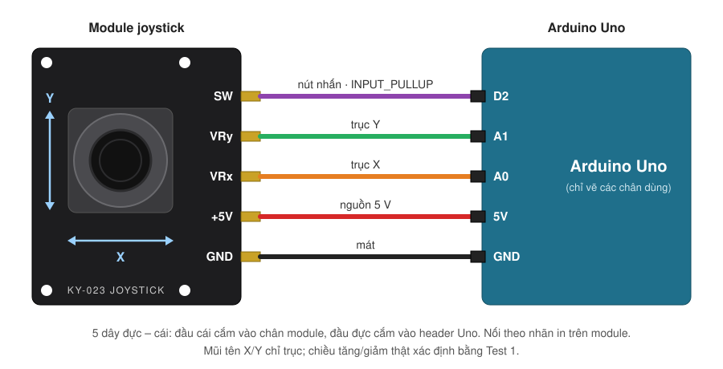
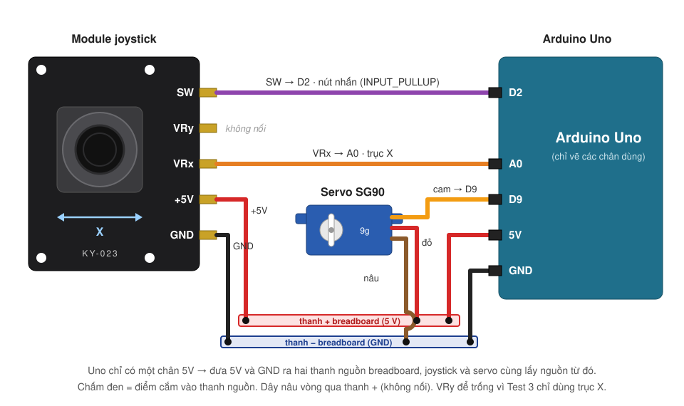

# Lab 14 · Joystick analog 2 trục (KY-023)

> Đọc module joystick 2 trục + nút nhấn bằng Arduino Uno: in giá trị thô ra Serial, nhận hướng đẩy (lên/xuống/trái/phải) có vùng chết, dùng joystick lái servo SG90 ([Lab 4](servo-sg90.md)), và hai phần mở rộng: di chuyển một chấm sáng trên ma trận LED 8×8 ([Lab 13](led-matrix-8x8.md)), làm game chạy vượt chướng ngại vật trên LCD 1602 ([Lab 2](lcd-i2c.md)).

## Joystick là gì

Module joystick (thường bán dưới tên **KY-023** hoặc *PS2 joystick module*) chính là cần gạt ngón cái của tay cầm chơi game, gắn lên một mạch nhỏ 5 chân. Bên trong không có IC nào, chỉ có **3 linh kiện cơ bản**:

- **2 biến trở 10 kΩ** đặt vuông góc nhau: một cái xoay theo trục **X** (trái – phải), một cái theo trục **Y** (lên – xuống). Cần gạt gắn với trục của cả hai qua một khung cardan (gimbal).
- **1 nút nhấn** nằm dưới đáy cần: **ấn thẳng cần xuống** thì nút đóng lại.
- **Lò xo** kéo cần về giữa khi thả tay.

```
  +5V ──┬──────────────┐
        │              │
       ┌┴┐            ┌┴┐
       │ │◄── VRx     │ │◄── VRy        SW ──o  o── GND
       │ │  (trục X)  │ │  (trục Y)          nút nhấn
       └┬┘            └┬┘                   (ấn cần xuống)
        │              │
  GND ──┴──────────────┘
```

Mỗi biến trở là một **cầu phân áp** giống hệt biến trở xoay đã dùng ở [Lab 4](servo-sg90.md): hai đầu nối `5V` và `GND`, chân giữa (con chạy) ra điện áp 0 – 5 V tùy vị trí cần. Vì vậy cách đọc joystick cũng y như đọc biến trở: `analogRead()`.

### Từ điện áp ra con số

ADC của Uno là **10 bit**: 0 V → `0`, 5 V → `1023`.

| Vị trí cần | Điện áp chân VRx/VRy | `analogRead()` |
|---|---|---|
| Đẩy hết về một phía | ~0 V | ~0 |
| Thả tay (ở giữa) | ~2,5 V | **khoảng 490 – 530**, không đúng 512 |
| Đẩy hết về phía kia | ~5 V | ~1023 |

Hai điểm cần nhớ:

- **Điểm giữa lệch** vài chục đơn vị so với 512 và khác nhau giữa hai trục, giữa các module. Code nên **đo điểm giữa lúc khởi động** thay vì viết cứng 512.
- **Không có "đẩy nhẹ = 0"**: thả tay ra số vẫn rung ±2 – 5 đơn vị. Muốn biết "đang đẩy hay không" thì phải có **vùng chết** (dead zone) quanh điểm giữa.

Chiều tăng/giảm của từng trục phụ thuộc vào cách cầm module (chân cắm ở bên nào), nên **không đoán trước** "đẩy lên là Y tăng hay giảm" — chạy Test 1 rồi ghi lại.

### Nút nhấn SW

Chân `SW` nối xuống `GND` khi ấn, còn khi thả thì **thả nổi** (hầu hết module KY-023 để trống chỗ hàn điện trở kéo lên). Vì vậy phải bật **điện trở kéo lên bên trong** của Uno bằng `INPUT_PULLUP`:

- Không ấn → `HIGH`.
- Ấn cần xuống → `LOW`.

Logic **ngược** so với nút nhấn có điện trở kéo xuống ở [Lab 1](led-basics.md). Nếu quên `INPUT_PULLUP`, `digitalRead()` sẽ ra 0/1 lung tung khi chưa ấn.

## Ứng dụng

| Ví dụ | Joystick làm gì |
|---|---|
| Xe robot, tàu mô hình điều khiển từ xa | Y = ga tiến/lùi, X = rẽ trái/phải; gửi qua Bluetooth, nRF24L01 hoặc Wi-Fi |
| Giá camera pan – tilt | X lái servo quay ngang, Y lái servo gật lên xuống |
| Cánh tay robot, cần cẩu mô hình | Mỗi trục điều khiển một khớp, nút nhấn để kẹp/nhả |
| Menu trên LCD, OLED | Lên/xuống chọn mục, ấn để xác nhận — thay cho 5 nút rời |
| Game trên ma trận LED | Di chuyển nhân vật (rắn săn mồi, pong…) |

Trong hệ IoT, joystick là **thiết bị đầu vào** ở tầng thiết bị: người dùng ra lệnh tại chỗ, vi điều khiển đọc rồi gửi lệnh tới cơ cấu chấp hành (ở gần, hoặc ở xa qua mạng).

## Linh kiện và chân

| Linh kiện | Số lượng |
|---|---|
| Arduino Uno | 1 |
| Module joystick KY-023 (5 chân) | 1 |
| Dây **đực – cái** | 5 |
| Servo SG90 (Test 3) | 1 |
| Breadboard + dây đực – đực (Test 3, để chia `5V`/`GND`) | 1 + vài sợi |

Module có hàng **chân đực** 5 chân, in nhãn ngay cạnh chân:

| Chân module | Nối vào Uno | Ý nghĩa |
|---|---|---|
| `GND` | `GND` | Mát |
| `+5V` | `5V` | Nguồn cho hai biến trở |
| `VRx` | `A0` | Điện áp trục X |
| `VRy` | `A1` | Điện áp trục Y |
| `SW` | `D2` | Nút nhấn (dùng `INPUT_PULLUP`) |

Module cấp `+5V` thì giá trị đọc đi hết 0 – 1023. Nếu lỡ cắm `+5V` vào `3.3V`, joystick vẫn chạy nhưng thang chỉ còn 0 – ~675 và điểm giữa ~338.

## Lắp mạch

{width=100%}

**Rút cáp USB ra trước khi cắm dây.**

1. Cắm đầu **cái** của 5 dây vào 5 chân của module. Chọn màu dễ nhớ: đen = `GND`, đỏ = `+5V`, cam = `VRx`, xanh lá = `VRy`, tím = `SW`.
2. Cắm đầu **đực** vào header Uno theo bảng trên: `GND` và `5V` ở hàng chân nguồn, `A0`/`A1` ở hàng chân analog (mép dưới), `D2` ở hàng chân digital (mép trên).
3. Kiểm tra lại nhãn in trên module — một số bản in thứ tự chân khác (ví dụ `SW` ở đầu thay vì cuối). **Nối theo nhãn, không theo vị trí.**

Test 1 và Test 2 không cần breadboard.

## Code

### Test 1 – đọc giá trị thô

```cpp
#define PIN_X  A0
#define PIN_Y  A1
#define PIN_SW 2

void setup() {
  Serial.begin(9600);
  pinMode(PIN_SW, INPUT_PULLUP);   // không ấn = HIGH, ấn = LOW
}

void loop() {
  int x  = analogRead(PIN_X);
  int y  = analogRead(PIN_Y);
  bool nhan = digitalRead(PIN_SW) == LOW;

  Serial.print("X = ");    Serial.print(x);
  Serial.print("\tY = ");  Serial.print(y);
  Serial.print("\tSW = "); Serial.println(nhan ? "NHAN" : "-");
  delay(200);
}
```

**Cách kiểm tra** (Serial Monitor, 9600 baud). Cầm module sao cho chân cắm hướng về một phía cố định (ví dụ bên trái), rồi điền bảng:

| Thao tác | X | Y |
|---|---|---|
| Thả tay | ~500 | ~500 |
| Đẩy lên (ra xa người) | | |
| Đẩy xuống (về phía người) | | |
| Đẩy sang trái | | |
| Đẩy sang phải | | |

- Mỗi hướng chỉ **một** trục đổi mạnh (về gần 0 hoặc gần 1023), trục kia gần như đứng yên. Nếu đẩy lên mà X đổi thì module đang xoay 90° so với mình — xoay lại hoặc đổi vai X/Y trong code.
- Ấn thẳng cần xuống (nghe "tách") thì cột `SW` hiện `NHAN`.
- Chú ý đẩy **chéo** thường không đạt đồng thời cả hai cực (0/1023), vì vòng giới hạn của cần là hình tròn.
- Ghi lại số lúc thả tay: đó là điểm giữa thật của module mình, dùng để chọn vùng chết ở Test 2.

**Mẹo:** Đổi dòng in thành `Serial.print(x); Serial.print(" "); Serial.println(y);` rồi mở **Serial Plotter** (`Tools → Serial Plotter`) để thấy hai đường X/Y di chuyển theo tay.

### Test 2 – nhận hướng đẩy + nút nhấn

Đo điểm giữa lúc khởi động (trung bình 16 lần đọc, **không chạm vào cần** khi reset), sau đó:

- Nếu độ lệch cả hai trục đều nhỏ hơn `VUNG_CHET` → `GIUA`.
- Ngược lại, trục nào lệch nhiều hơn thì quyết định hướng.
- Chỉ in khi hướng **thay đổi**, và chỉ báo nút khi vừa **ấn xuống** (bắt cạnh), có chống dội phím.

```cpp
#define PIN_X  A0
#define PIN_Y  A1
#define PIN_SW 2

#define VUNG_CHET 150   // lệch dưới mức này coi như đang ở giữa

// Kết quả Test 1: nếu đẩy sang phải mà X GIẢM thì đặt DAO_X = true,
// nếu đẩy lên mà Y GIẢM thì đặt DAO_Y = true.
const bool DAO_X = false;
const bool DAO_Y = false;

int centerX, centerY;
const char* huongCu = "";
bool swCu = HIGH;
unsigned long lanDoiSW = 0;

int docTrungBinh(byte pin) {
  long tong = 0;
  for (byte i = 0; i < 16; i++) tong += analogRead(pin);
  return tong / 16;
}

const char* tinhHuong(int dx, int dy) {
  if (abs(dx) < VUNG_CHET && abs(dy) < VUNG_CHET) return "GIUA";
  if (abs(dx) > abs(dy)) return dx > 0 ? "PHAI" : "TRAI";
  return dy > 0 ? "LEN" : "XUONG";
}

void setup() {
  Serial.begin(9600);
  pinMode(PIN_SW, INPUT_PULLUP);
  delay(200);                       // chờ lò xo đưa cần về giữa
  centerX = docTrungBinh(PIN_X);
  centerY = docTrungBinh(PIN_Y);
  Serial.print("Diem giua: X = "); Serial.print(centerX);
  Serial.print(", Y = ");          Serial.println(centerY);
}

void loop() {
  int dx = analogRead(PIN_X) - centerX;
  int dy = analogRead(PIN_Y) - centerY;
  if (DAO_X) dx = -dx;
  if (DAO_Y) dy = -dy;

  const char* huong = tinhHuong(dx, dy);
  if (strcmp(huong, huongCu) != 0) {        // chỉ in khi đổi hướng
    Serial.println(huong);
    huongCu = huong;
  }

  bool sw = digitalRead(PIN_SW);
  if (sw != swCu && millis() - lanDoiSW > 30) {  // chống dội 30 ms
    lanDoiSW = millis();
    if (sw == LOW) Serial.println(">> NUT NHAN");
    swCu = sw;
  }

  delay(10);
}
```

**Cách kiểm tra:**

- Lúc khởi động in `Diem giua: X = …, Y = …` gần với số thả tay ở Test 1.
- Đẩy lên/xuống/trái/phải in đúng `LEN`/`XUONG`/`TRAI`/`PHAI`, thả tay in `GIUA`. Nếu hướng bị ngược thì đổi `DAO_X` / `DAO_Y` thành `true`.
- Đẩy rất nhẹ (chưa ra khỏi vùng chết) thì không in gì. Muốn nhạy hơn thì giảm `VUNG_CHET` (đừng dưới ~40, vì sẽ "tự nhảy" khi thả tay).
- Mỗi lần ấn cần chỉ in **một** dòng `>> NUT NHAN`, giữ lâu không in thêm.

`tinhHuong()` chỉ trả về 4 hướng chính. Muốn 8 hướng (thêm chéo) thì xét riêng hai trục: mỗi trục vượt vùng chết thì góp một phần, ví dụ `LEN` + `PHAI` = `LEN-PHAI`.

### Test 3 – lái servo bằng joystick

Ghép servo SG90 từ [Lab 4](servo-sg90.md). Vì joystick và servo cùng cần `5V` mà Uno chỉ có một chân `5V`, dùng thanh nguồn breadboard để chia:

{width=100%}

| Từ | Đến |
|---|---|
| Uno `5V` | thanh `+` breadboard |
| Uno `GND` | thanh `−` breadboard |
| Joystick `+5V`, servo dây **đỏ** | thanh `+` |
| Joystick `GND`, servo dây **nâu** | thanh `−` |
| Joystick `VRx` | `A0` |
| Joystick `SW` | `D2` |
| Servo dây **cam** | `D9` |

**Vì sao không dùng `map()` thẳng?** Cách đơn giản nhất là `servo.write(map(analogRead(A0), 0, 1023, 0, 180))`: servo đi theo vị trí cần. Nhưng cần có lò xo, thả tay là servo **bật về 90°** — chỉ hợp với kiểu "đánh lái" (như vô-lăng xe). Muốn servo **ở lại** góc vừa chỉnh (như giá camera) thì dùng **điều khiển tốc độ**: độ nghiêng của cần quyết định servo quay **nhanh hay chậm**, thả tay là servo đứng yên tại chỗ.

```cpp
#include <Servo.h>

#define PIN_X     A0
#define PIN_SW    2
#define SERVO_PIN 9

#define VUNG_CHET 60
#define TOC_DO    200.0  // càng lớn càng chậm: đẩy hết cỡ ≈ 512/200 = 2,6° mỗi 20 ms ≈ 130°/s

Servo servo;
int centerX;
float goc = 90;

void setup() {
  Serial.begin(9600);
  pinMode(PIN_SW, INPUT_PULLUP);
  delay(200);
  long tong = 0;
  for (byte i = 0; i < 16; i++) tong += analogRead(PIN_X);
  centerX = tong / 16;

  servo.attach(SERVO_PIN);
  servo.write(goc);
}

void loop() {
  int dx = analogRead(PIN_X) - centerX;

  if (abs(dx) > VUNG_CHET) {
    goc += dx / TOC_DO;                 // nghiêng nhiều → quay nhanh
    goc = constrain(goc, 0, 180);
  }
  if (digitalRead(PIN_SW) == LOW) goc = 90;   // ấn cần → về giữa

  servo.write((int)goc);

  static byte dem = 0;
  if (++dem >= 10) {                    // in mỗi ~200 ms cho đỡ rối
    dem = 0;
    Serial.print("dx = "); Serial.print(dx);
    Serial.print("\tgoc = "); Serial.println((int)goc);
  }
  delay(20);                            // khớp chu kỳ xung servo 20 ms
}
```

**Cách kiểm tra:**

- Khởi động, servo về 90°.
- Đẩy nhẹ sang một bên: servo quay chậm. Đẩy hết cỡ: quay nhanh. Thả tay: servo **đứng yên** ở góc hiện tại.
- Tới 0° hoặc 180° thì dừng, không cố quay tiếp (nhờ `constrain`).
- Ấn cần: servo về 90°.
- Nếu đẩy phải mà servo quay trái, đổi `goc += dx / TOC_DO` thành `goc -= …`.
- Board tự reset khi servo bắt đầu quay → sụt nguồn, xem mục *Nguồn cho servo* ở [Lab 4](servo-sg90.md) (thêm tụ 100 – 470 µF giữa thanh `+`/`−`).

**Bài tập:** thêm servo thứ hai trên `D10`, lái bằng trục Y (`A1`) → giá camera pan – tilt 2 trục.

## Mở rộng – chấm sáng trên ma trận 8×8

Giữ nguyên mạch ma trận 1088BS của [Lab 13](led-matrix-8x8.md) (chiếm `D2`–`D13` và `A0`–`A3`). Joystick dùng hai chân analog còn trống:

| Chân module | Uno |
|---|---|
| `GND` | `GND` |
| `+5V` | `5V` |
| `VRx` | `A4` |
| `VRy` | `A5` |
| `SW` | không nối (hết chân; `D0`/`D1` để dành cho Serial) |

`A4`/`A5` cũng là `SDA`/`SCL` của I²C, nhưng mạch này không dùng I²C nên dùng làm chân analog bình thường.

Chỉ có **một** điểm sáng nên không cần quét: bật đúng một hàng và một cột là đủ.

```cpp
const byte ROWS[8] = {2, 3, 4, 5, 6, 7, 8, 9};
const byte COLS[8] = {10, 11, 12, 13, A0, A1, A2, A3};

#define ROW_ON  LOW      // 1088BS; loại 1088AS thì đảo cả bốn dòng
#define ROW_OFF HIGH
#define COL_ON  HIGH
#define COL_OFF LOW

#define PIN_X A4
#define PIN_Y A5
#define NGUONG 300       // lệch khỏi giữa hơn mức này thì mới bước
#define BUOC_MS 150      // giữ cần thì cứ 150 ms bước một ô

int px = 3, py = 3;      // vị trí chấm: cột, hàng (0..7)
unsigned long lanCuoi = 0;

void veCham() {
  for (byte i = 0; i < 8; i++) {
    digitalWrite(ROWS[i], ROW_OFF);
    digitalWrite(COLS[i], COL_OFF);
  }
  digitalWrite(ROWS[py], ROW_ON);
  digitalWrite(COLS[px], COL_ON);
}

void setup() {
  for (byte i = 0; i < 8; i++) {
    pinMode(ROWS[i], OUTPUT);
    pinMode(COLS[i], OUTPUT);
  }
  veCham();
}

void loop() {
  if (millis() - lanCuoi < BUOC_MS) return;
  lanCuoi = millis();

  int x = analogRead(PIN_X);
  int y = analogRead(PIN_Y);

  if (x > 512 + NGUONG && px < 7) px++;
  if (x < 512 - NGUONG && px > 0) px--;
  if (y > 512 + NGUONG && py < 7) py++;
  if (y < 512 - NGUONG && py > 0) py--;

  veCham();
}
```

Chấm sáng xuất phát gần giữa, đi theo hướng đẩy và dừng ở mép. Nếu đi ngược chiều, đổi `px++`/`px--` (hoặc `py++`/`py--`) cho nhau. Ngưỡng 300 đủ lớn nên không cần đo điểm giữa như Test 2.

**Bài tập:** để lại "vệt" các ô đã đi qua (lưu vào mảng 8 byte như hình trái tim ở Lab 13 và quét bằng `drawFrame()`), hoặc làm game rắn săn mồi.

## Mở rộng – game chạy vượt chướng ngại vật trên LCD 1602

Ghép joystick với màn **LCD 1602 I²C** của [Lab 2](lcd-i2c.md) để làm một game chạy vô tận: nhân vật đứng yên ở cột 2, chướng ngại vật chạy từ phải sang trái, gạt cần lên hoặc ấn núm để nhảy. Không cần thêm linh kiện nào ngoài hai module đã có.

LCD chỉ có 16 × 2 ô, mỗi ô 5 × 8 điểm, nên hình thô hơn màn OLED nhưng đủ cho lối chơi này. Nhân vật và chướng ngại vật được vẽ bằng **ký tự tự định nghĩa** (`createChar`, tối đa 8 ký tự — game dùng 5).

### Mạch

LCD và joystick cùng cần `5V`, nên chia nguồn bằng thanh `+`/`−` của breadboard như Test 3 (tháo servo ra):

| Từ | Đến |
|---|---|
| Uno `5V` | thanh `+` |
| Uno `GND` | thanh `−` |
| LCD `VCC`, joystick `+5V` | thanh `+` |
| LCD `GND`, joystick `GND` | thanh `−` |
| LCD `SDA` | `A4` |
| LCD `SCL` | `A5` |
| Joystick `VRx` | `A0` |
| Joystick `SW` | `D2` |

`VRy` không nối. `A1` để trống và được dùng làm nguồn số ngẫu nhiên (`randomSeed(analogRead(A1))`), nhờ vậy mỗi ván chướng ngại vật xuất hiện khác nhau.

### Cách chơi

| Màn hình | Ý nghĩa |
|---|---|
| Người que ở **dòng dưới**, cột 2 | Nhân vật đang chạy trên mặt đất |
| **Cây** ở dòng dưới | Phải **nhảy** qua |
| **Chim** ở dòng trên | **Không được nhảy** lúc chim tới |
| Người que ở **dòng trên** | Đang nhảy, ở trên không 3 nhịp rồi rơi xuống |
| `X` ở vị trí nhân vật | Va chạm — thua |

- **Gạt cần lên** hoặc **ấn núm** để nhảy.
- Mỗi nhịp sống sót được 1 điểm. Game nhanh dần: một nhịp từ 250 ms giảm dần tới 110 ms.
- Thua thì màn hiện điểm và kỷ lục (kỷ lục mất khi rút điện). Gạt lên hoặc ấn núm để chơi lại.

### Code

Cần thư viện `LiquidCrystal_I2C` như Lab 2.

```cpp
#include <Wire.h>
#include <LiquidCrystal_I2C.h>

LiquidCrystal_I2C lcd(0x27, 16, 2);   // không hiện gì thì thử 0x3F

#define PIN_X    A0
#define PIN_SW   2
#define LEN_TANG true   // gạt lên → A0 tăng (kiểm tra bằng Test 1). Ngược thì đổi thành false
#define NGUONG   250    // gạt quá mức này mới tính là "lên"

// Ký tự tự vẽ 5×8 (1 = điểm sáng)
byte chay1[8] = {0b01110, 0b01110, 0b00100, 0b01110, 0b10101, 0b00100, 0b01010, 0b10001};
byte chay2[8] = {0b01110, 0b01110, 0b00100, 0b01110, 0b10101, 0b00100, 0b01010, 0b01010};
byte nhayH[8] = {0b01110, 0b01110, 0b10101, 0b01110, 0b00100, 0b01010, 0b10001, 0b00000};
byte cay[8]   = {0b00100, 0b00101, 0b10101, 0b10111, 0b11100, 0b00100, 0b00100, 0b00100};
byte chim[8]  = {0b00000, 0b00000, 0b10001, 0b01010, 0b00100, 0b00000, 0b00000, 0b00000};
#define K_CHAY1 0
#define K_CHAY2 1
#define K_NHAY  2
#define K_CAY   3
#define K_CHIM  4

#define COT_NV 1          // nhân vật đứng ở cột thứ 2

bool dat[16], troi[16];   // chướng ngại vật dòng dưới / dòng trên
int  nhay = 0;            // số nhịp còn ở trên không (0 = đang đứng đất)
int  khoangCach = 0;      // số nhịp từ chướng ngại vật gần nhất
long diem = 0, kyLuc = 0;
bool muonNhay = false;
unsigned long lanCuoi = 0;
int  centerX;

bool bamNhay() {
  int dx = analogRead(PIN_X) - centerX;
  if (!LEN_TANG) dx = -dx;
  return dx > NGUONG || digitalRead(PIN_SW) == LOW;
}

void choBamRoiTha() {                 // đợi bấm rồi thả ra, tránh nhảy ngay khi vào ván
  while (!bamNhay()) delay(10);
  while (bamNhay()) delay(10);
}

void vanMoi() {
  for (byte c = 0; c < 16; c++) { dat[c] = false; troi[c] = false; }
  nhay = 0; khoangCach = 0; diem = 0; muonNhay = false;
  lcd.clear();
}

void ve(bool va) {
  lcd.setCursor(0, 0);
  for (byte c = 0; c < 16; c++) {
    if (c == COT_NV && nhay > 0) lcd.write(va ? 'X' : K_NHAY);
    else if (troi[c])            lcd.write(K_CHIM);
    else                         lcd.write(' ');
  }
  lcd.setCursor(0, 1);
  for (byte c = 0; c < 16; c++) {
    if (c == COT_NV && nhay == 0) lcd.write(va ? 'X' : (diem % 2 ? K_CHAY2 : K_CHAY1));
    else if (dat[c])              lcd.write(K_CAY);
    else                          lcd.write(' ');
  }
}

void setup() {
  Serial.begin(9600);
  pinMode(PIN_SW, INPUT_PULLUP);
  lcd.init();
  lcd.backlight();
  lcd.createChar(K_CHAY1, chay1);
  lcd.createChar(K_CHAY2, chay2);
  lcd.createChar(K_NHAY,  nhayH);
  lcd.createChar(K_CAY,   cay);
  lcd.createChar(K_CHIM,  chim);

  delay(200);                         // không chạm cần lúc khởi động
  long tong = 0;
  for (byte i = 0; i < 16; i++) tong += analogRead(PIN_X);
  centerX = tong / 16;
  randomSeed(analogRead(A1));         // A1 để trống → số ngẫu nhiên khác mỗi lần

  lcd.setCursor(0, 0); lcd.print("Gat len / an nut");
  lcd.setCursor(0, 1); lcd.print("  de bat dau");
  choBamRoiTha();
  vanMoi();
}

void loop() {
  if (bamNhay()) muonNhay = true;     // nhớ lệnh nhảy cho tới nhịp kế tiếp

  int nhip = 250 - min(diem, 280L) / 2;   // 250 ms → nhanh dần tới 110 ms
  if (millis() - lanCuoi < (unsigned long)nhip) return;
  lanCuoi = millis();

  // 1. Dời chướng ngại vật sang trái 1 ô
  for (byte c = 0; c < 15; c++) { dat[c] = dat[c + 1]; troi[c] = troi[c + 1]; }
  dat[15] = false; troi[15] = false;

  // 2. Thỉnh thoảng sinh chướng ngại vật mới ở cột cuối (cách nhau ít nhất 4 ô)
  khoangCach++;
  if (khoangCach >= 4 && random(100) < 35) {
    if (random(4) == 0) troi[15] = true;   // 1/4 là chim
    else                dat[15]  = true;
    khoangCach = 0;
  }

  // 3. Nhảy
  if (nhay > 0) nhay--;
  if (muonNhay && nhay == 0) nhay = 3;
  muonNhay = false;

  // 4. Va chạm
  bool va = (nhay > 0 && troi[COT_NV]) || (nhay == 0 && dat[COT_NV]);
  ve(va);

  if (va) {
    if (diem > kyLuc) kyLuc = diem;
    Serial.print("Thua! Diem = "); Serial.println(diem);
    delay(800);
    lcd.clear();
    lcd.setCursor(0, 0); lcd.print("THUA! Diem: "); lcd.print(diem);
    lcd.setCursor(0, 1); lcd.print("Ky luc: ");     lcd.print(kyLuc);
    choBamRoiTha();
    vanMoi();
    return;
  }
  diem++;
}
```

### Code hoạt động thế nào

Game chạy theo **nhịp** (tick): mỗi `nhip` mili giây làm một lượt 4 bước, giữa hai nhịp thì chỉ đọc joystick.

1. **Dời chướng ngại vật.** Hai mảng `dat[16]` (dòng dưới) và `troi[16]` (dòng trên) ghi ô nào đang có chướng ngại vật. Mỗi nhịp, mọi phần tử dời sang trái một ô, ô cuối (cột 16) để trống.
2. **Sinh chướng ngại vật mới** ở cột 16 với xác suất 35 %, nhưng chỉ khi đã cách cái trước ít nhất 4 ô (`khoangCach`) để luôn có chỗ đáp xuống. Cứ 4 cái thì khoảng 1 cái là chim.
3. **Nhảy.** `nhay` là số nhịp còn ở trên không. Lệnh nhảy được ghi vào `muonNhay` ngay khi gạt (đọc liên tục trong `loop()`), nên dù gạt nhanh giữa hai nhịp cũng không bị bỏ sót. Chỉ nhảy được khi đang đứng đất (`nhay == 0`).
4. **Va chạm.** Nhân vật luôn ở cột `COT_NV`; đang trên không mà gặp chim, hoặc đang dưới đất mà gặp cây, là thua.

Hai khung `chay1`/`chay2` chỉ khác ở hai chân, đổi qua lại theo `diem % 2` nên nhân vật trông như đang chạy. Mỗi nhịp vẽ lại cả 32 ô bằng `setCursor` + `write`, không dùng `lcd.clear()` để màn không bị chớp.

**Chỉnh độ khó:**

| Muốn | Sửa |
|---|---|
| Chậm hơn / nhanh hơn | Số `250` (tốc độ đầu) và `280L` (điểm đạt tốc độ tối đa) trong dòng `nhip` |
| Nhảy lâu hơn (dễ) / ngắn hơn (khó) | `nhay = 3` thành `4` / `2` |
| Nhiều chướng ngại vật hơn | `random(100) < 35` thành số lớn hơn |
| Nhiều chim hơn | `random(4) == 0` thành `random(2) == 0` |

LCD 1602 đổi ký tự khá chậm (vài chục ms), nên khi game chạy nhanh, chướng ngại vật trông hơi nhòe — mắt người vẫn thấy rõ, nhưng quay bằng điện thoại có thể gần như không thấy.

**Bài tập:**

- Hiện điểm ở góc trên bên phải trong lúc chơi (chỉ cho chim xuất hiện từ cột 12 trở về trái để không đè lên số).
- Lưu kỷ lục vào **EEPROM** (`#include <EEPROM.h>`, `EEPROM.put()` / `EEPROM.get()`) để rút điện không mất.
- Thêm buzzer kêu "bíp" mỗi lần nhảy và khi thua.

## Lỗi hay gặp

| Hiện tượng | Nguyên nhân / cách xử lý |
|---|---|
| X/Y luôn 0 hoặc luôn 1023 | Thiếu dây `+5V` hoặc `GND` của module — hai biến trở không có nguồn |
| X/Y nhảy lung tung dù không chạm | Dây `VRx`/`VRy` chưa vào `A0`/`A1` (chân analog thả nổi), hoặc lỏng đầu cái |
| Đẩy X mà số đổi ở Y | Cắm `VRx` và `VRy` lẫn nhau, hoặc module đang xoay 90° |
| `SW` lúc `NHAN` lúc không khi chưa chạm | Thiếu `INPUT_PULLUP` (đang để `INPUT`) |
| `SW` luôn `NHAN` | Dây `SW` cắm nhầm vào `GND`, hoặc cần đang bị ấn kẹt |
| Ấn một lần in nhiều dòng `>> NUT NHAN` | Dội phím — giữ đoạn chống dội 30 ms như Test 2 |
| Thả tay vẫn báo hướng | Điểm giữa đo lúc đang chạm cần (reset lại, không chạm), hoặc `VUNG_CHET` quá nhỏ |
| Giá trị tối đa chỉ ~675 | `+5V` của module đang cắm vào `3.3V` |
| Servo giật, board tự reset (Test 3) | Sụt nguồn khi servo quay — thêm tụ hoặc nguồn ngoài, xem Lab 4 |
| Game: LCD sáng nhưng không có chữ | Sai địa chỉ I²C (thử `0x3F`) hoặc chưa chỉnh độ tương phản — xem Lab 2 |
| Game: gạt xuống mới nhảy | Module ngược chiều — đổi `LEN_TANG` thành `false` |
| Game: vừa vào ván đã nhảy liên tục | Lúc reset đang chạm cần nên điểm giữa đo sai — reset lại, không chạm cần |
