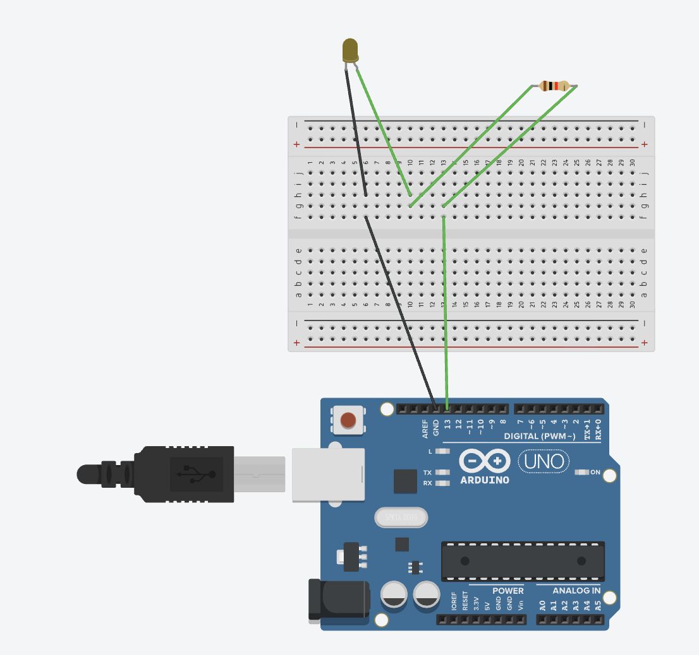
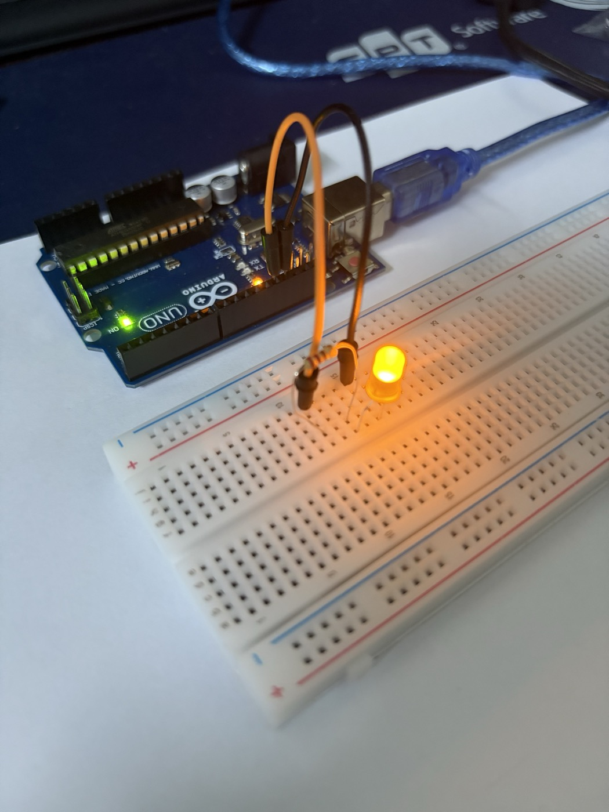
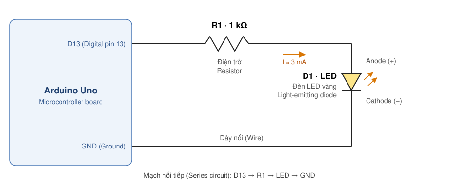
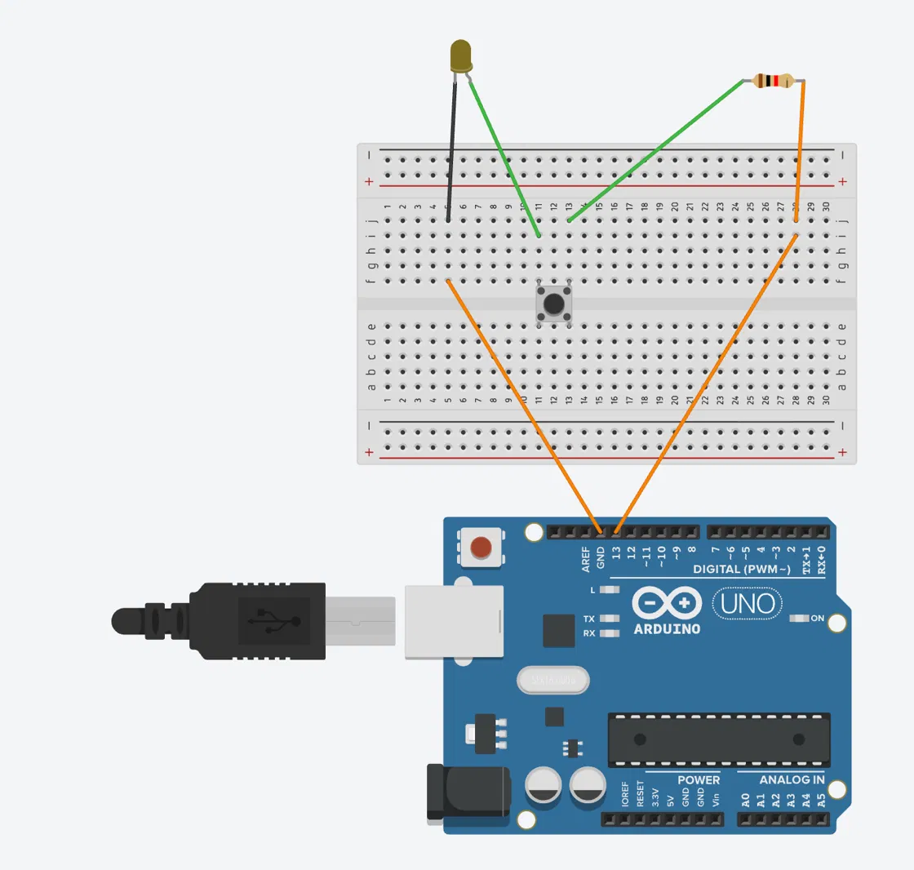
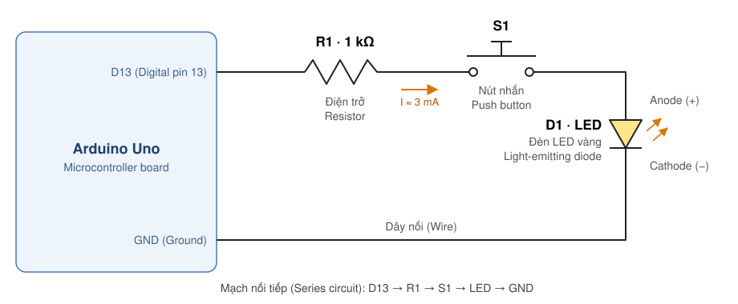

# Lab 1 · LED cơ bản & nút nhấn

> Hai mạch đầu tiên với Arduino Uno, thiết kế trên Tinkercad Circuits:
>
> - **1A — LED cơ bản**: D13 → điện trở → LED → GND. **Code** điều khiển LED (nhấp nháy).
> - **1B — Thêm nút nhấn**: chèn nút nhấn nối tiếp vào mạch 1A. **Nút nhấn** điều khiển LED, code chỉ cấp nguồn.
>
> So sánh hai mạch cho thấy rõ ranh giới giữa điều khiển bằng phần cứng và điều khiển bằng phần mềm.

## Kiến thức nền

**LED và điện trở hạn dòng.** LED là diode: khi phân cực thuận (anode dương hơn cathode), điện áp rơi trên nó gần như cố định — khoảng 1,8–2,2 V với LED đỏ/vàng — còn dòng tăng rất nhanh nếu điện áp vượt ngưỡng. Nối thẳng 5 V vào LED thì dòng chỉ bị giới hạn bởi nội trở của chân vi điều khiển, dễ cháy LED hoặc hỏng chân I/O (giới hạn tuyệt đối ~40 mA/chân, khuyến nghị ≤ 20 mA). Vì vậy luôn mắc một điện trở nối tiếp; dòng được tính theo định luật Ohm:

$$
I = \frac{V_{D13} - V_F}{R} = \frac{5\,\text{V} - 2\,\text{V}}{1000\,\Omega} \approx 3\,\text{mA}
$$

3 mA đủ để LED sáng rõ và rất an toàn. Muốn sáng hơn có thể dùng 220–330 Ω (≈ 9–14 mA).

**Nhận biết chân LED.** Chân **dài** (trong Tinkercad là chân **bị bẻ cong**) là **anode (+)**, nối về phía nguồn. Chân ngắn, phía có mép vát trên thân LED, là **cathode (−)**, nối về GND. Cắm ngược thì LED không sáng (diode chặn dòng) nhưng cũng không hỏng ở mức 5 V này.

**Đọc vạch điện trở.** Cả hai mạch dùng điện trở **nâu – đen – đỏ – nhũ** = 1, 0, ×10², ±5% → **1 kΩ**.

**Chương trình Arduino.** Arduino được lập trình bằng C/C++ (bản chất là C++ với thư viện Arduino, nhưng sketch đơn giản viết đúng phong cách C). Mỗi sketch có hai hàm bắt buộc: `setup()` chạy một lần khi cấp điện/reset, `loop()` chạy lặp vô hạn sau đó.

**Đèn "L" trên board.** Chân D13 của Uno nối sẵn với một LED nhỏ có nhãn `L` trên board, nên đèn `L` luôn sáng/tắt cùng trạng thái chân D13 — tiện để kiểm tra code đã chạy hay chưa.

---

## 1A · LED cơ bản (nhấp nháy)

### Linh kiện

| Ký hiệu | Linh kiện | Giá trị / ghi chú |
|---|---|---|
| — | Arduino Uno | Vi điều khiển ATmega328P, mức logic 5 V |
| R1 | Điện trở | 1 kΩ |
| D1 | LED vàng 5 mm | Chân cong = anode (+) |
| — | Breadboard, dây nối | |

### Thiết kế trên Tinkercad

{width=80%}

### Ảnh thực tế

{width=55%}

Mạch lắp thật giống thiết kế về nguyên lý, chỉ khác vị trí lỗ cắm trên breadboard:

- **Dây cam** từ chân **13** và **dây đen** từ chân **GND** đi ra breadboard. Quy ước màu dây (đen = GND, màu khác = tín hiệu) giúp kiểm tra mạch nhanh và tránh cắm nhầm.
- Điện trở và LED cắm trên breadboard, nối với hai dây trên qua các cột chung, theo đúng thứ tự D13 → R1 → LED → GND.
- LED vàng ngoài đang sáng, và đèn **`L`** trên board (cạnh chân 13) cũng sáng cùng lúc. Hai đèn cùng sáng vì cả hai đều nối với D13, tức là ảnh được chụp đúng nửa chu kỳ D13 = `HIGH` của code Blink.
- Đèn xanh **ON** chỉ báo board đang có nguồn qua cáp USB, không liên quan tới code.

### Sơ đồ nguyên lý

{width=100%}

### Đi dây trên breadboard

Cách breadboard nối bên trong:

- Mỗi **cột số** (1–30) ở nửa trên (hàng f–j) là một dải nối chung; nửa dưới (a–e) là dải khác. **Rãnh giữa** tách hai nửa.
- Hai dải `+` / `−` ở mép là đường nguồn — mạch này không dùng tới.

Mạch dùng ba cột của breadboard làm ba **nút điện** (node): mọi dây cắm vào cùng một cột thì nối với nhau.

| Cột | Nối những gì | Vai trò |
|---|---|---|
| 13 | D13 ↔ chân phải R1 | Tín hiệu từ chân số 13 vào điện trở |
| 10 | chân trái R1 ↔ anode LED | Nối điện trở với LED |
| 6 | cathode LED ↔ GND | Đường về đất |

Từng dây theo hình Tinkercad (dây xanh cho đường tín hiệu, dây đen cho đường GND):

| # | Dây | Từ | Đến |
|---|---|---|---|
| 1 | xanh | Arduino **D13** | f13 |
| 2 | xanh | g13 | chân phải R1 |
| 3 | xanh | chân trái R1 | g10 |
| 4 | xanh | h10 | **anode** LED (chân cong) |
| 5 | đen | **cathode** LED (chân thẳng) | h6 |
| 6 | đen | f6 | Arduino **GND** |

Chân GND và D13 nằm cạnh nhau ở đầu hàng header digital (thứ tự từ trái: AREF, GND, 13, 12…), nên đây là cặp chân tiện nhất cho mạch LED.

### Giải thích

Mạch chỉ có một vòng kín: D13 → R1 → LED → GND. LED sáng hay tắt **hoàn toàn do mức điện áp ở chân D13**, tức là do code quyết định:

- D13 = `HIGH` (5 V): có chênh lệch điện áp giữa D13 và GND → có dòng ≈ 3 mA → LED sáng.
- D13 = `LOW` (0 V): hai đầu mạch cùng 0 V → không có dòng → LED tắt.

Vị trí của điện trở (trước hay sau LED) không quan trọng vì dòng trong mạch nối tiếp ở mọi điểm là như nhau.

### Code — Blink

```c
// Lab 1A - LED nhấp nháy (D13 -> R1 -> LED -> GND)
const int LED_PIN = 13;

void setup() {
  pinMode(LED_PIN, OUTPUT);     // D13 là ngõ ra số
}

void loop() {
  digitalWrite(LED_PIN, HIGH);  // 5 V -> LED sáng
  delay(1000);                  // giữ 1000 ms
  digitalWrite(LED_PIN, LOW);   // 0 V -> LED tắt
  delay(1000);
}
```

- `pinMode(13, OUTPUT)` cấu hình chân là ngõ ra.
- `digitalWrite(13, HIGH/LOW)` đặt chân lên 5 V / xuống 0 V.
- `delay(ms)` dừng chương trình số mili-giây chỉ định. Chu kỳ ở đây là 2 s (sáng 1 s, tắt 1 s); đổi tham số để nháy nhanh/chậm hơn.

Khi chạy, LED vàng ngoài và đèn `L` trên board nhấp nháy cùng nhịp.

---

## 1B · Thêm nút nhấn

Giữ nguyên mạch 1A nhưng chèn thêm nút nhấn S1 vào giữa điện trở và LED; nút nhấn được cắm vắt qua rãnh giữa breadboard. Nhấn nút thì đèn sáng, nhả nút thì đèn tắt.

### Linh kiện

| Ký hiệu | Linh kiện | Giá trị / ghi chú |
|---|---|---|
| — | Arduino Uno | |
| R1 | Điện trở | 1 kΩ |
| S1 | Nút nhấn 4 chân (tactile push button) | Thường hở: chỉ dẫn điện khi đang nhấn |
| D1 | LED vàng 5 mm | Chân cong = anode (+) |
| — | Breadboard, dây nối | |

### Thiết kế trên Tinkercad

{width=85%}

### Video thực tế

<video controls muted playsinline preload="metadata" poster="../assets/lab01b-real-poster.jpg" style="display:block; max-width:360px; width:100%; margin:0 auto; border-radius:8px;">
  <source src="../assets/lab01b-real.mp4" type="video/mp4">
</video>

Diễn biến trong video:

- **Đầu video** quay board: dây cam cắm chân **13**, dây đen cắm **GND**, và đèn **`L`** trên board **sáng liên tục**. Điều này đúng với code 1B: D13 được đặt `HIGH` ngay trong `setup()` và giữ nguyên.
- Trên breadboard là nút nhấn, điện trở và LED vàng nối tiếp nhau. Khi **chưa nhấn**, LED tắt dù D13 đang ở 5 V, vì nút hở làm mạch bị ngắt.
- Khi **nhấn nút** (khoảng giây thứ 10), mạch kín và LED sáng. **Nhả tay** thì LED tắt ngay.
- Đèn `L` vẫn sáng suốt video, kể cả lúc LED ngoài tắt. Đây là bằng chứng trực quan cho ý "vi điều khiển không biết nút có được nhấn hay không": phía Arduino không thay đổi gì, chỉ có công tắc cơ học đóng/ngắt dòng.

### Sơ đồ nguyên lý

{width=100%}

Dòng điện chỉ có **một đường đi duy nhất**: từ D13 qua điện trở, qua nút nhấn, qua LED rồi về GND. Vì là mạch nối tiếp, chỉ cần một chỗ hở (ở đây là nút nhấn chưa được nhấn) thì cả mạch không có dòng.

### Đi dây trên breadboard

Breadboard nối như ở 1A. Điểm mới là nút nhấn:

- Nút nhấn 4 chân được cắm **vắt qua rãnh giữa**. Hai chân thẳng hàng qua rãnh (f11–e11, f13–e13) luôn nối với nhau; khi nhấn, cặp cột 11 được nối với cặp cột 13.

Đường đi theo hình Tinkercad:

| # | Dây | Từ | Đến | Vai trò |
|---|---|---|---|---|
| 1 | cam | Arduino **D13** | cột 28 | Lấy tín hiệu 5 V ra |
| 2 | cam | cột 28 | chân phải R1 | Đưa vào điện trở |
| 3 | xanh | chân trái R1 | cột 13 | Điện trở → một phía nút nhấn |
| 4 | — | nút nhấn S1 | cột 13 ↔ cột 11 | Chỉ nối khi đang nhấn |
| 5 | xanh | cột 11 | **anode** LED (chân cong) | Vào LED |
| 6 | đen | **cathode** LED | cột 5 | Ra khỏi LED |
| 7 | cam | cột 5 | Arduino **GND** | Khép kín mạch |

### Giải thích

**Thứ tự R1 – S1 – LED có quan trọng không?** Không. Trong mạch nối tiếp, dòng qua mọi phần tử bằng nhau, nên đổi chỗ các linh kiện không đổi kết quả. Điều duy nhất phải đúng là **chiều LED**.

**Ai điều khiển LED — code hay nút nhấn?** Khác với 1A, ở đây là **nút nhấn**. Code chỉ đặt D13 luôn ở mức HIGH (5 V), tức là "mở vòi". Nút nhấn đóng vai công tắc cơ học chặn hay cho dòng chảy. Vi điều khiển **không hề biết** nút đang được nhấn hay không — nó không đọc trạng thái nút. Đèn `L` trên board vì thế sáng liên tục bất kể nút.

Nếu nạp code Blink của 1A vào mạch này, LED chỉ nhấp nháy **khi đang giữ nút** — cả hai điều kiện (D13 HIGH *và* nút đóng) phải cùng thoả, giống một cổng AND.

### Code

```c
// Lab 1B - Nút nhấn bật LED (mạch nối tiếp D13 -> R1 -> S1 -> LED -> GND)
const int LED_PIN = 13;

void setup() {
  pinMode(LED_PIN, OUTPUT);     // D13 là ngõ ra
  digitalWrite(LED_PIN, HIGH);  // xuất 5 V liên tục; nút nhấn quyết định LED sáng hay tắt
}

void loop() {
  // Không cần làm gì: trạng thái LED do nút nhấn đóng/ngắt mạch.
}
```

`loop()` để trống vì không có gì cần cập nhật.

### Mở rộng: để vi điều khiển đọc nút nhấn

Cách mắc 1B đơn giản nhưng không "thông minh" — code không biết nút có được nhấn hay không, nên không làm được bật/tắt kiểu toggle, đếm số lần nhấn, gửi trạng thái lên mạng (bước cần cho IoT)… Cách mắc chuẩn là **tách nút nhấn và LED ra hai chân riêng**:

- **LED**: giữ nguyên mạch 1A (D13 → R1 → LED → GND).
- **Nút**: một chân nút → **D2**, chân còn lại → GND. Bật điện trở kéo lên nội (`INPUT_PULLUP`): khi nhả nút D2 đọc `HIGH`, khi nhấn D2 bị kéo xuống GND nên đọc `LOW`.

```c
const int LED_PIN = 13;
const int BUTTON_PIN = 2;

void setup() {
  pinMode(LED_PIN, OUTPUT);
  pinMode(BUTTON_PIN, INPUT_PULLUP);  // điện trở kéo lên ~20–50 kΩ bên trong chip
}

void loop() {
  int pressed = (digitalRead(BUTTON_PIN) == LOW);  // logic ngược do pull-up
  digitalWrite(LED_PIN, pressed ? HIGH : LOW);
}
```

Hành vi nhìn từ ngoài giống hệt 1B, nhưng giờ trạng thái nút đã nằm trong biến `pressed` — từ đây có thể thêm chống dội phím (debounce), toggle, hoặc `Serial.println(pressed)` để gửi dữ liệu đi.
