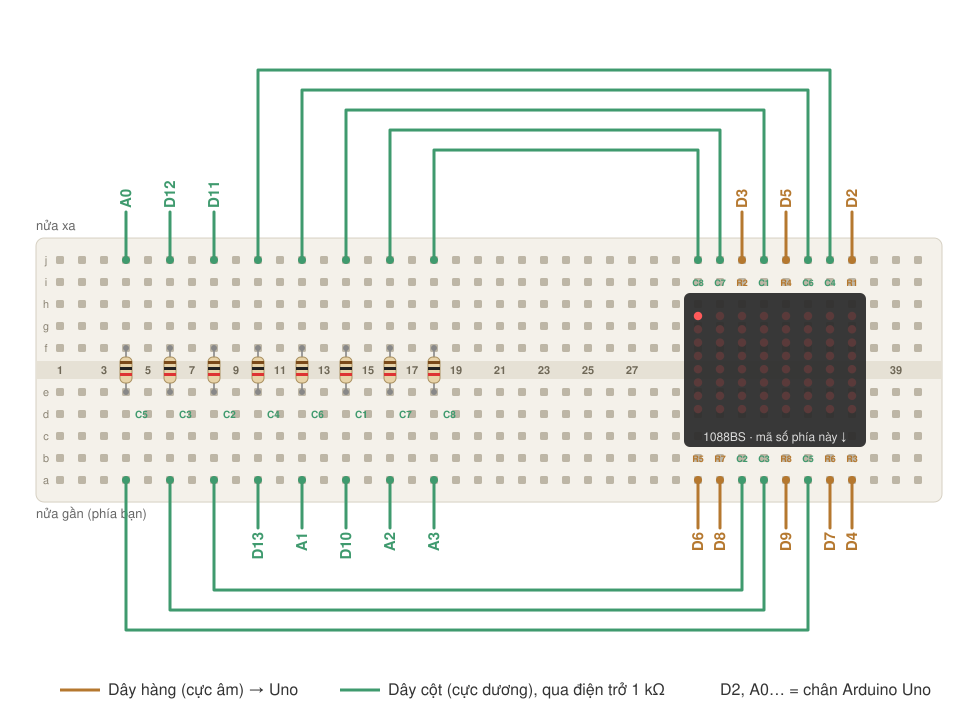

# Lab 13 · LED ma trận 8×8 (1088BS)

> Điều khiển ma trận LED 8×8 rời (16 chân) trực tiếp bằng Arduino Uno theo kiểu **quét hàng** (multiplexing): bật từng điểm, vẽ hình trái tim, rồi chạy chữ. Cuối lab có phần cho **module MAX7219** nếu kit của bạn là loại đã gắn sẵn IC điều khiển.

## LED ma trận 8×8 là gì

Ma trận 8×8 gồm **64 LED** xếp thành 8 hàng × 8 cột trong một khối nhựa. Nếu mỗi LED có chân riêng thì cần 64 + 1 chân; để tiết kiệm, nhà sản xuất nối chung:

- **8 LED cùng hàng** chung một cực,
- **8 LED cùng cột** chung cực còn lại.

Với **1088BS** (loại trong kit), hàng nối **cực âm** (cathode), cột nối **cực dương** (anode). Loại 1088AS thì ngược lại; hai loại có cùng sơ đồ chân, chỉ khác chiều cực.

Kết quả là chỉ còn **16 chân**: 8 chân hàng + 8 chân cột. LED ở hàng `r`, cột `c` sáng khi chân hàng `r` ở mức "bật" **và** chân cột `c` ở mức "bật" (với 1088BS: cột HIGH, hàng LOW).

```
            C1   C2   C3  ...  C8      (chân cột: cực dương)
             │    │    │        │
   R1 ───────●────●────●── … ───●      ● = 1 LED, anode nối cột,
             │    │    │        │          cathode nối hàng
   R2 ──────►●────●────●── … ───●
             ⋮    ⋮    ⋮        ⋮
   R8 ──────►●────●────●── … ───●
```

### Vì sao phải quét (multiplexing)

Với kiểu nối chung này, **không thể** bật tùy ý nhiều điểm cùng lúc. Ví dụ muốn sáng (R1,C1) và (R2,C2): bật R1, R2, C1, C2 thì (R1,C2) và (R2,C1) cũng sáng theo — ra 4 điểm thay vì 2.

Cách giải: **mỗi lúc chỉ bật một hàng**, đặt 8 chân cột theo hình của hàng đó, giữ khoảng 1 ms, tắt, chuyển sang hàng kế. Quét hết 8 hàng mất ~8 ms, tức hơn 100 lần/giây. Mắt người không thấy nhấp nháy ở tần số trên ~50 Hz nên thấy cả hình đứng yên. Đây cũng là nguyên lý của [LED 7 đoạn 4 số ở Lab 7](seven-segment-5641as.md), chỉ khác là 8 "chữ số" thay vì 4.

Hệ quả: mỗi LED chỉ sáng **1/8 thời gian**, nên hình sẽ tối hơn so với một LED đơn cùng dòng điện.

## Linh kiện và chân

| Linh kiện | Số lượng |
|---|---|
| Arduino Uno | 1 |
| LED ma trận 8×8 đỏ 1088BS, 16 chân | 1 |
| Điện trở **1 kΩ** (nâu – đen – đỏ) | 8 |
| Breadboard | 1 (loại lớn 830 lỗ) |
| Dây đực – đực | 24 (8 cho hàng, 16 cho cột) |

### Nhận chân ma trận

Đặt ma trận **mặt LED hướng về phía mình**, cạnh có in mã số (`1088BS`) ở **phía dưới**. Chân 1 ở **góc dưới bên trái**, đánh số **ngược chiều kim đồng hồ**: 1 → 8 dọc hàng chân dưới từ trái sang phải, 9 → 16 dọc hàng chân trên từ phải sang trái.

```
        16  15  14  13  12  11  10   9      ← hàng chân trên
      ┌───────────────────────────────┐
      │  ● ● ● ● ● ● ● ●              │
      │  ● ● ●  64 LED  ● ●           │    (nhìn từ mặt LED)
      │  ● ● ● ● ● ● ● ●              │
      └───────────────────────────────┘
         1   2   3   4   5   6   7   8      ← hàng chân dưới (cạnh có mã số)
```

Sơ đồ chân của 1088BS (giống hệt 1088AS, chỉ khác chiều cực):

| Hàng | R1 | R2 | R3 | R4 | R5 | R6 | R7 | R8 |
|---|---|---|---|---|---|---|---|---|
| Chân ma trận | 9 | 14 | 8 | 12 | 1 | 7 | 2 | 5 |

| Cột | C1 | C2 | C3 | C4 | C5 | C6 | C7 | C8 |
|---|---|---|---|---|---|---|---|---|
| Chân ma trận | 13 | 3 | 4 | 10 | 6 | 11 | 15 | 16 |

Thứ tự này **không theo quy luật** — do cách đi mạch bên trong — nên phải tra bảng, không đoán.

**`AS` hay `BS`.** Hậu tố chỉ khác chiều cực: **1088BS** hàng là cathode (cột là anode), **1088AS** hàng là anode. Code trong lab mặc định cho 1088BS, có hằng số để đảo nếu dùng loại kia. Một số hãng ghi ngược quy ước, nên vẫn làm Bước 2 (thử nhanh) ở phần Lắp mạch để chắc chắn.

**Tự dò chân nếu không chắc**: nối `5V` qua một điện trở 1 kΩ vào một chân, `GND` vào một chân khác. Nếu một LED sáng thì chân nối `5V` là **hàng/cột anode**, chân nối `GND` là cathode, và vị trí LED sáng cho biết đó là hàng nào, cột nào. Lặp lại vài lần là dựng lại được bảng trên.

### Nối với Uno

Dùng 16 chân của Uno: `D2`–`D13` và `A0`–`A3` (chân analog dùng được như chân digital, `A0` = 14 … `A3` = 17). Chừa `D0`/`D1` cho Serial.

| Hàng | Chân ma trận | Uno |
|---|---|---|
| R1 | 9 | `D2` |
| R2 | 14 | `D3` |
| R3 | 8 | `D4` |
| R4 | 12 | `D5` |
| R5 | 1 | `D6` |
| R6 | 7 | `D7` |
| R7 | 2 | `D8` |
| R8 | 5 | `D9` |

| Cột | Chân ma trận | Uno |
|---|---|---|
| C1 | 13 | `D10` qua 1 kΩ |
| C2 | 3 | `D11` qua 1 kΩ |
| C3 | 4 | `D12` qua 1 kΩ |
| C4 | 10 | `D13` qua 1 kΩ |
| C5 | 6 | `A0` qua 1 kΩ |
| C6 | 11 | `A1` qua 1 kΩ |
| C7 | 15 | `A2` qua 1 kΩ |
| C8 | 16 | `A3` qua 1 kΩ |

### Vì sao điện trở 1 kΩ, đặt ở cột

Khi quét theo hàng, **một chân hàng** phải gánh dòng của tối đa **8 LED** (với 1088BS là hút dòng về, vì hàng là cực âm) cùng lúc (cả hàng sáng), còn mỗi chân cột chỉ mang dòng của **1 LED**. Vì vậy điện trở đặt ở **cột** để mỗi LED có điện trở riêng, sáng đều nhau.

Giới hạn của Uno: tối đa **40 mA mỗi chân** (khuyến nghị ≤ 20 mA). Với LED đỏ ($V_f \approx 1{,}8$ V):

$$
I_{LED} = \frac{5 - 1{,}8}{1000} \approx 3{,}2 \text{ mA}, \qquad I_{hàng} = 8 \times 3{,}2 \approx 26 \text{ mA}
$$

Dòng chân hàng dưới 40 mA, an toàn. Nếu dùng 220 Ω như các lab trước thì $I_{LED} \approx 14{,}5$ mA và cả hàng sáng sẽ kéo **~116 mA** qua một chân — đủ để làm hỏng chân đó. Hình hơi tối là cái giá phải trả khi lái trực tiếp; muốn sáng hơn thì dùng IC điều khiển (xem phần [MAX7219](#module-max7219)).

## Lắp mạch

{width=100%}

**Rút cáp USB ra trước khi cắm dây.** Mạch có 24 dây, nên làm từng bước và đánh dấu từng dòng trong bảng khi cắm xong.

### Quy ước vị trí trên breadboard

Đặt breadboard nằm ngang trước mặt. Các **cột lỗ** được đánh số 1 → 63 từ trái sang phải; mỗi cột lỗ có 5 lỗ ở **nửa gần** (phía mình, dưới rãnh giữa) nối chung với nhau, và 5 lỗ ở **nửa xa** (trên rãnh giữa) nối chung với nhau. Hai nửa **không** nối với nhau qua rãnh.

Trong hướng dẫn này, "cột 33 – xa" nghĩa là *một lỗ bất kỳ còn trống ở cột 33, nửa xa*.

Mạch chia hai vùng:

- **Vùng ma trận**: cột 30 – 37.
- **Vùng điện trở**: cột 4 – 18, mỗi điện trở cách nhau một cột.

```
 cột:   4   6   8  10  12  14  16  18           30  31  32  33  34  35  36  37
        │   │   │   │   │   │   │   │           16  15  14  13  12  11  10   9  ← chân ma trận
 xa     ┃   ┃   ┃   ┃   ┃   ┃   ┃   ┃          ┌─────────────────────────────┐
 ═══════┃═══┃═══┃═══┃═══┃═══┃═══┃═══┃═ rãnh ══│        ma trận 8×8          │
 gần    ┃   ┃   ┃   ┃   ┃   ┃   ┃   ┃          │   (mặt LED hướng lên trên)  │
        C5  C3  C2  C4  C6  C1  C7  C8          └─────────────────────────────┘
        └─ 8 điện trở 1 kΩ vắt qua rãnh ─┘        1   2   3   4   5   6   7   8  ← chân ma trận
                                                  (cạnh có mã số 1088BS)
```

### Vì sao cần vùng điện trở riêng

Trong vùng ma trận, 8 cột lỗ 30 – 37 nằm sát nhau và **mỗi cột đã thuộc về một chân khác nhau**. Không thể cắm điện trở từ chân này sang cột lỗ bên cạnh, vì cột bên cạnh chính là một chân khác của ma trận — sẽ nối tắt hai chân. Vì vậy điện trở được đặt ở chỗ trống bên trái, mỗi cái **vắt qua rãnh giữa**: một chân ở nửa gần, một chân ở nửa xa của cùng một cột lỗ. Dòng đi: chân ma trận → dây → điện trở → dây → Uno.

### Hình lắp đầy đủ

{width=100%}

Dây nâu (hàng) đi thẳng từ ma trận về Uno. Dây xanh (cột) đi từ ma trận vòng sang một điện trở, rồi từ đầu kia của điện trở về Uno. Các bước dưới đây đi lần lượt từng phần của hình này.

### Bước 1 – cắm ma trận

1. Tìm **cạnh có in mã số** (`1088BS`) trên thân ma trận. Cạnh đó hướng **về phía mình**.
2. Đặt ma trận vắt ngang rãnh giữa, hàng chân có mã số (chân 1 – 8) cắm vào **nửa gần**, hàng chân kia (chân 9 – 16) cắm vào **nửa xa**.
3. Canh cho **chân 1** (góc gần, bên trái) rơi vào **cột 30**. Khi đó chân 1 → 8 nằm ở cột 30 → 37 nửa gần, chân 16 → 9 nằm ở cột 30 → 37 nửa xa.
4. Ấn đều hai tay lên thân ma trận cho đến khi cả 16 chân vào hết. Nếu một bên vào mà bên kia kẹt, rút ra và nắn thẳng chân — chân ma trận ngắn, dễ cong gập bên dưới mà không biết.

Sau bước này, mỗi cột lỗ 30 – 37 có hai chân ma trận (một ở nửa gần, một ở nửa xa) — **đúng**, vì hai nửa không nối nhau.

| Cột lỗ | Nửa gần: chân → vai trò | Nửa xa: chân → vai trò |
|---|---|---|
| 30 | 1 → **R5** | 16 → C8 |
| 31 | 2 → **R7** | 15 → C7 |
| 32 | 3 → C2 | 14 → **R2** |
| 33 | 4 → C3 | 13 → C1 |
| 34 | 5 → **R8** | 12 → **R4** |
| 35 | 6 → C5 | 11 → C6 |
| 36 | 7 → **R6** | 10 → C4 |
| 37 | 8 → **R3** | 9 → **R1** |

Thân ma trận sẽ che phần lớn các lỗ bên dưới, thường chỉ còn **1 – 2 lỗ ở mép ngoài** (phía xa nhất so với rãnh) của mỗi cột lỗ. Dây cắm vào các lỗ mép ngoài đó. Nếu thân ma trận che kín, nhấc ma trận ra, cắm dây vào các lỗ sát mép trước rồi mới cắm lại ma trận, hoặc dùng dây **đực – cái** cắm thẳng vào chân ma trận.

### Bước 2 – thử nhanh trước khi đi dây

Trước khi cắm 24 dây, kiểm tra hướng ma trận bằng một LED:

1. Một dây từ `5V` của Uno, qua một **điện trở 1 kΩ**, vào **cột 33 – xa** (chân 13 = C1, cực dương với 1088BS).
2. Một dây từ `GND` vào **cột 37 – xa** (chân 9 = R1, cực âm).
3. Cắm USB: LED **góc trên bên trái** phải sáng.

- Sáng đúng góc → đúng 1088BS, dùng code mặc định.
- Không sáng → đổi chỗ hai dây (`5V` vào cột 37, `GND` vào cột 33). Nếu giờ sáng thì ma trận thực ra là loại hàng anode (như 1088AS): khi nạp code nhớ đảo `ROW_ON/OFF` và `COL_ON/OFF`.
- Sáng ở góc khác → ma trận đang bị xoay, kiểm tra lại cạnh có mã số.

**Rút USB** và gỡ hai dây thử ra trước khi sang bước tiếp.

### Bước 3 – 8 điện trở

Cắm 8 điện trở 1 kΩ (nâu – đen – đỏ) **vắt qua rãnh giữa**, mỗi cái nằm dọc trong một cột lỗ: một chân ở nửa gần, một chân ở nửa xa.

| Điện trở cho | Cột lỗ |
|---|---|
| C5 | 4 |
| C3 | 6 |
| C2 | 8 |
| C4 | 10 |
| C6 | 12 |
| C1 | 14 |
| C7 | 16 |
| C8 | 18 |

Thứ tự điện trở không theo C1 → C8 mà được xếp sao cho **các dây không bắt chéo nhau** (xem hình lắp ở trên).

Cách một cột giữa hai điện trở để chân không chạm nhau. Bẻ chân điện trở thành hình chữ U cho vừa khoảng cách qua rãnh. Điện trở không phân cực.

### Bước 4 – 8 dây hàng (không qua điện trở)

Dùng **một màu dây** (ví dụ đỏ) cho tất cả dây hàng. Mỗi dây nối thẳng từ vùng ma trận về Uno:

| Hàng | Từ lỗ | Đến Uno |
|---|---|---|
| R1 | cột 37 – xa | `D2` |
| R2 | cột 32 – xa | `D3` |
| R3 | cột 37 – gần | `D4` |
| R4 | cột 34 – xa | `D5` |
| R5 | cột 30 – gần | `D6` |
| R6 | cột 36 – gần | `D7` |
| R7 | cột 31 – gần | `D8` |
| R8 | cột 34 – gần | `D9` |

### Bước 5 – 16 dây cột (qua điện trở)

Dùng **màu khác** (ví dụ xanh) cho dây cột. Mỗi cột cần **hai dây**: dây (a) từ chân ma trận tới điện trở, **cùng nửa** với chân ma trận (chân ở nửa xa thì vào đầu xa của điện trở, chân ở nửa gần thì vào đầu gần); dây (b) từ **đầu còn lại** của điện trở về Uno. Nhờ vậy dây (a) của nửa xa đi vòng phía trên, của nửa gần đi vòng phía dưới, không dây nào vắt ngang breadboard.

| Cột | (a) Từ chân ma trận | → đến điện trở | (b) Từ điện trở | → đến Uno |
|---|---|---|---|---|
| C1 | cột 33 – xa | cột 14 – xa | cột 14 – gần | `D10` |
| C2 | cột 32 – gần | cột 8 – gần | cột 8 – xa | `D11` |
| C3 | cột 33 – gần | cột 6 – gần | cột 6 – xa | `D12` |
| C4 | cột 36 – xa | cột 10 – xa | cột 10 – gần | `D13` |
| C5 | cột 35 – gần | cột 4 – gần | cột 4 – xa | `A0` |
| C6 | cột 35 – xa | cột 12 – xa | cột 12 – gần | `A1` |
| C7 | cột 31 – xa | cột 16 – xa | cột 16 – gần | `A2` |
| C8 | cột 30 – xa | cột 18 – xa | cột 18 – gần | `A3` |

Mẹo: làm xong toàn bộ cột (a) trước, rồi mới làm cột (b). Lỗ cắm dây ở vùng điện trở nên chọn hàng ngoài cùng (`j` hoặc `a`), để chừa hàng `f`/`e` cho chân điện trở. Dây (b) đi về hàng chân **analog** `A0`–`A3` ở mép dưới bên phải Uno, đừng nhầm với hàng chân nguồn bên cạnh.

### Bước 6 – kiểm tra trước khi cắm điện

- **Đếm dây**: 8 dây đỏ (hàng) đi thẳng từ cột 30 – 37 về `D2`–`D9`; 16 dây xanh (cột) đi qua vùng điện trở.
- **Mỗi lỗ ở vùng ma trận chỉ có một dây** ở mỗi nửa. Cả 16 vị trí (8 cột lỗ × 2 nửa) đều có đúng một dây.
- **Không có dây nào nối thẳng** từ vùng ma trận về `D10`–`D13` / `A0`–`A3` mà bỏ qua điện trở.
- Không có dây nào cắm vào thanh nguồn `+`/`−` — lab này không dùng thanh nguồn.
- Dán bảng ở Bước 4 – 5 cạnh mạch để dò lại khi có lỗi.

### Bước 7 – cắm USB, nạp Test 1

Nạp code Test 1 bên dưới, mở Serial Monitor. Điểm sáng phải chạy từ góc trên bên trái, sang phải hết hàng 1, rồi xuống hàng 2… Nếu sai, so dòng `R? C?` trên Serial với vị trí LED thật và tra lại bảng Bước 4 – 5.

## Code

Cả ba test dùng chung phần khai báo chân dưới đây. Mảng `ROWS[]` / `COLS[]` theo đúng thứ tự R1…R8 và C1…C8, nên nếu nối khác bảng thì chỉ cần sửa hai mảng này.

```cpp
const byte ROWS[8] = {2, 3, 4, 5, 6, 7, 8, 9};
const byte COLS[8] = {10, 11, 12, 13, A0, A1, A2, A3};

// 1088BS: hàng là cathode, cột là anode → cột HIGH + hàng LOW thì LED sáng.
// Nếu Test 1 không có LED nào sáng (ma trận loại 1088AS), đổi ngược cả bốn dòng dưới.
#define ROW_ON  LOW
#define ROW_OFF HIGH
#define COL_ON  HIGH
#define COL_OFF LOW
```

### Test 1 – bật lần lượt từng điểm

Cho một điểm sáng chạy qua đủ 64 vị trí, từ trái sang phải, trên xuống dưới. Đây là bài **kiểm tra dây**: nếu thứ tự chạy sai thì biết ngay dây nào bị lẫn.

```cpp
const byte ROWS[8] = {2, 3, 4, 5, 6, 7, 8, 9};
const byte COLS[8] = {10, 11, 12, 13, A0, A1, A2, A3};

#define ROW_ON  LOW
#define ROW_OFF HIGH
#define COL_ON  HIGH
#define COL_OFF LOW

void allOff() {
  for (byte i = 0; i < 8; i++) {
    digitalWrite(ROWS[i], ROW_OFF);
    digitalWrite(COLS[i], COL_OFF);
  }
}

void setup() {
  Serial.begin(9600);
  for (byte i = 0; i < 8; i++) {
    pinMode(ROWS[i], OUTPUT);
    pinMode(COLS[i], OUTPUT);
  }
  allOff();
}

void loop() {
  for (byte r = 0; r < 8; r++) {
    for (byte c = 0; c < 8; c++) {
      allOff();
      digitalWrite(ROWS[r], ROW_ON);
      digitalWrite(COLS[c], COL_ON);

      Serial.print("R"); Serial.print(r + 1);
      Serial.print(" C"); Serial.println(c + 1);
      delay(150);
    }
  }
}
```

**Cách kiểm tra:**

- Mở Serial Monitor (9600 baud). Mỗi dòng `R? C?` tương ứng đúng **một** LED sáng ở hàng, cột đó (hàng 1 ở trên, cột 1 bên trái khi mã số ở dưới).
- **Không LED nào sáng**: ma trận ngược cực so với code (loại hàng là anode, như 1088AS) — đổi `ROW_ON`/`ROW_OFF` thành `HIGH`/`LOW` và `COL_ON`/`COL_OFF` thành `LOW`/`HIGH`, nạp lại.
- **Sáng nhưng sai chỗ**: ghi lại dòng Serial và vị trí thật, so với bảng để tìm dây bị đổi. Nếu hình bị xoay 90° (điểm chạy dọc thay vì ngang) thì hàng và cột đang bị đổi vai — tráo hai mảng `ROWS` và `COLS`, đồng thời đảo chiều `ON`/`OFF`.
- **Một hàng hoặc một cột không bao giờ sáng**: dây đó lỏng hoặc chưa cắm.
- `D13` có LED `L` trên board Uno nối song song, nên LED `L` sẽ nháy theo cột 4 — bình thường.

### Test 2 – vẽ hình trái tim (quét hàng)

Hình được lưu thành mảng 8 byte, mỗi byte là một hàng, **bit 7 là cột 1** (trái), bit 0 là cột 8. Viết ở dạng nhị phân `0b…` thì nhìn code thấy luôn hình.

```cpp
const byte ROWS[8] = {2, 3, 4, 5, 6, 7, 8, 9};
const byte COLS[8] = {10, 11, 12, 13, A0, A1, A2, A3};

#define ROW_ON  LOW
#define ROW_OFF HIGH
#define COL_ON  HIGH
#define COL_OFF LOW

const byte HEART[8] = {
  0b00000000,
  0b01100110,
  0b11111111,
  0b11111111,
  0b01111110,
  0b00111100,
  0b00011000,
  0b00000000,
};

void setup() {
  for (byte i = 0; i < 8; i++) {
    pinMode(ROWS[i], OUTPUT);
    pinMode(COLS[i], OUTPUT);
    digitalWrite(ROWS[i], ROW_OFF);
    digitalWrite(COLS[i], COL_OFF);
  }
}

// Vẽ 1 khung hình: quét 8 hàng một lượt (~8 ms)
void drawFrame(const byte img[8]) {
  for (byte r = 0; r < 8; r++) {
    // 1. Đặt 8 cột theo hình của hàng r
    for (byte c = 0; c < 8; c++) {
      bool on = img[r] & (0x80 >> c);      // bit 7 = cột 1
      digitalWrite(COLS[c], on ? COL_ON : COL_OFF);
    }
    // 2. Bật hàng r, giữ 1 ms, tắt
    digitalWrite(ROWS[r], ROW_ON);
    delay(1);
    digitalWrite(ROWS[r], ROW_OFF);
  }
}

void loop() {
  drawFrame(HEART);
}
```

Giải thích:

- **Thứ tự trong `drawFrame`**: đặt cột **trước**, rồi mới bật hàng, và tắt hàng **trước** khi chuyển sang hàng kế. Nếu làm ngược, hàng mới sẽ thoáng hiện hình của hàng cũ, gây "bóng ma" (ghosting) mờ mờ.
- **`loop()` phải gọi `drawFrame` liên tục**. Chỉ cần thêm một `delay(500)` vào `loop()` là hình tắt ngay — vì ma trận không tự nhớ hình, CPU phải vẽ lại liên tục.

**Cách kiểm tra:**

- Thấy trái tim đứng yên, không nhấp nháy.
- Đổi `delay(1)` thành `delay(10)`: quét 8 hàng mất 80 ms (~12 Hz), sẽ thấy rõ các hàng sáng **lần lượt** từ trên xuống — đây chính là quét hàng chạy chậm.
- Tự vẽ hình khác: sửa các số `0b…` trong `HEART`, mỗi số `1` là một điểm sáng.

### Test 3 – chạy chữ

Cho dòng chữ `IOT ♥` chạy từ phải sang trái. Lần này chữ được lưu **theo cột** (mỗi byte là một cột, bit 0 là hàng 1 trên cùng) vì chạy chữ ngang thực chất là dịch cửa sổ 8 cột dọc theo một dải cột dài.

Không dùng `delay()` để đợi giữa hai bước dịch, vì như Test 2 cho thấy, `delay` làm ma trận tắt. Thay vào đó dùng `millis()`: vẫn vẽ liên tục, chỉ dịch khi đã đủ 100 ms.

```cpp
const byte ROWS[8] = {2, 3, 4, 5, 6, 7, 8, 9};
const byte COLS[8] = {10, 11, 12, 13, A0, A1, A2, A3};

#define ROW_ON  LOW
#define ROW_OFF HIGH
#define COL_ON  HIGH
#define COL_OFF LOW

// Mỗi byte = 1 cột, bit 0 = hàng 1 (trên cùng)
const byte MSG[] = {
  0x41, 0x7F, 0x41,                   0x00, 0x00,   // I
  0x3E, 0x41, 0x41, 0x41, 0x3E,       0x00, 0x00,   // O
  0x01, 0x01, 0x7F, 0x01, 0x01,       0x00, 0x00,   // T
  0x0C, 0x1E, 0x3E, 0x7C, 0x3E, 0x1E, 0x0C,         // ♥
  0x00, 0x00, 0x00, 0x00, 0x00, 0x00, 0x00, 0x00,   // khoảng trống trước khi lặp
};
const int MSG_LEN = sizeof(MSG);

#define STEP_MS 100      // dịch 1 cột mỗi 100 ms

int offset = 0;
unsigned long lastStep = 0;

void setup() {
  for (byte i = 0; i < 8; i++) {
    pinMode(ROWS[i], OUTPUT);
    pinMode(COLS[i], OUTPUT);
    digitalWrite(ROWS[i], ROW_OFF);
    digitalWrite(COLS[i], COL_OFF);
  }
}

void drawWindow() {
  for (byte r = 0; r < 8; r++) {
    for (byte c = 0; c < 8; c++) {
      byte col = MSG[(offset + c) % MSG_LEN];   // vòng lại đầu chuỗi
      bool on = col & (1 << r);
      digitalWrite(COLS[c], on ? COL_ON : COL_OFF);
    }
    digitalWrite(ROWS[r], ROW_ON);
    delay(1);
    digitalWrite(ROWS[r], ROW_OFF);
  }
}

void loop() {
  drawWindow();

  if (millis() - lastStep >= STEP_MS) {
    lastStep = millis();
    offset = (offset + 1) % MSG_LEN;
  }
}
```

**Cách kiểm tra:**

- Chữ `I`, `O`, `T` rồi trái tim chạy từ phải sang trái, hết chuỗi thì quay lại từ đầu.
- Đổi `STEP_MS` thành `50` (nhanh hơn) hoặc `200` (chậm hơn) — độ sáng không đổi vì việc vẽ không phụ thuộc tốc độ chạy.
- Thêm chữ: vẽ chữ trên giấy kẻ ô 8 hàng, mỗi cột đổi thành một byte (hàng 1 = bit 0 = giá trị 1, hàng 2 = 2, hàng 3 = 4, …, hàng 8 = 128) rồi chèn vào `MSG`.

## Module MAX7219

Nhiều kit bán ma trận 8×8 **gắn sẵn trên một bo mạch có IC MAX7219** (bo xanh, 5 chân `VCC GND DIN CS CLK` ở mỗi đầu). Khi đó toàn bộ phần quét hàng, điện trở, giới hạn dòng đã nằm trong IC:

| | Lái trực tiếp (lab trên) | Module MAX7219 |
|---|---|---|
| Số chân Uno dùng | 16 | 3 |
| Điện trở ngoài | 8 cái | Không (1 điện trở `ISET` trên bo) |
| CPU phải quét liên tục | Có — `delay()` làm tắt hình | Không — IC tự quét, Uno chỉ gửi hình 1 lần |
| Độ sáng | Tối (giới hạn dòng chân Uno) | Sáng, chỉnh được 16 mức bằng lệnh |
| Ghép nhiều ma trận | Hết chân | Nối tiếp `DOUT` → `DIN`, vẫn 3 chân |

Đây là cùng ý tưởng với IC **74HC595** ở [Lab 7](seven-segment-5641as.md) — dùng giao tiếp nối tiếp để giảm số chân — nhưng MAX7219 còn tự làm luôn việc quét và giới hạn dòng.

Nối dây:

| Module | Uno |
|---|---|
| `VCC` | `5V` |
| `GND` | `GND` |
| `DIN` | `D12` |
| `CS` | `D10` |
| `CLK` | `D11` |

Cài thư viện **LedControl** (Eberhard Fahle) trong **Library Manager**, rồi nạp:

```cpp
#include <LedControl.h>

// LedControl(DIN, CLK, CS, số module)
LedControl lc(12, 11, 10, 1);

const byte HEART[8] = {
  0b00000000,
  0b01100110,
  0b11111111,
  0b11111111,
  0b01111110,
  0b00111100,
  0b00011000,
  0b00000000,
};

void setup() {
  lc.shutdown(0, false);   // MAX7219 khởi động ở chế độ ngủ, phải đánh thức
  lc.setIntensity(0, 4);   // độ sáng 0–15
  lc.clearDisplay(0);

  for (byte r = 0; r < 8; r++) {
    lc.setRow(0, r, HEART[r]);
  }
}

void loop() {
  // Không cần làm gì: MAX7219 tự giữ và tự quét hình
}
```

Mảng `HEART` y hệt Test 2 — chỉ khác là gửi một lần trong `setup()` rồi thôi. Nếu hình bị xoay hoặc lật gương (tùy cách hàn ma trận lên bo), dùng `lc.setColumn()` thay cho `setRow()` hoặc đảo bit.

## Lỗi hay gặp

| Hiện tượng | Nguyên nhân / cách xử lý |
|---|---|
| Không LED nào sáng ở Test 1 | Ma trận ngược cực so với code — đảo `ROW_ON/OFF` và `COL_ON/OFF` |
| Điểm chạy dọc thay vì ngang | Hàng và cột bị đổi vai — tráo mảng `ROWS` ↔ `COLS` và đảo cực |
| Một hàng/cột luôn tắt | Dây lỏng, hoặc chân ma trận bị cong không vào lỗ breadboard |
| Hai điểm sáng cùng lúc ở Test 1 | Hai chân ma trận cắm chung một cột lỗ breadboard — ma trận chưa vắt qua rãnh giữa |
| Hình có "bóng ma" mờ ở hàng bên cạnh | Bật hàng mới trước khi đặt xong cột — giữ đúng thứ tự trong `drawFrame` |
| Hình nhấp nháy hoặc tắt khi thêm code | Có `delay()` dài trong `loop()` — đổi sang kiểu `millis()` như Test 3 |
| Cả hình rất tối | Bình thường khi lái trực tiếp với 1 kΩ và quét 1/8; **không** hạ điện trở xuống 220 Ω (quá dòng chân Uno), dùng MAX7219 nếu cần sáng |
| Uno bị reset / nóng khi cả hàng sáng | Dùng điện trở quá nhỏ hoặc đặt điện trở ở hàng thay vì cột |
| MAX7219: không sáng gì | Quên `lc.shutdown(0, false)`, hoặc đổi nhầm `DIN`/`CLK` |
