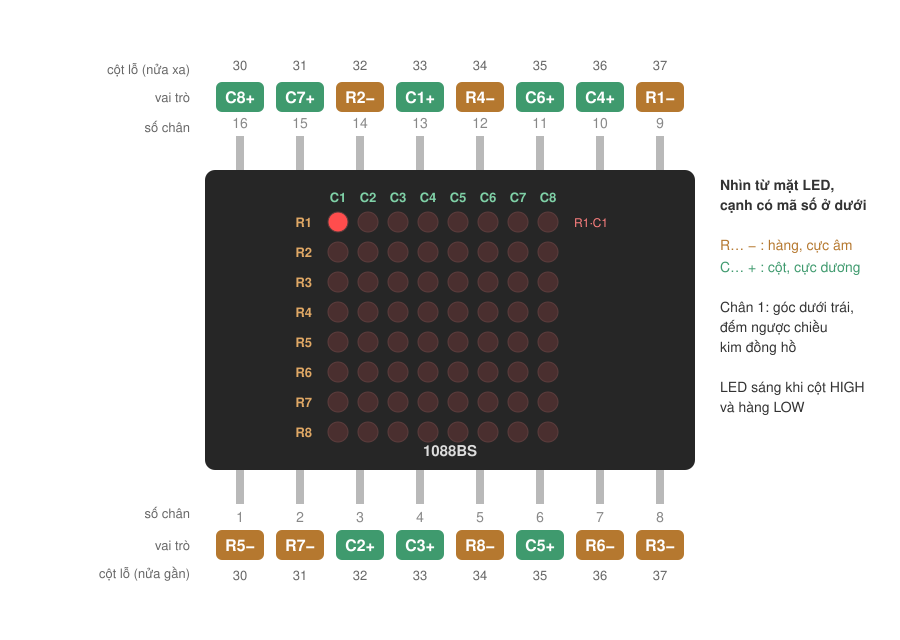
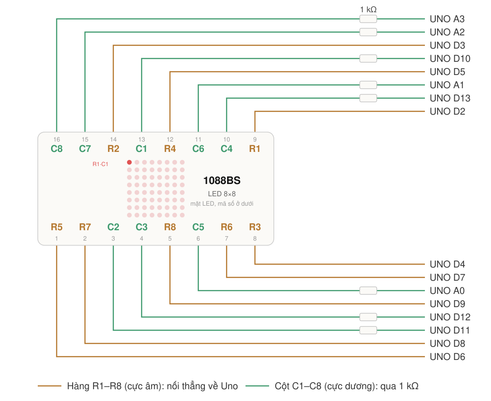

# Lab 13 · LED ma trận 8×8 (1088BS)

> Điều khiển ma trận LED 8×8 rời (16 chân) trực tiếp bằng Arduino Uno, không dùng IC điều khiển: thử 1 đèn, chạy điểm sáng qua 64 đèn, vẽ trái tim, chạy chương trình trình diễn (tim đập, mặt cười, mưa rơi, Game of Life) và làm xúc xắc điện tử. Cuối lab có phần cho **module MAX7219** nếu kit của bạn là loại đã gắn sẵn IC.

## LED ma trận 8×8 là gì

Ma trận 8×8 gồm **64 LED** xếp thành 8 hàng × 8 cột trong một khối nhựa. Nếu mỗi LED có chân riêng thì cần 64 + 1 chân; để tiết kiệm, nhà sản xuất nối chung:

- **8 LED cùng hàng** chung một cực,
- **8 LED cùng cột** chung cực còn lại.

Kết quả là chỉ còn **16 chân**: 8 chân hàng + 8 chân cột. Với con **1088BS** trong kit (đã thử thực tế), hàng nối **cực dương** (anode), cột nối **cực âm** (cathode): LED ở hàng `r`, cột `c` sáng khi chân hàng `r` ở `HIGH` **và** chân cột `c` ở `LOW`.

```
            C1   C2   C3  ...  C8      (chân cột: cực âm)
             │    │    │        │
   R1 ──────►●────●────●── … ───●      ● = 1 LED, anode nối hàng,
             │    │    │        │          cathode nối cột
   R2 ──────►●────●────●── … ───●
             ⋮    ⋮    ⋮        ⋮
   R8 ──────►●────●────●── … ───●
```

**Hậu tố `AS` / `BS` không thống nhất giữa các hãng.** Có ma trận cùng mã, cùng sơ đồ chân nhưng ngược chiều cực. Vì vậy luôn làm [Bước 1 – thử 1 đèn](#bước-1--thử-1-đèn) trước; nếu ngược thì chỉ cần đảo 4 dòng `#define` trong code.

### Vì sao phải quét

Với kiểu nối chung này, **không thể** bật tùy ý nhiều điểm cùng lúc. Ví dụ muốn sáng (R1,C1) và (R2,C2): bật R1, R2, C1, C2 thì (R1,C2) và (R2,C1) cũng sáng theo — ra 4 điểm thay vì 2.

Cách giải: bật **lần lượt từng điểm** của hình, mỗi điểm khoảng 0,15 ms, rồi lặp lại thật nhanh. Quét hết 64 điểm mất khoảng 10 ms, tức khoảng 100 lần/giây; mắt người không thấy nhấp nháy ở tần số trên ~50 Hz nên thấy cả hình đứng yên. Đây cũng là nguyên lý quét của [LED 7 đoạn 4 số ở Lab 7](seven-segment-5641as.md).

### Vì sao quét từng đèn, dùng điện trở 220 Ω

Cách quét phổ biến hơn là **quét theo hàng**: bật cả một hàng, đặt 8 cột theo hình. Nhưng khi cả hàng sáng, **một chân hàng** phải cấp dòng cho cả 8 LED. Giới hạn của Uno là **40 mA mỗi chân** (khuyến nghị ≤ 20 mA). Với LED đỏ ($V_f \approx 1{,}8$ V):

| Điện trở cột | Dòng 1 LED | Quét theo hàng (8 LED/chân) | Quét từng đèn (1 LED/chân) |
|---|---|---|---|
| 220 Ω | ~14,5 mA | **~116 mA — hỏng chân** | ~14,5 mA — an toàn |
| 1 kΩ | ~3,2 mA | ~26 mA — an toàn | ~3,2 mA — rất tối |

Lab này dùng **8 điện trở 220 Ω** (vòng đỏ – đỏ – nâu, kit có sẵn nhiều) và **quét từng đèn**: mỗi thời điểm chỉ một LED sáng, nên dòng qua mọi chân Uno luôn khoảng 14,5 mA. Đánh đổi là mỗi LED chỉ sáng một phần nhỏ thời gian; hình càng ít điểm thì càng sáng.

**Không chạy code quét theo hàng với điện trở 220 Ω.** Nếu dùng 1 kΩ thì quét theo hàng được, nhưng phải đủ 8 điện trở 1 kΩ.

## Linh kiện

| Linh kiện | Số lượng |
|---|---|
| Arduino Uno | 1 |
| LED ma trận 8×8 đỏ 1088BS, 16 chân | 1 |
| Điện trở **220 Ω** (đỏ – đỏ – nâu) | 8 |
| Breadboard | 1 (chỉ để cắm điện trở) |
| Dây **đực – cái** | 16 (từ chân ma trận ra) |
| Dây đực – đực | 8 (từ điện trở về Uno) |

**Không cắm ma trận lên breadboard.** Thân 1088BS rộng khoảng 32 mm, cắm vắt qua rãnh giữa sẽ che kín cả 5 lỗ mỗi bên, không còn chỗ cắm dây. Thay vào đó, cắm **đầu cái** của dây đực – cái thẳng vào từng chân ma trận.

## Sơ đồ chân và nối dây

Cầm ma trận **mặt LED hướng về phía mình**, cạnh có in chữ `1088BS` ở **phía dưới**. Chân 1 ở **góc dưới bên trái**, đánh số **ngược chiều kim đồng hồ**: 1 → 8 dọc hàng chân dưới từ trái sang phải, 9 → 16 dọc hàng chân trên từ phải sang trái.

{width=100%}

Thứ tự hàng/cột **không theo quy luật** — do cách đi mạch bên trong — nên phải tra bảng, không đoán. Dùng 16 chân Uno: `D2`–`D13` và `A0`–`A3` (chân analog dùng được như chân digital). Chừa `D0`/`D1` cho Serial.

**8 dây hàng (R) — cắm thẳng về Uno, không qua điện trở:**

| Hàng | Chân ma trận | Vị trí chân (đếm từ trái) | Uno |
|---|---|---|---|
| R1 | 9 | trên, thứ 8 (ngoài cùng phải) | `D2` |
| R2 | 14 | trên, thứ 3 | `D3` |
| R3 | 8 | dưới, thứ 8 (ngoài cùng phải) | `D4` |
| R4 | 12 | trên, thứ 5 | `D5` |
| R5 | 1 | dưới, thứ 1 (ngoài cùng trái) | `D6` |
| R6 | 7 | dưới, thứ 7 | `D7` |
| R7 | 2 | dưới, thứ 2 | `D8` |
| R8 | 5 | dưới, thứ 5 | `D9` |

**8 dây cột (C) — đi qua điện trở 220 Ω:**

| Cột | Chân ma trận | Vị trí chân (đếm từ trái) | Uno |
|---|---|---|---|
| C1 | 13 | trên, thứ 4 | 220 Ω → `D10` |
| C2 | 3 | dưới, thứ 3 | 220 Ω → `D11` |
| C3 | 4 | dưới, thứ 4 | 220 Ω → `D12` |
| C4 | 10 | trên, thứ 7 | 220 Ω → `D13` |
| C5 | 6 | dưới, thứ 6 | 220 Ω → `A0` |
| C6 | 11 | trên, thứ 6 | 220 Ω → `A1` |
| C7 | 15 | trên, thứ 2 | 220 Ω → `A2` |
| C8 | 16 | trên, thứ 1 (ngoài cùng trái) | 220 Ω → `A3` |

{width=100%}

Đường đi của mỗi loại dây:

```
Dây hàng:  chân R ──(đực–cái)───────────────────────────────────────► Uno D2…D9

Dây cột:   chân C ──(đực–cái)──► [hàng lỗ X] ═ 220 Ω ═ [hàng lỗ Y] ──(đực–đực)──► Uno D10…D13 / A0…A3
                                 └──── breadboard, điện trở vắt qua rãnh giữa ────┘
```

- Mỗi điện trở **vắt qua rãnh giữa** breadboard. Ở mỗi đầu, dây và chân điện trở phải nằm **cùng một hàng 5 lỗ**.
- Các điện trở cách nhau **ít nhất một hàng lỗ** để chân không chạm nhau.
- Mạch **không dùng** `5V`, `GND`: ma trận lấy điện qua chính các chân D/A.
- `A0`–`A3` ở hàng chân **ANALOG IN** (mép dưới bên phải Uno), dùng như chân digital.

## Lắp từng bước

Không cắm đủ 24 dây rồi mới thử. Mỗi bước chỉ cắm thêm vài dây, nạp code, thấy đúng rồi mới cắm tiếp — khi có lỗi thì biết ngay nằm ở mấy dây vừa cắm. **Rút USB mỗi lần cắm thêm dây.**

Cả lab dùng chung phần khai báo chân dưới đây. Mảng `ROWS[]` / `COLS[]` theo đúng thứ tự R1…R8 và C1…C8:

```cpp
const byte ROWS[8] = {2, 3, 4, 5, 6, 7, 8, 9};             // R1 → R8
const byte COLS[8] = {10, 11, 12, 13, A0, A1, A2, A3};     // C1 → C8

// 1088BS trong kit: hàng = cực dương, cột = cực âm
// Nếu ma trận của bạn ngược cực, đổi ngược cả bốn dòng dưới.
#define ROW_ON  HIGH
#define ROW_OFF LOW
#define COL_ON  LOW
#define COL_OFF HIGH
```

### Bước 1 – thử 1 đèn

Chỉ cắm **R1** và **C1**: 2 dây đực – cái, 1 điện trở, 1 dây đực – đực.

| Dây | Từ | Đến |
|---|---|---|
| R1 | chân 9 (trên, ngoài cùng phải) | `D2` |
| C1 | chân 13 (trên, thứ 4 từ trái) | một đầu điện trở 220 Ω |
| — | đầu kia điện trở | `D10` |

```cpp
#define ROW1 2     // R1 (cực dương)
#define COL1 10    // C1 (cực âm), qua 220 Ω

void setup() {
  Serial.begin(9600);
  pinMode(ROW1, OUTPUT);
  pinMode(COL1, OUTPUT);
  digitalWrite(ROW1, HIGH);   // hàng = cực dương
}

void loop() {
  digitalWrite(COL1, LOW);    // cột = cực âm → LOW thì sáng
  Serial.println("R1 C1: SANG");
  delay(500);
  digitalWrite(COL1, HIGH);
  Serial.println("R1 C1: tat");
  delay(500);
}
```

**Kết quả đúng:** LED **góc trên bên trái** nhấp nháy mỗi nửa giây.

| Hiện tượng | Nguyên nhân / cách xử lý |
|---|---|
| Serial in đều nhưng không sáng | Ma trận ngược cực: đổi `HIGH` ↔ `LOW` ở cả hai chân (`ROW1` thành `LOW`, `COL1` sáng khi `HIGH`). Nếu giờ sáng thì đảo 4 dòng `#define` ở mọi code sau |
| Đổi cực vẫn không sáng | Đầu dây cái chưa ăn vào chân (ấn hết cỡ), hoặc dây và chân điện trở không cùng hàng 5 lỗ |
| Sáng LED khác | Cắm nhầm chân — kiểm tra lại hướng cầm: mặt LED về phía mình, chữ `1088BS` ở dưới |

Kiểm tra nhanh không cần code: dây điện trở sang `GND`, dây chân 9 sang `5V`; không sáng thì đổi chiều. Chiều nào sáng thì chân nối `5V` là cực dương.

### Bước 2 – 2 hàng × 3 cột (6 đèn)

Giữ dây Bước 1, cắm thêm:

| Thêm | Chân ma trận | Nối về Uno |
|---|---|---|
| C2 | 3 (dưới, thứ 3) | 220 Ω → `D11` |
| C3 | 4 (dưới, thứ 4) | 220 Ω → `D12` |
| R2 | 14 (trên, thứ 3) | thẳng → `D3` |

```cpp
const byte ROWS[] = {2, 3};          // R1, R2  (cực dương)
const byte COLS[] = {10, 11, 12};    // C1, C2, C3 (cực âm, qua 220 Ω)
const byte NR = sizeof(ROWS);
const byte NC = sizeof(COLS);

void allOff() {
  for (byte i = 0; i < NR; i++) digitalWrite(ROWS[i], LOW);
  for (byte i = 0; i < NC; i++) digitalWrite(COLS[i], HIGH);
}

void setup() {
  Serial.begin(9600);
  for (byte i = 0; i < NR; i++) pinMode(ROWS[i], OUTPUT);
  for (byte i = 0; i < NC; i++) pinMode(COLS[i], OUTPUT);
  allOff();
}

void loop() {
  for (byte r = 0; r < NR; r++) {
    for (byte c = 0; c < NC; c++) {
      allOff();
      digitalWrite(ROWS[r], HIGH);   // bật hàng
      digitalWrite(COLS[c], LOW);    // bật cột
      Serial.print("R"); Serial.print(r + 1);
      Serial.print(" C"); Serial.println(c + 1);
      delay(500);
    }
  }
}
```

**Kết quả đúng:** điểm sáng chạy ① → ⑥, mỗi lúc chỉ một đèn, khớp dòng Serial:

```
         C1   C2   C3
R1  →    ①    ②    ③      (hàng trên cùng)
R2  →    ④    ⑤    ⑥      (hàng thứ 2)
```

| Hiện tượng | Nguyên nhân |
|---|---|
| Serial in `R1 C2` mà không đèn nào sáng | Dây hoặc điện trở của C2 lỏng / không cùng hàng lỗ |
| `R1 C2` sáng ở vị trí C3 và ngược lại | Hai dây `D11` và `D12` bị đổi chỗ trên Uno |
| `R2 …` sáng ở hàng khác | Nhầm chân: R2 là chân 14, hàng chân **trên**, thứ 3 từ trái |
| Đèn sáng lung tung, nhiều đèn cùng lúc | Đang chạy code cũ chỉ khai báo 2 chân — các chân còn lại thả nổi. Nạp đúng code bước này |

### Bước 3 – đủ 16 dây

Cắm thêm **C4 – C8** (mỗi cột một điện trở 220 Ω), chạy thử, rồi cắm **R3 – R8** theo bảng ở phần [Sơ đồ chân và nối dây](#sơ-đồ-chân-và-nối-dây). Hàng nào chưa cắm thì lúc chạy đến hàng đó ma trận chỉ tối. Sau đó chuyển sang Test 1.

Đối chiếu nhanh khi cắm xong:

```
Hàng chân TRÊN (trái → phải):  C8  C7  R2  C1  R4  C6  C4  R1
                        Uno:   A3  A2  D3  D10 D5  A1  D13 D2

Hàng chân DƯỚI (trái → phải):  R5  R7  C2  C3  R8  C5  R6  R3
                        Uno:   D6  D8  D11 D12 D9  A0  D7  D4
```

## Code

### Test 1 – chạy điểm sáng qua 64 đèn

Kiểm tra toàn bộ dây: một điểm sáng chạy từ trái sang phải, trên xuống dưới, qua đủ 64 vị trí.

```cpp
const byte ROWS[8] = {2, 3, 4, 5, 6, 7, 8, 9};             // R1 → R8
const byte COLS[8] = {10, 11, 12, 13, A0, A1, A2, A3};     // C1 → C8

#define ROW_ON  HIGH
#define ROW_OFF LOW
#define COL_ON  LOW
#define COL_OFF HIGH

void allOff() {
  for (byte i = 0; i < 8; i++) {
    digitalWrite(ROWS[i], ROW_OFF);
    digitalWrite(COLS[i], COL_OFF);
  }
}

void setup() {
  Serial.begin(9600);
  for (byte i = 0; i < 8; i++) {
    pinMode(ROWS[i], OUTPUT);
    pinMode(COLS[i], OUTPUT);
  }
  allOff();
}

void loop() {
  for (byte r = 0; r < 8; r++) {
    for (byte c = 0; c < 8; c++) {
      allOff();
      digitalWrite(ROWS[r], ROW_ON);
      digitalWrite(COLS[c], COL_ON);
      Serial.print("R"); Serial.print(r + 1);
      Serial.print(" C"); Serial.println(c + 1);
      delay(150);
    }
  }
}
```

**Cách kiểm tra:**

- Mỗi dòng `R? C?` trên Serial Monitor (9600 baud) tương ứng đúng **một** LED sáng ở hàng, cột đó.
- **Sáng sai chỗ**: ghi lại dòng Serial và vị trí thật, tra bảng để tìm hai dây bị đổi. Nếu điểm chạy dọc thay vì ngang thì hàng và cột bị đổi vai.
- **Một hàng hoặc một cột không bao giờ sáng**: dây đó lỏng hoặc chưa cắm.
- `D13` có LED `L` trên board Uno nối song song, nên LED `L` nháy theo cột 4 — bình thường.

<video controls playsinline preload="metadata" poster="../assets/led-matrix-8x8-scan-real-poster.jpg" style="display:block; max-width:360px; width:100%; margin:0 auto; border-radius:8px;">
  <source src="../assets/led-matrix-8x8-scan-real.mp4" type="video/mp4">
</video>

Mạch thật chạy Test 1: 16 dây đực – cái cắm thẳng vào chân ma trận, ma trận đặt đứng trước breadboard. Điểm sáng chạy lần lượt qua các vị trí; đoạn sau của video quay sang Uno và breadboard có các điện trở vắt qua rãnh giữa.

### Test 2 – vẽ hình trái tim

Hình được lưu thành mảng 8 byte, mỗi byte là một hàng, **bit 7 là cột 1** (trái), bit 0 là cột 8. Viết ở dạng nhị phân `0b…` thì nhìn code thấy luôn hình.

```cpp
const byte ROWS[8] = {2, 3, 4, 5, 6, 7, 8, 9};
const byte COLS[8] = {10, 11, 12, 13, A0, A1, A2, A3};

#define ROW_ON  HIGH
#define ROW_OFF LOW
#define COL_ON  LOW
#define COL_OFF HIGH

const byte HEART[8] = {
  0b00000000,
  0b01100110,
  0b11111111,
  0b11111111,
  0b01111110,
  0b00111100,
  0b00011000,
  0b00000000,
};

void setup() {
  for (byte i = 0; i < 8; i++) {
    pinMode(ROWS[i], OUTPUT);
    pinMode(COLS[i], OUTPUT);
    digitalWrite(ROWS[i], ROW_OFF);
    digitalWrite(COLS[i], COL_OFF);
  }
}

// Quét từng đèn: mỗi lúc chỉ 1 LED sáng → dòng mỗi chân ~14,5 mA, an toàn với 220 Ω
void drawFrame(const byte img[8]) {
  for (byte r = 0; r < 8; r++) {
    digitalWrite(ROWS[r], ROW_ON);
    for (byte c = 0; c < 8; c++) {
      if (img[r] & (0x80 >> c)) {           // bit 7 = cột 1
        digitalWrite(COLS[c], COL_ON);
        delayMicroseconds(150);
        digitalWrite(COLS[c], COL_OFF);
      }
    }
    digitalWrite(ROWS[r], ROW_OFF);
  }
}

void loop() {
  drawFrame(HEART);
}
```

Giải thích:

- **`drawFrame` chỉ bật những điểm có bit `1`**, mỗi điểm 150 µs rồi tắt. Hình trái tim có 36 điểm nên một khung mất khoảng 5,4 ms, tức gần 200 khung mỗi giây.
- **`loop()` phải gọi `drawFrame` liên tục.** Thêm một `delay(500)` vào `loop()` là hình tắt ngay — ma trận không tự nhớ hình, CPU phải vẽ lại liên tục.
- Hình nhấp nháy thì giảm `delayMicroseconds(150)` xuống `100`; muốn sáng hơn thì tăng lên `250` (tăng quá sẽ bắt đầu thấy nháy).
- Tự vẽ hình khác: sửa các số `0b…`, mỗi số `1` là một điểm sáng.

<video controls playsinline preload="metadata" poster="../assets/led-matrix-8x8-heart-real-poster.jpg" style="display:block; max-width:640px; width:100%; margin:0 auto; border-radius:8px;">
  <source src="../assets/led-matrix-8x8-heart-real.mp4" type="video/mp4">
</video>

Trái tim hiện đứng yên, không nhấp nháy, dù thực ra mỗi lúc chỉ có một LED sáng.

### Test 3 – chương trình trình diễn

Bốn hiệu ứng chạy lần lượt rồi lặp lại: **tim đập**, **mặt cười nháy mắt**, **mưa rơi** và **Game of Life**. Hàm `show(img, ms)` giữ một hình trên ma trận trong `ms` mili giây bằng cách gọi `drawFrame` liên tục — thay cho `delay()`, vốn làm tắt hình.

```cpp
const byte ROWS[8] = {2, 3, 4, 5, 6, 7, 8, 9};
const byte COLS[8] = {10, 11, 12, 13, A0, A1, A2, A3};

#define ROW_ON  HIGH
#define ROW_OFF LOW
#define COL_ON  LOW
#define COL_OFF HIGH

// ----- Các hình (mỗi byte = 1 hàng, bit 7 = cột 1) -----
const byte HEART_BIG[8]   = {0x00,0x66,0xFF,0xFF,0x7E,0x3C,0x18,0x00};
const byte HEART_SMALL[8] = {0x00,0x00,0x24,0x7E,0x3C,0x18,0x00,0x00};
const byte SMILE[8]       = {0x3C,0x42,0xA5,0x81,0xA5,0x99,0x42,0x3C};
const byte WINK[8]        = {0x3C,0x42,0xB5,0x81,0xA5,0x99,0x42,0x3C};

byte frame[8];   // hình thay đổi được (mưa, Game of Life)

// Quét từng đèn: mỗi lúc chỉ 1 LED sáng → an toàn với 220 Ω
void drawFrame(const byte img[8]) {
  for (byte r = 0; r < 8; r++) {
    digitalWrite(ROWS[r], ROW_ON);
    for (byte c = 0; c < 8; c++) {
      if (img[r] & (0x80 >> c)) {
        digitalWrite(COLS[c], COL_ON);
        delayMicroseconds(150);
        digitalWrite(COLS[c], COL_OFF);
      }
    }
    digitalWrite(ROWS[r], ROW_OFF);
  }
}

// Giữ một hình trên ma trận trong ms mili giây
void show(const byte img[8], unsigned int ms) {
  unsigned long t0 = millis();
  while (millis() - t0 < ms) drawFrame(img);
}

// ----- Game of Life: mỗi ô sống/chết theo số hàng xóm -----
byte cell(const byte g[8], int r, int c) {
  r = (r + 8) % 8;  c = (c + 8) % 8;          // tràn mép thì vòng sang mép kia
  return (g[r] >> (7 - c)) & 1;
}

void lifeStep(byte g[8]) {
  byte next[8] = {0};
  for (int r = 0; r < 8; r++) {
    for (int c = 0; c < 8; c++) {
      byte n = 0;
      for (int dr = -1; dr <= 1; dr++)
        for (int dc = -1; dc <= 1; dc++)
          if (dr || dc) n += cell(g, r + dr, c + dc);
      bool alive = cell(g, r, c);
      if (n == 3 || (alive && n == 2)) next[r] |= 0x80 >> c;
    }
  }
  memcpy(g, next, 8);
}

void setup() {
  for (byte i = 0; i < 8; i++) {
    pinMode(ROWS[i], OUTPUT);
    pinMode(COLS[i], OUTPUT);
    digitalWrite(ROWS[i], ROW_OFF);
    digitalWrite(COLS[i], COL_OFF);
  }
  randomSeed(analogRead(A5));   // A5 để trống → số ngẫu nhiên mỗi lần chạy khác nhau
}

void loop() {
  // 1. Tim đập
  for (byte i = 0; i < 4; i++) {
    show(HEART_BIG, 300);
    show(HEART_SMALL, 200);
  }

  // 2. Mặt cười nháy mắt
  for (byte i = 0; i < 3; i++) {
    show(SMILE, 900);
    show(WINK, 250);
  }

  // 3. Mưa rơi
  memset(frame, 0, 8);
  for (int i = 0; i < 60; i++) {
    for (int r = 7; r > 0; r--) frame[r] = frame[r - 1];   // dịch xuống 1 hàng
    frame[0] = 0;
    for (byte c = 0; c < 8; c++)
      if (random(6) == 0) frame[0] |= 0x80 >> c;           // giọt mưa mới ở hàng trên
    show(frame, 80);
  }

  // 4. Game of Life
  for (byte r = 0; r < 8; r++) frame[r] = random(256);
  for (int g = 0; g < 60; g++) {
    show(frame, 150);
    lifeStep(frame);
  }
}
```

Giải thích:

- **Mưa rơi**: mỗi bước dịch cả hình xuống một hàng, hàng trên cùng sinh giọt mới ngẫu nhiên (mỗi cột 1/6 cơ hội).
- **Game of Life** (John Conway): mỗi đèn là một tế bào. Tế bào sống còn sống nếu có 2–3 hàng xóm sống; ô trống sinh tế bào mới nếu có đúng 3 hàng xóm sống. Từ một hình ngẫu nhiên, các đám đèn tự lớn lên, chết đi hoặc bò quanh ma trận. Mép trên nối với mép dưới, mép trái nối với mép phải.
- **`randomSeed(analogRead(A5))`**: `A5` không nối gì nên đọc ra nhiễu ngẫu nhiên — mỗi lần bật, mưa và Game of Life khác nhau.

<video controls playsinline preload="metadata" poster="../assets/led-matrix-8x8-show-real-poster.jpg" style="display:block; max-width:640px; width:100%; margin:0 auto; border-radius:8px;">
  <source src="../assets/led-matrix-8x8-show-real.mp4" type="video/mp4">
</video>

Ma trận được dựng trên đầu một joystick (chỉ làm giá đỡ, không nối dây). Lần lượt thấy trái tim đập to – nhỏ, mặt cười nháy mắt trái, rồi mưa rơi và các đám đèn của Game of Life.

### Test 4 – xúc xắc điện tử

Không cần nút nhấn: gõ một ký tự bất kỳ trong **Serial Monitor** rồi nhấn **Enter** để lắc, hoặc chờ 5 giây để xúc xắc tự lắc.

```cpp
const byte ROWS[8] = {2, 3, 4, 5, 6, 7, 8, 9};             // R1 → R8
const byte COLS[8] = {10, 11, 12, 13, A0, A1, A2, A3};     // C1 → C8

#define ROW_ON  HIGH
#define ROW_OFF LOW
#define COL_ON  LOW
#define COL_OFF HIGH

#define AUTO_MS 5000   // tự lắc sau mỗi 5 giây

const byte DICE[6][8] = {
  {0x00,0x00,0x00,0x18,0x18,0x00,0x00,0x00},   // 1
  {0x60,0x60,0x00,0x00,0x00,0x00,0x06,0x06},   // 2
  {0x60,0x60,0x00,0x18,0x18,0x00,0x06,0x06},   // 3
  {0x66,0x66,0x00,0x00,0x00,0x00,0x66,0x66},   // 4
  {0x66,0x66,0x00,0x18,0x18,0x00,0x66,0x66},   // 5
  {0x66,0x66,0x00,0x66,0x66,0x00,0x66,0x66},   // 6
};

byte face = 0;
unsigned long lastRoll = 0;

// Quét từng đèn: mỗi lúc chỉ 1 LED sáng → an toàn với 220 Ω
void drawFrame(const byte img[8]) {
  for (byte r = 0; r < 8; r++) {
    digitalWrite(ROWS[r], ROW_ON);
    for (byte c = 0; c < 8; c++) {
      if (img[r] & (0x80 >> c)) {
        digitalWrite(COLS[c], COL_ON);
        delayMicroseconds(150);
        digitalWrite(COLS[c], COL_OFF);
      }
    }
    digitalWrite(ROWS[r], ROW_OFF);
  }
}

// Giữ một hình trên ma trận trong ms mili giây
void show(const byte img[8], unsigned int ms) {
  unsigned long t0 = millis();
  while (millis() - t0 < ms) drawFrame(img);
}

void roll() {
  for (byte i = 0; i < 12; i++) {             // hiệu ứng đang lăn, chậm dần
    show(DICE[random(6)], 40 + i * 15);
  }
  face = random(6);
  Serial.print("Ket qua: ");
  Serial.println(face + 1);
  lastRoll = millis();
}

void setup() {
  Serial.begin(9600);
  for (byte i = 0; i < 8; i++) {
    pinMode(ROWS[i], OUTPUT);
    pinMode(COLS[i], OUTPUT);
    digitalWrite(ROWS[i], ROW_OFF);
    digitalWrite(COLS[i], COL_OFF);
  }
  randomSeed(analogRead(A5));
  Serial.println("Go phim bat ky + Enter de lac xuc xac");
}

void loop() {
  if (Serial.available()) {                   // có ký tự gửi từ Serial Monitor
    while (Serial.available()) Serial.read(); // đọc bỏ hết
    roll();
  } else if (millis() - lastRoll >= AUTO_MS) {
    roll();
  }
  drawFrame(DICE[face]);
}
```

**Cách chơi:**

1. Nạp code, mở **Serial Monitor** ở 9600 baud.
2. Gõ một ký tự (ví dụ `a`) vào ô *Message*, nhấn **Enter**: ma trận đổi mặt liên tục, chậm dần rồi dừng; Serial in `Ket qua: …` khớp số chấm trên ma trận.
3. Không gõ gì thì 5 giây sau xúc xắc tự lắc. Sửa `AUTO_MS` để đổi khoảng thời gian; muốn **chỉ lắc khi gõ phím** thì xoá nhánh `else if (...) { roll(); }`.

Mỗi chấm xúc xắc là một khối 2×2 LED, đặt ở các vị trí góc / giữa của lưới 8×8.

<video controls playsinline preload="metadata" poster="../assets/led-matrix-8x8-dice-real-poster.jpg" style="display:block; max-width:640px; width:100%; margin:0 auto; border-radius:8px;">
  <source src="../assets/led-matrix-8x8-dice-real.mp4" type="video/mp4">
</video>

Ma trận hiện mặt **1**: một khối 2×2 LED ở giữa lưới.

## Module MAX7219

Nhiều kit bán ma trận 8×8 **gắn sẵn trên một bo mạch có IC MAX7219** (bo xanh, 5 chân `VCC GND DIN CS CLK` ở mỗi đầu). Khi đó toàn bộ phần quét, điện trở, giới hạn dòng đã nằm trong IC:

| | Lái trực tiếp (lab trên) | Module MAX7219 |
|---|---|---|
| Số chân Uno dùng | 16 | 3 |
| Điện trở ngoài | 8 cái | Không (1 điện trở `ISET` trên bo) |
| CPU phải quét liên tục | Có — `delay()` làm tắt hình | Không — IC tự quét, Uno chỉ gửi hình 1 lần |
| Độ sáng | Tối dần khi hình nhiều điểm | Sáng, chỉnh được 16 mức bằng lệnh |
| Ghép nhiều ma trận | Hết chân | Nối tiếp `DOUT` → `DIN`, vẫn 3 chân |

Đây là cùng ý tưởng với IC **74HC595** ở [Lab 7](seven-segment-5641as.md) — dùng giao tiếp nối tiếp để giảm số chân — nhưng MAX7219 còn tự làm luôn việc quét và giới hạn dòng.

Nối dây:

| Module | Uno |
|---|---|
| `VCC` | `5V` |
| `GND` | `GND` |
| `DIN` | `D12` |
| `CS` | `D10` |
| `CLK` | `D11` |

Cài thư viện **LedControl** (Eberhard Fahle) trong **Library Manager**, rồi nạp:

```cpp
#include <LedControl.h>

// LedControl(DIN, CLK, CS, số module)
LedControl lc(12, 11, 10, 1);

const byte HEART[8] = {
  0b00000000,
  0b01100110,
  0b11111111,
  0b11111111,
  0b01111110,
  0b00111100,
  0b00011000,
  0b00000000,
};

void setup() {
  lc.shutdown(0, false);   // MAX7219 khởi động ở chế độ ngủ, phải đánh thức
  lc.setIntensity(0, 4);   // độ sáng 0–15
  lc.clearDisplay(0);

  for (byte r = 0; r < 8; r++) {
    lc.setRow(0, r, HEART[r]);
  }
}

void loop() {
  // Không cần làm gì: MAX7219 tự giữ và tự quét hình
}
```

Mảng `HEART` y hệt Test 2 — chỉ khác là gửi một lần trong `setup()` rồi thôi. Nếu hình bị xoay hoặc lật gương (tùy cách hàn ma trận lên bo), dùng `lc.setColumn()` thay cho `setRow()` hoặc đảo bit. Phần này chưa thử trên phần cứng thật vì kit dùng ma trận rời.

## Lỗi hay gặp

| Hiện tượng | Nguyên nhân / cách xử lý |
|---|---|
| Ma trận che kín breadboard, không cắm được dây | Không cắm ma trận lên breadboard — dùng dây đực – cái cắm thẳng vào chân |
| Code chạy (Serial in đều) nhưng không LED nào sáng | Ma trận ngược cực so với code — đảo `ROW_ON/OFF` và `COL_ON/OFF` |
| Sáng sai đèn ở bài thử 1 đèn | Cầm ma trận sai hướng hoặc đếm chân từ mặt sau — mặt LED về phía mình, chữ `1088BS` ở dưới |
| Điểm chạy dọc thay vì ngang | Hàng và cột bị đổi vai — tráo mảng `ROWS` ↔ `COLS` và đảo cực |
| Một hàng/cột luôn tắt | Đầu dây cái lỏng, hoặc dây và chân điện trở không cùng hàng 5 lỗ |
| Nhiều đèn sáng lung tung | Code không khai báo đủ chân, các chân còn lại thả nổi — dùng code khai báo cả 16 chân |
| Hình tắt hoặc nhấp nháy khi thêm code | Có `delay()` trong `loop()` — dùng `show(img, ms)` thay cho `delay()` |
| Hình tối, nhất là hình nhiều điểm | Bình thường khi quét từng đèn; tăng `delayMicroseconds` một chút, hoặc dùng MAX7219 |
| Uno nóng / reset | Đang chạy code quét theo hàng với điện trở 220 Ω — chỉ dùng `drawFrame` quét từng đèn trong lab này |
