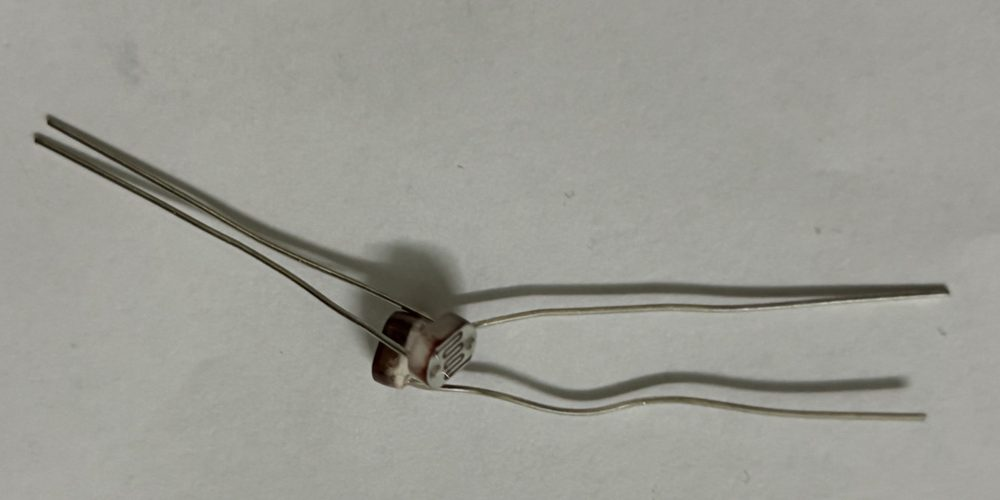

# Lab 5 · Quang trở (LDR) – cảm biến ánh sáng

> Đo cường độ ánh sáng bằng quang trở và Arduino Uno: đọc giá trị analog lên Serial Monitor, làm đèn ngủ tự bật khi trời tối, chỉnh độ sáng LED theo ánh sáng phòng, rồi dùng hai quang trở để servo tự xoay về phía sáng hơn. Đây là lab đầu tiên tự mắc **cầu chia áp** để đọc một cảm biến analog.

## Quang trở là gì

**Quang trở** (LDR – *Light Dependent Resistor*, hay *photoresistor*) là một điện trở có **giá trị thay đổi theo ánh sáng**: càng sáng thì điện trở càng **nhỏ**, càng tối thì điện trở càng **lớn**. Mặt trên có một đường ziczac màu cam làm bằng **cadmi sunfua (CdS)**. Ánh sáng chiếu vào giải phóng thêm điện tử tự do trong lớp CdS, nên dòng điện đi qua dễ hơn.

Loại hay gặp trong kit là **GL5528** (đường kính 5 mm):

| Thông số | GL5528 |
|---|---|
| Điện trở khi sáng (10 lux) | 8–20 kΩ |
| Điện trở khi tối hẳn | ≥ 1 MΩ |
| Điện trở dưới đèn bàn / nắng | ~1 kΩ hoặc nhỏ hơn |
| Thời gian đáp ứng | ~20 ms khi sáng lên, ~30 ms khi tối đi |
| Đỉnh nhạy | ~540 nm (ánh sáng xanh lá, gần mắt người) |
| Điện áp tối đa | 150 V DC |
| Phân cực | **Không** – cắm chiều nào cũng được |

{width=70%}

Kit dùng **quang trở trần** (không có mạch module), thân tròn dẹt khoảng 5 mm, hai chân dài và mềm. Hai chân giống hệt nhau, không có chân dài/ngắn hay dấu cực như LED. Chân rất dễ cong, nên vuốt thẳng trước khi cắm breadboard; có thể cắt ngắn bớt cho LDR đứng vững, nhưng chừa ít nhất 1 cm.

Quang trở rẻ và dễ dùng, nhưng **không chính xác**: hai con cùng mã có thể lệch nhau vài chục phần trăm, giá trị còn trôi theo nhiệt độ, và quan hệ giữa điện trở với lux là phi tuyến. Nó hợp để phân biệt **sáng / tối / rất sáng**, không hợp để đo lux chính xác (khi đó dùng cảm biến số như BH1750).

## Cầu chia áp

Arduino không đo trực tiếp được điện trở, chỉ đo được **điện áp** (`analogRead()` trả 0–1023 cho 0–5 V). Vì vậy phải biến thay đổi điện trở thành thay đổi điện áp bằng **cầu chia áp**: mắc quang trở nối tiếp một **điện trở cố định 10 kΩ** giữa `5V` và `GND`, lấy điện áp ở điểm giữa.

```
5V ──[ LDR ]──┬──[ 10 kΩ ]── GND
              │
              A0
```

Điện áp ở `A0`:

$$V_{A0} = 5\,\text{V} \times \frac{R_{10k}}{R_{LDR} + R_{10k}}$$

| Ánh sáng | $R_{LDR}$ | $V_{A0}$ | `analogRead(A0)` |
|---|---|---|---|
| Che kín bằng tay / tối | ~1 MΩ | ~0,05 V | ~10 |
| Phòng hơi tối | ~50 kΩ | ~0,8 V | ~170 |
| Phòng đủ sáng (~10 lux) | ~15 kΩ | ~2 V | ~410 |
| Dưới đèn bàn | ~2 kΩ | ~4,2 V | ~850 |
| Đèn flash điện thoại chiếu sát | ~0,5 kΩ | ~4,8 V | ~970 |

Với cách mắc này, **càng sáng thì số đọc càng lớn**, dễ hiểu khi đọc code. Nếu đổi chỗ LDR và điện trở 10 kΩ thì ngược lại: càng sáng số càng nhỏ.

**Vì sao chọn 10 kΩ.** Cầu chia áp nhạy nhất khi điện trở cố định xấp xỉ điện trở LDR ở mức sáng cần phân biệt. GL5528 khoảng 10–20 kΩ ở ánh sáng phòng, nên 10 kΩ cho dải đo rộng nhất trong nhà. Muốn phân biệt tốt các mức **tối** thì tăng lên 47–100 kΩ; muốn phân biệt tốt các mức **rất sáng** (ngoài trời) thì giảm xuống 1–2 kΩ.

Điện trở 10 kΩ có vòng màu **nâu – đen – cam – nhũ vàng**, khác với 220 Ω (đỏ – đỏ – nâu) dùng cho LED. Xem lại bảng màu ở bài [linh kiện điện tử cơ bản](../lectures/electronic-components.md).

## Linh kiện và chân

| Linh kiện | Số lượng | Ghi chú |
|---|---|---|
| Quang trở GL5528 | 1 | 2 chân, không phân cực |
| Điện trở 10 kΩ | 1 | Cầu chia áp |
| LED (đỏ hoặc vàng) + điện trở 220 Ω | 1 bộ | Dùng cho Test 2 và Test 3 |
| Breadboard, dây đực – đực | | |

Nối dây:

| Từ | Đến |
|---|---|
| Uno `5V` / `GND` | Thanh `+` / `−` breadboard |
| LDR chân 1 | Thanh `+` |
| LDR chân 2 | Một cột trống, gọi là **điểm giữa** |
| Điện trở 10 kΩ | Từ điểm giữa xuống thanh `−` |
| Điểm giữa | `A0` |
| LED (Test 2, 3) | `D9` → điện trở 220 Ω → chân dài LED; chân ngắn → thanh `−` |

LED cắm `D9` vì đây là chân có dấu `~`, dùng được `analogWrite()` ở Test 3. Lab này không dùng thư viện `Servo`, nên `D9` không bị chiếm Timer1 như [Lab 4](servo-sg90.md).

**Module quang trở.** Một số kit dùng module quang trở có mạch xanh với 3 hoặc 4 chân (`VCC`, `GND`, `AO`, `DO`) và một biến trở xanh. Module đã có sẵn cầu chia áp:

- `AO` → `A0`: dùng như code bên dưới, nhưng hầu hết module mắc LDR ở **phía dưới** cầu chia áp, nên **càng sáng số càng nhỏ**. Đảo điều kiện so sánh trong code cho phù hợp.
- `DO` → chân digital: chip so sánh **LM393** đưa ra `HIGH`/`LOW` theo ngưỡng chỉnh bằng biến trở trên module, đèn `DO-LED` trên module sáng khi qua ngưỡng. Đọc bằng `digitalRead()`, không cần code ngưỡng.

## Code

### Test 1 – đọc giá trị ánh sáng

```cpp
#define LDR_PIN A0

void setup() {
  Serial.begin(9600);
}

void loop() {
  int raw = analogRead(LDR_PIN);         // 0–1023
  float v = raw * 5.0 / 1023.0;          // đổi ra volt

  Serial.print("raw = ");
  Serial.print(raw);
  Serial.print("  V = ");
  Serial.print(v, 2);
  Serial.println(" V");
  delay(500);
}
```

**Cách kiểm tra:**

- Để bình thường trong phòng: số đọc nằm đâu đó giữa 300 và 700, tùy đèn phòng.
- Lấy tay che kín LDR: số giảm mạnh, có thể dưới 50.
- Bật đèn flash điện thoại chiếu sát: số tăng lên gần 1000.
- Mở **Tools → Serial Plotter** (cùng 9600 baud) sẽ thấy đồ thị lên xuống theo tay che. Serial Plotter vẽ mọi số trên một dòng, nên dòng `raw = ... V = ...` sẽ thành hai đường.

**Ghi lại 3 số** trên mạch thật: lúc che kín, lúc ánh sáng phòng, lúc chiếu flash. Test 2 cần các số này để chọn ngưỡng.

### Test 2 – đèn ngủ tự động

LED bật khi phòng **tối**, tắt khi **sáng**. Cách đơn giản nhất là so với một ngưỡng:

```cpp
if (raw < 300) digitalWrite(LED_PIN, HIGH);
else           digitalWrite(LED_PIN, LOW);
```

Nhưng khi ánh sáng nằm sát ngưỡng (trời chạng vạng, bóng người đi qua), nhiễu ADC làm `raw` nhảy 298, 301, 299… và LED **nháy liên tục**. Cách sửa là dùng **hai ngưỡng** (*hysteresis*, trễ): tối hơn 250 mới bật, sáng hơn 350 mới tắt, ở giữa thì giữ nguyên trạng thái cũ.

```cpp
#define LDR_PIN   A0
#define LED_PIN   9

#define NGUONG_BAT  250   // tối hơn mức này → bật đèn
#define NGUONG_TAT  350   // sáng hơn mức này → tắt đèn

bool denBat = false;

void setup() {
  Serial.begin(9600);
  pinMode(LED_PIN, OUTPUT);
}

void loop() {
  int raw = analogRead(LDR_PIN);

  if (!denBat && raw < NGUONG_BAT) {
    denBat = true;
    Serial.println("Toi -> BAT den");
  } else if (denBat && raw > NGUONG_TAT) {
    denBat = false;
    Serial.println("Sang -> TAT den");
  }
  digitalWrite(LED_PIN, denBat ? HIGH : LOW);

  Serial.print("raw = ");
  Serial.println(raw);
  delay(200);
}
```

Chọn hai ngưỡng theo số đã ghi ở Test 1: `NGUONG_BAT` khoảng 1/2 số đọc lúc ánh sáng phòng, `NGUONG_TAT` cao hơn `NGUONG_BAT` khoảng 50–100. Khoảng cách giữa hai ngưỡng càng lớn thì càng ít nháy, nhưng đèn phản ứng càng chậm.

**Cách kiểm tra:**

- Che dần LDR bằng tay: đến khi `raw` xuống dưới `NGUONG_BAT` thì LED sáng, Serial in `Toi -> BAT den` **một lần**.
- Hé tay ra một chút (để `raw` nằm giữa hai ngưỡng): LED **vẫn sáng**, không nháy.
- Bỏ tay ra hẳn: LED tắt, Serial in `Sang -> TAT den`.

**Đừng để LED chiếu vào LDR.** Nếu LED đặt sát và hướng về LDR, khi LED bật nó làm LDR "thấy sáng" và tắt lại, rồi lại tối và bật lại: mạch tự dao động. Đặt LED cách xa hoặc quay lưng LED về phía LDR.

### Test 3 – độ sáng LED theo ánh sáng phòng

Thay vì bật/tắt, cho LED **sáng dần** khi phòng tối dần, giống đèn màn hình điện thoại tự chỉnh độ sáng (nhưng ngược chiều: phòng tối thì đèn ngủ sáng hơn).

```cpp
#define LDR_PIN  A0
#define LED_PIN  9      // chân ~ để dùng analogWrite

// số đọc lúc che kín và lúc ánh sáng phòng (ghi ở Test 1)
#define RAW_TOI   50
#define RAW_SANG  600

void setup() {
  Serial.begin(9600);
  pinMode(LED_PIN, OUTPUT);
}

void loop() {
  int raw = analogRead(LDR_PIN);
  raw = constrain(raw, RAW_TOI, RAW_SANG);

  // tối (RAW_TOI) → sáng nhất 255, sáng (RAW_SANG) → tắt 0
  int doSang = map(raw, RAW_TOI, RAW_SANG, 255, 0);
  analogWrite(LED_PIN, doSang);

  Serial.print("raw = ");
  Serial.print(raw);
  Serial.print("  PWM = ");
  Serial.println(doSang);
  delay(50);
}
```

Giải thích:

- **`constrain()` trước `map()`**: `map()` không tự chặn, nên nếu `raw` vượt `RAW_SANG` thì kết quả âm, `analogWrite()` nhận số âm sẽ cho giá trị sai. Chặn trước cho chắc.
- **`map(raw, RAW_TOI, RAW_SANG, 255, 0)`**: đảo khoảng ra (255 → 0) để tối thì PWM lớn. Không cần viết `255 - map(...)`.
- **Hiệu chỉnh**: thay `RAW_TOI`, `RAW_SANG` bằng số đo thật. Nếu dùng nguyên 0–1023 thì LED gần như không bao giờ sáng hết cỡ hay tắt hẳn, vì trong phòng LDR hiếm khi xuống 0 hay lên 1023.
- **Mắt người cảm nhận độ sáng phi tuyến**: PWM 0 → 50 trông thay đổi nhiều, 200 → 255 gần như không khác. Muốn đều mắt hơn thì bình phương: `doSang = doSang * doSang / 255;` (đổi `doSang` sang `long` để tránh tràn số khi nhân, vì `int` trên Uno chỉ tới 32767).

### Test 4 – servo bám ánh sáng (2 quang trở)

Ghép quang trở với servo SG90 của [Lab 4](servo-sg90.md): hai LDR đặt cách nhau, servo tự xoay về phía **sáng hơn**. Đây là nguyên lý của tấm pin mặt trời bám nắng (*solar tracker*): khi hai LDR nhận ánh sáng bằng nhau thì tấm pin đang nhìn thẳng vào nguồn sáng.

| Linh kiện | Nối vào |
|---|---|
| Uno `5V` / `GND` | Thanh `+` / `−` phía dưới breadboard |
| LDR trái (cột 6–7) | Cột 7 → thanh `+`; cột 6 là điểm giữa → **`A0`** |
| Điện trở 10 kΩ trái | Cột 6 → thanh `−` |
| LDR phải (cột 24–25) | Cột 25 → thanh `+`; cột 24 là điểm giữa → **`A1`** |
| Điện trở 10 kΩ phải | Cột 24 → thanh `−` |
| Servo – tín hiệu | `D9` |
| Servo – đỏ / nâu | Thanh `+` / `−` (đầu bên phải breadboard) |

Mỗi LDR là một cầu chia áp riêng giống hệt Test 1, nên cả hai cho **số lớn khi sáng**.

```cpp
#include <Servo.h>

#define LDR_TRAI   A0
#define LDR_PHAI   A1
#define SERVO_PIN  9

#define VUNG_CHET  30   // chênh lệch nhỏ hơn mức này thì coi như cân bằng
#define BUOC       1    // mỗi lần xoay 1°

Servo myServo;
int goc = 90;           // bắt đầu ở giữa

void setup() {
  Serial.begin(9600);
  myServo.attach(SERVO_PIN);
  myServo.write(goc);
}

void loop() {
  int trai = analogRead(LDR_TRAI);
  int phai = analogRead(LDR_PHAI);
  int lech = trai - phai;            // > 0: bên trái sáng hơn

  if (lech > VUNG_CHET) {
    goc += BUOC;                     // quay về phía LDR trái
  } else if (lech < -VUNG_CHET) {
    goc -= BUOC;                     // quay về phía LDR phải
  }
  goc = constrain(goc, 0, 180);
  myServo.write(goc);

  Serial.print("trai = ");
  Serial.print(trai);
  Serial.print("  phai = ");
  Serial.print(phai);
  Serial.print("  goc = ");
  Serial.println(goc);
  delay(20);
}
```

Giải thích:

- **So sánh hai LDR với nhau, không so với ngưỡng cố định.** Trời sáng hay tối thì hai số cùng lên cùng xuống, chỉ có **hiệu** `trai - phai` cho biết nguồn sáng lệch về bên nào. Nhờ vậy mạch chạy được cả trong phòng lẫn ngoài nắng mà không cần hiệu chỉnh ngưỡng.
- **Xoay từng bước 1°** chứ không nhảy thẳng đến góc tính sẵn: mỗi vòng `loop()` servo nhích một chút về phía sáng hơn, đến khi hai LDR cân bằng thì dừng. Đây là vòng điều khiển phản hồi đơn giản nhất. Với `delay(20)`, quay hết 180° mất khoảng 3,6 s.
- **`VUNG_CHET`** (vùng chết) giống ý tưởng hysteresis ở Test 2: hai LDR không bao giờ cho số bằng hệt nhau (sai lệch giữa hai con, nhiễu ADC), nên nếu không có vùng chết servo sẽ lắc qua lắc lại quanh điểm cân bằng. Tăng lên nếu servo còn rung, giảm xuống nếu servo dừng chưa đúng hướng.
- **Chiều quay** phụ thuộc cách gắn LDR lên cánh tay servo. Nếu servo quay **ra xa** nguồn sáng thay vì về phía đó, đổi `goc += BUOC` thành `goc -= BUOC` và ngược lại (hoặc đổi chỗ dây `A0`/`A1`).

**Cách kiểm tra:**

- Để hai LDR cùng ánh sáng phòng: servo đứng yên ở 90°, `trai` và `phai` chênh nhau ít.
- Che LDR phải bằng tay: `phai` tụt, `lech` dương, servo quay dần về một phía và Serial in `goc` tăng dần.
- Che LDR trái: servo quay ngược lại.
- Chiếu đèn flash vào một bên: servo quay về phía đó rồi dừng ở đầu hành trình (0° hoặc 180°), vì trên breadboard hai LDR đứng yên, không bao giờ cân bằng lại được.

**Làm bám nắng thật.** Trên breadboard, LDR không gắn vào servo nên servo quay mãi đến cuối hành trình. Muốn servo **dừng đúng hướng** nguồn sáng thì gắn hai LDR lên cánh tay servo, quay lưng vào nhau hoặc ngăn giữa bằng một tấm bìa đứng (vách chắn). Khi cánh tay nhìn thẳng vào đèn thì hai LDR sáng bằng nhau, khi lệch thì vách chắn đổ bóng lên một con. Cách này cần dây dài từ LDR xuống breadboard.

Trong kit có đúng **hai quang trở**, đủ cho mạch này.

### Mở rộng: hiển thị lên LCD

Ghép với [Lab 2](lcd-i2c.md): LCD vẫn ở `A4`/`A5`, LDR ở `A0`. In một thanh mức sáng 16 ô:

```cpp
#include <Wire.h>
#include <LiquidCrystal_I2C.h>

LiquidCrystal_I2C lcd(0x27, 16, 2);

void setup() {
  lcd.init();
  lcd.backlight();
}

void loop() {
  int raw = analogRead(A0);
  int phanTram = map(raw, 0, 1023, 0, 100);
  int soO = map(raw, 0, 1023, 0, 16);

  lcd.setCursor(0, 0);
  lcd.print("Anh sang: ");
  lcd.print(phanTram);
  lcd.print(" %   ");

  lcd.setCursor(0, 1);
  for (int i = 0; i < 16; i++) {
    lcd.print(i < soO ? (char)255 : ' ');   // 255 = ô tô đen trong ROM HD44780
  }
  delay(200);
}
```

"%" ở đây chỉ là tỉ lệ điện áp, **không phải** phần trăm ánh sáng thật, vì quan hệ giữa điện áp và lux là phi tuyến.

## Ứng dụng của quang trở

| Lĩnh vực | Ví dụ | Quang trở làm gì |
|---|---|---|
| Chiếu sáng | Đèn đường, đèn sân vườn tự bật | Bật đèn khi trời tối, tắt khi sáng (chính là Test 2) |
| Điện thoại / màn hình | Tự chỉnh độ sáng màn hình | Đo ánh sáng môi trường (máy hiện đại dùng photodiode, cùng nguyên lý) |
| Năng lượng | Tấm pin mặt trời bám nắng | 2 quang trở hai bên, servo ([Lab 4](servo-sg90.md)) xoay về phía số đo lớn hơn (chính là Test 4) |
| An ninh | Báo động tia laser | Laser chiếu vào LDR, có người cắt ngang tia thì số đo tụt → báo động |
| Đồ chơi / robot | Robot dò line, robot đi theo ánh sáng | Đo ánh sáng phản xạ từ mặt sàn đen/trắng |
| Nông nghiệp | Nhà kính | Ghi lại số giờ nắng, kéo rèm che khi quá nắng |

### Trong hệ IoT

Quang trở là ví dụ điển hình của **cảm biến analog** ở tầng thiết bị: tín hiệu liên tục, phải qua **ADC** mới thành số, và phải **hiệu chỉnh** theo từng con cảm biến. Vài hướng ghép với các lab trước:

- **LDR + servo (Lab 4)**: rèm cửa tự đóng khi nắng gắt, mở khi trời dịu.
- **LDR + DHT11 (Lab 3) + LCD (Lab 2)**: trạm thời tiết mini hiển thị nhiệt độ, độ ẩm và mức sáng.
- **ESP8266/ESP32 thay Uno**: gửi số đo ánh sáng lên cloud mỗi phút để vẽ đồ thị ngày/đêm. Lưu ý ADC của ESP32 là 12 bit (0–4095) và tham chiếu 3,3 V, nên phải sửa lại các ngưỡng.

## Mô phỏng

Tinkercad Circuits có sẵn **Photoresistor** (tìm `photoresistor` hoặc `LDR` trong ô linh kiện):

1. Kéo *Arduino Uno R3*, *Breadboard small*, *Photoresistor*, một *Resistor* (đổi giá trị thành **10 kΩ**) và một *LED* + *Resistor 220 Ω* vào.
2. Nối như bảng ở trên.
3. Dán code Test 1, bấm **Start Simulation**, mở **Serial Monitor** ở dưới khung code.
4. **Bấm vào quang trở** lúc đang mô phỏng sẽ hiện thanh trượt độ sáng. Kéo sang trái (tối) thì `raw` giảm, sang phải (sáng) thì tăng.

Quang trở trong Tinkercad cho số đọc tuyến tính và không nhiễu, nên LED ở Test 2 sẽ không nháy kể cả khi chỉ dùng một ngưỡng. Hysteresis chỉ thấy tác dụng trên mạch thật.

Mạch Test 4 dựng trên Tinkercad:

{width=100%}

Đọc mạch theo từng đường:

- **Nguồn:** `5V` (dây đỏ) và `GND` (dây đen) của Uno đi vào thanh `+` và `−` phía dưới breadboard, ở đầu bên trái. Servo lấy điện từ đầu bên phải của cùng hai thanh này.
- **LDR trái:** hai chân cắm ở hàng `e`, cột 6 và 7. Cột 7 có dây đỏ xuống thanh `+`. Cột 6 có điện trở 10 kΩ (vòng nâu – đen – cam) xuống thanh `−`, và dây xanh nhạt từ hàng `c` đi về `A0`.
- **LDR phải:** giống hệt, ở cột 24 và 25. Dây xanh dương từ cột 24 chạy chéo qua breadboard về `A1`.
- **Servo:** dây xanh từ `D9` chạy vòng phía trên sang giắc servo. Dây đỏ và đen của servo đi xuống thanh `+`/`−`.

Lúc mô phỏng, bấm vào từng quang trở để kéo thanh trượt độ sáng riêng của nó. Kéo LDR trái sáng hơn LDR phải thì servo quay về một phía, kéo ngược lại thì servo quay về phía kia, kéo hai thanh bằng nhau thì servo dừng.

## Ảnh thực tế

### Video Test 4

<video controls muted playsinline preload="metadata" poster="../assets/ldr-servo-real-poster.jpg" style="display:block; max-width:360px; width:100%; margin:0 auto; border-radius:8px;">
  <source src="../assets/ldr-servo-real.mp4" type="video/mp4">
</video>

Mạch thật chạy code Test 4. Camera đi từ breadboard xuống servo:

- **Breadboard** ở trên cùng: hai quang trở cắm cách nhau, mỗi con có dây đỏ vòng lên thanh `+`, điện trở 10 kΩ xuống thanh `−` và dây vàng từ điểm giữa về `A0`/`A1`.
- **Arduino Uno** ở giữa, cắm cáp USB. Đèn `TX` nháy liên tục vì code in Serial mỗi 20 ms.
- **Servo SG90** nằm dưới cùng, cánh tay ban đầu nằm ngang (90°).

Kết quả:

- **Khoảng 5–9 s**: lấy ngón tay che quang trở bên phải. Cánh tay servo quay dần từ nằm ngang lên gần thẳng đứng, đúng kiểu nhích từng 1° một chứ không giật một phát.
- **Khoảng 9–12 s**: chuyển ngón tay sang che quang trở bên trái. Servo quay ngược lại về vị trí nằm ngang.

Che bên nào thì servo quay về một chiều, che bên kia thì quay chiều ngược lại, khớp với phần **Cách kiểm tra** của Test 4. Vì hai quang trở cắm cố định trên breadboard (không gắn lên cánh tay servo), servo không tự dừng lại ở hướng nguồn sáng mà cứ quay đến khi bỏ tay ra hoặc chạm đầu hành trình.

### Serial Monitor

Serial Monitor khi chạy code Test 4 trên mạch thật, buổi tối trong phòng đèn mờ:

{width=70%}

Đọc kết quả:

- **Số đọc rất thấp (8 và 13)**: phòng tối nên điện trở LDR lên cỡ vài trăm kΩ đến 1 MΩ, điểm giữa cầu chia áp chỉ còn khoảng 0,05 V. Khớp với dòng "che kín / tối" trong bảng ở phần cầu chia áp.
- **Hai LDR lệch nhau 5 đơn vị** dù cùng ánh sáng: đây là sai lệch giữa hai con quang trở (và hai điện trở 10 kΩ), đúng như đã nói ở phần giới thiệu.
- **Servo đứng yên ở 90°**: `lech = 8 - 13 = -5`, nhỏ hơn `VUNG_CHET = 30` nên code coi như cân bằng. Không có vùng chết thì servo đã nhích dần về phía LDR phải chỉ vì sai lệch linh kiện.
- Ở mức tối như vậy, che tay chỉ làm số giảm được vài đơn vị, nhỏ hơn vùng chết, nên servo hầu như không phản ứng. Video ở trên quay trong phòng sáng hơn nên che tay là servo quay ngay. Muốn thử trong phòng tối thì **chiếu đèn flash điện thoại** vào một bên. Nếu thường dùng mạch trong phòng tối, đổi điện trở 10 kΩ sang 47–100 kΩ hoặc giảm `VUNG_CHET`.

## Lỗi hay gặp

| Hiện tượng | Nguyên nhân / cách xử lý |
|---|---|
| Số đọc luôn 0 | Thiếu dây `5V` vào LDR, hoặc dây `A0` cắm vào thanh `−` |
| Số đọc luôn ~1023 | Thiếu điện trở 10 kΩ xuống `GND`, hoặc điện trở cắm lệch cột không chạm điểm giữa |
| Số đọc nhảy lung tung, chạm tay vào dây thì đổi | `A0` đang **thả nổi**: dây `A0` không chạm điểm giữa cầu chia áp |
| Che tay số chỉ đổi rất ít | Dùng nhầm điện trở 220 Ω thay vì 10 kΩ (đọc lại vòng màu), hoặc phòng quá tối/quá sáng so với điện trở đã chọn |
| Càng sáng số càng nhỏ | LDR và điện trở 10 kΩ bị đổi chỗ, hoặc dùng module có `AO` mắc ngược — đảo điều kiện trong code |
| LED nháy liên tục khi trời chạng vạng | Chỉ dùng một ngưỡng — dùng hysteresis như Test 2 |
| LED tự bật tắt liên tục dù không ai đụng | LED chiếu ánh sáng vào chính LDR — đặt LED xa hoặc quay hướng khác |
| Đèn phòng bật mà số đọc dao động nhẹ đều đặn | Đèn huỳnh quang/LED nhấp nháy 100 Hz theo điện lưới — lấy trung bình 10–20 lần đọc |
| `analogWrite()` chỉ bật/tắt, không sáng dần | LED cắm chân không có dấu `~` — chuyển sang `D3`, `D5`, `D6`, `D9`, `D10` hoặc `D11` |
