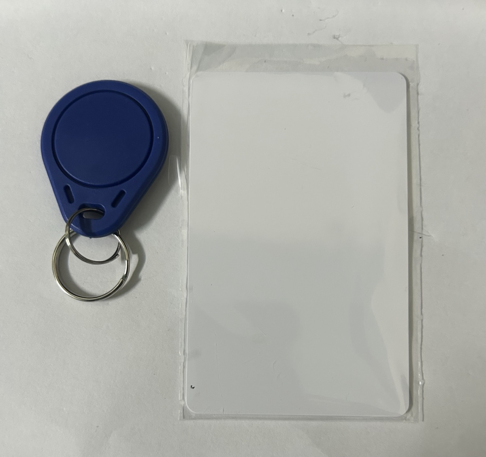
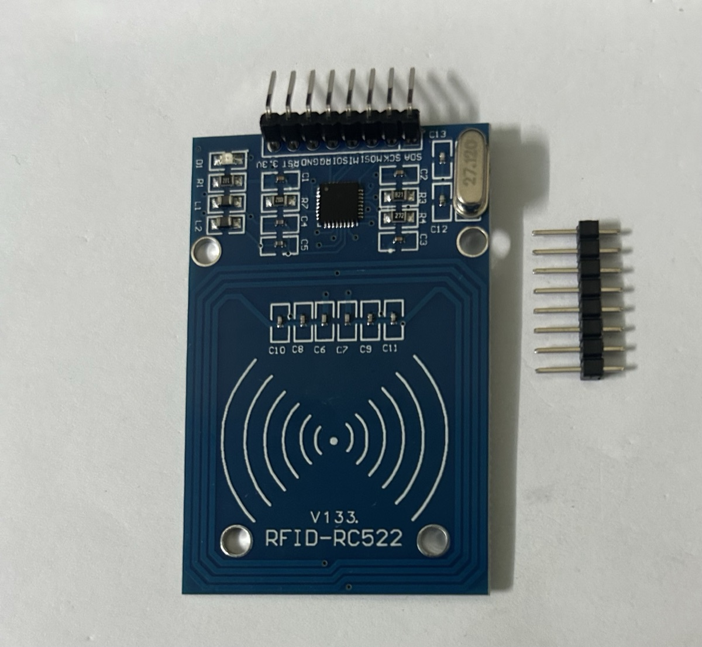

# Lab 10 · RFID: module RC522 + thẻ MIFARE Classic 1K

> Dùng module **RC522** với Arduino Uno để đọc thẻ RFID 13,56 MHz trong kit (thẻ trắng và móc khóa). Lab đi từ **đọc mã UID** của thẻ, sang **đọc/ghi dữ liệu** vào bộ nhớ thẻ, và cuối cùng ghép thành **khóa cửa quẹt thẻ**: thẻ hợp lệ thì servo mở khóa, đèn xanh và còi kêu một tiếng; thẻ lạ thì đèn đỏ và còi kêu ba tiếng. Đây cũng là lab đầu tiên dùng giao tiếp **SPI**.

## RFID là gì

**RFID** (*Radio Frequency Identification*) là nhận dạng bằng sóng vô tuyến. Một hệ RFID có hai phần:

| | Đầu đọc (reader) | Thẻ (tag) |
|---|---|---|
| Trong lab | Module RC522 | Thẻ trắng |
| Nguồn điện | Lấy từ Arduino | **Không có pin** (thẻ thụ động) |
| Thành phần | Chip MFRC522 + anten in trên mạch | Chip nhỏ + cuộn dây anten bên trong vỏ nhựa |

Thẻ không có pin, vậy lấy điện ở đâu? Anten của đầu đọc tạo ra một **từ trường xoay chiều 13,56 MHz**. Khi đưa thẻ lại gần, cuộn dây trong thẻ nằm trong từ trường này và **sinh ra dòng điện cảm ứng** (giống máy biến áp không có lõi), đủ để nuôi chip trong thẻ. Chip trả lời bằng cách **thay đổi tải** trên cuộn dây của mình, đầu đọc nhận ra thay đổi đó thành dữ liệu.

Vì năng lượng truyền bằng cảm ứng nên **tầm đọc rất ngắn**, chỉ khoảng **0–5 cm** với RC522. Đây là điểm cố ý của chuẩn 13,56 MHz: thẻ phải chạm gần mới đọc được, nên khó bị đọc trộm từ xa.

### Các dải tần RFID

| Dải tần | Tầm đọc | Ví dụ |
|---|---|---|
| **LF 125 kHz** | ~10 cm | Thẻ chấm công, thẻ thang máy đời cũ (EM4100). Chỉ có mã số, không ghi được |
| **HF 13,56 MHz** | ~0–10 cm | **Thẻ trong lab (MIFARE)**, thẻ xe buýt, thẻ ngân hàng không chạm, **NFC** trên điện thoại, CCCD gắn chip |
| **UHF 860–960 MHz** | 1–10 m | Tem hàng hóa trong kho, thu phí không dừng (ETC) |

RC522 chỉ đọc dải **13,56 MHz** theo chuẩn **ISO/IEC 14443A**. Thẻ 125 kHz (thẻ chấm công dày, thường in số trên mặt) **không đọc được** bằng RC522.

**NFC** trên điện thoại là một nhánh của RFID 13,56 MHz. Điện thoại Android có NFC đọc được thẻ trong kit bằng app như *NFC Tools* hay *MIFARE Classic Tool*, tiện để kiểm tra chéo kết quả ở Phần A.

## Thẻ MIFARE Classic 1K

Thẻ trắng trong kit là **MIFARE Classic 1K** (còn gọi là **S50**), loại thẻ 13,56 MHz phổ biến nhất. (Móc khóa đi kèm thì RC522 không đọc được, xem [Test A1](#test-a1--kiểm-tra-module-và-đọc-uid).)

### UID

Mỗi thẻ có một **UID** (*Unique Identifier*) dài **4 byte**, ghi sẵn từ nhà máy, ví dụ `A3 5F 1C 0B`. Phần A chỉ đọc UID này. Đa số hệ thống gửi xe, khóa cửa giá rẻ chỉ dựa vào UID để nhận thẻ.

⚠️ UID **không phải là bí mật**: bất kỳ đầu đọc nào cũng đọc được, và có loại thẻ "magic" (thẻ UID đổi được) cho phép chép UID sang thẻ khác. Hệ thống dùng UID làm khóa cửa (như Phần C) chỉ phù hợp cho mục đích học tập hoặc độ an toàn thấp.

### Bộ nhớ: 16 sector × 4 block × 16 byte {#mifare-memory}

Bộ nhớ 1 KB (1024 byte) chia thành **16 sector**, mỗi sector có **4 block**, mỗi block **16 byte**. Block được đánh số liên tục từ 0 đến 63:

```
Sector 0   block 0   [UID + dữ liệu nhà sản xuất]   ← chỉ đọc
           block 1   [dữ liệu]
           block 2   [dữ liệu]
           block 3   [Key A | Access bits | Key B]   ← sector trailer
Sector 1   block 4   [dữ liệu]                       ← Phần B ghi vào đây
           block 5   [dữ liệu]
           block 6   [dữ liệu]
           block 7   [Key A | Access bits | Key B]   ← sector trailer
...
Sector 15  block 60–62 [dữ liệu], block 63 [trailer]
```

- **Block 0** chứa UID, khóa cứng từ nhà máy, không ghi được.
- **Block cuối của mỗi sector** (3, 7, 11, …, 63) là **sector trailer**: chứa hai khóa **Key A**, **Key B** (6 byte mỗi khóa) và các **access bits** quy định ai được đọc/ghi block nào.
- Còn lại **47 block dữ liệu** (16 sector × 3 block − block 0), tổng cộng 752 byte ghi được.

### Xác thực trước khi đọc/ghi

Muốn đọc hoặc ghi một block, đầu đọc phải **xác thực** (*authenticate*) với sector chứa block đó bằng Key A hoặc Key B. Thẻ mới xuất xưởng có cả hai khóa là **`FF FF FF FF FF FF`**, nên code trong lab dùng khóa này.

⚠️ **Không ghi vào sector trailer** (block 3, 7, 11, …) khi chưa hiểu rõ access bits. Ghi sai access bits hoặc quên khóa mới là **khóa vĩnh viễn** cả sector đó, không có cách mở lại. Code Phần B chặn sẵn việc ghi vào trailer.

Thuật toán mã hóa của MIFARE Classic (*Crypto1*) đã bị bẻ khóa từ năm 2008, nên thẻ này **không an toàn** cho thanh toán hay kiểm soát ra vào quan trọng. Hệ thống mới dùng **MIFARE DESFire** hoặc **MIFARE Plus** với mã hóa AES.

## Module RC522

{width=75%}

Bộ RFID trong kit gồm:

- **Module `RFID-RC522`** (in `V133` trên mạch), mạch xanh dương:
  - **Nửa dưới** là **anten in trên mạch**: đường đồng chạy vòng quanh mép, bên trong in hình sóng radio. Đây là chỗ đặt thẻ.
  - **Nửa trên** là **chip MFRC522** (con chip vuông 32 chân ở giữa), **thạch anh `27.120`** MHz (vỏ kim loại bên phải, đúng bằng 2 × 13,56 MHz), một **LED nguồn `D1`** ở góc trái và hàng 8 lỗ chân dọc mép trên.
- **Hai hàng chân 8 pin** (*pin header*) để rời: một hàng **thẳng**, một hàng **cong 90°**. Module bán ra **chưa hàn chân**, chỉ dùng **một** trong hai hàng (xem [Hàn chân header](#rc522-header)).
- **Thẻ trắng** cỡ thẻ ATM và **móc khóa xanh dương** (*keyfob*). Thẻ trắng là MIFARE Classic 1K 13,56 MHz. **Móc khóa trong kit thì RC522 không đọc được** (đã thử ở [Test A1](#test-a1--kiểm-tra-module-và-đọc-uid)), nhiều khả năng là loại 125 kHz dù vỏ giống hệt loại 13,56 MHz.

{width=55%}

Thẻ **không cần bóc túi nilon** để đọc, sóng đi xuyên qua nilon dễ dàng (và qua cả ví, vỏ điện thoại bằng nhựa).

**8 chân**, nhãn in ngay dưới hàng lỗ. Nhìn mặt có linh kiện, **anten ở dưới, hàng lỗ ở trên**: nhãn bị in **lộn ngược**, đọc từ **phải sang trái** là `SDA` · `SCK` · `MOSI` · `MISO` · `IRQ` · `GND` · `RST` · `3.3V`. Nói cách khác, **`SDA` là chân sát thạch anh** (lỗ có **pad vuông**, chân số 1), **`3.3V` là chân sát LED `D1`**. Hai chân dễ cắm nhầm nhất, `GND` và `3.3V`, nằm ở đầu phía LED.

```
   phía LED D1                                      phía thạch anh
   3.3V   RST   GND   IRQ   MISO  MOSI  SCK   SDA ■   (■ = pad vuông, chân 1)
    ○      ○     ○     ○     ○     ○     ○     □
   ┌─────────────────────────────────────────────┐
   │  D1      chip MFRC522              27.120   │
   │                                             │
   │             ~~~ anten ~~~                   │
   └─────────────────────────────────────────────┘
```

Bảng chức năng và cách nối:

| Chân | Chức năng | Nối vào Uno |
|---|---|---|
| `SDA` | Chọn chip SPI (SS / CS). Tên `SDA` vì chip cũng hỗ trợ I²C, nhưng module nối sẵn để chạy SPI | `D10` |
| `SCK` | Xung nhịp SPI | `D13` |
| `MOSI` | Dữ liệu Uno → RC522 | `D11` |
| `MISO` | Dữ liệu RC522 → Uno | `D12` |
| `IRQ` | Báo ngắt | **Không nối** |
| `GND` | Mass | `GND` |
| `RST` | Reset chip | `D9` |
| `3.3V` | Nguồn | **`3.3V`** |

| Thông số | RC522 |
|---|---|
| Điện áp nguồn | **3,3 V** |
| Dòng tiêu thụ | 13–26 mA khi đọc |
| Tần số | 13,56 MHz |
| Chuẩn thẻ | ISO/IEC 14443A (MIFARE Classic, Ultralight, NTAG…) |
| Tầm đọc | 0–5 cm (thẻ), ngắn hơn với móc khóa |
| Giao tiếp | SPI (tới 10 Mbit/s), I²C, UART. Module nối sẵn cho SPI |

⚠️ **Nguồn của RC522 là 3,3 V, không phải 5 V.** Cắm `3.3V` của module vào `5V` của Uno có thể làm hỏng chip. Đây là module đầu tiên trong kit cần chú ý điều này.

Còn các **chân tín hiệu** (`SCK`, `MOSI`, `SDA`, `RST`) thì nhận mức 5 V từ Uno. Datasheet MFRC522 không ghi là chịu được 5 V, nhưng nối thẳng như trên là cách làm phổ biến và chạy ổn trong thực tế. Muốn đúng chuẩn thì đặt **module chuyển mức logic** (*logic level shifter*) 5 V ↔ 3,3 V ở giữa. Chiều ngược lại, `MISO` ra mức 3,3 V, Uno vẫn đọc là `HIGH` (ngưỡng ~3 V, xem bảng điện áp ở [Lab 8](infrared-remote-fc51.md#low-là-bao-nhiêu-volt)).

### Hàn chân header {#rc522-header}

Module bán ra chưa có chân. **Phải hàn** chứ không cắm hờ dây vào lỗ được: tiếp xúc lỏng làm SPI lúc chạy lúc không, Serial báo `0x00` / `0xFF` và rất khó tìm ra lỗi.

**Chọn hàng chân nào?**

| | Hàng **cong 90°** (khuyên dùng) | Hàng **thẳng** |
|---|---|---|
| Sau khi hàn | Chân chĩa **ngang ra ngoài mép**, song song mặt mạch | Chân chĩa **thẳng xuống** dưới mặt mạch |
| Cách dùng | Module **nằm phẳng trên bàn**, nối Uno bằng **dây đực – cái** | Cắm module **nằm sấp** lên breadboard |
| Ưu điểm | Mặt anten luôn ngửa lên, đặt thẻ lên dễ; breadboard trống cho LED, buzzer, servo | Không cần dây đực – cái, cắm vào là xong |
| Nhược điểm | Cần 7 dây đực – cái | Module che mất ~8 hàng breadboard; mặt có linh kiện úp xuống, nhưng vẫn đặt thẻ ở mặt trên được |

Lab này dùng **hàng cong 90°**, giống ảnh dưới:

{width=65%}

Các bước:

1. **Đặt hàng chân từ mặt có linh kiện** (mặt có nhãn chữ): thanh nhựa đen nằm sát mặt này, **đầu chân ngắn** xuyên qua lỗ ra mặt sau, **đầu cong dài chĩa ra ngoài mép**, không chĩa vào trong đè lên chip. Đúng như ảnh trên.
2. **Cố định** hàng chân cho vuông góc mép mạch: kẹp bằng kẹp giấy, dán băng dính giấy, hoặc lật úp module rồi kê đầu chân dài lên một cục tẩy cho mạch nằm cân.
3. **Lật ra mặt sau, hàn một chân ở đầu** (ví dụ `SDA`) trước. Nhìn lại: nếu hàng chân bị nghiêng thì vừa chạm mỏ hàn vào mối hàn vừa chỉnh lại cho thẳng. Hàn chân **ở đầu kia** (`3.3V`), kiểm tra lần nữa.
4. Hàn **6 chân còn lại**. Mỏ hàn ~320–350 °C, áp mỏ vào **cả chân lẫn pad** 1–2 giây rồi mới đưa thiếc vào, thiếc tự chảy quanh chân. Tổng thời gian mỗi mối dưới 3–4 giây để không làm bong pad.
5. **Kiểm tra mối hàn:**
   - Mối tốt có hình **nón nhỏ, bóng**, bao kín pad. Mối dạng **cục tròn** chỉ đậu trên chân, hoặc **xám sần** là hàn nguội: hàn lại.
   - Các chân cách nhau chỉ **2,54 mm**: soi kỹ **không có thiếc nối hai chân cạnh nhau**, nhất là `GND`–`RST`–`3.3V`. Có cầu thiếc thì kéo mỏ hàn sạch dọc khe giữa hai chân để tách.
   - Nếu có đồng hồ vạn năng: để chế độ thông mạch (kêu bíp), đo `3.3V` với `GND`: **không được kêu**. Kêu là đang chập, phải sửa trước khi cắm điện.

Chưa có mỏ hàn thì nhờ thầy / phòng lab hàn giúp, hoặc mua module **đã hàn sẵn chân** (đắt hơn vài nghìn đồng). Cách "chữa cháy" là bẻ chân để cắm nghiêng vào lỗ cho chân tì vào thành lỗ, nhưng chỉ đủ để thử nhanh, không đủ tin cậy cho cả lab.

### SPI là gì

Các lab trước đã gặp nhiều cách giao tiếp: `digitalRead()` một chân ([Lab 8](infrared-remote-fc51.md)), giao thức 1 dây của DHT11 ([Lab 3](dht11.md)), I²C 2 dây của LCD ([Lab 2](lcd-i2c.md)), dịch bit qua 74HC595 ([Lab 7](seven-segment-5641as.md)). RC522 dùng **SPI** (*Serial Peripheral Interface*): 4 dây, nhanh hơn I²C nhiều.

```
         Uno (master)                 RC522 (slave)
   D13 SCK  ───────────────────────▶  SCK     xung nhịp, do master tạo
   D11 MOSI ───────────────────────▶  MOSI    master gửi
   D12 MISO ◀───────────────────────  MISO    slave trả lời
   D10 SS   ───────────────────────▶  SDA     LOW = "tôi đang nói với bạn"
```

| | I²C (LCD, Lab 2) | SPI (RC522) |
|---|---|---|
| Số dây tín hiệu | 2 (`SDA`, `SCL`) | 4 (`SCK`, `MOSI`, `MISO`, `SS`) |
| Chọn thiết bị | Bằng **địa chỉ** gửi trên dây | Bằng **một chân SS riêng** cho mỗi thiết bị |
| Tốc độ thường dùng | 100–400 kbit/s | 1–10 Mbit/s |
| Chân trên Uno | `A4`, `A5` | **Cố định** `D11`, `D12`, `D13`; `SS` chọn tùy ý |

Chân `SCK`, `MOSI`, `MISO` trên Uno **cố định** vì nối với bộ SPI phần cứng bên trong ATmega328P, không đổi được. Chân `SS` thì chọn chân digital nào cũng được, lab dùng `D10` theo thói quen. Cũng 3 chân này có trên **header ICSP** 6 chân ở cuối board.

**Hệ quả:** `D13` đã thành `SCK`, nên **LED `L` trên board sẽ nháy mờ** mỗi khi Arduino nói chuyện với RC522. Đó là bình thường, không phải lỗi. Lab này **không dùng** LED `L` làm đèn báo.

## Linh kiện và chân

| Linh kiện | Số lượng | Ghi chú |
|---|---|---|
| Arduino Uno + cáp USB | 1 | |
| Module RC522 + thẻ trắng + móc khóa | 1 bộ | Đã hàn hàng chân cong 90° ([cách hàn](#rc522-header)) |
| LED xanh lá, LED đỏ + 2 điện trở 220 Ω | 1 bộ | Phần C |
| Buzzer | 1 | Phần C |
| Servo SG90 | 1 | Phần C, làm chốt khóa |
| Breadboard, dây đực – đực, dây đực – cái | | Dây đực – cái để nối thẳng vào header RC522 |

Nối dây đầy đủ (Phần A, B chỉ cần RC522):

| Linh kiện | Chân | Nối vào Uno |
|---|---|---|
| RC522 | `SDA` | `D10` |
| RC522 | `SCK` | `D13` |
| RC522 | `MOSI` | `D11` |
| RC522 | `MISO` | `D12` |
| RC522 | `IRQ` | (bỏ trống) |
| RC522 | `GND` | `GND` |
| RC522 | `RST` | `D9` |
| RC522 | `3.3V` | **`3.3V`** |
| LED xanh lá | Chân dài qua 220 Ω | `D5` |
| LED đỏ | Chân dài qua 220 Ω | `D6` |
| Buzzer | Chân `+` (dài) | `D7` |
| Servo | Cam (tín hiệu) | `D3` |
| Servo | Đỏ | `5V` |
| LED, buzzer, servo | Chân âm / nâu | `GND` |

Giải thích cách chọn chân:

- `D10`–`D13` dành cho SPI, `D9` cho `RST`: đây là cách nối mặc định trong ví dụ của thư viện, nên đọc tài liệu trên mạng sẽ khớp.
- **Servo ở `D3`**, không phải `D9` như [Lab 4](servo-sg90.md), vì `D9` đã là `RST`. Thư viện `Servo` tạo xung trên chân nào cũng được.
- Thư viện `Servo` chiếm Timer1, `tone()` chiếm Timer2: hai thứ không tranh nhau. `D5`, `D6` vẫn dùng bình thường.
- **RC522 nối `3.3V`**, các module còn lại nối `5V`. Không kéo chung một thanh nguồn cho tất cả.

## Cài thư viện

Arduino IDE → **Tools → Manage Libraries** → tìm **MFRC522** → cài bản của **GithubCommunity** (tác giả gốc *miguelbalboa*), bản 1.4.x.

Thư viện này đã ngừng phát triển nhưng vẫn là bản được dùng nhiều nhất, ví dụ trên mạng gần như đều viết cho nó. Có một bản mới tên **MFRC522v2** với cú pháp khác (`MFRC522DriverPinSimple`, `MFRC522DriverSPI`…): code trong lab **không** dùng bản đó, nếu lỡ cài thì gỡ ra để tránh nhầm.

`SPI.h` có sẵn trong Arduino IDE, không cần cài.

## Phần A – Đọc UID của thẻ

### Test A1 – kiểm tra module và đọc UID

```cpp
#include <SPI.h>
#include <MFRC522.h>

#define SS_PIN  10
#define RST_PIN 9

MFRC522 rfid(SS_PIN, RST_PIN);

void setup() {
  Serial.begin(9600);
  SPI.begin();
  rfid.PCD_Init();
  delay(10);
  rfid.PCD_DumpVersionToSerial();   // in phiên bản chip, để biết đã nối đúng chưa
  Serial.println("Hay dua the lai gan dau doc...");
}

void loop() {
  // 1. Có thẻ mới trong vùng đọc không?
  if (!rfid.PICC_IsNewCardPresent()) return;
  // 2. Đọc UID của thẻ đó
  if (!rfid.PICC_ReadCardSerial()) return;

  Serial.print("UID:");
  for (byte i = 0; i < rfid.uid.size; i++) {
    Serial.print(rfid.uid.uidByte[i] < 0x10 ? " 0" : " ");
    Serial.print(rfid.uid.uidByte[i], HEX);
  }

  MFRC522::PICC_Type type = rfid.PICC_GetType(rfid.uid.sak);
  Serial.print("   | loai the: ");
  Serial.println(rfid.PICC_GetTypeName(type));

  rfid.PICC_HaltA();        // cho thẻ "ngủ", không đọc lại liên tục
  rfid.PCD_StopCrypto1();
}
```

Giải thích:

- Thư viện gọi đầu đọc là **PCD** (*Proximity Coupling Device*) và thẻ là **PICC** (*Proximity Integrated Circuit Card*), theo tên trong chuẩn ISO 14443. Hàm bắt đầu bằng `PCD_` làm việc với module, `PICC_` làm việc với thẻ.
- **`PCD_DumpVersionToSerial()`** đọc thanh ghi phiên bản của chip. Đây là bước kiểm tra dây quan trọng nhất:

  | Serial in | Ý nghĩa |
  |---|---|
  | `Firmware Version: 0x92 = v2.0` hoặc `0x91 = v1.0` | Chip MFRC522 chính hãng, dây SPI đúng |
  | `0x12`, `0x82`, `0x88`, `0xB2` … `= (unknown)` | **Chip clone**, rất hay gặp trên module giá rẻ. Thường vẫn đọc thẻ bình thường. Module trong kit là `0x82` |
  | `0x00` hoặc `0xFF` kèm `WARNING: Communication failure` | **Không nói chuyện được với chip**: sai dây, chưa hàn header, hoặc chưa cấp nguồn |

- **`PICC_IsNewCardPresent()`** gửi lệnh tìm thẻ; **`PICC_ReadCardSerial()`** chọn thẻ đó và đọc UID vào `rfid.uid`. Phải gọi cả hai, theo đúng thứ tự.
- **`rfid.uid.sak`** (*Select Acknowledge*) là byte thẻ trả về khi được chọn, cho biết loại thẻ. `PICC_GetTypeName()` đổi ra chữ, ví dụ `MIFARE 1KB`.
- **`PICC_HaltA()`** đưa thẻ vào trạng thái nghỉ. Nếu bỏ dòng này, giữ thẻ trên đầu đọc sẽ không in liên tục mà in xen kẽ, vì thẻ bị chọn lại ở mỗi vòng `loop()`.
- `uidByte[i] < 0x10` thêm số `0` đằng trước để byte `0x0B` in ra `0B` chứ không phải `B`, cho UID luôn đủ 2 ký tự mỗi byte.

**Cách kiểm tra:** nạp code, mở Serial Monitor (baud **9600**). Dòng đầu tiên phải là phiên bản chip (không phải `0x00` / `0xFF`). Đặt thẻ trắng **phẳng, sát** lên mặt anten, rồi đến móc khóa. Kết quả thật trên module trong kit:

{width=70%}

- Module trong kit báo **`0x82 = (unknown)`**: chip **clone**, không phải MFRC522 chính hãng (`0x91` / `0x92`). Không có dòng `WARNING`, và thẻ vẫn đọc bình thường, nên bỏ qua chữ `unknown`.
- Thẻ được nhận đúng là **MIFARE 1KB**. UID 4 byte `5A 4D E5 8B` là của **thẻ trắng**.

- **Móc khóa xanh dương trong kit không đọc được**, kể cả khi đặt phẳng, chạm hẳn giữa anten và đã tăng độ nhạy anten lên tối đa (xem dưới). Nhiều khả năng móc khóa là loại **125 kHz** (EM4100) có vỏ giống hệt loại 13,56 MHz, mà RC522 không đọc được dải này. Cách kiểm tra: áp móc khóa vào điện thoại Android có NFC; điện thoại không phản ứng (trong khi thẻ trắng thì có) là móc khóa 125 kHz.

**Ghi lại UID của các thẻ đọc được**, Phần C cần dùng.

**Tăng độ nhạy anten.** Module clone thường đọc yếu, nhất là với móc khóa có anten nhỏ. Thêm một dòng ngay sau `rfid.PCD_Init();`:

```cpp
rfid.PCD_SetAntennaGain(rfid.RxGain_max);   // độ nhạy thu tối đa (48 dB)
```

Lần chạy đầu tiên, Serial báo `Firmware Version: 0x0` kèm `WARNING: Communication failure` dù đèn `D1` đã sáng: module có điện nhưng dây SPI chưa đúng. Dò lại từng dây theo **nhãn in trên mạch** (xem bảng [Lỗi hay gặp](#lỗi-hay-gặp)) thì chạy.

### Test A2 – xem toàn bộ bộ nhớ thẻ

Thư viện có sẵn ví dụ **File → Examples → MFRC522 → DumpInfo**. Nạp ví dụ này, đặt thẻ lên đầu đọc và **giữ yên khoảng 2 giây**: Serial in ra cả 64 block của thẻ dưới dạng bảng, sector 15 ở trên cùng, sector 0 ở dưới cùng.

Đối chiếu với phần [bộ nhớ](#mifare-memory):

- **Block 0**: 4 byte đầu chính là UID đã đọc ở Test A1.
- **Block 3, 7, …, 63** (trailer): đều có dạng `00 00 00 00 00 00  FF 07 80 69  FF FF FF FF FF FF`. Key A luôn hiển thị là `00` vì thẻ không cho đọc Key A, `FF 07 80 69` là access bits mặc định, Key B là `FF…FF`.
- Các block dữ liệu khác của thẻ mới đều là `00`.

Nếu Serial in `MIFARE_Read() failed: Timeout` hoặc `Authentication failed` ở giữa chừng: thẻ bị nhấc ra trước khi đọc xong. Đặt lại và giữ yên lâu hơn.

## Phần B – Ghi và đọc dữ liệu trên thẻ

Biến thẻ thành "bộ nhớ bỏ túi": gõ một dòng chữ (tối đa 16 ký tự) vào Serial Monitor, chạm thẻ để ghi vào **block 4**. Từ đó, mỗi lần chạm thẻ, Arduino đọc lại và in ra dòng chữ đã ghi.

### Test B1 – ghi tên lên thẻ

```cpp
#include <SPI.h>
#include <MFRC522.h>

#define SS_PIN  10
#define RST_PIN 9
#define BLOCK   4        // block dữ liệu đầu tiên của sector 1

MFRC522 rfid(SS_PIN, RST_PIN);
MFRC522::MIFARE_Key key;
String pending = "";     // chữ đang chờ ghi vào thẻ tiếp theo

void setup() {
  Serial.begin(9600);
  SPI.begin();
  rfid.PCD_Init();
  for (byte i = 0; i < 6; i++) key.keyByte[i] = 0xFF;   // khóa mặc định FF FF FF FF FF FF
  Serial.println("Cham the de doc. Go chu (toi da 16 ky tu) + Enter de ghi.");
}

bool isTrailer(byte block) { return block % 4 == 3; }

void handleCard() {
  // 1. Xác thực với sector chứa BLOCK bằng Key A
  MFRC522::StatusCode st = rfid.PCD_Authenticate(
      MFRC522::PICC_CMD_MF_AUTH_KEY_A, BLOCK, &key, &rfid.uid);
  if (st != MFRC522::STATUS_OK) {
    Serial.print("Xac thuc loi: ");
    Serial.println(rfid.GetStatusCodeName(st));
    return;
  }

  // 2. Nếu có chữ đang chờ thì ghi trước
  if (pending.length() > 0) {
    if (BLOCK == 0 || isTrailer(BLOCK)) {
      Serial.println("Khong ghi vao block 0 / sector trailer!");
      return;
    }
    byte data[16];
    for (byte i = 0; i < 16; i++) data[i] = i < pending.length() ? pending[i] : ' ';
    st = rfid.MIFARE_Write(BLOCK, data, 16);
    Serial.print("Ghi: ");
    if (st == MFRC522::STATUS_OK) Serial.println("OK");
    else Serial.println(rfid.GetStatusCodeName(st));
    if (st == MFRC522::STATUS_OK) pending = "";
  }

  // 3. Đọc lại block
  byte buf[18];          // 16 byte dữ liệu + 2 byte CRC
  byte size = sizeof(buf);
  st = rfid.MIFARE_Read(BLOCK, buf, &size);
  if (st != MFRC522::STATUS_OK) {
    Serial.print("Doc loi: ");
    Serial.println(rfid.GetStatusCodeName(st));
    return;
  }
  Serial.print("Block "); Serial.print(BLOCK); Serial.print(": \"");
  for (byte i = 0; i < 16; i++) Serial.write(buf[i] >= 32 && buf[i] < 127 ? buf[i] : '.');
  Serial.print("\"   hex:");
  for (byte i = 0; i < 16; i++) {
    Serial.print(buf[i] < 0x10 ? " 0" : " ");
    Serial.print(buf[i], HEX);
  }
  Serial.println();
}

void loop() {
  if (Serial.available()) {
    pending = Serial.readStringUntil('\n');
    pending.trim();
    if (pending.length() > 16) pending = pending.substring(0, 16);
    Serial.print("Se ghi \""); Serial.print(pending); Serial.println("\" vao the tiep theo");
  }

  if (!rfid.PICC_IsNewCardPresent() || !rfid.PICC_ReadCardSerial()) return;

  if (rfid.PICC_GetType(rfid.uid.sak) != MFRC522::PICC_TYPE_MIFARE_1K) {
    Serial.println("Khong phai the MIFARE Classic 1K, bo qua");
  } else {
    handleCard();
  }
  rfid.PICC_HaltA();
  rfid.PCD_StopCrypto1();   // bắt buộc sau khi đã xác thực
}
```

Giải thích:

- **`MIFARE_Key key`** chứa 6 byte khóa, đặt hết là `0xFF` cho thẻ mới.
- **`PCD_Authenticate(KEY_A, BLOCK, …)`** xác thực với **cả sector** chứa `BLOCK` (block 4 → sector 1). Sau khi xác thực, đọc/ghi được block 4, 5, 6 mà không cần xác thực lại. Muốn chuyển sang sector khác thì phải xác thực lại.
- **`MIFARE_Write()`** luôn ghi **đủ 16 byte**. Chữ ngắn hơn 16 ký tự được đệm bằng dấu cách.
- **`MIFARE_Read()`** cần bộ đệm **18 byte**: 16 byte dữ liệu và 2 byte CRC thẻ gửi kèm. Đưa mảng 16 byte vào sẽ báo lỗi `STATUS_NO_ROOM`.
- **`isTrailer()`**: block trailer có số thứ tự chia 4 dư 3. Đổi `BLOCK` thành 3, 7, … thì code từ chối ghi, tránh khóa hỏng thẻ.
- **`PCD_StopCrypto1()`** tắt mã hóa sau khi đã xác thực. Thiếu dòng này thì lần chạm thẻ sau (kể cả thẻ khác) sẽ báo lỗi xác thực.
- In ra cả dạng chữ lẫn hex. Byte không in được (như `00` của thẻ mới) hiện thành dấu `.`.

**Cách kiểm tra:**

1. Serial Monitor để **baud 9600**, ô kết thúc dòng chọn **Newline** (góc dưới bên phải).
2. Chạm thẻ trắng: thẻ mới in `Block 4: "................"` và hex toàn `00`.
3. Gõ `Xin chao IoT` rồi Enter. Serial in `Se ghi "Xin chao IoT" vao the tiep theo`.
4. Chạm thẻ trắng: in `Ghi: OK` rồi `Block 4: "Xin chao IoT    "`.
5. **Rút USB, cắm lại**, chạm thẻ trắng lần nữa: chữ vẫn còn. Dữ liệu nằm **trong thẻ**, không phải trong Arduino.
6. Chạm một thẻ 13,56 MHz khác (nếu có): vẫn là `....`, vì đó là thẻ khác.

Gõ tiếng Việt có dấu sẽ bị cắt ngắn và hiện sai: mỗi chữ có dấu chiếm 2–3 byte UTF-8, và Serial Monitor không hiển thị lại được. Dùng chữ không dấu.

**Thử thêm:**

- Gõ chữ rồi chạm thẻ **thật nhanh, nhấc ra ngay**: có thể báo `Ghi: Timeout`, chữ cũ vẫn còn. Thẻ cần nằm trong từ trường suốt quá trình ghi.
- Đặt tờ giấy, tấm nhựa, bàn tay giữa thẻ và đầu đọc: vẫn đọc được. Thử với **tấm kim loại** (nắp hộp, mặt lưng điện thoại kim loại): không đọc được, vì kim loại chặn từ trường.

## Phần C – Khóa cửa quẹt thẻ

Ghép mọi thứ thành một **hệ thống kiểm soát ra vào**: chỉ thẻ có UID nằm trong danh sách được phép mới mở khóa. Làm hai bước: Test C1 chỉ thêm servo vào code Test A1 cho dễ kiểm tra, Test C2 mới thêm đèn và còi.

### Test C1 – quẹt thẻ, servo mở rồi tự đóng

Giữ nguyên mạch Phần A, nối thêm servo: **cam** → `D3`, **đỏ** → `5V`, **nâu** → `GND`. Code là Test A1 cộng thêm phần servo:

| Sự kiện | Servo |
|---|---|
| Khởi động / đang chờ | **90°** (đóng) |
| Quẹt **thẻ trắng** | Về **0°** (mở) |
| 3 s sau, không cần quẹt | **Tự quay lại 90°** |
| Thẻ khác | Đứng yên, Serial in `the la` |

```cpp
#include <SPI.h>
#include <MFRC522.h>
#include <Servo.h>

#define SS_PIN    10
#define RST_PIN   9
#define SERVO_PIN 3

#define ANGLE_CLOSE 90     // bình thường: 90 độ
#define ANGLE_OPEN  0      // quẹt thẻ: về 0 độ
#define OPEN_MS     3000   // giữ ở 0 độ 3 giây rồi tự quay lại

MFRC522 rfid(SS_PIN, RST_PIN);
Servo s;
const byte WHITE_CARD[4] = {0x5A, 0x4D, 0xE5, 0x8B};   // UID thẻ trắng, lấy từ Test A1

bool isOpen = false;
unsigned long openedAt = 0;

void setup() {
  Serial.begin(9600);
  SPI.begin();
  rfid.PCD_Init();
  delay(10);
  rfid.PCD_DumpVersionToSerial();
  s.attach(SERVO_PIN);
  s.write(ANGLE_CLOSE);
  Serial.println("Hay dua the lai gan dau doc...");
}

void loop() {
  // Tự quay lại 90 độ khi đã mở đủ 3 giây
  if (isOpen && millis() - openedAt >= OPEN_MS) {
    s.write(ANGLE_CLOSE);
    isOpen = false;
    Serial.println("   -> het gio, servo tu ve 90");
  }

  if (!rfid.PICC_IsNewCardPresent()) return;
  if (!rfid.PICC_ReadCardSerial()) return;

  Serial.print("UID:");
  for (byte i = 0; i < rfid.uid.size; i++) {
    Serial.print(rfid.uid.uidByte[i] < 0x10 ? " 0" : " ");
    Serial.print(rfid.uid.uidByte[i], HEX);
  }
  MFRC522::PICC_Type type = rfid.PICC_GetType(rfid.uid.sak);
  Serial.print("   | loai the: ");
  Serial.println(rfid.PICC_GetTypeName(type));

  if (memcmp(rfid.uid.uidByte, WHITE_CARD, 4) == 0) {
    s.write(ANGLE_OPEN);
    isOpen = true;
    openedAt = millis();          // quẹt lại khi đang mở thì tính lại 3 giây
    Serial.println("   -> the dung, servo ve 0");
  } else {
    Serial.println("   -> the la");
  }

  rfid.PICC_HaltA();
  rfid.PCD_StopCrypto1();
}
```

Giải thích:

- Phần đọc và in UID **giữ nguyên Test A1**: nếu servo không chạy, Serial vẫn cho biết thẻ đã được đọc hay chưa, nên biết ngay lỗi nằm ở phần đọc thẻ hay phần servo.
- **Tự đóng bằng `millis()`**: lúc quẹt thẻ lưu thời điểm vào `openedAt`; đầu mỗi vòng `loop()` kiểm tra đã đủ `OPEN_MS` chưa. Không dùng `delay(3000)`, nên trong 3 giây đó module vẫn đọc thẻ bình thường.
- Đổi thời gian giữ bằng `OPEN_MS` (ví dụ `5000` là 5 giây), đổi góc bằng `ANGLE_CLOSE` / `ANGLE_OPEN` tùy cách gắn chốt khóa.

**Kết quả trên mạch thật:**

<video controls playsinline preload="metadata" poster="../assets/rfid-servo-real-poster.jpg" style="display:block; max-width:640px; width:100%; margin:0 auto; border-radius:8px;">
  <source src="../assets/rfid-servo-real.mp4" type="video/mp4">
</video>

Đưa thẻ trắng lại gần module, servo quay về 0°, 3 giây sau tự quay lại 90°. Module RC522 nối bằng dải dây 8 màu, servo SG90 cắm qua breadboard.

### Test C2 – thêm đèn và còi

Mạch đầy đủ: thêm LED xanh `D5`, LED đỏ `D6`, buzzer `D7` như bảng [Linh kiện và chân](#linh-kiện-và-chân). Code này dùng góc ngược với Test C1 (khóa ở 0°, mở ở 90°); đổi `ANGLE_LOCK` / `ANGLE_OPEN` cho khớp cách gắn servo.

| Sự kiện | Đèn | Còi | Servo |
|---|---|---|---|
| Đang chờ | Tắt | | 0° (khóa) |
| **Thẻ hợp lệ** | **Xanh** sáng 3 s | 1 tiếng dài | **90° (mở)**, 3 s sau tự về 0° |
| **Thẻ lạ** | **Đỏ** nháy 3 lần | 3 tiếng ngắn | Đứng yên |

```cpp
#include <SPI.h>
#include <MFRC522.h>
#include <Servo.h>

#define SS_PIN    10
#define RST_PIN   9
#define LED_OK    5
#define LED_DENY  6
#define BUZZER    7
#define SERVO_PIN 3

#define ANGLE_LOCK   0
#define ANGLE_OPEN   90
#define OPEN_MS      3000

// Danh sách UID được phép: thay bằng UID ghi lại ở Test A1
const byte ALLOWED[][4] = {
  {0x5A, 0x4D, 0xE5, 0x8B},   // thẻ trắng
  {0x7A, 0x21, 0xE4, 0x80},   // thẻ thứ hai (mẫu, thay bằng UID thật)
};
const byte N_ALLOWED = sizeof(ALLOWED) / sizeof(ALLOWED[0]);

MFRC522 rfid(SS_PIN, RST_PIN);
Servo lock;

bool isOpen = false;
unsigned long openedAt = 0;

bool isAllowed(const MFRC522::Uid& uid) {
  if (uid.size != 4) return false;
  for (byte i = 0; i < N_ALLOWED; i++) {
    if (memcmp(uid.uidByte, ALLOWED[i], 4) == 0) return true;
  }
  return false;
}

void printUid(const MFRC522::Uid& uid) {
  for (byte i = 0; i < uid.size; i++) {
    Serial.print(uid.uidByte[i] < 0x10 ? " 0" : " ");
    Serial.print(uid.uidByte[i], HEX);
  }
}

void grant() {
  Serial.println("  -> MO CUA");
  digitalWrite(LED_OK, HIGH);
  lock.write(ANGLE_OPEN);
  tone(BUZZER, 2000, 400);
  isOpen = true;
  openedAt = millis();
}

void deny() {
  Serial.println("  -> TU CHOI");
  for (byte i = 0; i < 3; i++) {
    digitalWrite(LED_DENY, HIGH);
    tone(BUZZER, 400, 120);
    delay(200);
    digitalWrite(LED_DENY, LOW);
    delay(100);
  }
}

void setup() {
  Serial.begin(9600);
  pinMode(LED_OK, OUTPUT);
  pinMode(LED_DENY, OUTPUT);
  pinMode(BUZZER, OUTPUT);
  lock.attach(SERVO_PIN);
  lock.write(ANGLE_LOCK);
  SPI.begin();
  rfid.PCD_Init();
  Serial.println("Khoa cua RFID san sang");
}

void loop() {
  // 1. Tự khóa lại sau OPEN_MS
  if (isOpen && millis() - openedAt > OPEN_MS) {
    lock.write(ANGLE_LOCK);
    digitalWrite(LED_OK, LOW);
    isOpen = false;
    Serial.println("Da khoa lai");
  }

  // 2. Quẹt thẻ
  if (!rfid.PICC_IsNewCardPresent() || !rfid.PICC_ReadCardSerial()) return;

  Serial.print("The:");
  printUid(rfid.uid);
  if (isAllowed(rfid.uid)) grant();
  else deny();

  rfid.PICC_HaltA();
  rfid.PCD_StopCrypto1();
}
```

Giải thích:

- **`ALLOWED`** là mảng 2 chiều, mỗi hàng là một UID 4 byte. Thêm thẻ thì thêm một hàng, `N_ALLOWED` tự tính lại số hàng.
- **`memcmp(a, b, 4) == 0`** so sánh 4 byte một lúc, gọn hơn viết vòng lặp so từng byte.
- **Tự khóa lại bằng `millis()`**, không dùng `delay(3000)`: trong lúc cửa đang mở, `loop()` vẫn chạy, nên quẹt thẻ lạ vẫn được báo ngay. Cùng ý tưởng với Phần C của [Lab 8](infrared-remote-fc51.md#phần-c--công-tắc-đèn-2-cách).
- Quẹt thẻ hợp lệ khi cửa **đang mở** sẽ gia hạn thêm 3 s (vì `openedAt` được đặt lại).
- **`deny()`** có dùng `delay()` (~0,9 s): chấp nhận được vì đó là lúc báo lỗi, không cần phản hồi gì khác.
- **`tone(pin, tần số, thời gian)`** chạy được với cả buzzer **passive** (kêu đúng tần số: 2000 Hz cao, 400 Hz trầm) và **active** (kêu được nhưng không đổi cao độ, chỉ khác độ dài tiếng). Với active buzzer, có thể thay `tone()` bằng `digitalWrite(BUZZER, HIGH)` + `delay()` + `LOW`.
- Servo nối nguồn `5V` của Uno, RC522 nối `3.3V`. Servo quay có thể làm sụt áp nguồn chung; nếu thấy RC522 đọc chập chờn **đúng lúc servo quay**, cấp nguồn servo bằng pin 4×AA riêng (nối chung `GND` với Uno).

**Cách kiểm tra:**

1. Hàng đầu của `ALLOWED` đã là UID **thẻ trắng** trong kit (`5A 4D E5 8B`). Thẻ của bạn khác UID thì sửa lại theo Test A1.
2. Nạp code. Quẹt thẻ trắng: đèn xanh, bíp dài, servo quay 90°, 3 s sau quay về và Serial in `Da khoa lai`.
3. Quẹt một **thẻ 13,56 MHz khác** không có trong danh sách (thẻ xe buýt, thẻ thang máy, thẻ gửi xe…): đèn đỏ nháy 3 lần, 3 tiếng bíp ngắn, servo đứng yên. Móc khóa trong kit không dùng được cho bước này vì RC522 không đọc được nó (xem Test A1).
4. Thêm UID của thẻ đó vào `ALLOWED`, nạp lại: giờ cả hai đều mở được.

> 📷 *Chờ ảnh/video Test C2 (đèn + còi).*

**Mở rộng:**

- **Thẻ quản trị (master card):** quẹt thẻ master để vào chế độ "học", thẻ tiếp theo được thêm vào danh sách. Lưu danh sách vào **EEPROM** (`#include <EEPROM.h>`) để không mất khi rút điện, không phải sửa code mỗi lần thêm thẻ.
- **Hiển thị lên LCD** ([Lab 2](lcd-i2c.md)): `Xin chao, Quang` theo tên ứng với từng UID, hoặc `The khong hop le`. Có thể lấy tên đọc từ block 4 ghi ở Phần B, thay vì lưu trong code.
- **Chấm công:** mỗi lần quẹt, in ra Serial dòng `UID,thời gian`. Arduino không có đồng hồ thời gian thực, nên gửi lên Raspberry Pi (theo kiến trúc [Lab 9](sensor-edge-cloud.md)) để Pi gắn giờ, lưu file CSV và đẩy lên cloud qua MQTT ([bài MQTT](../lectures/mqtt.md)).
- **Chống quẹt thử:** sai 3 lần liên tiếp thì khóa đầu đọc 30 s.

## Ứng dụng

| Ứng dụng | Dùng gì |
|---|---|
| Khóa cửa phòng, tủ đồ | RC522 + servo / khóa chốt điện (*solenoid*) + relay |
| Chấm công, điểm danh | RC522 + LCD + gửi dữ liệu về server |
| Bãi giữ xe | RC522 đọc thẻ + camera chụp biển số, ghép theo UID |
| Thẻ xe buýt, ví điện tử nội bộ | Ghi số dư vào block dữ liệu (MIFARE dùng *value block* có sẵn lệnh cộng/trừ) |
| Quản lý thiết bị, sách thư viện | Dán tem NFC vào từng món, quét bằng điện thoại |
| Kho hàng, chuỗi cung ứng | RFID **UHF**: đọc hàng trăm tem cùng lúc từ vài mét, không cần quét từng món như mã vạch |

**RFID hay mã vạch / QR?**

| | RFID 13,56 MHz | Mã vạch / QR |
|---|---|---|
| Cần nhìn thấy | Không, đọc xuyên giấy, nhựa | Có, phải thấy rõ tem |
| Ghi lại được | Có (752 byte trên MIFARE 1K) | Không, in một lần |
| Chép / làm giả | Khó hơn (cần thẻ đặc biệt) | Chụp ảnh là xong |
| Bền | Chip trong vỏ nhựa, chịu được bẩn, trầy | Mờ, rách là không đọc được |
| Giá mỗi tem/thẻ | Vài nghìn đồng | Gần như bằng 0 |

## Ảnh thực tế

### Module RC522 đã hàn chân và nối dây

{width=55%}

Đọc mạch:

- Module được **lật ngược** (anten lên trên) nên nhãn chân đọc xuôi được, từ trái sang: `SDA` · `SCK` · `MOSI` · `MISO` · `IRQ` · `GND` · `RST` · `3.3V`. Đúng như phần [module RC522](#module-rc522): `SDA` sát **thạch anh `27.120`**, `3.3V` sát **LED `D1`**.
- Hàng chân **cong 90°** đã hàn, chân chĩa ra ngoài mép, nên cắm được cả một **dải 8 dây cái liền nhau** (dây cầu vồng) vào một lần, gọn hơn cắm từng dây.
- Màu dây theo thứ tự trong dải, không theo quy ước: **đen** `SDA` → `D10`, **nâu** `SCK` → `D13`, **đỏ** `MOSI` → `D11`, **cam** `MISO` → `D12`, **vàng** `IRQ` (để trống ở đầu Uno), **xanh lá** `GND` → `GND`, **xanh dương** `RST` → `D9`, **tím** `3.3V` → `3.3V`. Khi dây không theo màu quy ước thì càng phải dò theo nhãn: ở đây dây **đỏ không phải nguồn**, nguồn là dây **tím**.
- **LED `D1` sáng đỏ**: module đã có điện. Kết quả đọc thẻ trên mạch này là ảnh Serial ở [Test A1](#test-a1--kiểm-tra-module-và-đọc-uid).

Video Phần C (quẹt thẻ, servo mở rồi tự đóng) xem ở [Test C1](#test-c1--quẹt-thẻ-servo-mở-rồi-tự-đóng).

> 📷 *Chờ ảnh Phần B và Test C2.*

## Lỗi hay gặp

| Hiện tượng | Nguyên nhân / cách xử lý |
|---|---|
| LED `D1` trên module không sáng | Module chưa có điện: dây `3.3V` / `GND` cắm sai chân (đọc **nhãn in trên mạch**, đừng đếm theo vị trí), lỏng đầu dây cái, hoặc mối hàn hai chân này chưa ăn |
| `D1` đã sáng nhưng Serial in `Firmware Version: 0x00` hoặc `0xFF`, `Communication failure` | Có điện nhưng không nói chuyện được với chip. Dò **từng dây** tín hiệu theo nhãn trên mạch: `SDA`→`D10`, `SCK`→`D13`, `MOSI`→`D11`, `MISO`→`D12`, `RST`→`D9` (thiếu `RST` thì chip ở trạng thái tắt, trả về đúng `0x00`). Kiểm tra mối hàn 5 chân này và đếm lại lỗ `D9`–`D13` trên Uno |
| Phiên bản `(unknown)` như `0x12`, `0x88` | Chip clone. Thường vẫn đọc thẻ bình thường, bỏ qua cảnh báo. Nếu không đọc được thẻ thì thử đổi module |
| Phiên bản đúng nhưng đặt thẻ không in gì | Thẻ chưa đủ gần: đặt **phẳng, sát** lên phần anten (nửa trên mạch), không phải phần chip. Hoặc thẻ không phải 13,56 MHz (thẻ chấm công 125 kHz) |
| Đọc được thẻ trắng, móc khóa thì phải để thật sát | Anten trong móc khóa nhỏ hơn nhiều: bình thường. Thêm `PCD_SetAntennaGain(rfid.RxGain_max)` |
| Thẻ trắng đọc được, móc khóa **không bao giờ** đọc được | Móc khóa là loại **125 kHz**, RC522 không đọc được. Kiểm tra bằng NFC trên điện thoại |
| Đang chạy được, chạm thẻ xong thì lại báo `0x0` | Dây bị lỏng do module xê dịch khi ấn thẻ. Ấn chặt lại các đầu dây, dán băng dính cố định module và bó dây |
| Lúc được lúc không, chạm nhẹ vào dây thì chạy | Tiếp xúc kém: chưa hàn header hoặc dây đực – cái lỏng. Dây SPI nên ngắn dưới 20 cm |
| Module nóng, rồi không chạy nữa | Đã cấp **5V** vào chân `3.3V`. Rút ra ngay; nếu không phục hồi thì chip đã hỏng |
| Lỗi biên dịch `MFRC522DriverPinSimple`, `MFRC522DriverSPI` | Đang dùng code của thư viện **MFRC522v2**. Dùng thư viện MFRC522 bản 1.4.x và cú pháp như trong lab |
| Giữ thẻ trên đầu đọc thì UID in liên tục / in ngắt quãng | Thiếu `PICC_HaltA()` sau khi đọc |
| `Authentication failed` / `Xac thuc loi: Timeout` | Thẻ nhấc ra quá nhanh, hoặc thẻ đã bị đổi khóa (thẻ cũ từ hệ thống khác). Hoặc thiếu `PCD_StopCrypto1()` ở lần đọc trước |
| `MIFARE_Read` báo `STATUS_NO_ROOM` / `A buffer is not big enough` | Bộ đệm đọc phải là **18 byte**, không phải 16 |
| Phần B chạm thẻ báo `Khong phai the MIFARE Classic 1K` | Thẻ là loại khác (Ultralight, NTAG, thẻ CCCD…). Các thẻ này đọc UID được nhưng không dùng cách xác thực bằng Key A |
| Gõ chữ vào Serial nhưng không thấy `Se ghi …` | Ô kết thúc dòng của Serial Monitor đang là `No line ending`: đổi sang **Newline** |
| LED `L` trên board nháy mờ | `D13` là chân `SCK` của SPI: bình thường |
| Quẹt thẻ đúng nhưng vẫn báo `TU CHOI` | UID trong `ALLOWED` gõ sai. Copy đúng từng byte từ Serial Test A1, nhớ tiền tố `0x` |
| Servo quay thì RC522 đọc lỗi, hoặc Uno tự reset | Servo kéo sụt áp nguồn. Cấp nguồn servo riêng (pin 4×AA), nối chung `GND` |
