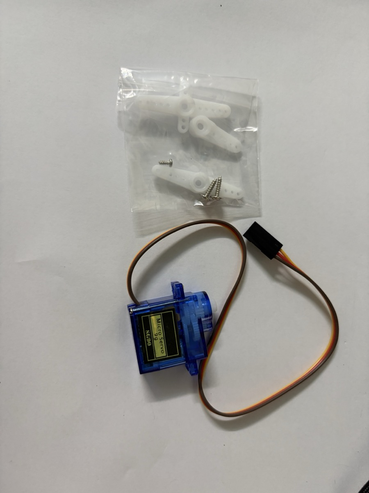

# Lab 4 · Động cơ servo SG90 (9g)

> Điều khiển servo SG90 quay đến góc mong muốn bằng Arduino Uno: quét qua lại 0–180°, nhập góc từ Serial Monitor, rồi xoay theo biến trở. Đây là lab đầu tiên dùng **cơ cấu chấp hành** (actuator) thay vì cảm biến hay màn hình.

## Servo SG90 là gì

**Servo** là động cơ có **điều khiển vị trí**: ra lệnh "quay đến 90°" thì nó tự quay đến đó và giữ nguyên, khác với động cơ DC chỉ quay liên tục. Bên trong vỏ nhựa xanh của SG90 có:

- một **động cơ DC** nhỏ,
- **hộp số** bánh răng nhựa giảm tốc, tăng lực xoắn,
- một **biến trở** gắn vào trục ra để đo góc hiện tại,
- **mạch điều khiển** so sánh góc đo được với góc ra lệnh, rồi quay động cơ theo chiều làm sai lệch nhỏ dần (vòng điều khiển phản hồi kín).

Chữ **"9g"** là khối lượng của servo (khoảng 9 gam), không phải lực kéo.

| Thông số | SG90 |
|---|---|
| Góc quay | ~180° (0–180°) |
| Điện áp | 4,8–6 V (dùng 5 V của Uno) |
| Mô-men xoắn | ~1,8 kg·cm ở 4,8 V |
| Tốc độ | ~0,1 s / 60° |
| Dòng không tải | ~10 mA khi đứng yên, 100–250 mA khi quay |
| Dòng kẹt (stall) | ~650 mA khi bị chặn không quay được |
| Bánh răng | Nhựa (bản MG90S dùng bánh răng kim loại) |

{width=60%}

Túi phụ kiện đi kèm có:

- **3 cánh tay servo** (horn) bằng nhựa trắng: loại 3 cánh (hai cánh dài, một cánh ngắn), loại 1 cánh và loại 2 cánh. Lỗ giữa có khía răng, ấn thẳng vào trục trắng của servo là khớp. Gắn một cánh vào trục để nhìn rõ góc quay.
- **3 ốc vít**: 1 ốc ngắn đầu tròn để siết cánh tay vào trục, 2 ốc dài tự khoan để bắt servo vào khung qua hai tai hai bên vỏ.

Khi chỉ thử nghiệm thì không cần siết ốc cánh tay, cứ ấn vào là đủ chặt.

### Điều khiển bằng xung PWM

Servo không nhận "số góc" mà nhận **độ rộng xung** trên dây tín hiệu:

- Cứ **20 ms** (tần số 50 Hz) Arduino gửi một xung HIGH.
- Độ rộng xung quyết định góc: khoảng **0,5–1 ms → 0°**, **1,5 ms → 90°**, **2–2,4 ms → 180°**.
- Phần còn lại của chu kỳ 20 ms là LOW.

```
góc 0°    ‾|_____________________   xung ~0,5 ms
góc 90°   ‾‾‾|___________________   xung ~1,5 ms
góc 180°  ‾‾‾‾‾|_________________   xung ~2,4 ms
          |<------ 20 ms ------>|
```

Độ rộng chính xác cho 0° và 180° khác nhau giữa các lô SG90, nên mỗi con có thể lệch vài độ. Thư viện `Servo` mặc định dùng **544 µs cho 0°** và **2400 µs cho 180°**.

`analogWrite()` của Uno chạy ở ~490 Hz hoặc ~980 Hz, không phải 50 Hz, nên **không dùng `analogWrite()` cho servo**. Phải dùng thư viện `Servo`.

## Ứng dụng của servo

Servo hợp với mọi việc cần **quay đến một góc xác định rồi giữ nguyên**, trong khoảng nửa vòng, với lực nhỏ. Không cần cảm biến vị trí ngoài vì servo đã tự phản hồi bên trong.

| Lĩnh vực | Ví dụ | Servo làm gì |
|---|---|---|
| Mô hình điều khiển từ xa (RC) | Máy bay, xe, tàu mô hình | Bẻ cánh lái, đánh lái bánh trước. Đây là nơi servo SG90 ra đời, nên xung 50 Hz chính là chuẩn tín hiệu của bộ thu RC |
| Robot | Cánh tay robot, robot 4 chân/6 chân, robot hình người | Mỗi khớp là một servo. Cánh tay robot 4 bậc tự do dùng 4 servo |
| Camera | Giá pan–tilt cho webcam, camera an ninh | 2 servo: một quay ngang (pan), một gật lên xuống (tilt) |
| Nhà thông minh | Khoá cửa, mở rèm, bật công tắc đèn cơ | Servo gạt chốt hoặc ấn công tắc có sẵn, không phải đi lại dây điện 220 V |
| Nông nghiệp | Van tưới, cửa sổ nhà kính | Mở van khi đất khô, mở cửa sổ khi quá nóng |
| Chăn nuôi | Máy cho cá/thú cưng ăn tự động | Xoay nắp hộp thức ăn theo giờ |
| Đời sống | Thùng rác tự mở nắp, cần chắn bãi giữ xe | Mở nắp hoặc nâng thanh chắn khi phát hiện người/xe |
| Năng lượng | Tấm pin mặt trời bám nắng | Xoay tấm pin về phía có nhiều ánh sáng nhất (so sánh 2 quang trở) |
| Hiển thị | Đồng hồ kim, đồng hồ đo kiểu analog | Kim chỉ nhiệt độ/độ ẩm thay cho màn hình số |

### Trong hệ IoT

Trong kiến trúc IoT, servo nằm ở **tầng thiết bị** với vai trò **cơ cấu chấp hành**: nhận quyết định từ vi điều khiển hoặc từ cloud rồi biến nó thành chuyển động thật. Một vòng IoT đầy đủ thường có dạng:

```
cảm biến đo  →  vi điều khiển / cloud quyết định  →  servo hành động
```

Ghép với các linh kiện đã có trong kit:

- **DHT11 (Lab 3) + servo**: nhiệt độ vượt 32 °C thì servo mở cửa thông gió, dưới 28 °C thì đóng lại.
- **Cảm biến độ ẩm đất + servo**: đất khô thì servo mở van tưới vài giây.
- **PIR HC-SR501 + servo**: có người đến gần thì mở nắp thùng rác, 5 giây sau đóng lại.
- **Nút nhấn + servo + LCD (Lab 2)**: khoá cửa bật/tắt, LCD hiện trạng thái `LOCKED`/`OPEN`.
- **ESP8266/ESP32 thay Uno**: điều khiển servo từ điện thoại qua Wi-Fi hoặc MQTT, ví dụ mở rèm từ xa.

### Khi nào không nên dùng servo SG90

| Yêu cầu | Chọn thay thế |
|---|---|
| Quay liên tục nhiều vòng (bánh xe) | Động cơ DC + driver, hoặc servo 360° |
| Định vị chính xác nhiều vòng (máy in 3D, CNC) | Động cơ bước (stepper) + driver A4988 |
| Lực lớn (khớp vai cánh tay robot, cửa nặng) | Servo lớn bánh răng kim loại như MG996R, kèm nguồn ngoài |
| Chịu va đập, hoạt động liên tục lâu dài | MG90S (bánh răng kim loại) thay SG90 (bánh răng nhựa dễ mẻ răng) |

## Dây và chân

SG90 có sẵn cáp 3 sợi, đầu là **giắc cái 3 lỗ**:

| Dây servo | Nối vào Uno | Ghi chú |
|---|---|---|
| **Nâu** | `GND` | Mát (có hãng dùng màu đen) |
| **Đỏ** | `5V` | Nguồn, luôn ở giữa |
| **Cam** | `D9` | Tín hiệu (có hãng dùng màu vàng hoặc trắng) |

Dây đỏ nằm ở giữa nên cắm ngược giắc cũng chỉ đảo nâu và cam, servo không chạy nhưng thường không hỏng. Dù vậy vẫn nên nhìn màu dây trước khi cấp điện.

Giắc servo là **đầu cái** và header của Uno cũng là **đầu cái**, nên cần 3 sợi dây **đực – đực**: một đầu cắm vào giắc servo, đầu kia cắm vào Uno. Không cần breadboard cho Test 1 và Test 2. Test 3 thêm biến trở nên cần breadboard để chia `5V` và `GND`.

Chân tín hiệu dùng chân digital nào cũng được (thư viện tự tạo xung), không bắt buộc chân có dấu `~`. Chọn `D9` theo thói quen.

### Nguồn cho servo

Một SG90 **không tải** cấp từ `5V` của Uno qua USB là chạy được. Nhưng mỗi lần bắt đầu quay servo hút một xung dòng lớn, có thể làm sụt áp:

- Board **tự reset** (đèn `L` nháy, Serial Monitor in lại dòng chào), hoặc servo giật cục.
- Cách khắc phục: thêm **tụ hoá 100–470 µF** giữa `5V` và `GND` gần servo (chân dài `+` vào `5V`), hoặc cấp servo bằng **nguồn ngoài 5 V** (4 pin AA, adapter 5 V) và **nối chung GND** với Uno.
- Từ 2 servo trở lên, hoặc servo phải nâng vật, thì dùng nguồn ngoài.
- **Không lấy nguồn servo từ chân I/O** (chân digital chỉ chịu ~20 mA).

## Thư viện

Thư viện **`Servo`** có sẵn trong Arduino IDE, không cần cài. Các hàm hay dùng:

| Hàm | Ý nghĩa |
|---|---|
| `myServo.attach(9)` | Gắn servo vào chân 9, bắt đầu phát xung |
| `myServo.attach(9, 500, 2400)` | Như trên, nhưng tự đặt độ rộng xung cho 0° và 180° (µs) |
| `myServo.write(90)` | Quay đến góc 90° (0–180) |
| `myServo.writeMicroseconds(1500)` | Ra lệnh trực tiếp bằng độ rộng xung |
| `myServo.read()` | Trả về góc **đã ra lệnh** gần nhất, không phải góc thật đo được |
| `myServo.detach()` | Ngừng phát xung, servo thả lỏng không giữ vị trí |

Trên Uno, thư viện `Servo` chiếm **Timer1**, nên sau khi `attach()` thì `analogWrite()` trên chân `D9` và `D10` không dùng được nữa (kể cả khi servo cắm chân khác).

## Code

### Test 1 – quét 0° → 180° → 0°

Bản rút gọn của ví dụ **File → Examples → Servo → Sweep**:

```cpp
#include <Servo.h>

Servo myServo;

void setup() {
  myServo.attach(9);
}

void loop() {
  for (int goc = 0; goc <= 180; goc++) {   // quay thuận
    myServo.write(goc);
    delay(15);                             // chờ servo theo kịp
  }
  delay(500);
  for (int goc = 180; goc >= 0; goc--) {   // quay ngược
    myServo.write(goc);
    delay(15);
  }
  delay(500);
}
```

Mỗi bước 1° chờ 15 ms, nên một lượt 0 → 180° mất khoảng 2,7 s. Giảm `delay` thì quay nhanh hơn, nhưng dưới ~3 ms/độ thì servo không theo kịp và chỉ nhảy cóc.

**Cách kiểm tra:**

- Cánh tay servo quét đều qua lại khoảng nửa vòng, nghỉ một chút ở mỗi đầu.
- Đứng yên ở hai đầu mà servo **kêu rè rè** hoặc rung: nó đang cố vượt giới hạn cơ khí. Giới hạn góc lại, ví dụ 10–170°, hoặc chỉnh `attach(9, min, max)`.
- Góc quét thực tế thường không đúng 180°, có thể chỉ 160–175°. Đó là sai lệch giữa các con SG90, xem phần hiệu chỉnh ở Test 2.

### Test 2 – nhập góc từ Serial Monitor

Mở **Serial Monitor** ở 9600 baud, chọn **Newline** ở ô kết thúc dòng, gõ một số 0–180 rồi Enter:

```cpp
#include <Servo.h>

Servo myServo;

void setup() {
  Serial.begin(9600);
  myServo.attach(9);
  myServo.write(90);                    // về giữa khi khởi động
  Serial.println("Nhap goc 0-180:");
}

void loop() {
  if (Serial.available()) {
    int goc = Serial.parseInt();        // đọc số nguyên
    while (Serial.available()) Serial.read();  // bỏ ký tự xuống dòng còn sót

    goc = constrain(goc, 0, 180);       // chặn ngoài khoảng
    myServo.write(goc);
    Serial.print("Quay den ");
    Serial.print(goc);
    Serial.println(" do");
  }
}
```

**Hiệu chỉnh góc.** Dùng Test 2 để đo con servo đang có:

1. Gõ `0`, `90`, `180`, đánh dấu vị trí cánh tay ở mỗi góc (hoặc đặt thước đo độ dưới trục).
2. Nếu 0° và 180° không cách nhau đúng nửa vòng, đổi dòng `attach` thành `myServo.attach(9, 500, 2400);` rồi chỉnh hai số: tăng số đầu nếu 0° quay quá đà (kêu rè), giảm số sau nếu 180° quay quá đà.
3. Muốn thử trực tiếp độ rộng xung thì tạm thay `myServo.write(goc)` bằng `myServo.writeMicroseconds(goc)` và gõ các giá trị 500–2500.

Ghi lại cặp số tìm được, các lab sau dùng lại.

### Test 3 – xoay theo biến trở

Biến trở là "núm vặn" tự nhiên cho servo: vặn núm bao nhiêu thì cánh tay servo quay theo bấy nhiêu.

| Chân | Nối vào |
|---|---|
| Biến trở – chân ngoài 1 | `5V` (thanh nguồn breadboard) |
| Biến trở – chân giữa | `A0` |
| Biến trở – chân ngoài 2 | `GND` (thanh nguồn breadboard) |
| Servo đỏ / nâu | `5V` / `GND` (cùng thanh nguồn) |
| Servo cam | `D9` |

Đảo hai chân ngoài của biến trở chỉ làm đảo chiều quay, không hỏng gì.

```cpp
#include <Servo.h>

Servo myServo;

void setup() {
  Serial.begin(9600);
  myServo.attach(9);
}

void loop() {
  int raw = analogRead(A0);              // 0–1023
  int goc = map(raw, 0, 1023, 0, 180);   // đổi sang 0–180°
  myServo.write(goc);

  Serial.print("raw = ");
  Serial.print(raw);
  Serial.print("  goc = ");
  Serial.println(goc);
  delay(15);
}
```

Đây là ví dụ **File → Examples → Servo → Knob** thêm phần in Serial. Khi để yên núm mà servo vẫn rung nhẹ, đó là nhiễu ADC làm `raw` nhảy ±1–2, kéo theo góc nhảy 0–1°. Có thể lọc bằng cách chỉ `write()` khi góc mới lệch góc cũ từ 2° trở lên (xem Test 4).

### Test 4 – biến trở + servo + 2 LED báo trạng thái

Mở rộng Test 3: vặn biến trở để xoay servo trong khoảng **0–90°**, hai LED cho biết servo đang ở nửa nào:

- **LED đỏ (`D12`)** sáng khi góc **< 45°**.
- **LED vàng (`D8`)** sáng khi góc **≥ 45°**.

Trong code, đèn ở `D8` được đặt tên `led1_G` (GREEN) nhưng mạch thật và Tinkercad đều cắm LED vàng. Màu LED không ảnh hưởng gì đến code, chỉ là tên biến.

| Linh kiện | Nối vào |
|---|---|
| Servo – tín hiệu | `D9` |
| Servo – nguồn / GND | Thanh `+` / `−` của breadboard |
| Biến trở – 2 chân ngoài | Thanh `−` và thanh `+` |
| Biến trở – chân giữa | **`A5`** |
| LED đỏ | `D12` → điện trở → chân dài LED; chân ngắn → thanh `−` |
| LED vàng | `D8` → điện trở → chân dài LED; chân ngắn → thanh `−` |
| Uno `5V` / `GND` | Thanh `+` / `−` |

Biến trở ở mạch này cắm vào `A5` thay vì `A0`. Chân analog nào cũng được, chỉ cần sửa `POT_PIN`. Lưu ý `A4`/`A5` trên Uno cũng là `SDA`/`SCL` của I²C: nếu sau này gắn thêm LCD của [Lab 2](lcd-i2c.md) thì phải chuyển biến trở sang `A0`–`A3`.

```cpp
// Thư viện cần thiết để điều khiển các động cơ Servo
#include <Servo.h>

// Định nghĩa các chân kết nối
const int potPin = A5;      // Chân kết nối Potentiometer (biến trở)
const int servoPin = 9;     // Chân kết nối Micro Servo
const int led1_G = 8;       // Chân kết nối LED 1 GREEN
const int led2_R = 12;      // Chân kết nối LED 2 RED

// Khai báo đối tượng Servo
Servo myServo;

void setup() {
  // Gắn đối tượng Servo vào chân đã định
  myServo.attach(servoPin);
  myServo.write(0);

  // Thiết lập các chân LED là OUTPUT
  pinMode(led1_G, OUTPUT);
  pinMode(led2_R, OUTPUT);

  // Theo dõi giá trị trên Serial Monitor
  Serial.begin(9600);
}

void loop() {
  // 1. Đọc giá trị Analog từ Potentiometer (0 đến 1023)
  int potValue = analogRead(potPin);
  Serial.println(potValue);

  // 2. Chuyển đổi (map) giá trị Potentiometer (0-1023) sang góc Servo (0-90)
  // map(value, fromLow, fromHigh, toLow, toHigh)
  int servoAngle = map(potValue, 0, 1023, 0, 90);

  // 3. Điều khiển Servo quay đến góc đã tính toán
  myServo.write(servoAngle);
  Serial.println(servoAngle);

  // 4. Báo nửa hành trình bằng LED:
  // góc < 45 độ thì bật LED RED, từ 45 độ trở lên thì bật LED GREEN
  if (servoAngle < 45) {
    digitalWrite(led1_G, LOW);
    digitalWrite(led2_R, HIGH);
  } else {
    digitalWrite(led1_G, HIGH);
    digitalWrite(led2_R, LOW);
  }

  // Chờ một chút để động cơ Servo có thời gian di chuyển và làm ổn định
  delay(100);
  Serial.println();
}
```

Giải thích:

- **`map(potValue, 0, 1023, 0, 90)`**: chỉ dùng **một phần tư vòng** (0–90°) thay vì 0–180° như Test 3. Vặn hết núm thì servo mới quay 90°. Muốn dùng hết hành trình thì đổi `90` thành `180` và ngưỡng `45` thành `90`.
- **Ngưỡng đổi đèn**: `map()` làm tròn xuống, nên `potValue` từ 0 đến 511 cho góc 0–44° (đèn đỏ), từ 512 trở lên cho 45–90° (đèn vàng). Tức là đèn đổi màu đúng lúc núm vặn qua **nửa vòng**.
- **`myServo.write(0)` trong `setup()`**: đưa servo về 0° ngay khi bật, trước khi đọc biến trở. Nếu núm đang ở giữa thì lúc khởi động servo sẽ giật về 0° rồi quay ngược lên vị trí của núm.
- **Serial Monitor** mỗi vòng in 3 dòng: giá trị thô (0–1023), góc (0–90) và một dòng trống để ngăn cách. Với `delay(100)` là khoảng 10 lần mỗi giây.
- **`delay(100)`** làm servo phản ứng hơi chậm (trễ tối đa 0,1 s sau khi vặn), đổi lại Serial Monitor dễ đọc hơn. Test 3 dùng `delay(15)` nên servo bám núm mượt hơn.

**Cách kiểm tra:**

- Vặn núm hết về một đầu: servo ở 0°, đèn đỏ sáng, Serial in `0`.
- Vặn từ từ qua nửa vòng: đến khi Serial in góc `45` thì đèn đỏ tắt, đèn vàng sáng.
- Vặn hết về đầu kia: servo ở 90° (vuông góc với vị trí ban đầu), Serial in `1023` và `90`.

#### Cải tiến: lọc nhiễu và đèn báo đang quay

Cùng mạch đó, có thể đổi cách dùng hai LED: đèn ở `D8` sáng khi servo **đang quay**, đèn đỏ sáng khi góc **≤ 10° hoặc ≥ 170°** để cảnh báo servo gần giới hạn cơ khí (vùng dễ kêu rè rè). Bản này dùng hết 0–180°.

```cpp
#include <Servo.h>

#define SERVO_PIN  9
#define POT_PIN    A5
#define LED_DO     12   // đỏ: gần giới hạn góc
#define LED_D8     8    // servo đang quay

Servo myServo;
int gocCu = -1;                  // góc đã ghi lần trước
unsigned long lanQuayCuoi = 0;   // thời điểm (ms) servo quay lần cuối

void setup() {
  Serial.begin(9600);
  pinMode(LED_DO, OUTPUT);
  pinMode(LED_D8, OUTPUT);
  myServo.attach(SERVO_PIN);
}

void loop() {
  int raw = analogRead(POT_PIN);         // 0–1023
  int goc = map(raw, 0, 1023, 0, 180);

  // chỉ ra lệnh khi góc đổi ≥ 2°, lọc nhiễu ADC
  if (gocCu < 0 || abs(goc - gocCu) >= 2) {
    myServo.write(goc);
    gocCu = goc;
    lanQuayCuoi = millis();

    Serial.print("raw = ");
    Serial.print(raw);
    Serial.print("  goc = ");
    Serial.println(goc);
  }

  // đèn D8 sáng thêm 300 ms sau lần quay cuối
  digitalWrite(LED_D8, millis() - lanQuayCuoi < 300 ? HIGH : LOW);
  // đỏ sáng khi gần hai đầu hành trình
  digitalWrite(LED_DO, (gocCu <= 10 || gocCu >= 170) ? HIGH : LOW);

  delay(15);
}
```

Bản cải tiến có ba điểm mới:

- **Vùng chết 2°** (*dead-band*): `gocCu` lưu góc đã ghi. Góc mới chỉ được `write()` khi lệch từ 2° trở lên, nên nhiễu ADC không làm servo rung và Serial Monitor chỉ in khi thật sự vặn núm.
- **`millis()` thay vì `delay()`** để giữ đèn `D8` sáng 300 ms sau lần quay cuối. Nếu dùng `delay(300)` thì cả `loop()` đứng lại, servo không theo kịp núm vặn. `millis()` trả về số ms từ lúc board khởi động; lấy hiệu với thời điểm đã lưu để biết đã trôi qua bao lâu.
- LED cắm `D8` và `D12` chỉ dùng `digitalWrite()`, nên không bị ảnh hưởng việc thư viện `Servo` chiếm Timer1. Nếu muốn chỉnh độ sáng LED bằng `analogWrite()` thì tránh `D9`/`D10`.

Kiểm tra: vặn núm thì đèn `D8` sáng suốt lúc vặn và tắt sau khoảng 0,3 s khi buông tay. Vặn hết về một đầu thì đèn đỏ sáng. Để yên núm thì Serial Monitor không in thêm dòng nào.

## Mô phỏng

Tinkercad Circuits có sẵn **Micro Servo** (tìm `servo` trong ô linh kiện), hình dạng giống SG90 và chạy được thư viện `Servo`:

1. Kéo *Arduino Uno R3* và *Micro Servo* vào.
2. Nối `Ground` → `GND`, `Power` → `5V`, `Signal` → `D9`. Di chuột lên từng chân của servo để xem tên.
3. Dán code Test 1, bấm **Start Simulation**: cánh tay servo quét qua lại trên màn hình.
4. Test 3: thêm *Potentiometer*, nối như bảng ở trên, lúc mô phỏng bấm kéo núm biến trở để xoay.

Servo trong Tinkercad quay đúng 0–180° và không bao giờ sụt nguồn, nên không thấy được các lỗi rè rè hay reset board như ngoài đời thật.

Mạch Test 4 dựng trên Tinkercad:

{width=100%}

Đọc mạch theo từng đường:

- **Nguồn:** `5V` (dây đỏ) và `GND` (dây đen) của Uno đi vào thanh `+` và `−` phía dưới breadboard. Servo và biến trở đều lấy điện từ hai thanh này.
- **Servo:** dây xám từ `D9` vòng qua trên breadboard tới chân tín hiệu của giắc. Hai chân còn lại về thanh `+` (cột 27) và thanh `−` (cột 25).
- **Biến trở** ở cột 28–30: chân trái về `−`, chân phải về `+`, chân giữa đi dây dài xuống dưới vòng sang `A5`.
- **LED đỏ:** `D12` → cột 9 → điện trở (cột 5–9) → chân dài LED ở cột 5. Chân ngắn ở cột 4 về thanh `−`.
- **LED vàng:** `D8` → cột 16 → điện trở (cột 12–16) → chân dài LED ở cột 12. Chân ngắn ở cột 11 về thanh `−`.

Trong Tinkercad, chân **cong** của LED là chân dương (anode). Hai điện trở có vòng màu nâu – đen – đỏ = **1 kΩ**, giá trị mặc định khi kéo điện trở vào Tinkercad. LED vẫn sáng nhưng hơi mờ (khoảng 3 mA). Mạch thật dùng điện trở **220 Ω** trong kit như [Lab 1](led-basics.md) thì LED sáng rõ hơn.

## Ảnh thực tế

### Video Test 4

<video controls muted playsinline preload="metadata" poster="../assets/servo-pot-real-poster.jpg" style="display:block; max-width:360px; width:100%; margin:0 auto; border-radius:8px;">
  <source src="../assets/servo-pot-real.mp4" type="video/mp4">
</video>

Mạch thật lắp theo đúng sơ đồ Tinkercad ở trên, chạy code Test 4. Board xoay ngang 90° nên hàng DIGITAL nằm bên trái, hàng POWER/ANALOG IN nằm bên phải.

- **Servo** đặt bên trái board, cắm vào giắc bằng 3 dây đực – đực. **Dây cam** đi từ `D9` tới chân tín hiệu, hai dây đỏ và đen đi về thanh `+`/`−` của breadboard.
- **Biến trở** là loại núm vặn có trục khía, cắm ở cuối breadboard. **Dây vàng** từ chân giữa chạy lên `A5`.
- Hai LED đỏ và vàng cắm ở đầu breadboard, gần board.

Diễn biến trong video:

- **Giây 0–5**: núm biến trở ở nửa đầu hành trình. Góc servo dưới 45°, **LED đỏ sáng**, LED vàng tắt.
- **Giây 6–11**: vặn núm qua nửa vòng. Cánh tay servo xoay theo, **LED đỏ tắt và LED vàng sáng** đúng lúc góc qua 45°.
- **Giây 12–13**: vặn núm về lại, servo quay ngược và **LED đỏ sáng lại**.
- Servo chỉ xoay khoảng **một phần tư vòng** dù vặn hết núm, đúng với `map(..., 0, 90)` trong code.
- Đèn `ON` (xanh lá) và đèn `L` trên board sáng suốt video. Board **không bị reset** khi servo quay, vì một SG90 không tải cấp từ USB là đủ nguồn.

> 📷 *Chờ ảnh Serial Monitor (Test 2/3/4).*

## Lỗi hay gặp

| Hiện tượng | Nguyên nhân / cách xử lý |
|---|---|
| Servo không nhúc nhích | Dây cam không ở chân trong `attach()`, thiếu `GND` chung (khi dùng nguồn ngoài), hoặc giắc cắm ngược (nâu/cam đảo chỗ) |
| Servo chỉ rung, kêu, không quay | Nguồn yếu (cáp USB dài, cổng hub) — đổi cổng USB, thêm tụ, hoặc dùng nguồn ngoài |
| Board tự reset mỗi lần servo quay | Sụt áp do dòng khởi động của servo — thêm tụ 100–470 µF giữa `5V` và `GND`, hoặc nguồn ngoài |
| Kêu rè rè ở 0° hoặc 180° | Ra lệnh vượt giới hạn cơ khí — giới hạn góc (10–170°) hoặc chỉnh `attach(pin, min, max)` |
| Góc quét thực tế < 180° | Độ rộng xung mặc định không khớp con servo — hiệu chỉnh như Test 2 |
| Quay liên tục không dừng | Đây là servo **360° (continuous rotation)**, không phải servo vị trí; `write(90)` là dừng, < 90 / > 90 là quay hai chiều |
| `analogWrite()` trên `D9`/`D10` hết tác dụng | Thư viện `Servo` chiếm Timer1 — đổi LED/PWM sang chân `D3`, `D5`, `D6` hoặc `D11` |
| Servo nóng, mùi khét | Bị kẹt cơ khí (cánh tay chạm vật cản) hoặc vặn trục bằng tay khi đang cấp điện — rút điện ngay, đừng xoay trục bằng tay |
| Servo rung nhẹ khi để yên biến trở | Nhiễu ADC — chỉ `write()` khi góc đổi ≥ 2° |
