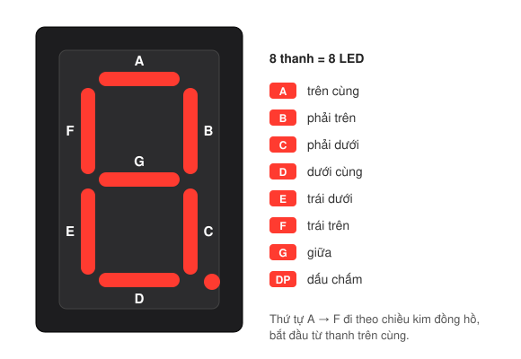
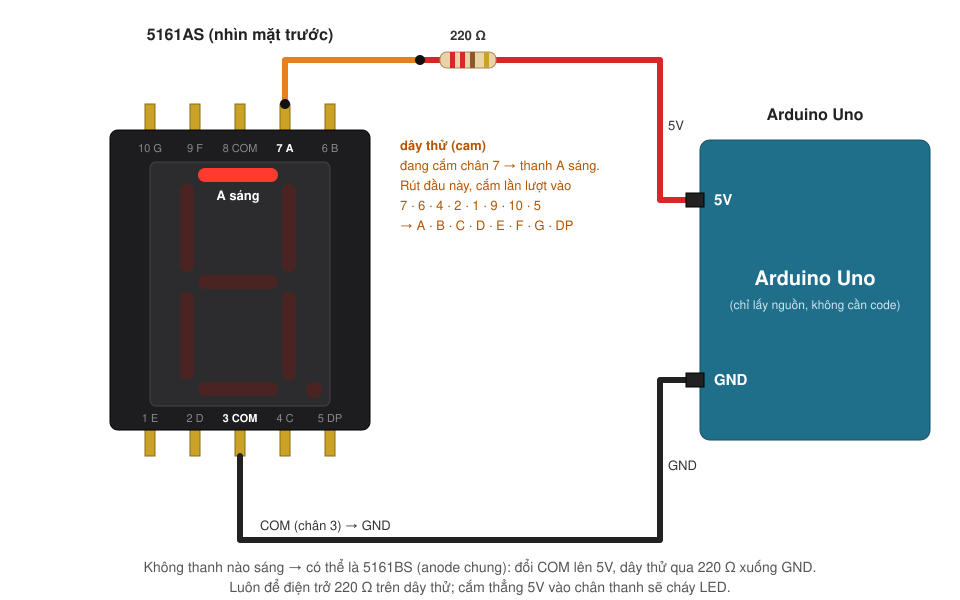
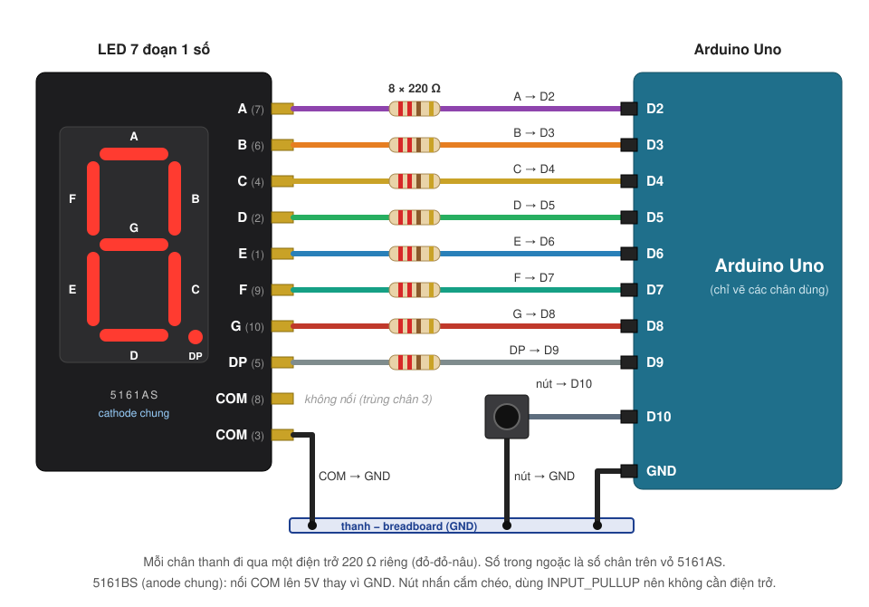

# Lab 15 · LED 7 đoạn 1 số (5161AS)

> Hiển thị một chữ số trên LED 7 đoạn **1 số** với Arduino Uno. Module có **8 thanh** sáng (7 đoạn `A`–`G` và dấu chấm `DP`), mỗi thanh là một LED riêng. Lab đi từ sơ đồ chân, nối dây trực tiếp 8 chân, thử từng thanh, đếm 0 → 9, rồi làm bộ đếm bằng nút nhấn và xúc xắc. Chỉ có một chữ số nên **không cần quét**, khác với [Lab 7](seven-segment-5641as.md) (4 số).

## LED 7 đoạn 1 số là gì

Một chữ số gồm 8 LED trong một vỏ: 7 thanh `A`–`G` ghép thành hình số `8` và một dấu chấm `DP`:

{width=60%}

Bật đúng tổ hợp thanh sẽ ra chữ số: số `1` = `B C`, số `7` = `A B C`, số `8` = cả 7 thanh.

Tất cả 8 LED nối chung **một đầu** vào chân chung (`COM`). Hậu tố trong mã cho biết kiểu chung:

- **5161AS**: **cathode chung (common cathode)**. `COM` nối `GND`, thanh sáng khi chân thanh ở mức `HIGH`.
- **5161BS**: **anode chung (common anode)**. `COM` nối `5V`, thanh sáng khi chân thanh ở mức `LOW`.

Hai loại trông giống hệt nhau, chỉ khác chữ `A`/`B` in ở cạnh vỏ. Code trong lab có một dòng `#define` để đổi qua lại.

## Linh kiện

| Linh kiện | Số lượng |
|---|---|
| Arduino Uno + cáp USB | 1 |
| LED 7 đoạn 1 số 5161AS (hoặc 5161BS) | 1 |
| Điện trở 220 Ω | 8 |
| Nút nhấn 4 chân | 1 |
| Breadboard, dây cắm đực–đực | |

## Sơ đồ chân

**10 chân**, chia hai hàng 5 chân ở **trên** và **dưới** thân (không như 5641AS có chân ở giữa). Đặt module sao cho dấu chấm `DP` ở góc **dưới bên phải**, nhìn mặt trước: chân **1** ở góc **dưới bên trái**, đánh số **ngược chiều kim đồng hồ** (1 → 5 hàng dưới từ trái sang phải, 6 → 10 hàng trên từ phải sang trái).

| Hàng trên (10 → 6) | 10 `G` | 9 `F` | 8 `COM` | 7 `A` | 6 `B` |
|---|---|---|---|---|---|
| **Hàng dưới (1 → 5)** | **1 `E`** | **2 `D`** | **3 `COM`** | **4 `C`** | **5 `DP`** |

- Chân **3** và **8** (chính giữa mỗi hàng) đều là `COM`, đã nối sẵn bên trong. Chỉ cần nối một chân, nối cả hai cũng được.
- Mỗi thanh nằm gần chân của nó: `A` ở trên cùng → chân 7 hàng trên, `D` ở dưới cùng → chân 2 hàng dưới, `DP` ở góc dưới phải → chân 5.

**Kiểm tra kiểu chung chân** bằng đồng hồ ở thang đo diode: que **đen** vào chân 3 (`COM`), que **đỏ** vào chân 7 (`A`). Thanh A sáng mờ → cathode chung (5161AS). Phải đảo que mới sáng → anode chung (5161BS).

### Mạch test không cần code

Không có đồng hồ thì dùng Arduino làm nguồn 5 V để thử từng thanh, chưa cần nạp code:

{width=100%}

1. Cắm module bắc ngang rãnh giữa breadboard. Nối chân **3** (`COM`) xuống `GND` của Arduino.
2. Nối `5V` vào một đầu điện trở **220 Ω**. Đầu kia của điện trở nối một sợi dây thử.
3. Cắm USB cho Arduino (code đang chạy trên board không ảnh hưởng, chỉ dùng chân 5V và GND).
4. Cắm dây thử lần lượt vào từng chân thanh và ghi lại thanh nào sáng:

| Chân | 7 | 6 | 4 | 2 | 1 | 9 | 10 | 5 |
|---|---|---|---|---|---|---|---|---|
| Thanh sáng | `A` | `B` | `C` | `D` | `E` | `F` | `G` | `DP` |

- Cả 8 thanh sáng đúng bảng → module là cathode chung (5161AS), sơ đồ chân đúng, chuyển sang phần nối dây.
- Không thanh nào sáng → thử loại anode chung (5161BS): đổi chân 3 lên `5V`, dây thử qua 220 Ω xuống `GND`, rồi cắm lại lần lượt.
- Một thanh sáng sai vị trí so với bảng → module trong kit có sơ đồ chân khác, ghi lại bảng thực tế và sửa thứ tự trong `SEG_PINS` của code cho khớp.
- Đúng một thanh không sáng → thanh đó hỏng hoặc chân chưa cắm chặt.

**Không bao giờ bỏ điện trở**: cắm thẳng 5V vào chân thanh sẽ làm cháy LED trong vài giây.

## Nối dây

Cắm module **bắc ngang rãnh giữa breadboard**: hàng chân trên ở một nửa, hàng chân dưới ở nửa kia.

{width=100%}

| Thanh | Chân 5161AS | Nối Arduino |
|---|---|---|
| `A` | 7 | `2` |
| `B` | 6 | `3` |
| `C` | 4 | `4` |
| `D` | 2 | `5` |
| `E` | 1 | `6` |
| `F` | 9 | `7` |
| `G` | 10 | `8` |
| `DP` | 5 | `9` |
| `COM` | 3 (hoặc 8) | `GND` (loại 5161BS: `5V`) |

**Mỗi chân thanh đi qua một điện trở 220 Ω riêng.** Không thay 8 điện trở bằng một điện trở duy nhất trên chân `COM`: dòng chung khi đó chia cho số thanh đang sáng, nên số `1` (2 thanh) sẽ sáng hơn hẳn số `8` (7 thanh).

Dòng mỗi thanh với 220 Ω khoảng (5 − 2) / 220 ≈ 14 mA. Khi hiện số `8.` cả 8 thanh sáng, chân `COM` nhận ~110 mA. Chân `COM` nối thẳng `GND` (không qua chân Arduino) nên không sao; mỗi chân Arduino `2`–`9` chỉ cấp 14 mA, dưới mức 20 mA khuyến nghị.

Nút nhấn (dùng ở Test 3, 4): một chân vào Arduino `10`, chân chéo đối diện vào `GND`. Code bật điện trở kéo lên trong (`INPUT_PULLUP`), nên không cần điện trở ngoài: nhả nút đọc `HIGH`, nhấn đọc `LOW`.

## Code

Cả bốn test dùng chung phần khai báo dưới đây. Mỗi chữ số được lưu thành **1 byte**: bit 0 = `A`, bit 1 = `B`, …, bit 6 = `G`, bit 7 = `DP`. Ví dụ số `2` sáng `A B G E D` = bit 0, 1, 6, 4, 3 = `0b01011011`.

```cpp
#define COMMON_CATHODE 1   // 5161AS = 1, 5161BS (anode chung) = 0

const int SEG_PINS[8] = {2, 3, 4, 5, 6, 7, 8, 9};  // A B C D E F G DP

// bit:  7  6 5 4 3 2 1 0
// thanh: DP G F E D C B A
const byte DIGITS[10] = {
  0b00111111,  // 0
  0b00000110,  // 1
  0b01011011,  // 2
  0b01001111,  // 3
  0b01100110,  // 4
  0b01101101,  // 5
  0b01111101,  // 6
  0b00000111,  // 7
  0b01111111,  // 8
  0b01101111,  // 9
};

void show(byte pattern) {
  for (int i = 0; i < 8; i++) {
    bool on = pattern & (1 << i);
    // anode chung: thanh sáng khi chân ở LOW, nên đảo bit
    digitalWrite(SEG_PINS[i], (on == COMMON_CATHODE) ? HIGH : LOW);
  }
}

void setupSegments() {
  for (int i = 0; i < 8; i++) pinMode(SEG_PINS[i], OUTPUT);
  show(0);  // tắt hết
}
```

Muốn bật thêm dấu chấm: `show(DIGITS[n] | 0b10000000);`.

### Test 1 – thử từng thanh

Bật lần lượt `A` → `B` → … → `G` → `DP`, mỗi thanh 0,5 giây, rồi bật cả 8. Đây là bước kiểm tra dây: thanh nào sáng sai thứ tự là dây chân đó bị lắp lệch.

```cpp
// (dán phần khai báo chung ở trên vào đây)

void setup() {
  setupSegments();
}

void loop() {
  for (int i = 0; i < 8; i++) {
    show(1 << i);      // chỉ bật thanh thứ i
    delay(500);
  }
  show(0xFF);          // cả 8 thanh: "8."
  delay(1000);
  show(0);
  delay(500);
}
```

### Test 2 – đếm 0 → 9

```cpp
// (dán phần khai báo chung ở trên vào đây)

void setup() {
  setupSegments();
}

void loop() {
  for (int n = 0; n <= 9; n++) {
    show(DIGITS[n]);
    delay(1000);   // chỉ một chữ số, không phải quét nên dùng delay() được
  }
}
```

### Test 3 – bộ đếm bằng nút nhấn

Mỗi lần nhấn nút, số tăng 1 (9 → quay về 0). Nút cơ khí bị **rung (bounce)**: một lần nhấn tạo ra nhiều xung `HIGH`/`LOW` trong vài ms, nếu đếm mọi cạnh xuống thì một lần nhấn có thể nhảy 2–3 số. Code chỉ chấp nhận cạnh xuống cách lần trước ít nhất 50 ms.

```cpp
// (dán phần khai báo chung ở trên vào đây)

const int BUTTON_PIN = 10;
const unsigned long DEBOUNCE_MS = 50;

int count = 0;
int lastState = HIGH;
unsigned long lastPress = 0;

void setup() {
  setupSegments();
  pinMode(BUTTON_PIN, INPUT_PULLUP);
  show(DIGITS[count]);
}

void loop() {
  int state = digitalRead(BUTTON_PIN);
  if (lastState == HIGH && state == LOW &&          // cạnh xuống = vừa nhấn
      millis() - lastPress > DEBOUNCE_MS) {
    lastPress = millis();
    count = (count + 1) % 10;
    show(DIGITS[count]);
  }
  lastState = state;
}
```

### Test 4 – xúc xắc

Giữ nút: số chạy nhanh 1 → 6. Nhả nút: số chậm dần rồi dừng ở một giá trị ngẫu nhiên, dấu chấm `DP` bật để báo đã có kết quả.

```cpp
// (dán phần khai báo chung ở trên vào đây)

const int BUTTON_PIN = 10;

void setup() {
  setupSegments();
  pinMode(BUTTON_PIN, INPUT_PULLUP);
  randomSeed(analogRead(A0));   // A0 để trống: nhiễu analog làm hạt giống ngẫu nhiên
  show(DIGITS[1] | 0b10000000);
}

void loop() {
  if (digitalRead(BUTTON_PIN) == HIGH) return;     // chưa nhấn

  int face = 1;
  while (digitalRead(BUTTON_PIN) == LOW) {         // đang giữ nút: lắc nhanh
    face = face % 6 + 1;
    show(DIGITS[face]);
    delay(40);
  }

  for (int wait = 40; wait < 300; wait += 30) {    // nhả nút: chậm dần
    face = random(1, 7);
    show(DIGITS[face]);
    delay(wait);
  }
  show(DIGITS[face] | 0b10000000);                 // kết quả + dấu chấm
}
```

## So sánh với LED 7 đoạn 4 số

| | 1 số (5161AS, lab này) | 4 số (5641AS, [Lab 7](seven-segment-5641as.md)) |
|---|---|---|
| Số chân | 10 (2 chân `COM` trùng nhau) | 12 |
| Chân Arduino cần | 8 | 12 (hoặc 3 + 4 khi dùng 74HC595) |
| Quét | Không cần, dùng `delay()` thoải mái | Bắt buộc, không được `delay()` dài |
| Độ sáng | Sáng 100% thời gian | Mỗi số chỉ sáng ~1/4 thời gian |

8 chân Arduino cho một chữ số là khá tốn. Khi cần thêm cảm biến, chuyển 8 chân thanh sang **74HC595** giống Lab 7: Arduino chỉ còn dùng 3 dây, và bảng `DIGITS` vẫn giữ nguyên nếu nối `Q0`–`Q7` theo thứ tự `A`–`DP`.

## Lỗi hay gặp

| Hiện tượng | Nguyên nhân thường gặp |
|---|---|
| Không thanh nào sáng | `COM` chưa nối, hoặc nối sai kiểu: 5161AS cần `COM` → `GND`, 5161BS cần `COM` → `5V`. Kiểm tra mã in ở cạnh vỏ và dòng `#define COMMON_CATHODE` |
| Hiện "ngược": thanh cần tắt thì sáng, cần sáng thì tắt | Module anode chung nhưng code để `COMMON_CATHODE 1` (hoặc ngược lại) |
| Số hiện sai hình | Một dây thanh lắp lệch. Chạy Test 1, thanh nào sáng sai thứ tự là dây chân đó |
| Một thanh không bao giờ sáng | Chân của thanh đó chưa cắm chặt, điện trở chưa nối, hoặc thanh đã cháy (thử bằng đồng hồ ở thang diode) |
| Số `1` sáng hơn số `8` | Dùng một điện trở chung ở `COM` thay vì 8 điện trở ở 8 chân thanh |
| Nhấn nút một lần, số nhảy 2–3 bước | Nút bị rung, thiếu đoạn chống rung (debounce) |
| Nút không có tác dụng | Chưa `INPUT_PULLUP`, hoặc hai chân nút cắm cùng một cặp đã nối sẵn bên trong. Cắm theo **đường chéo** cho chắc |
