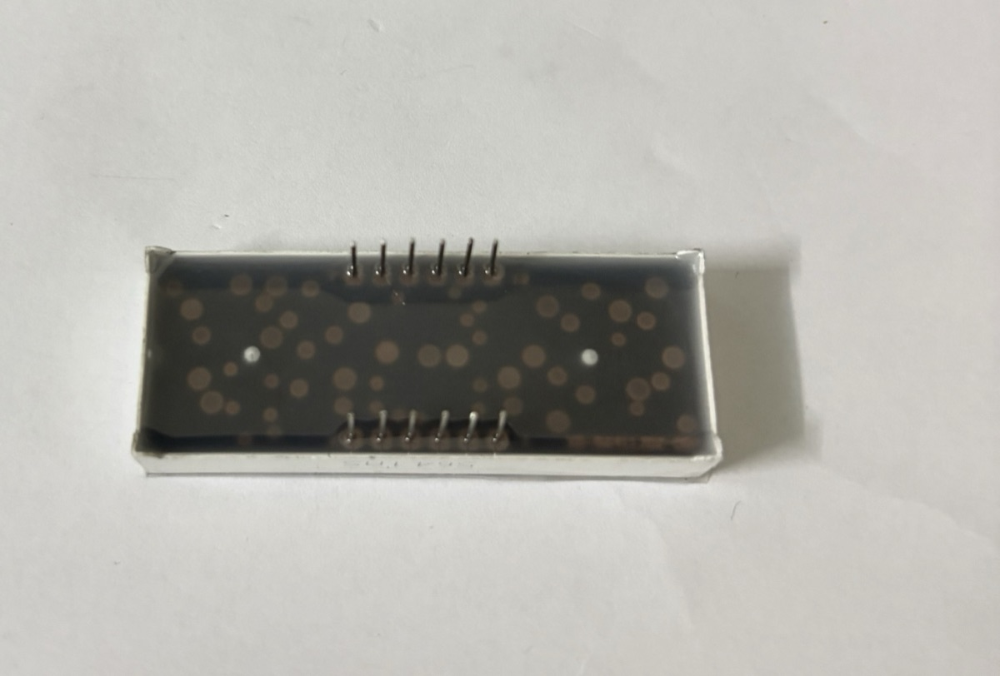
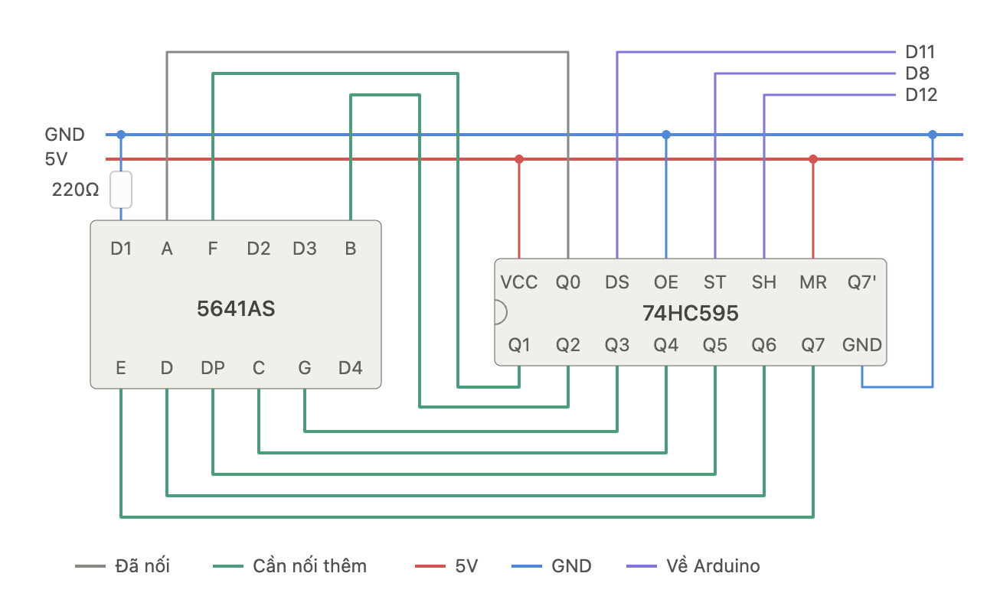
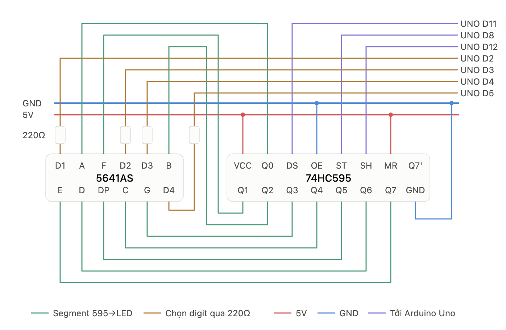

# Lab 7 · LED 7 đoạn 4 số 5641AS + IC 74HC595

> Hiển thị số trên LED 7 đoạn 4 số **5641AS** với Arduino Uno. Lab giải thích sơ đồ chân và cách quét (multiplexing), nối trực tiếp 12 chân với thư viện `SevSeg`, rồi dùng **IC dịch 74HC595** để Arduino chỉ cần 3 dây cho 8 chân đoạn. Đây là lab đầu tiên dùng **thanh ghi dịch** để mở rộng số chân ra.

## LED 7 đoạn 4 số là gì

Bốn chữ số LED 7 đoạn chung một vỏ, cỡ chữ **0,56 inch**. Mỗi chữ số có 7 đoạn `A`–`G` và một dấu chấm `DP`:

```
      A
     ───
  F │   │ B
     ─G─
  E │   │ C
     ───   • DP
      D
```

Hậu tố trong mã cho biết kiểu chung chân:

- **5641AS**: **cathode chung (common cathode)**. Mỗi chữ số có một chân chung nối về phía âm. Đoạn sáng khi chân đoạn `HIGH` **và** chân chữ số `LOW`.
- **5641BS**: anode chung, logic ngược lại. Hai mã trông giống hệt nhau, chỉ khác chữ `A`/`B` in ở cạnh vỏ.

### Ảnh thực tế module

{width=70%}

::: {layout-ncol=2}



:::

Module trong kit in mã **`5641AS`** trên một cạnh dài, nên đây là loại **cathode chung**. Chữ số màu đỏ, vỏ trắng, mặt hiển thị đen.

- **Cạnh có in mã** nằm cùng phía với các dấu chấm `DP` (nhìn ảnh mặt trước, mã in ngay dưới hàng chấm). Phía này là **hàng chân 1 → 6**. Hàng chân sát cạnh còn lại là 7 → 12.
- 12 chân nằm gọn ở **giữa thân**, hai hàng cách nhau khá xa. Cắm module **bắc ngang rãnh giữa breadboard**, mỗi hàng chân nằm ở một nửa board, để 12 chân không bị chập vào nhau.
- Thân module rộng, che mất khá nhiều lỗ breadboard. Nên cắm dây vào các lỗ còn trống ở hai đầu cột chân trước rồi mới ấn module xuống.

### Sơ đồ chân

**12 chân**, chia hai hàng 6 chân. Đặt module sao cho dấu chấm `DP` ở phía dưới, nhìn mặt trước: chân **1** ở góc **dưới bên trái**, đánh số **ngược chiều kim đồng hồ** (1 → 6 hàng dưới từ trái sang phải, 7 → 12 hàng trên từ phải sang trái).

| Hàng trên (12 → 7) | 12 `D1` | 11 `A` | 10 `F` | 9 `D2` | 8 `D3` | 7 `B` |
|---|---|---|---|---|---|---|
| **Hàng dưới (1 → 6)** | **1 `E`** | **2 `D`** | **3 `DP`** | **4 `C`** | **5 `G`** | **6 `D4`** |

`D1`–`D4` là 4 chân chung của 4 chữ số (D1 = chữ số bên trái). 8 chân còn lại là chân đoạn, **dùng chung cho cả 4 chữ số**: chân `A` nối với đoạn A của cả 4 số.

**Kiểm tra kiểu chung chân** bằng đồng hồ ở thang đo diode: que **đỏ** vào chân 11 (`A`), que **đen** vào chân 12 (`D1`). Đoạn A của số đầu tiên sáng mờ → cathode chung (5641AS). Phải đảo que mới sáng → anode chung.

### Quét (multiplexing)

Vì chân đoạn dùng chung, tại một thời điểm chỉ bật được **một chữ số**. Chương trình bật lần lượt D1 → D2 → D3 → D4, mỗi số khoảng 2–5 ms, lặp liên tục. Mắt không kịp thấy nhấp nháy nên cả 4 số trông như sáng cùng lúc. Hệ quả:

- Không được dùng `delay()` dài trong `loop()`, nếu không màn sẽ chỉ hiện một số hoặc nhấp nháy. Đo thời gian bằng `millis()`.
- Mỗi chữ số chỉ sáng ~1/4 thời gian, nên trông mờ hơn LED đơn dùng cùng điện trở.

## Cách 1 · Nối trực tiếp với Arduino

**Nối dây với Arduino Uno** (tốn 12 chân):

| Chân 5641AS | Nối Arduino |
|---|---|
| `A` `B` `C` `D` `E` `F` `G` `DP` | `2` `3` `4` `5` `6` `7` `8` `9`, **mỗi chân qua một điện trở 220 Ω – 1 kΩ** |
| `D1` `D2` `D3` `D4` | `10` `11` `12` `13`, nối thẳng |

Đặt điện trở ở **chân đoạn**, không đặt ở chân chữ số: nếu chỉ có một điện trở trên chân chung thì số "1" (2 đoạn) sẽ sáng hơn hẳn số "8" (7 đoạn). Chân chữ số phải hút dòng của tối đa 8 đoạn cùng lúc; với 1 kΩ (~3 mA/đoạn) là ~24 mA, vẫn trong giới hạn chân Uno. Nếu dùng 220 Ω cho sáng hơn thì nên đệm chân chữ số bằng transistor NPN (ví dụ 2N2222).

Code dùng thư viện **`SevSeg`** (cài từ Library Manager). Thư viện tự lo việc quét; chỉ cần gọi `refreshDisplay()` thật thường xuyên trong `loop()`:

```cpp
#include <SevSeg.h>

SevSeg sevseg;

void setup() {
  byte numDigits = 4;
  byte digitPins[]   = {10, 11, 12, 13};          // D1 D2 D3 D4
  byte segmentPins[] = {2, 3, 4, 5, 6, 7, 8, 9};  // A B C D E F G DP
  bool resistorsOnSegments = true;                // điện trở đặt ở chân đoạn
  sevseg.begin(COMMON_CATHODE, numDigits, digitPins, segmentPins,
               resistorsOnSegments);
  sevseg.setBrightness(90);
}

void loop() {
  static unsigned long last = 0;
  static int tenths = 0;                          // đếm 0,1 giây

  if (millis() - last >= 100) {                   // không dùng delay()
    last += 100;
    tenths = (tenths + 1) % 10000;
    sevseg.setNumber(tenths, 1);                  // 1 chữ số thập phân: 123.4
  }
  sevseg.refreshDisplay();                        // gọi mỗi vòng loop
}
```

Với loại 5641BS chỉ cần đổi `COMMON_CATHODE` thành `COMMON_ANODE`.

Cách này tốn 12/20 chân của Uno, gần như không còn chỗ cho cảm biến khác. Hai cách tiết kiệm chân: IC dịch **74HC595** cho 8 chân đoạn (phần dưới), hoặc module có sẵn chip **TM1637** (chỉ 2 dây tín hiệu).

## Cách 2 · Dùng IC 74HC595

**74HC595** là thanh ghi dịch 8 bit: Arduino gửi 8 bit **nối tiếp** qua một dây dữ liệu, mỗi bit kèm một xung clock, rồi phát một xung chốt (latch) để cả 8 bit cùng xuất ra 8 chân `Q0`–`Q7`. Arduino chỉ cần **3 dây** (dữ liệu, clock, chốt) thay vì 8. Bản thử này mới bật **chữ số đầu tiên**.

{width=100%}

### Nối dây

**74HC595 ↔ nguồn và Arduino:**

| Chân 74HC595 | Tên khác | Nối | Vai trò |
|---|---|---|---|
| `VCC` (16) | | `5V` | Nguồn |
| `GND` (8) | | `GND` | Mass |
| `DS` (14) | `SER`, data | Arduino `11` | Dữ liệu nối tiếp, từng bit một |
| `SH` (11) | `SH_CP`, `SRCLK`, clock | Arduino `12` | Mỗi cạnh lên đẩy một bit vào thanh ghi dịch |
| `ST` (12) | `ST_CP`, `RCLK`, latch | Arduino `8` | Cạnh lên chép 8 bit ra các chân `Q0`–`Q7` cùng lúc |
| `OE` (13) | | `GND` | Luôn bật ngõ ra (kích mức thấp) |
| `MR` (10) | `SRCLR` | `5V` | Không xoá thanh ghi (kích mức thấp) |
| `Q7'` (9) | | để trống | Dùng để nối tiếp sang một 74HC595 thứ hai |

**74HC595 ↔ 5641AS.** Thứ tự chân Q được chọn sao cho dây trên breadboard đi gọn, không theo thứ tự A → G:

| `Q0` | `Q1` | `Q2` | `Q3` | `Q4` | `Q5` | `Q6` | `Q7` |
|---|---|---|---|---|---|---|---|
| `A` | `F` | `B` | `G` | `C` | `DP` | `D` | `E` |

Chân chữ số `D1` nối xuống `GND` qua **một điện trở 220 Ω**, nên chữ số đầu luôn được bật. `D2`–`D4` để trống nên ba số còn lại tắt. Vì chỉ có một điện trở chung cho cả 8 đoạn, số nào ít đoạn sáng (số `1`) sẽ sáng hơn số nhiều đoạn (số `8`). Như vậy đủ để thử mạch. Bản đủ 4 số ở [phần sau](#quet-4-so) nối cả `D1`–`D4` về Arduino để quét.

### Code

Vì thứ tự chân không theo A → G, bảng mã số phải tính theo đúng cách nối: bit 0 = `Q0` = `A`, bit 1 = `Q1` = `F`, … Ví dụ số `5` sáng `A F G C D` = bit 0, 1, 3, 4, 6 = `0b01011011`. Code dưới đây đếm 0 → 9 trên chữ số đầu tiên, mỗi số 1 giây:

```cpp
const int DATA_PIN  = 11;  // DS
const int LATCH_PIN = 8;   // ST
const int CLOCK_PIN = 12;  // SH

// bit:  7 6 5  4 3 2 1 0
// đoạn: E D DP C G B F A   (theo cách nối Q0–Q7 ở trên)
const byte DIGITS[10] = {
  0b11010111,  // 0
  0b00010100,  // 1
  0b11001101,  // 2
  0b01011101,  // 3
  0b00011110,  // 4
  0b01011011,  // 5
  0b11011011,  // 6
  0b00010101,  // 7
  0b11011111,  // 8
  0b01011111,  // 9
};

void show(byte pattern) {
  digitalWrite(LATCH_PIN, LOW);
  shiftOut(DATA_PIN, CLOCK_PIN, MSBFIRST, pattern);  // bit 7 đi trước, cuối cùng nằm ở Q7
  digitalWrite(LATCH_PIN, HIGH);                     // chốt: 8 chân Q đổi cùng lúc
}

void setup() {
  pinMode(DATA_PIN, OUTPUT);
  pinMode(LATCH_PIN, OUTPUT);
  pinMode(CLOCK_PIN, OUTPUT);
}

void loop() {
  for (int n = 0; n <= 9; n++) {
    show(DIGITS[n]);
    delay(1000);   // chỉ có 1 chữ số, không cần quét nên dùng delay() được
  }
}
```

Muốn bật dấu chấm thì thêm bit 5: `show(DIGITS[n] | 0b00100000);`.

### Video mạch thật (một số)

Chữ số đầu tiên đã sáng và hiển thị số `5`:

<video controls playsinline preload="metadata" poster="../assets/7seg-595-real-poster.jpg" style="display:block; max-width:640px; width:100%; margin:0 auto; border-radius:8px;">
  <source src="../assets/7seg-595-real.mp4" type="video/mp4">
</video>

## Cách 2 (tiếp) · Quét đủ 4 số {#quet-4-so}

Giữ nguyên phần 74HC595 ở trên, chỉ đổi cách nối 4 chân chữ số: thay vì `D1` nối cố định xuống `GND`, cả `D1`–`D4` đều nối về Arduino, **mỗi chân qua một điện trở 220 Ω**. Arduino kéo chân nào xuống `LOW` thì chữ số đó sáng.

{width=100%}

### Nối dây

Phần 74HC595 (nguồn, `DS` → `11`, `ST` → `8`, `SH` → `12`, `OE`, `MR`) và 8 dây `Q0`–`Q7` → chân đoạn **giữ nguyên** như bảng ở trên. Chỉ thêm 4 dây chọn chữ số:

| Chân 5641AS | Chân số trên module | Qua | Nối Arduino |
|---|---|---|---|
| `D1` (số trái nhất) | 12 | 220 Ω | `2` |
| `D2` | 9 | 220 Ω | `3` |
| `D3` | 8 | 220 Ω | `4` |
| `D4` (số phải nhất) | 6 | 220 Ω | `5` |

Mỗi lúc chỉ một chữ số bật, nên mỗi chân Arduino chỉ phải hút dòng của một chữ số: khoảng (5 V − 2 V) / 220 Ω ≈ **14 mA**, trong giới hạn của chân Uno. Điện trở vẫn nằm ở chân chữ số (một điện trở cho cả 8 đoạn của số đó), nên số `1` vẫn sáng hơn số `8` một chút. Muốn độ sáng đều thì chuyển 4 điện trở này thành 8 điện trở trên 8 dây đoạn.

### Code

Bảng `DIGITS` giữ nguyên vì thứ tự `Q0`–`Q7` không đổi. Vòng `loop()` quét lần lượt 4 chữ số, mỗi số sáng khoảng 3 ms:

```cpp
const int DATA_PIN  = 11;  // DS
const int LATCH_PIN = 8;   // ST
const int CLOCK_PIN = 12;  // SH
const int DIGIT_PINS[4] = {2, 3, 4, 5};  // D1 D2 D3 D4 (qua 220 Ω)

// bit:  7 6 5  4 3 2 1 0
// đoạn: E D DP C G B F A
const byte DIGITS[10] = {
  0b11010111, 0b00010100, 0b11001101, 0b01011101, 0b00011110,  // 0–4
  0b01011011, 0b11011011, 0b00010101, 0b11011111, 0b01011111,  // 5–9
};

void show(byte pattern) {
  digitalWrite(LATCH_PIN, LOW);
  shiftOut(DATA_PIN, CLOCK_PIN, MSBFIRST, pattern);
  digitalWrite(LATCH_PIN, HIGH);
}

void setup() {
  pinMode(DATA_PIN, OUTPUT);
  pinMode(LATCH_PIN, OUTPUT);
  pinMode(CLOCK_PIN, OUTPUT);
  for (int i = 0; i < 4; i++) {
    pinMode(DIGIT_PINS[i], OUTPUT);
    digitalWrite(DIGIT_PINS[i], HIGH);   // cathode chung: HIGH = tắt chữ số
  }
}

void loop() {
  int value = 1234;                      // thử đồng hồ đếm giây: (millis() / 1000) % 10000
  int d[4] = { value / 1000 % 10, value / 100 % 10, value / 10 % 10, value % 10 };

  for (int i = 0; i < 4; i++) {
    show(DIGITS[d[i]]);                  // 1. đưa mẫu đoạn của chữ số i ra Q0–Q7
    digitalWrite(DIGIT_PINS[i], LOW);    // 2. bật chữ số i
    delay(3);                            // 3. giữ sáng ~3 ms
    digitalWrite(DIGIT_PINS[i], HIGH);   // 4. tắt trước khi đổi mẫu, tránh "bóng ma"
  }
}
```

Một vòng quét 4 số mất khoảng 12 ms, tức hơn 80 lần mỗi giây, nên mắt không thấy nhấp nháy. Bước 4 quan trọng: nếu đổi mẫu đoạn khi chữ số cũ còn bật, số đó sẽ loé lên hình của số kế tiếp, để lại vệt mờ (ghosting).

`delay(3)` ở đây đủ ngắn nên không làm hỏng việc quét. Nếu `loop()` cần làm thêm việc khác (đọc cảm biến, đếm thời gian) thì nên bỏ `delay()`, dùng `millis()` để chuyển sang chữ số kế tiếp, như cách thư viện `SevSeg` ở Cách 1 làm.

### Kết quả: cả 4 số cùng sáng

{width=90%}

Màn hiện đủ **`1234`**: 74HC595 lo 8 chân đoạn, Arduino dùng thêm 4 chân `D2`–`D5` để chọn chữ số. Tổng cộng mạch tốn **7 chân** Arduino, so với 12 chân ở Cách 1.

## Lỗi hay gặp

| Hiện tượng | Nguyên nhân thường gặp |
|---|---|
| Không đoạn nào sáng | Chân chữ số chưa nối về `GND`, hoặc dùng nhầm module anode chung (5641BS). Thử bằng đồng hồ như ở phần sơ đồ chân |
| Số hiện sai hình (ví dụ `5` ra ký tự lạ) | Một dây `Q` → chân đoạn bị lắp lệch so với bảng nối. Thử lần lượt `show(1 << k)` với `k` = 0 → 7 để xem mỗi bit bật đúng đoạn nào |
| 74HC595 không xuất gì | `OE` chưa nối `GND` hoặc `MR` chưa nối `5V` (để thả nổi thì IC chạy thất thường) |
| Cả 4 số hiện cùng một chữ số | Đang bật nhiều chân `D` cùng lúc, chưa quét. Mỗi lúc chỉ được một chân `D` ở mức `LOW` |
| Các số nhấp nháy hoặc chỉ một số sáng | Có `delay()` dài trong `loop()`. Cách 1: `refreshDisplay()` không được gọi đủ nhanh |
| Mỗi số có vệt mờ của số bên cạnh (ghosting) | Đổi mẫu đoạn khi chữ số cũ còn bật. Tắt chân `D` trước khi gọi `show()` |
| Các số hiện đúng nhưng sai vị trí (`4321`) | Thứ tự chân trong `DIGIT_PINS` không khớp `D1`–`D4` trên module |
