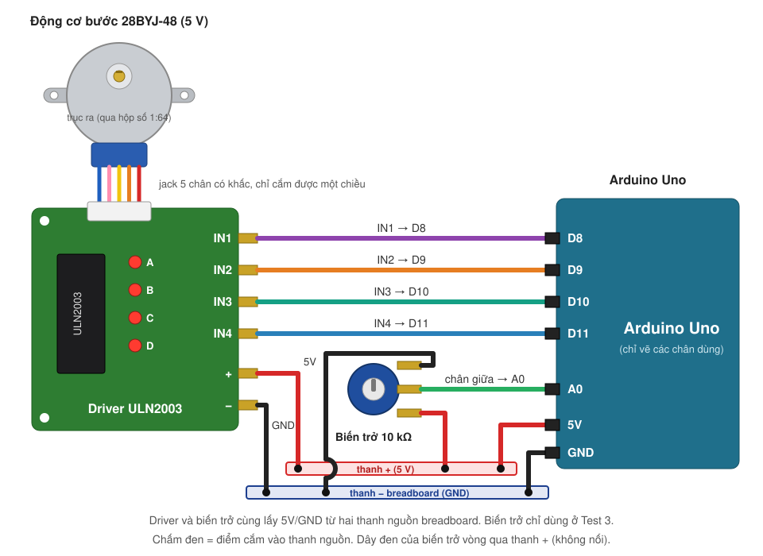

# Lab 16 · Động cơ bước 28BYJ-48 + driver ULN2003

> Điều khiển động cơ bước (stepper motor) 28BYJ-48 qua board driver ULN2003 với Arduino Uno. Lab đi từ nguyên lý "bước", nối dây, quay bằng thư viện `Stepper`, tự viết chuỗi bật cuộn dây (half-step) để thấy động cơ thật sự được điều khiển thế nào, rồi cho trục quay theo biến trở. Khác với servo ở [Lab 4](servo-sg90.md), động cơ bước quay **liên tục nhiều vòng** và định vị bằng cách **đếm bước**, không có cảm biến vị trí bên trong.

## Động cơ bước là gì

Động cơ DC thường cấp điện là quay, không biết đã quay bao nhiêu. Động cơ bước thì khác: bên trong có nhiều **cuộn dây (pha)** xếp quanh rotor nam châm. Mỗi lần đổi cuộn dây được cấp điện, rotor bị hút sang vị trí kế tiếp và **đứng yên ở đó**: đó là một **bước**. Muốn quay một góc bất kỳ chỉ cần gửi đúng số bước; muốn quay nhanh hơn thì gửi bước dồn dập hơn.

Hệ quả:

- **Định vị chính xác mà không cần cảm biến**: biết đã gửi bao nhiêu bước là biết trục đang ở đâu (vòng hở – open loop).
- Nhưng **không biết nếu bị trượt bước**: tải quá nặng hoặc gửi bước quá nhanh, rotor không theo kịp, Arduino vẫn tưởng đã quay đủ.
- **Khi đứng yên vẫn tốn điện**: cuộn dây còn cấp điện để giữ trục (holding torque), nên động cơ nóng dần nếu không tắt.

### 28BYJ-48

Loại rẻ nhất, có sẵn trong hầu hết kit Arduino:

| Thông số | Giá trị |
|---|---|
| Điện áp | 5 V DC |
| Kiểu | **Unipolar**, 4 pha, 5 dây (dây đỏ là chung) |
| Góc bước của motor bên trong | 11,25° (32 bước/vòng, full-step) |
| Hộp số | ~1 : 64 (chính xác là 63,684 : 1) |
| Số bước một vòng **trục ra** | **2048** (full-step) hoặc **4096** (half-step) |
| Tốc độ tối đa thực tế | ~15 vòng/phút |
| Dòng | ~100 mA mỗi cuộn, ~200 mA khi bật 2 cuộn cùng lúc |

Hộp số làm trục ra **chậm nhưng khỏe và mịn**: mỗi bước full-step chỉ 360° / 2048 ≈ 0,18°. Đổi lại, tốc độ tối đa chỉ khoảng 15 vòng/phút (4 giây một vòng).

### Vì sao cần driver ULN2003

Mỗi cuộn dây cần ~100 mA, trong khi chân Arduino chỉ nên cấp tối đa 20 mA. Board driver dùng IC **ULN2003**: 7 transistor Darlington, mỗi kênh chịu được 500 mA. Arduino chỉ gửi tín hiệu logic vào `IN1`–`IN4`; khi `INx` ở mức `HIGH`, transistor tương ứng nối đầu cuộn dây xuống `GND`, dây đỏ chung đã có sẵn 5V nên cuộn dây có điện. IC cũng có sẵn diode dập xung ngược sinh ra khi tắt cuộn dây.

4 LED `A`–`D` trên board nối song song với 4 kênh: LED nào sáng là cuộn đó đang có điện. Đây là công cụ debug rất tiện: chạy chậm là nhìn thấy được chuỗi bước.

## Linh kiện

| Linh kiện | Số lượng |
|---|---|
| Arduino Uno + cáp USB | 1 |
| Động cơ bước 28BYJ-48 (5 V) | 1 |
| Board driver ULN2003 | 1 |
| Biến trở 10 kΩ (Test 3) | 1 |
| Breadboard, dây cắm đực–cái và đực–đực | |

Dán một mẩu băng dính lên trục động cơ làm "kim chỉ": trục quay rất chậm, không có kim thì khó thấy nó có đang quay hay không.

## Nối dây

Cắm jack 5 chân của động cơ vào ổ trắng trên board driver (có khấc, chỉ cắm được một chiều). Phần còn lại:

{width=100%}

| Board ULN2003 | Nối Arduino |
|---|---|
| `IN1` | `8` |
| `IN2` | `9` |
| `IN3` | `10` |
| `IN4` | `11` |
| `+` (5–12V) | `5V` |
| `−` | `GND` |

| Biến trở 10 kΩ | Nối |
|---|---|
| Chân giữa | `A0` |
| Một chân ngoài | `5V` |
| Chân ngoài còn lại | `GND` |

**Về nguồn**: một động cơ 28BYJ-48 (~200 mA) chạy được từ chân `5V` của Uno khi cắm USB, đủ cho lab này. Khi có thêm servo, nhiều động cơ, hay Uno bị reset lúc động cơ khởi động, hãy cấp cho driver một nguồn **5 V riêng** (adapter hoặc 4 pin AA) và **nối chung `GND`** của nguồn đó với `GND` Arduino. Không nối chung GND thì tín hiệu `IN1`–`IN4` không có mốc, động cơ chạy lung tung. Không cấp nguồn > 5 V cho bản 28BYJ-48 5 V dù board ghi 5–12 V: con số đó là của driver, không phải động cơ.

## Code

### Test 1 – quay bằng thư viện `Stepper`

Thư viện `Stepper` có sẵn trong Arduino IDE, không cần cài. Nó dùng chế độ **full-step**, nên một vòng trục ra là **2048 bước**.

**Chú ý thứ tự chân**: thư viện cần các chân theo thứ tự `IN1, IN3, IN2, IN4`, tức `8, 10, 9, 11`. Viết `8, 9, 10, 11` là lỗi phổ biến nhất: động cơ rung, kêu "rè rè" nhưng không quay hoặc chỉ quay một chiều.

```cpp
#include <Stepper.h>

const int STEPS_PER_REV = 2048;   // full-step, 1 vòng trục ra

// Thứ tự chân: IN1, IN3, IN2, IN4 (không phải 8, 9, 10, 11)
Stepper motor(STEPS_PER_REV, 8, 10, 9, 11);

void setup() {
  Serial.begin(9600);
  motor.setSpeed(10);   // vòng/phút; 28BYJ-48 chịu được tối đa ~15
}

void loop() {
  Serial.println("Quay 1 vong");
  motor.step(STEPS_PER_REV);          // số dương: một chiều
  delay(1000);

  Serial.println("Quay nguoc 1/4 vong");
  motor.step(-STEPS_PER_REV / 4);     // số âm: chiều ngược lại, 512 bước = 90°
  delay(1000);
}
```

Thử đổi `setSpeed(10)` thành `5`, `15`, rồi `20`. Từ khoảng 17–18 vòng/phút trở lên, động cơ bắt đầu trượt bước hoặc chỉ rung tại chỗ: tín hiệu đổi nhanh hơn rotor kịp theo.

`motor.step()` là hàm **chặn (blocking)**: một vòng ở 10 vòng/phút mất 6 giây, trong lúc đó `loop()` không làm gì khác được, kể cả đọc cảm biến. Test 3 sẽ giải quyết việc này.

### Test 2 – tự viết chuỗi half-step

Thư viện giấu mất phần thú vị nhất. Ở đây tự bật từng cuộn dây theo chuỗi **half-step** 8 trạng thái: xen kẽ bật **1 cuộn** và **2 cuộn liền kề**, nên rotor dừng cả ở giữa hai vị trí full-step. Kết quả là gấp đôi số bước (**4096 bước/vòng**), chạy mịn và êm hơn.

| Bước | `IN1` (A) | `IN2` (B) | `IN3` (C) | `IN4` (D) |
|---|---|---|---|---|
| 0 | 1 | 0 | 0 | 0 |
| 1 | 1 | 1 | 0 | 0 |
| 2 | 0 | 1 | 0 | 0 |
| 3 | 0 | 1 | 1 | 0 |
| 4 | 0 | 0 | 1 | 0 |
| 5 | 0 | 0 | 1 | 1 |
| 6 | 0 | 0 | 0 | 1 |
| 7 | 1 | 0 | 0 | 1 |

Đi xuôi bảng (0 → 7 → 0 …) là quay một chiều, đi ngược bảng là quay chiều kia. Chỉ dùng các dòng chẵn (0, 2, 4, 6) là **wave drive** (1 cuộn mỗi lúc, yếu hơn); chỉ dùng các dòng lẻ là **full-step 2 pha**, chính là thứ thư viện `Stepper` làm.

Phần dưới đây là **phần khai báo chung**, Test 3 dùng lại:

```cpp
const int IN_PINS[4] = {8, 9, 10, 11};   // IN1..IN4, theo thứ tự tự nhiên
const long STEPS_PER_REV = 4096;          // half-step

const byte HALF_STEP[8][4] = {
  {1, 0, 0, 0},
  {1, 1, 0, 0},
  {0, 1, 0, 0},
  {0, 1, 1, 0},
  {0, 0, 1, 0},
  {0, 0, 1, 1},
  {0, 0, 0, 1},
  {1, 0, 0, 1},
};

int phase = 0;   // đang ở dòng nào của bảng

void stepOnce(int dir) {           // dir = +1 hoặc -1
  phase = (phase + dir + 8) % 8;
  for (int i = 0; i < 4; i++) digitalWrite(IN_PINS[i], HALF_STEP[phase][i]);
}

void release() {                   // tắt cả 4 cuộn: hết giữ trục, hết nóng
  for (int i = 0; i < 4; i++) digitalWrite(IN_PINS[i], LOW);
}

void setupStepper() {
  for (int i = 0; i < 4; i++) pinMode(IN_PINS[i], OUTPUT);
  release();
}
```

Test 2: chạy **thật chậm** 16 bước (nhìn LED `A`–`D` đi đúng chuỗi trong bảng), sau đó quay một vòng ở tốc độ bình thường, rồi quay ngược nửa vòng.

```cpp
// (dán phần khai báo chung ở trên vào đây)

void waitUs(unsigned long us) {
  if (us >= 16000) delay(us / 1000);   // delayMicroseconds() chỉ chính xác tới ~16 ms
  else delayMicroseconds(us);
}

void rotate(long steps, unsigned long usPerStep) {
  int dir = (steps > 0) ? 1 : -1;
  long n = (steps > 0) ? steps : -steps;
  for (long i = 0; i < n; i++) {
    stepOnce(dir);
    waitUs(usPerStep);
  }
  release();
}

void setup() {
  setupStepper();
}

void loop() {
  rotate(16, 400000UL);                 // 0,4 s mỗi bước: xem LED chạy
  delay(1000);
  rotate(STEPS_PER_REV, 1200);          // 1 vòng ≈ 4096 × 1,2 ms ≈ 4,9 s
  delay(1000);
  rotate(-STEPS_PER_REV / 2, 1200);     // ngược nửa vòng
  delay(2000);
}
```

Thử giảm `1200` xuống `1000`, `800`, `600` µs để tìm giới hạn của động cơ trong kit. Dưới ngưỡng đó động cơ kêu nhưng đứng yên: rotor không kịp theo, đây chính là **trượt bước**.

Sau mỗi lần quay, `release()` tắt hết cuộn dây. Bỏ dòng đó đi rồi để vài phút, sờ vỏ động cơ sẽ thấy ấm: cuộn dây vẫn ăn ~100–200 mA chỉ để giữ trục.

### Test 3 – trục quay theo biến trở

Xoay biến trở từ đầu này sang đầu kia, trục động cơ quay theo từ 0 đến 1 vòng. Code **không dùng `delay()`**: mỗi vòng `loop()` đọc biến trở, so với vị trí hiện tại, và chỉ bước thêm một bước nếu đã đủ thời gian kể từ bước trước (`micros()`). Nhờ vậy động cơ đổi hướng ngay khi xoay biến trở ngược lại, không phải chờ hết lượt quay như Test 1.

```cpp
// (dán phần khai báo chung ở trên vào đây)

const int POT_PIN = A0;
const unsigned long STEP_US = 1200;   // thời gian tối thiểu giữa 2 bước
const int DEADBAND = 10;              // lệch ≤ 10 bước (~0,9°) thì coi như tới nơi

long position = 0;                    // vị trí hiện tại, tính bằng bước
unsigned long lastStep = 0;
unsigned long lastMove = 0;
bool released = true;

void setup() {
  setupStepper();
  Serial.begin(9600);
}

void loop() {
  long target = map(analogRead(POT_PIN), 0, 1023, 0, STEPS_PER_REV);
  long diff = target - position;

  if (abs(diff) > DEADBAND) {
    if (micros() - lastStep >= STEP_US) {
      lastStep = micros();
      int dir = (diff > 0) ? 1 : -1;
      stepOnce(dir);
      position += dir;
      lastMove = millis();
      released = false;
    }
  } else if (!released && millis() - lastMove > 500) {
    release();                        // đứng yên 0,5 s thì nhả cuộn dây
    released = true;
    Serial.print("Toi vi tri: ");
    Serial.print(position * 360.0 / STEPS_PER_REV);
    Serial.println(" do");
  }
}
```

- **`DEADBAND`**: giá trị `analogRead` luôn rung vài đơn vị. Không có vùng chết, động cơ sẽ giật qua giật lại liên tục quanh vị trí đích.
- **Vị trí 0 là "lúc bật nguồn"**: động cơ bước không biết trục đang ở đâu. Khi reset, code coi vị trí hiện tại là 0, nên nếu lúc đó biến trở đang ở giữa, trục sẽ quay nửa vòng ngay khi khởi động. Máy in 3D và CNC giải quyết bằng **homing**: lúc khởi động, quay chậm tới khi chạm công tắc hành trình rồi mới đặt `position = 0`.
- Xoay biến trở thật nhanh: trục vẫn đi đều với tốc độ tối đa, không bị trượt bước, vì code không bao giờ bước nhanh hơn `STEP_US`.
- Đảo chiều quay so với biến trở: đổi chỗ hai chân ngoài của biến trở, hoặc dùng `map(..., STEPS_PER_REV, 0)`.

## So sánh: động cơ DC, servo, động cơ bước

| | Động cơ DC | Servo SG90 ([Lab 4](servo-sg90.md)) | Động cơ bước 28BYJ-48 (lab này) |
|---|---|---|---|
| Góc quay | Liên tục | 0–180° | Liên tục, nhiều vòng |
| Biết vị trí? | Không | Có (biến trở bên trong, vòng kín) | Đếm bước (vòng hở) |
| Điều khiển | Điện áp / PWM tốc độ | 1 dây xung PWM | 4 dây, chuỗi pha |
| Tốc độ | Nhanh (hàng nghìn vòng/phút) | Nhanh trong 180° | Chậm (~15 vòng/phút) |
| Giữ vị trí khi đứng yên | Không | Có | Có, khi cuộn dây còn điện |
| Ứng dụng | Quạt, bánh xe | Cần gạt, cửa chắn | Kim đồng hồ, rèm, van, bàn xoay |

Cần nhanh và khỏe hơn (máy in 3D, CNC) thì dùng động cơ bước **bipolar** NEMA 17 với driver A4988/DRV8825: chỉ cần 2 chân Arduino (`STEP`, `DIR`) thay vì 4.

## Lỗi hay gặp

| Hiện tượng | Nguyên nhân thường gặp |
|---|---|
| Động cơ rung, kêu nhưng không quay (Test 1) | Khai báo `Stepper motor(2048, 8, 9, 10, 11)`. Phải là `8, 10, 9, 11` |
| Rung, không quay ở mọi test | Bước quá nhanh: giảm `setSpeed()` hoặc tăng `usPerStep`. Hoặc một dây `IN` cắm lỏng: chạy chậm như đầu Test 2 và xem LED nào không bao giờ sáng |
| LED `A`–`D` nháy đúng nhưng trục không quay | Thiếu nguồn: chân `+`/`−` của driver chưa nối, hoặc jack động cơ chưa cắm hết |
| Không LED nào sáng | Driver chưa có nguồn, hoặc `GND` driver và `GND` Arduino không chung |
| Uno reset / mất USB khi động cơ chạy | Nguồn USB yếu. Dùng nguồn 5 V riêng cho driver, nối chung `GND` |
| Quay được nửa vòng thay vì 1 vòng | Lẫn full-step và half-step: thư viện `Stepper` dùng 2048 bước/vòng, code half-step dùng 4096 |
| Quay nhiều vòng thì lệch dần | Hộp số thực là 63,684 : 1, không phải 64 : 1, nên một vòng thật là ~2038 (full-step) / ~4076 (half-step) bước. Cần quay liên tục chính xác thì dùng số này |
| Động cơ nóng khi đứng yên | Cuộn dây vẫn có điện. Gọi `release()` sau khi quay xong nếu không cần giữ trục |
| Test 3: trục giật qua lại khi không chạm biến trở | `DEADBAND` quá nhỏ so với nhiễu `analogRead` |
