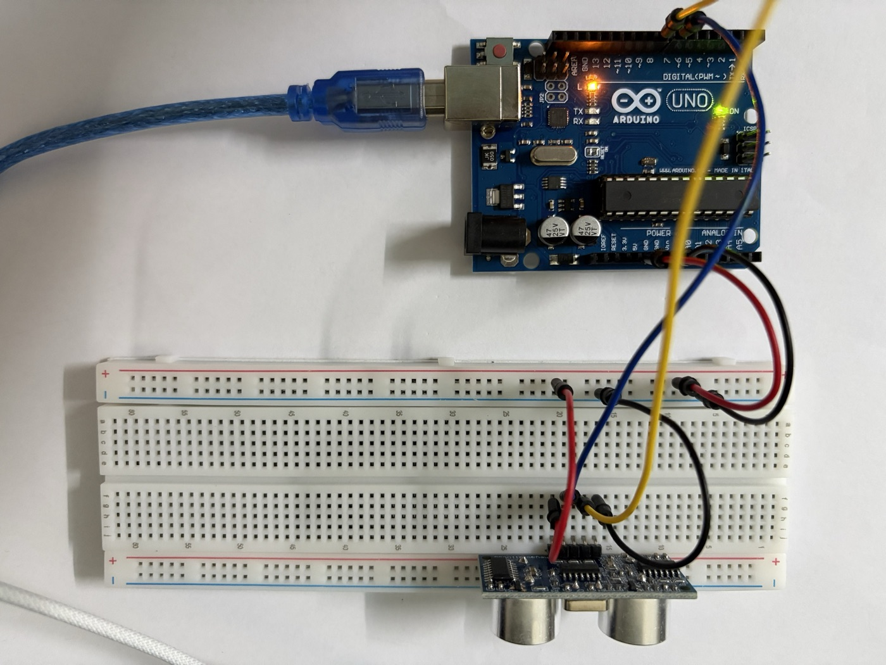

# Lab 6 · Cảm biến siêu âm HC-SR04 / HC-SR05 – đo khoảng cách

> Đo khoảng cách bằng sóng siêu âm với Arduino Uno: phát xung `TRIG`, đo độ rộng xung `ECHO` bằng `pulseIn()`, đổi thời gian ra cm. Sau đó lọc nhiễu bằng trung vị, làm đèn báo lùi xe 3 màu, và bù sai số nhiệt độ bằng DHT11. Đây là lab đầu tiên đọc một cảm biến bằng **độ rộng xung** thay vì mức điện áp.

## Cảm biến siêu âm là gì

Module có hai "mắt" tròn bằng kim loại, nhưng đó không phải camera mà là hai **đầu dò siêu âm** (*transducer*):

- **`T`** (*transmitter*) – loa phát sóng âm tần số **40 kHz**, cao hơn tai người nghe được (≤ 20 kHz).
- **`R`** (*receiver*) – micro thu sóng phản xạ.

Nguyên lý giống con dơi và máy sonar: phát một chuỗi sóng âm, chờ sóng **dội lại** từ vật cản, đo **thời gian đi và về** rồi nhân với vận tốc âm thanh.

$$d = \frac{v_{\text{âm}} \times t}{2}$$

Chia 2 vì sóng đi **tới vật rồi quay về**, quãng đường là gấp đôi khoảng cách.

### Một lần đo diễn ra thế nào

```
TRIG  ___|‾‾‾‾|______________________________________   ← Arduino giữ HIGH 10 µs
          10µs
Sóng  _________|||||||||_____________________________   ← module tự phát 8 xung 40 kHz
ECHO  ___________________|‾‾‾‾‾‾‾‾‾‾‾‾‾‾‾‾‾|_________   ← HIGH suốt thời gian chờ sóng về
                          <------ t ------>
```

1. Arduino kéo `TRIG` lên `HIGH` **ít nhất 10 µs** rồi hạ xuống.
2. Chip trên module phát **8 chu kỳ** sóng 40 kHz (khoảng 200 µs) qua đầu `T`.
3. Ngay sau khi phát xong, module kéo `ECHO` lên `HIGH`.
4. Khi đầu `R` nhận được sóng phản xạ, `ECHO` hạ xuống `LOW`.
5. **Độ rộng xung `ECHO`** chính là thời gian `t` đi và về.

Arduino không cần biết gì về 40 kHz, chỉ cần tạo xung `TRIG` và đo xung `ECHO`.

### Đổi thời gian ra khoảng cách

Ở 20 °C, âm thanh đi được **343 m/s = 0,0343 cm/µs**. Vậy:

$$d\,[\text{cm}] = \frac{t\,[\mu s] \times 0{,}0343}{2} = \frac{t}{58{,}3}$$

| Khoảng cách | Thời gian `ECHO` |
|---|---|
| 2 cm (gần nhất đo được) | ~117 µs |
| 10 cm | ~583 µs |
| 1 m | ~5,8 ms |
| 4 m (xa nhất HC-SR04) | ~23 ms |
| Không có vật cản | ~38 ms rồi tự hạ (tùy module) |

Nhiều tài liệu viết `distance = duration / 58` hoặc `duration * 0.034 / 2`, đều là cùng một công thức làm tròn.

## HC-SR04 và HC-SR05

Hai module dùng chung nguyên lý và **chung code**, khác nhau chủ yếu ở số chân và tầm đo:

| Thông số | HC-SR04 | HC-SR05 |
|---|---|---|
| Số chân | 4: `VCC` · `Trig` · `Echo` · `GND` | 5: `VCC` · `Trig` · `Echo` · `OUT` · `GND` |
| Điện áp | 5 V DC | 5 V DC |
| Dòng tiêu thụ | ~15 mA | ~15 mA (tùy bản dưới 10 mA) |
| Tần số sóng | 40 kHz | 40 kHz |
| Tầm đo | 2–400 cm | 2–450 cm |
| Độ phân giải công bố | ~3 mm | ~2 mm |
| Góc đo | ~15° | ~15° |
| Xung `TRIG` | ≥ 10 µs | ≥ 10 µs |
| Chu kỳ đo tối thiểu | 60 ms | 60 ms |

**Chân `OUT` của HC-SR05:** để trống. Tài liệu của các nhà sản xuất ghi không thống nhất (có bản ghi là ngõ ra công tắc, có bản bắt chước chân chọn chế độ 1 dây của SRF05), còn cách dùng phổ biến với Arduino chỉ cần `Trig` và `Echo`. Nối HC-SR05 y như HC-SR04, bỏ qua `OUT`.

Con số "3 mm" chỉ là độ phân giải lý thuyết. Trên mạch thật, sai số thường cỡ **±1 cm** ở khoảng cách gần, và tăng dần khi đo xa.

**Bản 3,3 V.** HC-SR04 gốc cần 5 V và chân `ECHO` ra mức 5 V. Nếu dùng ESP32/ESP8266 (chân chịu 3,3 V) thì phải hạ áp `ECHO` bằng cầu chia áp (ví dụ 1 kΩ + 2 kΩ), hoặc mua bản **HC-SR04P** chạy được 3–5,5 V.

{width=60%}

Module trong kit là **HC-SR05**, trên mạch in chữ **`HY-SRF05`** (hãng HY, đặt tên theo cảm biến SRF05 mà nó bắt chước). Nhìn mặt trước:

- **Hai đầu dò:** `T` (phát) bên trái, `R` (thu) bên phải, giống hệt HC-SR04.
- **Thạch anh `Y1`** (khối kim loại bạc ở giữa phía trên): tạo xung nhịp cho chip đo thời gian ở mặt sau.
- **5 chân** từ trái sang phải: `Vcc` · `Trig` · `Echo` · `OUT` · `GND`. So với HC-SR04 chỉ thêm `OUT` ở giữa `Echo` và `GND`, nên **đừng cắm theo thói quen 4 chân**: chân thứ tư là `OUT`, `GND` là chân thứ năm.
- **Header bẻ góc 90°:** chân chĩa ra phía sau, song song với mặt mạch. Cắm lên breadboard thì module đứng thẳng, mặt hai "mắt" nhìn ngang, tiện để đo vật phía trước.

## Giới hạn của cảm biến siêu âm

Cảm biến đo được khi sóng **dội thẳng về** đầu `R`. Những trường hợp đo sai hoặc không đo được:

| Tình huống | Vì sao |
|---|---|
| Vật **nghiêng** so với cảm biến (> ~15°) | Sóng phản xạ đi chệch hướng, không về đầu `R` → đọc ra xa hơn thật hoặc timeout |
| Vật **mềm, xốp**: vải, mút, rèm, áo len | Hấp thụ sóng âm, phản xạ yếu |
| Vật **nhỏ, mảnh**: bút, cây que, dây | Bề mặt phản xạ quá nhỏ |
| Vật **gần hơn 2 cm** | Sóng về trước khi module kịp chuyển sang chế độ nghe |
| Hai cảm biến siêu âm chạy cùng lúc | Cảm biến này nhận nhầm sóng của cảm biến kia — đo lần lượt, không đo song song |
| Đo liên tục quá nhanh (< 60 ms) | Sóng dội từ lần đo trước (vật xa, phản xạ nhiều lần) về muộn, bị tính cho lần đo sau |

Ngược lại, siêu âm **không phụ thuộc màu sắc và ánh sáng**: vật đen, vật trong suốt (kính) hay phòng tối đều đo được, điều mà cảm biến hồng ngoại hay camera làm không tốt.

## Linh kiện và chân

| Linh kiện | Số lượng | Ghi chú |
|---|---|---|
| HC-SR04 hoặc HC-SR05 | 1 | |
| LED đỏ + điện trở 220 Ω | 1 bộ | Dùng cho Test 3 |
| Buzzer (còi) | 1 | Dùng cho Test 3. Trong Tinkercad là *Piezo* |
| Module DHT11 | 1 | Dùng cho Test 4, xem [Lab 3](dht11.md) |
| LCD 1602 I²C | 1 | Dùng cho Test 4, xem [Lab 2](lcd-i2c.md) |
| Breadboard, dây đực – đực, dây đực – cái | | |

Nối dây:

| Chân cảm biến | Nối vào Uno |
|---|---|
| `VCC` | `5V` |
| `Trig` | `D7` |
| `Echo` | `D8` |
| `GND` | `GND` |
| `OUT` (chỉ HC-SR05) | Để trống |

Có thể cắm module thẳng lên breadboard (chân hướng xuống, mặt "mắt" quay ra ngoài mép), hoặc dùng **dây đực – cái** dạng cáp dẹt trong kit chụp vào header của module để xoay cảm biến tự do. Đặt cảm biến sao cho **không có gì chắn trước mặt** trong khoảng 30 cm đầu: dây cắm, mép bàn hay thành breadboard nằm trong vùng 15° đều có thể bị đo nhầm.

`Trig`/`Echo` không cần chân PWM hay chân ngắt, chân digital nào cũng được. `D7`/`D8` được chọn để chừa `D2` cho DHT11 (giống Lab 3), `D5`/`D6` cho LED và buzzer, `A4`/`A5` cho LCD.

## Code

### Test 1 – đo khoảng cách

```cpp
#define TRIG_PIN  7
#define ECHO_PIN  8

#define TIMEOUT_US  30000UL   // 30 ms ≈ 5 m đi và về, quá mức này coi như không có vật

void setup() {
  Serial.begin(9600);
  pinMode(TRIG_PIN, OUTPUT);
  pinMode(ECHO_PIN, INPUT);
  digitalWrite(TRIG_PIN, LOW);
}

float doKhoangCach() {
  // xung TRIG 10 µs, có 2 µs LOW trước để xung sạch
  digitalWrite(TRIG_PIN, LOW);
  delayMicroseconds(2);
  digitalWrite(TRIG_PIN, HIGH);
  delayMicroseconds(10);
  digitalWrite(TRIG_PIN, LOW);

  unsigned long t = pulseIn(ECHO_PIN, HIGH, TIMEOUT_US);   // µs, 0 nếu timeout
  if (t == 0) return -1;                                   // không đo được

  return t * 0.0343 / 2.0;                                 // cm
}

void loop() {
  float d = doKhoangCach();

  if (d < 0) {
    Serial.println("Ngoai tam do");
  } else {
    Serial.print("d = ");
    Serial.print(d, 1);
    Serial.println(" cm");
  }
  delay(100);
}
```

Giải thích:

- **`pulseIn(ECHO_PIN, HIGH, timeout)`** chờ chân `ECHO` lên `HIGH`, bấm giờ, chờ xuống `LOW`, rồi trả về số µs. Đây là hàm **chặn** (*blocking*): trong lúc chờ, `loop()` không làm được gì khác.
- **Luôn truyền `timeout`.** Mặc định `pulseIn()` chờ tới **1 giây**. Khi không có vật cản, một số module HC-SR04 bản rẻ giữ `ECHO` ở `HIGH` rất lâu, chương trình sẽ đứng gần 1 s mỗi lần đo. Với 30 ms, hàm trả 0 nếu quá tầm và code in `Ngoai tam do`.
- **`unsigned long`** cho `t`: thời gian có thể tới vài chục nghìn µs, vượt giới hạn 32767 của `int` trên Uno.
- **`delay(100)`** giữa hai lần đo, lớn hơn 60 ms theo khuyến cáo để sóng dội của lần trước tắt hẳn.

**Cách kiểm tra:**

- Đặt cảm biến hướng lên trần nhà hoặc ra phòng trống: Serial in khoảng cách tới trần/tường, hoặc `Ngoai tam do` nếu quá 4 m.
- Đưa bàn tay (hoặc tốt hơn là một quyển sách, mặt phẳng song song với cảm biến) lại gần dần: số giảm theo.
- Dùng thước kẻ đo thật ở **10 cm, 20 cm, 50 cm** và so với số trên Serial. Ghi lại sai lệch.
- Đưa sách sát dưới 2 cm: số nhảy lung tung hoặc lớn bất thường, vì đã dưới tầm đo tối thiểu.
- Nghiêng quyển sách khoảng 45°: số nhảy hoặc báo ngoài tầm, vì sóng dội đi hướng khác.

### Test 2 – lọc nhiễu bằng trung vị

Đo thật sẽ thấy thỉnh thoảng có một số **vọt hẳn ra** (ví dụ 23, 23, 24, **187**, 23…) do sóng dội lạc hoặc một lần timeout. Lấy **trung bình** thì một số vọt cũng kéo lệch kết quả. Lấy **trung vị** (*median*) của 5 lần đo, tức sắp xếp rồi chọn số ở giữa, thì vài số vọt bị loại bỏ hoàn toàn.

```cpp
#define TRIG_PIN  7
#define ECHO_PIN  8
#define TIMEOUT_US  30000UL
#define SO_LAN  5

void setup() {
  Serial.begin(9600);
  pinMode(TRIG_PIN, OUTPUT);
  pinMode(ECHO_PIN, INPUT);
}

float doKhoangCach() {
  digitalWrite(TRIG_PIN, LOW);
  delayMicroseconds(2);
  digitalWrite(TRIG_PIN, HIGH);
  delayMicroseconds(10);
  digitalWrite(TRIG_PIN, LOW);

  unsigned long t = pulseIn(ECHO_PIN, HIGH, TIMEOUT_US);
  if (t == 0) return 999;          // timeout → coi là rất xa, để trung vị đẩy ra cuối
  return t * 0.0343 / 2.0;
}

float doTrungVi() {
  float a[SO_LAN];
  for (int i = 0; i < SO_LAN; i++) {
    a[i] = doKhoangCach();
    delay(60);
  }
  // sắp xếp chèn (insertion sort), mảng nhỏ nên đủ nhanh
  for (int i = 1; i < SO_LAN; i++) {
    float x = a[i];
    int j = i - 1;
    while (j >= 0 && a[j] > x) {
      a[j + 1] = a[j];
      j--;
    }
    a[j + 1] = x;
  }
  return a[SO_LAN / 2];            // phần tử giữa
}

void loop() {
  float tho = doKhoangCach();
  delay(60);
  float loc = doTrungVi();

  // Serial Plotter: 2 đường "tho" và "loc"
  Serial.print("tho:");
  Serial.print(tho > 500 ? 0 : tho);
  Serial.print(" loc:");
  Serial.println(loc > 500 ? 0 : loc);
}
```

Mở **Tools → Serial Plotter** (9600 baud). Định dạng `ten:giatri` giúp Plotter đặt tên cho từng đường.

**Cách kiểm tra:**

- Để cảm biến nhìn vào một bức tường cố định: đường `tho` thỉnh thoảng có gai nhọn, đường `loc` gần như phẳng.
- Đưa tay qua lại nhanh: `loc` phản ứng **chậm hơn** `tho` một chút, vì mỗi giá trị lọc mất 5 × 60 ms = 0,3 s. Đây là cái giá của bộ lọc: càng nhiều lần đo thì càng mượt nhưng càng trễ.

### Test 3 – báo vật cản bằng LED và buzzer

Mạch gốc của bài này là một sơ đồ Fritzing cho **Raspberry Pi**: HC-SR04, một LED đỏ, một điện trở và một buzzer, chân `Echo` đi qua cầu chia áp **R1 220 Ω + R2 330 Ω**. Dưới đây là bản chuyển sang **Arduino Uno** để dựng trên Tinkercad.

**Khác gì so với bản Raspberry Pi:**

| | Raspberry Pi (mạch gốc) | Arduino Uno (lab này) |
|---|---|---|
| Mức logic chân GPIO | 3,3 V, **không chịu được 5 V** | 5 V |
| Chân `Echo` | Phải qua cầu chia áp 220 Ω / 330 Ω: $5 \times \frac{330}{220+330} = 3\,\text{V}$ | **Nối thẳng** vào `D8`, bỏ R1 và R2 |
| `VCC` cảm biến | Chân 5 V của header GPIO | `5V` của Uno |
| Báo động | LED + điện trở + buzzer **nối tiếp** trên một chân GPIO | Mỗi thứ **một chân riêng**: LED `D5`, buzzer `D6` |
| Code | Python (`RPi.GPIO`, `time.time()`) | C++ (`pulseIn()`) |

Tách LED và buzzer ra hai chân vì mắc nối tiếp thì 5 V phải chia cho cả LED, điện trở lẫn buzzer, cả hai đều yếu. Tách ra thì LED sáng rõ, buzzer kêu to, và sửa code điều khiển riêng từng thứ được (ví dụ chỉ nháy LED, không kêu).

Nối dây:

| Từ | Đến |
|---|---|
| Uno `5V` / `GND` | Thanh `+` / `−` breadboard |
| HC-SR04 `Vcc` / `Gnd` | Thanh `+` / `−` |
| HC-SR04 `Trig` | `D7` |
| HC-SR04 `Echo` | `D8` (trực tiếp, không điện trở) |
| LED đỏ | `D5` → điện trở 220 Ω → chân dài (anode); chân ngắn (cathode) → thanh `−` |
| Buzzer | Chân `+` (chân dài) → `D6`; chân `−` → thanh `−` |

```cpp
#define TRIG_PIN    7
#define ECHO_PIN    8
#define LED_PIN     5     // LED đỏ (qua điện trở 220 Ω)
#define BUZZER_PIN  6     // piezo

#define TIMEOUT_US  30000UL
#define CANH_BAO    50    // < 50 cm: bắt đầu báo
#define SAT         10    // < 10 cm: báo liên tục

unsigned long lanBeepTruoc = 0;
bool dangKeu = false;

void setup() {
  Serial.begin(9600);
  pinMode(TRIG_PIN, OUTPUT);
  pinMode(ECHO_PIN, INPUT);
  pinMode(LED_PIN, OUTPUT);
  pinMode(BUZZER_PIN, OUTPUT);
}

float doKhoangCach() {
  digitalWrite(TRIG_PIN, LOW);
  delayMicroseconds(2);
  digitalWrite(TRIG_PIN, HIGH);
  delayMicroseconds(10);
  digitalWrite(TRIG_PIN, LOW);

  unsigned long t = pulseIn(ECHO_PIN, HIGH, TIMEOUT_US);
  if (t == 0) return 999;
  return t * 0.0343 / 2.0;
}

// bật/tắt LED và buzzer cùng lúc
void baoDong(bool bat) {
  digitalWrite(LED_PIN, bat);
  if (bat) tone(BUZZER_PIN, 2000);   // 2 kHz
  else     noTone(BUZZER_PIN);
}

void loop() {
  float d = doKhoangCach();

  if (d >= CANH_BAO) {
    dangKeu = false;                 // xa: tắt hết
    baoDong(false);
  } else if (d < SAT) {
    dangKeu = true;                  // quá sát: LED sáng đứng, còi kêu liên tục
    baoDong(true);
  } else {
    // 10 cm → nháy/bíp mỗi 80 ms, 50 cm → mỗi 500 ms
    unsigned long chuKy = map((long)d, SAT, CANH_BAO, 80, 500);
    if (millis() - lanBeepTruoc >= chuKy) {
      lanBeepTruoc = millis();
      dangKeu = !dangKeu;
      baoDong(dangKeu);
    }
  }

  Serial.print("d = ");
  Serial.print(d, 1);
  Serial.println(" cm");
  delay(60);
}
```

Giải thích:

- **`tone(BUZZER_PIN, 2000)`** phát sóng vuông 2 kHz, dùng được cho cả **buzzer thụ động** (piezo, cần tần số mới kêu, chính là *Piezo* trong Tinkercad) lẫn **buzzer chủ động** (có mạch dao động bên trong, chỉ cần cấp `HIGH`). Nếu kit là buzzer chủ động thì thay `tone()`/`noTone()` bằng `digitalWrite(BUZZER_PIN, HIGH/LOW)` cũng được.
- **LED và buzzer bật tắt cùng nhau** trong hàm `baoDong()`: `digitalWrite(LED_PIN, bat)` cho chân `D5` ra 5 V (LED sáng) hoặc 0 V (LED tắt), cùng lúc với `tone()`/`noTone()` của buzzer. Vì vậy LED nháy đúng nhịp tiếng bíp.
- **Bíp bằng `millis()` chứ không dùng `delay()`**: nếu `delay(chuKy)` thì trong lúc chờ Arduino không đo, vật lại gần mà còi vẫn kêu chậm. Với `millis()`, mỗi vòng `loop()` vẫn đo, chỉ đổi trạng thái khi đủ thời gian. Cùng kỹ thuật với nháy LED không chặn ở [Lab 1](led-basics.md).
- **`map((long)d, SAT, CANH_BAO, 80, 500)`**: `map()` chỉ làm việc với số nguyên nên ép kiểu `d`. Càng gần thì chu kỳ càng ngắn, bíp càng nhanh, đúng kiểu cảm biến lùi xe.
- **`tone()` dùng Timer2**, nên sẽ làm mất PWM ở chân `D3` và `D11`. Lab này không dùng hai chân đó.

**Cách kiểm tra:**

| Khoảng cách | LED | Buzzer |
|---|---|---|
| ≥ 50 cm | tắt | im |
| 10–50 cm | nháy, càng gần càng nhanh | bíp cùng nhịp |
| < 10 cm | sáng đứng | kêu liên tục |

### Test 4 – bù nhiệt độ bằng DHT11, hiển thị LCD

Vận tốc âm thanh **phụ thuộc nhiệt độ không khí**:

$$v \approx 331{,}3 + 0{,}606 \times T \quad [\text{m/s}],\ T \text{ tính bằng °C}$$

| Nhiệt độ | Vận tốc âm | Đo vật thật ở 2 m, code dùng 343 m/s sẽ ra |
|---|---|---|
| 10 °C | 337,4 m/s | 203,3 cm |
| 20 °C | 343,4 m/s | 199,8 cm |
| 30 °C (phòng ở Việt Nam) | 349,5 m/s | 196,3 cm |
| 35 °C | 352,5 m/s | 194,6 cm |

Phòng 30 °C đã lệch gần **2 %**, khoảng 4 cm ở 2 m. Ghép DHT11 của [Lab 3](dht11.md) để đọc nhiệt độ thật và tính lại vận tốc. Nối thêm:

| Linh kiện | Nối vào |
|---|---|
| DHT11 `out` | `D2` |
| DHT11 `+` / `−` | `5V` / `GND` |
| LCD I²C `SDA` / `SCL` | `A4` / `A5` |
| LCD I²C `VCC` / `GND` | `5V` / `GND` |

```cpp
#include <Wire.h>
#include <LiquidCrystal_I2C.h>
#include <DHT.h>

#define TRIG_PIN  7
#define ECHO_PIN  8
#define DHTPIN    2
#define DHTTYPE   DHT11
#define TIMEOUT_US  30000UL

LiquidCrystal_I2C lcd(0x27, 16, 2);
DHT dht(DHTPIN, DHTTYPE);

float nhietDo = 25.0;                 // giá trị mặc định nếu DHT11 lỗi
unsigned long lanDocDhtTruoc = 0;

void setup() {
  pinMode(TRIG_PIN, OUTPUT);
  pinMode(ECHO_PIN, INPUT);
  dht.begin();
  lcd.init();
  lcd.backlight();
}

unsigned long doThoiGian() {
  digitalWrite(TRIG_PIN, LOW);
  delayMicroseconds(2);
  digitalWrite(TRIG_PIN, HIGH);
  delayMicroseconds(10);
  digitalWrite(TRIG_PIN, LOW);
  return pulseIn(ECHO_PIN, HIGH, TIMEOUT_US);
}

void loop() {
  // DHT11 chỉ đọc được mỗi ~1–2 s, nhiệt độ cũng thay đổi chậm
  if (millis() - lanDocDhtTruoc >= 2000) {
    lanDocDhtTruoc = millis();
    float t = dht.readTemperature();
    if (!isnan(t)) nhietDo = t;
  }

  float v = 331.3 + 0.606 * nhietDo;          // m/s
  float cmMoiUs = v / 10000.0;                // m/s → cm/µs

  unsigned long t = doThoiGian();

  lcd.setCursor(0, 0);
  if (t == 0) {
    lcd.print("d: ngoai tam    ");
  } else {
    float dBu = t * cmMoiUs / 2.0;            // có bù nhiệt
    float d20 = t * 0.0343 / 2.0;             // giả sử 20 °C
    lcd.print("d:");
    lcd.print(dBu, 1);
    lcd.print(" (");
    lcd.print(d20, 1);
    lcd.print(")    ");
  }

  lcd.setCursor(0, 1);
  lcd.print("T:");
  lcd.print(nhietDo, 0);
  lcd.print((char)223);                       // ký tự ° trong ROM HD44780
  lcd.print("C v:");
  lcd.print(v, 0);
  lcd.print("m/s ");

  delay(100);
}
```

Dòng 1 hiện khoảng cách **có bù nhiệt**, trong ngoặc là số **không bù** (giả sử 20 °C) để so sánh. Dòng 2 hiện nhiệt độ và vận tốc âm đang dùng.

**Cách kiểm tra:**

- Đặt cảm biến cách tường đúng **1 m** (đo bằng thước dây). Số có bù phải gần 100 cm hơn số trong ngoặc. Ở phòng 30 °C, hai số chênh nhau khoảng 2 cm.
- Ở khoảng cách gần (10–20 cm), hai số gần như bằng nhau: sai số nhiệt tỉ lệ với khoảng cách, nên chỉ đáng kể khi đo xa.
- Độ ẩm cũng ảnh hưởng vận tốc âm nhưng rất ít (dưới 0,5 %), bỏ qua được.

### Mở rộng: thư viện NewPing

Thư viện **NewPing** (cài qua **Library Manager**) gói sẵn phần phát xung, timeout và lọc trung vị:

```cpp
#include <NewPing.h>

NewPing sonar(7, 8, 400);        // TRIG, ECHO, khoảng cách tối đa (cm)

void setup() { Serial.begin(9600); }

void loop() {
  unsigned int cm = sonar.convert_cm(sonar.ping_median(5));   // trung vị 5 lần, 0 = ngoài tầm
  Serial.println(cm);
  delay(100);
}
```

NewPing cũng hỗ trợ chế độ **1 chân** (nối `TRIG` và `ECHO` chung một chân Arduino) để tiết kiệm chân, và đo **không chặn** bằng ngắt timer. Lab vẫn viết tay ở các Test trên để hiểu rõ `TRIG`/`ECHO` hoạt động thế nào.

## Ứng dụng của cảm biến siêu âm

| Lĩnh vực | Ví dụ | Cảm biến làm gì |
|---|---|---|
| Ô tô | Cảm biến lùi xe, hỗ trợ đỗ xe | Đo khoảng cách tới xe/tường phía sau, báo tít nhanh dần (chính là Test 3) |
| Robot | Robot tránh vật cản | Đo phía trước, gần hơn ngưỡng thì rẽ |
| Đo mức | Bồn nước, thùng rác thông minh | Gắn trên nắp hướng xuống, khoảng cách tới mặt nước/rác cho biết mức đầy |
| Bãi đỗ xe | Đèn báo chỗ trống trên trần | Có xe đỗ thì khoảng cách giảm đột ngột → đổi đèn đỏ |
| Đếm người | Cửa ra vào | Khoảng cách tới cửa đối diện tụt xuống khi có người đi qua |
| Y tế / tiện ích | Máy rửa tay, thùng rác tự mở nắp | Đưa tay lại gần thì kích hoạt |

### Trong hệ IoT

HC-SR04 là ví dụ cho kiểu **cảm biến đo thời gian** (*time-of-flight*) ở tầng thiết bị: tín hiệu là **độ rộng xung**, không qua ADC như quang trở. Vài hướng ghép:

- **HC-SR04 + servo (Lab 4)**: gắn cảm biến lên cánh tay servo, quét 0–180° và in cặp (góc, khoảng cách) để vẽ "radar" trên máy tính.
- **Đo mức nước bồn + ESP32**: mỗi 10 phút gửi mức nước lên cloud, cảnh báo khi bồn sắp cạn. Nhớ hạ áp chân `ECHO` về 3,3 V.
- **Thùng rác thông minh**: một HC-SR04 trên nắp đo mức đầy, một cái phía trước phát hiện tay để servo mở nắp. Nhớ **đo lần lượt** hai cảm biến, không phát cùng lúc.

## Mô phỏng

Tinkercad Circuits có sẵn **Ultrasonic Distance Sensor (4-pin)**, chính là HC-SR04 (tìm `ultrasonic` trong ô linh kiện). Không có HC-SR05, nhưng code giống hệt nên dùng bản 4 chân để mô phỏng.

1. Kéo *Arduino Uno R3*, *Breadboard small* và *Ultrasonic Distance Sensor (4-pin)* vào.
2. Nối `VCC` → `5V`, `TRIG` → `D7`, `ECHO` → `D8`, `GND` → `GND`.
3. Dán code Test 1, bấm **Start Simulation**, mở **Serial Monitor**.
4. **Bấm vào cảm biến** lúc đang mô phỏng sẽ hiện một vùng hình quạt và một chấm tròn (vật cản ảo). Kéo chấm lại gần hoặc ra xa thì số trên Serial thay đổi theo. Kéo chấm ra ngoài vùng quạt thì code in `Ngoai tam do`.

### Dựng mạch Test 3 trên Tinkercad

Bản Arduino của mạch Fritzing (Raspberry Pi) ở Test 3, gồm cảm biến, LED và buzzer.

1. Kéo vào: *Arduino Uno R3*, *Breadboard small*, *Ultrasonic Distance Sensor (4-pin)*, *LED* (đỏ), *Resistor* (đổi thành **220 Ω**) và *Piezo*.
2. **Nguồn:** `5V` của Uno (dây đỏ) → thanh `+` phía trên breadboard; `GND` (dây đen) → thanh `−` phía trên.
3. **Cảm biến** (đặt ngoài breadboard, bên phải):
   - `VCC` → thanh `+` (dây đỏ)
   - `GND` → thanh `−` (dây đen)
   - `TRIG` → `D7` của Uno (dây xanh dương)
   - `ECHO` → `D8` của Uno (dây vàng) — **không** cần R1/R2 như bản Raspberry Pi
4. **Piezo** (đặt ngoài breadboard): chân `+` → `D6` của Uno, chân `−` → thanh `−` (dây đen).
5. **LED** cắm ở hàng `j`: chân thẳng (cathode) ở **cột 10**, chân cong (anode) ở **cột 11**.
6. **Điện trở 220 Ω** nằm ngang ở hàng `h`, từ **h11** (cùng cột anode) đến **h15**.
7. Dây từ **i10** lên thanh `−` (đen), dây từ **j15** lên `D5` của Uno (cam).
8. Dán code Test 3, **Start Simulation**. Bấm vào cảm biến, kéo chấm vật cản vào trong 50 cm: LED nháy và loa máy tính phát tiếng bíp, kéo càng gần càng nhanh.

Tinkercad phát tiếng piezo qua loa máy tính, nhớ bật âm lượng. Nếu LED không sáng thì thường do cắm ngược chân (đổi cột 10 và 11), hoặc điện trở cắm lệch sang cột 10 (cột cathode) thay vì cột 11.

Cảm biến trong Tinkercad cho số đúng tuyệt đối, không nhiễu và không phụ thuộc nhiệt độ, nên Test 2 và Test 4 chỉ thấy tác dụng trên mạch thật. Tinkercad không có DHT11, chỉ có *Temperature Sensor [TMP36]*, nên muốn mô phỏng Test 4 thì thay DHT11 bằng TMP36 đọc qua `analogRead()`.

{width=100%}

Đọc mạch theo từng đường:

- **Nguồn:** `5V` (dây đỏ) và `GND` (dây đen) của Uno đi vào thanh `+` và `−` phía trên breadboard, ở đầu bên trái.
- **HC-SR04:** nằm ngoài breadboard, bên phải. `VCC` (dây đỏ) và `GND` (dây đen) đi xuống đầu bên phải của hai thanh nguồn. `TRIG` (dây xanh dương) và `ECHO` (dây vàng) chạy ngang lên header digital, vào `D7` và `D8`. Không có điện trở chia áp như bản Raspberry Pi.
- **Piezo:** nằm phía trên Uno. Chân `+` (dây vàng) đi vào `D6`, chân `−` (dây đen) chạy xuống thanh `−` ở giữa breadboard.
- **LED:** cắm ở hàng `j`, cột 10 (cathode) và 11 (anode). Dây đen từ cột 10 lên thanh `−`. Điện trở 220 Ω (vòng đỏ – đỏ – nâu) nằm ở hàng `h` từ cột 11 sang cột 15, rồi dây cam từ cột 15 chạy thẳng lên `D5`, ngay cạnh dây piezo ở `D6`.

Dây chân `+` của piezo và dây `ECHO` cùng màu vàng, cắm sát nhau ở `D6` và `D8`. Khi dò lỗi, bấm vào từng dây để xem nó nối chân nào.

## Ảnh thực tế

### Mạch thật với HC-SR05

{width=100%}

Đọc mạch:

- **Cảm biến** cắm ở mép dưới breadboard, **lật ngửa** (nhìn thấy mặt sau có chip), header bẻ góc 90° cắm vào lỗ, hai đầu dò chĩa ra ngoài mép bàn. Cách đặt này giúp phía trước cảm biến không bị breadboard hay dây che.
- Vì module lật ngửa nên thứ tự chân **vẫn là** `Vcc` · `Trig` · `Echo` · `OUT` · `GND` tính từ trái sang, giống mặt trước. Lật module mà không xoay thì trái phải không đổi.
- **Dây từ cảm biến:** đỏ (`Vcc`) và đen (`GND`) lên thanh nguồn phía trên. Xanh dương và vàng (`Trig`/`Echo`) chạy thẳng lên header digital của Uno. Chân `OUT` để trống.
- **Nguồn:** dây đỏ và đen từ header POWER của Uno vào thanh `+`/`−` phía trên breadboard.

### Video Test 3 (cảm biến + buzzer)

<video controls playsinline preload="metadata" poster="../assets/ultrasonic-real-poster.jpg" style="display:block; max-width:360px; width:100%; margin:0 auto; border-radius:8px;">
  <source src="../assets/ultrasonic-real.mp4" type="video/mp4">
</video>

Mạch thật chạy code Test 3, bản chỉ có cảm biến và buzzer, không có LED:

- **HC-SR05** cắm ở mép breadboard, hai đầu dò quay ra phía sau khung hình.
- **Buzzer** (vỏ đen tròn) cắm bên phải breadboard: dây vàng lên chân điều khiển của Uno, dây đen xuống thanh `−`.
- Trên Uno, đèn `ON` sáng xanh, đèn `TX` nháy cam liên tục vì code in khoảng cách ra Serial mỗi vòng `loop()`.

Video có tiếng, nên **bật âm thanh** khi xem.

Kết quả:

- **Không đưa tay vào**, còi vẫn **bíp ngắt quãng đều đặn**. Đây không phải lỗi: ngay trước cảm biến có màn hình (vật tối màu phía trên khung hình) nằm trong khoảng 10–50 cm, nên code coi đó là vật cản và báo ở mức giữa.
- **Đưa vật lại gần dưới 10 cm**, còi chuyển sang **kêu liền một hồi dài**, đúng nhánh `d < SAT` trong code.

Muốn còi **im** khi không có ai lại gần thì:

- xoay cảm biến ra chỗ trống, hoặc dời vật phía trước ra xa hơn 50 cm;
- hoặc giảm vùng báo động, ví dụ `#define CANH_BAO 20`.

Mở **Serial Monitor** để xem dòng `d = ... cm`, biết cảm biến đang "thấy" vật ở khoảng cách bao nhiêu.

> 📷 *Chờ ảnh Serial Monitor/Serial Plotter.*

## Lỗi hay gặp

| Hiện tượng | Nguyên nhân / cách xử lý |
|---|---|
| Luôn in `Ngoai tam do` (hoặc 0) | Đổi lẫn dây `Trig`/`Echo`, hoặc thiếu `VCC` 5 V. Kiểm tra lại `#define TRIG_PIN`/`ECHO_PIN` khớp với dây |
| Mỗi lần đo chậm khoảng 1 giây | Gọi `pulseIn()` không có `timeout` và module giữ `ECHO` lâu khi không có vật — thêm tham số `TIMEOUT_US` |
| Số đọc luôn rất nhỏ (2–5 cm) hoặc cố định | Có vật chắn sát trước cảm biến: dây cắm, mép breadboard, ngón tay giữ module. Đưa cảm biến ra mép bàn |
| Thỉnh thoảng có số vọt rất lớn | Sóng dội lạc hoặc timeout — lọc trung vị như Test 2 |
| Đo tường thì đúng, đo người/áo thì sai | Vải hấp thụ sóng âm — bình thường với cảm biến siêu âm |
| Đo xa luôn hụt vài cm | Phòng nóng, vận tốc âm lớn hơn 343 m/s — bù nhiệt độ như Test 4 |
| Hai cảm biến cùng mạch đo sai | Phát cùng lúc, nhận nhầm sóng của nhau — đo lần lượt, cách nhau ≥ 60 ms |
| HC-SR05 không chạy dù nối giống HC-SR04 | Lỡ nối chân `OUT` vào `Trig`/`Echo` hoặc `GND`. Rút dây `OUT` ra, để trống |
| ESP32 đọc lung tung hoặc chân bị nóng | `ECHO` ra 5 V vào chân 3,3 V — thêm cầu chia áp hoặc dùng HC-SR04P |
