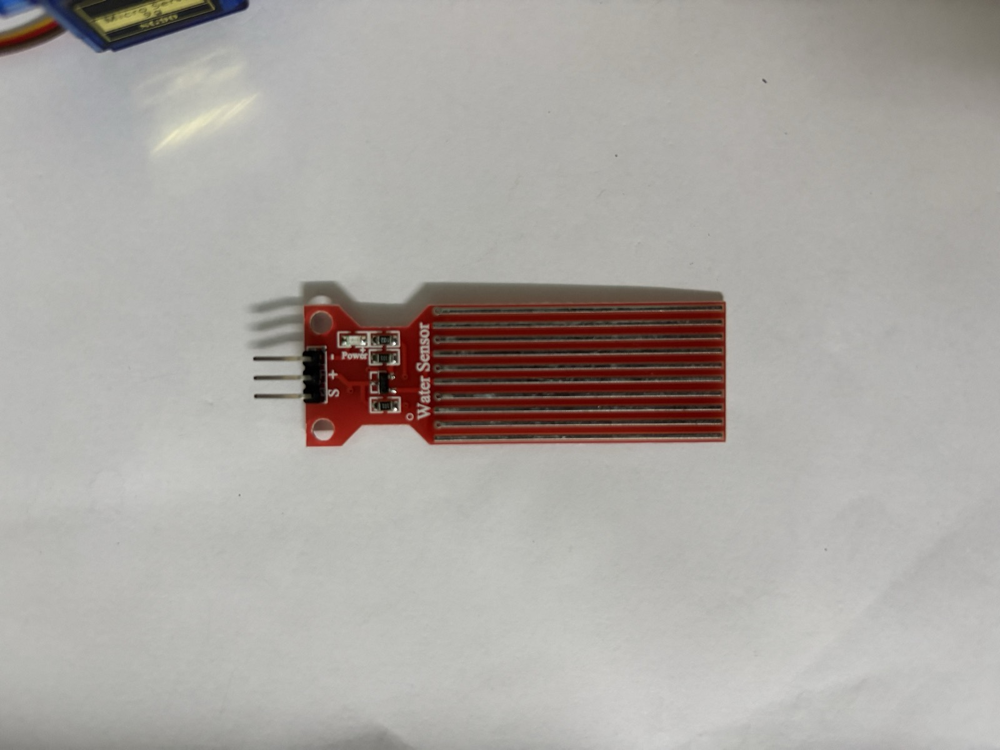

# Lab 11 · Cảm biến mực nước (water sensor)

> Đọc module cảm biến nước bằng Arduino Uno: in giá trị analog lên Serial Monitor và quan sát số đọc thay đổi khi nhúng cảm biến vào nước. Lab này chỉ làm test cơ bản.

## Cảm biến nước là gì

Module **water sensor** (hay *water level sensor*, *rain/water detection sensor*) là một mạch in màu đỏ, phần dưới có nhiều **đường đồng song song để trần**, xen kẽ nhau: một nửa nối nguồn, một nửa nối về chân tín hiệu qua một transistor NPN. Khi khô, giữa các đường không có dòng điện. Khi nước chạm vào, nước (có lẫn ion, không phải nước cất) dẫn điện nối các đường lại với nhau, transistor dẫn, điện áp ở chân tín hiệu tăng lên. **Ngập càng sâu**, càng nhiều đường được nối, **điện áp càng cao**.

| Thông số | Giá trị điển hình |
|---|---|
| Điện áp hoạt động | 3–5 V |
| Dòng tiêu thụ | < 20 mA |
| Ngõ ra | Analog (0 V khi khô, tăng dần khi ngập) |
| Vùng phát hiện | ~40 × 16 mm |
| Đèn trên module | LED nguồn `PWR` sáng khi cấp điện |

Module có 3 chân:

| Chân | Ý nghĩa |
|---|---|
| `S` (signal) | Ngõ ra analog |
| `+` | Nguồn 5 V |
| `−` | GND |

{width=40%}

Nhìn từ mặt trước, từ trên xuống:

- **Hàng 3 chân cắm** ghi `S`, `+`, `−` từ trái sang phải. Chân cắm thẳng, dùng dây đực – cái nối thẳng vào Uno.
- **Đèn `Power`** (LED dán nhỏ) và điện trở hạn dòng của nó: sáng khi có điện, không liên quan đến nước.
- **Transistor** (con chip đen 3 chân ở giữa) và hai điện trở dán: phần khuếch đại tín hiệu ra chân `S`.
- **10 đường đồng song song**, xen kẽ hai nhóm. Các đường có **lỗ tròn nhỏ ở đầu trên** được nối chung với nhau ở mặt sau; các đường còn lại nối chung ở phía trên. Nước bắc cầu giữa hai nhóm thì có tín hiệu.
- Hai **lỗ bắt vít** ở hai bên hàng chân, dùng để gắn module lên thành bể/thùng.

::: {layout-ncol=2}



:::

Cảm biến này chỉ cho biết **có nước / ngập nhiều hay ít**, không đo mực nước chính xác theo mm: số đọc phụ thuộc độ dẫn điện của nước (nước máy, nước muối, nước mưa cho số khác nhau).

## Linh kiện và chân

| Linh kiện | Số lượng |
|---|---|
| Arduino Uno | 1 |
| Module water sensor | 1 |
| Dây đực – cái | 3 |
| Cốc nước | 1 |

Nối dây:

| Module | Uno |
|---|---|
| `S` | `A0` |
| `+` | `5V` |
| `−` | `GND` |

## Code

### Test 1 – đọc giá trị cảm biến

```cpp
#define WATER_PIN A0

void setup() {
  Serial.begin(9600);
}

void loop() {
  int raw = analogRead(WATER_PIN);   // 0–1023

  Serial.print("Water = ");
  Serial.println(raw);
  delay(500);
}
```

**Cách kiểm tra:**

- Để cảm biến khô ngoài không khí: số đọc gần **0** (thường dưới 10).
- Nhúng **đầu** vùng đường đồng vào cốc nước: số tăng vọt lên vài trăm.
- Nhúng sâu dần: số tăng tiếp, nhưng chậm dần và gần bão hòa khi ngập gần hết vùng đồng.
- Rút ra: số giảm về gần 0. Nếu còn giọt nước đọng giữa các đường đồng thì số có thể còn vài chục, lau khô là hết.
- Mở **Tools → Serial Plotter** (9600 baud) để thấy đồ thị lên xuống khi nhúng/rút.

**Chỉ nhúng phần có đường đồng**, không để nước chạm tới linh kiện và chân cắm phía trên module.

## Lưu ý: cảm biến bị ăn mòn

Khi cấp điện liên tục mà các đường đồng ngâm trong nước, dòng điện một chiều gây **điện phân**, đường đồng bị oxy hóa và mòn dần sau vài ngày đến vài tuần, số đọc sẽ lệch. Khi dùng lâu dài (không chỉ test), nên cấp nguồn cho module bằng một chân digital, chỉ bật lúc đọc:

```cpp
#define WATER_PIN  A0
#define POWER_PIN  7     // chân + của module nối D7 thay vì 5V

void setup() {
  Serial.begin(9600);
  pinMode(POWER_PIN, OUTPUT);
  digitalWrite(POWER_PIN, LOW);
}

void loop() {
  digitalWrite(POWER_PIN, HIGH);
  delay(10);                          // chờ module ổn định
  int raw = analogRead(WATER_PIN);
  digitalWrite(POWER_PIN, LOW);

  Serial.print("Water = ");
  Serial.println(raw);
  delay(1000);
}
```

Module tiêu thụ dưới 20 mA, chân digital của Uno cấp được (tối đa 40 mA, khuyến nghị 20 mA).

## Lỗi hay gặp

| Hiện tượng | Nguyên nhân / cách xử lý |
|---|---|
| Đèn `PWR` không sáng, số luôn 0 | Thiếu dây `+` hoặc `−`, hoặc cắm ngược |
| Số nhảy lung tung khi khô | Dây `S` không chạm `A0`, chân analog đang thả nổi |
| Khô mà số vẫn vài chục | Còn nước đọng giữa các đường đồng — lau khô |
| Nhúng nước số tăng rất ít | Dùng nước cất / nước tinh khiết (ít ion, dẫn điện kém) — thử nước máy |
| Số đọc trôi dần qua nhiều ngày | Đường đồng bị điện phân ăn mòn — chỉ cấp nguồn lúc đọc như phần lưu ý |
