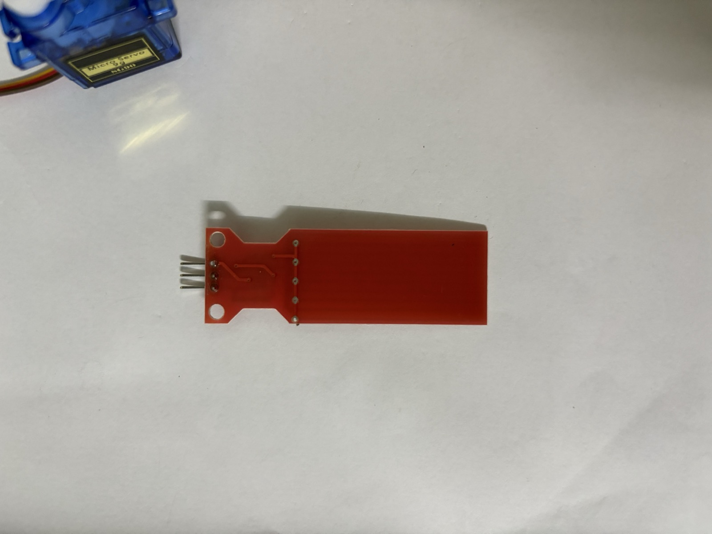

> Đọc module cảm biến nước bằng Arduino Uno: in giá trị analog lên Serial Monitor và quan sát số đọc thay đổi khi nhúng cảm biến vào nước, làm mạch báo có nước bằng LED, rồi đo mực nước (cm) hiện lên Serial.

## Giới thiệu module

### Nguyên lý hoạt động

Module **water sensor** (hay *water level sensor*, *rain/water detection sensor*) là một mạch in màu đỏ, phần dưới có nhiều **đường đồng song song để trần**, xen kẽ nhau: một nửa nối nguồn, một nửa nối về chân tín hiệu qua một transistor NPN. Khi khô, giữa các đường không có dòng điện. Khi nước chạm vào, nước (có lẫn ion, không phải nước cất) dẫn điện nối các đường lại với nhau, transistor dẫn, điện áp ở chân tín hiệu tăng lên. **Ngập càng sâu**, càng nhiều đường được nối, **điện áp càng cao**.

### Thông số

| Thông số | Giá trị điển hình |
|---|---|
| Điện áp hoạt động | 3–5 V |
| Dòng tiêu thụ | < 20 mA |
| Ngõ ra | Analog (0 V khi khô, tăng dần khi ngập) |
| Vùng phát hiện | ~40 × 16 mm |
| Đèn trên module | LED nguồn `PWR` sáng khi cấp điện |

### Ứng dụng

- **Báo mưa**: gắn ngoài trời, có giọt nước bắc qua các đường đồng thì báo, dùng để tự thu phơi đồ hoặc đóng cửa sổ.
- **Báo rò rỉ nước**: đặt dưới gầm máy giặt, bồn rửa, đáy tủ lạnh.
- **Theo dõi mực nước** trong bể cá, thùng chứa, chậu cây (xem phần *Xem thêm*).
- **Trong hệ IoT**: gửi trạng thái "có nước / mức nước" lên cloud để cảnh báo qua điện thoại.

### Hình thực tế

{width=40%}

Nhìn từ mặt trước, từ trên xuống:

- **Hàng 3 chân cắm** ghi `S`, `+`, `−` từ trái sang phải. Chân cắm thẳng, dùng dây đực – cái nối thẳng vào Uno.
- **Đèn `Power`** (LED dán nhỏ) và điện trở hạn dòng của nó: sáng khi có điện, không liên quan đến nước.
- **Transistor** (con chip đen 3 chân ở giữa) và hai điện trở dán: phần khuếch đại tín hiệu ra chân `S`.
- **10 đường đồng song song**, xen kẽ hai nhóm. Các đường có **lỗ tròn nhỏ ở đầu trên** được nối chung với nhau ở mặt sau; các đường còn lại nối chung ở phía trên. Nước bắc cầu giữa hai nhóm thì có tín hiệu.
- Hai **lỗ bắt vít** ở hai bên hàng chân, dùng để gắn module lên thành bể/thùng.

::: {layout-ncol=2}



:::

Cảm biến này chỉ cho biết **có nước / ngập nhiều hay ít**, không đo mực nước chính xác theo mm: số đọc phụ thuộc độ dẫn điện của nước (nước máy, nước muối, nước mưa cho số khác nhau).

## Chân và cách lắp

### Chân module

| Chân | Ý nghĩa |
|---|---|
| `S` (signal) | Ngõ ra analog |
| `+` | Nguồn 5 V |
| `−` | GND |

### Linh kiện và nối dây

| Linh kiện | Số lượng |
|---|---|
| Arduino Uno | 1 |
| Module water sensor | 1 |
| Dây đực – cái | 3 |
| Cốc nước | 1 |
| LED + điện trở 220 Ω | 1 bộ (Test 2) |
| Breadboard, dây đực – đực | (Test 2) |

Nối dây:

| Module | Uno |
|---|---|
| `S` | `A0` |
| `+` | `5V` |
| `−` | `GND` |

### Lắp mạch

Mạch đầy đủ (dùng cho cả Test 1 và Test 2):

```
                 ┌──────────── Arduino Uno ────────────┐
                 │  5V    GND         A0           D8  │
                 └───┬─────┬───────────┬────────────┬──┘
                     │     │           │            │
 thanh + breadboard ─┘     │           │         [220 Ω]
 thanh − breadboard ───────┘           │            │
                                       │          LED (chân dài)
   Water sensor                        │            │
     S  ───────────────────────────────┘          LED (chân ngắn)
     +  ── thanh +                                  │
     −  ── thanh −                       thanh − ───┘
```

**Rút cáp USB ra trước khi cắm dây**, lắp xong và kiểm tra lại mới cắm điện.

**Bước 1 – nguồn ra breadboard.** Dây đực – đực: `5V` của Uno → thanh `+` (vạch đỏ) của breadboard, `GND` của Uno → thanh `−` (vạch xanh). Từ đây module và LED đều lấy nguồn từ hai thanh này.

**Bước 2 – cảm biến.** Cầm module, mặt có chữ `S + −` hướng về phía mình. Dùng 3 dây đực – cái, đầu **cái** cắm vào chân module:

| Chân module | Đầu đực cắm vào |
|---|---|
| `S` (trái) | Chân `A0` của Uno |
| `+` (giữa) | Thanh `+` breadboard |
| `−` (phải) | Thanh `−` breadboard |

Nên dùng dây khác màu (ví dụ vàng – đỏ – đen) để khỏi nhầm. Đặt module đứng, chân cắm ở trên, phần đường đồng chĩa xuống phía cốc nước. Dây đủ dài để module nằm **xa** Uno và breadboard, phòng nước văng.

**Bước 3 – LED (chỉ cần cho Test 2).** Trên breadboard, chọn một chỗ trống, ví dụ cột 10 và 11:

1. **Nhận chân LED**: chân **dài** là cực dương (+), chân ngắn là cực âm (−); nhìn trong bóng LED thì cực âm là bản kim loại to hơn, vành LED phía cực âm có chỗ vát phẳng.
2. Cắm **chân dài** vào hàng `e` cột 10, **chân ngắn** thẳng xuống thanh `−`.
3. Cắm **điện trở 220 Ω** (vòng đỏ – đỏ – nâu) từ hàng `a` cột 10 sang hàng `a` cột 15. Điện trở không phân cực, chiều nào cũng được.
4. Dây đực – đực từ hàng `c` cột 15 → chân `D8` của Uno.

Đường đi của dòng điện: `D8` → dây → cột 15 → điện trở → cột 10 → LED → thanh `−` → `GND`.

**Bước 4 – kiểm tra trước khi cắm điện.**

- Đếm lại 3 dây của module: `S` vào `A0` (hàng chân analog, phía dưới bên phải), **không phải** chân `D0`.
- `+` và `−` của module không bị đảo. Cắm ngược nguồn có thể làm hỏng transistor trên module.
- LED đúng chiều: chân dài phía điện trở, chân ngắn ở thanh `−`.
- Thanh `+` và `−` không có dây nào nối tắt với nhau.

**Bước 5 – cắm USB, nạp code.** Cắm cáp USB: đèn `Power` trên module phải sáng ngay (chưa cần code). Không sáng thì quay lại kiểm tra dây `+`/`−`. Sau đó nạp code Test 1 hoặc Test 2 bên dưới và mở **Serial Monitor** ở 9600 baud.

**Bước 6 – thử với nước.** Đặt cốc nước **xa** Uno và breadboard, nhúng từ từ phần đường đồng vào. Lần đầu chỉ nhúng 1–2 cm để thấy số thay đổi, không nhúng quá vạch chữ *Water Sensor*.

## Ví dụ mạch thực tế: có nước thì đèn sáng

Cảm biến chạm nước thì LED sáng, khô thì tắt. Mạch như phần [Lắp mạch](#lắp-mạch), gồm cả LED ở bước 3: `D8` → điện trở 220 Ω → chân dài LED, chân ngắn LED → `GND`. Muốn chỉ xem số đọc thô mà không cần LED, xem Test 1 ở phần *Xem thêm*.

```cpp
#define WATER_PIN  A0
#define LED_PIN    8

#define NGUONG     100   // số đọc lớn hơn mức này → coi là có nước

void setup() {
  Serial.begin(9600);
  pinMode(LED_PIN, OUTPUT);
}

void loop() {
  int raw = analogRead(WATER_PIN);
  bool coNuoc = raw > NGUONG;

  digitalWrite(LED_PIN, coNuoc ? HIGH : LOW);

  Serial.print("Water = ");
  Serial.print(raw);
  Serial.println(coNuoc ? "  -> CO NUOC" : "  -> kho");
  delay(200);
}
```

Giải thích:

- **Ngưỡng `NGUONG`**: lúc khô số đọc gần 0, vừa chạm nước đã nhảy lên vài trăm, nên khoảng cách rất rộng, một ngưỡng 100 là đủ, không cần hysteresis như [Lab 5](photoresistor.md). Nếu số `Water` in ra Serial lúc khô của bạn cao hơn (nước đọng, độ ẩm cao) thì nâng ngưỡng lên.
- **Không có LED rời?** Đổi `LED_PIN` thành `13` để dùng LED `L` có sẵn trên board Uno.

**Cách kiểm tra:**

- Cảm biến khô: LED tắt, Serial in `-> kho`.
- Nhúng đầu cảm biến vào cốc nước: LED sáng ngay, Serial in `-> CO NUOC`.
- Nhỏ một giọt nước bắc ngang hai đường đồng cạnh nhau: LED cũng sáng. Đây là cách module dùng để **báo mưa** hoặc **báo rò rỉ nước** dưới gầm máy giặt.
- Rút ra và lau khô: LED tắt.

### Mạch thật và video

<video controls playsinline preload="metadata" poster="../assets/water-sensor-led-real-poster.jpg" style="display:block; max-width:640px; width:100%; margin:0 auto; border-radius:8px;">
  <source src="../assets/water-sensor-led-real.mp4" type="video/mp4">
</video>

Mạch thật chạy code Test 2:

- **Module water sensor** nằm cạnh bát nước, nối về Uno bằng 3 dây: vàng (`S` → `A0`), đỏ (`+` → `5V`), đen (`−` → `GND`). Đèn `Power` đỏ trên module sáng ngay khi cắm USB, kể cả lúc chưa có nước.
- **LED vàng** trên breadboard, có điện trở 220 Ω, nối về `D8` và `GND` bằng hai dây xanh lá.

Kết quả:

- **Khoảng 0–4 s**: cảm biến khô, nằm trên mặt giấy. LED vàng **tắt**.
- **Khoảng 4–6 s**: cầm module ở phần chân cắm, nhúng vùng đường đồng xuống bát nước. Ngay khi đường đồng chạm nước, LED vàng **sáng**.
- **Khoảng 6–11 s**: giữ cảm biến trong nước, chỉ ngập phần đường đồng, chưa tới vạch chữ *Water Sensor*. LED sáng ổn định, không nháy.

Đúng như phần **Cách kiểm tra** của Test 2: khô thì tắt, có nước thì sáng. Khoảng cách giữa số đọc lúc khô (gần 0) và lúc chạm nước (vài trăm) rất lớn, nên một ngưỡng 100 là đủ để LED không nháy.

## Xem thêm

### Test 1 – đọc giá trị cảm biến

```cpp
#define WATER_PIN A0

void setup() {
  Serial.begin(9600);
}

void loop() {
  int raw = analogRead(WATER_PIN);   // 0–1023

  Serial.print("Water = ");
  Serial.println(raw);
  delay(500);
}
```

**Cách kiểm tra:**

- Để cảm biến khô ngoài không khí: số đọc gần **0** (thường dưới 10).
- Nhúng **đầu** vùng đường đồng vào cốc nước: số tăng vọt lên vài trăm.
- Nhúng sâu dần: số tăng tiếp, nhưng chậm dần và gần bão hòa khi ngập gần hết vùng đồng.
- Rút ra: số giảm về gần 0. Nếu còn giọt nước đọng giữa các đường đồng thì số có thể còn vài chục, lau khô là hết.
- Mở **Tools → Serial Plotter** (9600 baud) để thấy đồ thị lên xuống khi nhúng/rút.

**Chỉ nhúng phần có đường đồng**, không để nước chạm tới linh kiện và chân cắm phía trên module.

**Ghi lại số đọc** lúc khô và lúc vừa chạm nước để chọn ngưỡng cho Test 2.

### Test 3 – đo mực nước, hiện lên Serial

Test 1 chỉ in số thô 0–1023. Test này đổi số đó thành **mực nước** (cm) và **mức** (khô / thấp / trung bình / cao), kèm một thanh ngang để nhìn cho dễ. Mạch giữ nguyên, không cần LED.

Số đọc **không tăng đều** theo độ sâu: chạm nước là nhảy lên vài trăm, sau đó tăng chậm dần. Vì vậy không dùng `map(raw, 0, 1023, 0, 40)` được, mà phải **hiệu chỉnh**: đo số đọc thật ở vài độ sâu, rồi nội suy giữa các điểm đó.

**Bước hiệu chỉnh** (dùng code Test 1 ở trên):

1. Lấy bút đánh dấu lên mặt sau module các vạch **0, 1, 2, 3, 4 cm** tính từ **đầu dưới** vùng đường đồng.
2. Nhúng cảm biến đứng thẳng vào cốc nước đến từng vạch, chờ 2–3 giây cho số ổn định, ghi lại số đọc.
3. Điền 5 số đó vào mảng `RAW_MOC` trong code dưới đây. Số trong code chỉ là ví dụ, mạch của bạn sẽ khác (tùy loại nước, độ mòn đường đồng).

```cpp
#define WATER_PIN  A0

// Số đọc thật ở các độ sâu 0, 1, 2, 3, 4 cm (thay bằng số đo của bạn)
const int   RAW_MOC[] = { 0, 480, 560, 610, 640 };
const float CM_MOC[]  = { 0, 1.0, 2.0, 3.0, 4.0 };
const int   SO_MOC    = 5;

#define NGUONG_KHO  50   // dưới mức này coi là khô

// Đọc 10 lần lấy trung bình cho bớt nhiễu
int docTrungBinh() {
  long tong = 0;
  for (int i = 0; i < 10; i++) {
    tong += analogRead(WATER_PIN);
    delay(5);
  }
  return tong / 10;
}

// Nội suy tuyến tính giữa hai mốc hiệu chỉnh gần nhất
float doiRaCm(int raw) {
  if (raw <= RAW_MOC[0]) return 0;
  for (int i = 1; i < SO_MOC; i++) {
    if (raw <= RAW_MOC[i]) {
      float tiLe = (float)(raw - RAW_MOC[i - 1]) / (RAW_MOC[i] - RAW_MOC[i - 1]);
      return CM_MOC[i - 1] + tiLe * (CM_MOC[i] - CM_MOC[i - 1]);
    }
  }
  return CM_MOC[SO_MOC - 1];   // vượt mốc cuối → coi như ngập hết
}

const char* mucNuoc(int raw, float cm) {
  if (raw < NGUONG_KHO) return "KHO";
  if (cm < 1.5)         return "THAP";
  if (cm < 3.0)         return "TRUNG BINH";
  return "CAO";
}

void setup() {
  Serial.begin(9600);
  Serial.println("=== Do muc nuoc ===");
}

void loop() {
  int raw = docTrungBinh();
  float cm = doiRaCm(raw);

  Serial.print("raw = ");
  Serial.print(raw);
  Serial.print("  |  muc nuoc = ");
  Serial.print(cm, 1);
  Serial.print(" cm  |  ");
  Serial.print(mucNuoc(raw, cm));

  // thanh ngang: mỗi dấu # = 0.25 cm, tối đa 16 dấu
  Serial.print("  [");
  int soDau = cm / 4.0 * 16;
  for (int i = 0; i < 16; i++) {
    Serial.print(i < soDau ? '#' : ' ');
  }
  Serial.println("]");

  delay(500);
}
```

Giải thích:

- **`docTrungBinh()`**: mặt nước dao động khi cầm tay, số đọc nhảy vài chục đơn vị. Lấy trung bình 10 lần đọc cho số ổn định hơn.
- **`doiRaCm()`**: tìm hai mốc hiệu chỉnh kẹp `raw` ở giữa, rồi tính tỉ lệ. Ví dụ `raw = 520` nằm giữa mốc 1 cm (480) và 2 cm (560), đúng chính giữa, nên ra **1,5 cm**. Đây là nội suy tuyến tính từng đoạn: đường cong thật được xấp xỉ bằng các đoạn thẳng nối các điểm đã đo.
- **`RAW_MOC` phải tăng dần.** Nếu hai mốc bằng nhau thì phép chia sẽ chia cho 0. Khi đó đo lại hoặc bỏ bớt một mốc (giảm `SO_MOC`).
- **`mucNuoc()`**: chia mực nước thành 4 mức. Đổi các ngưỡng 1,5 và 3,0 cm cho hợp với việc bạn dùng (bể cá, chậu cây…).

Kết quả trên Serial Monitor (9600 baud) sẽ có dạng:

```
=== Do muc nuoc ===
raw = 3  |  muc nuoc = 0.0 cm  |  KHO  [                ]
raw = 488  |  muc nuoc = 1.1 cm  |  THAP  [####            ]
raw = 585  |  muc nuoc = 2.5 cm  |  TRUNG BINH  [##########      ]
raw = 633  |  muc nuoc = 3.8 cm  |  CAO  [###############  ]
```

**Cách kiểm tra:**

- Để khô: in `KHO`, thanh trống.
- Nhúng từ từ đến từng vạch đã đánh dấu: số cm in ra phải gần đúng vạch (lệch khoảng ±0,3 cm là bình thường).
- Rút ra từ từ: số cm giảm dần về 0.
- Kết quả chỉ đúng với **loại nước đã dùng khi hiệu chỉnh**. Đổi sang nước khác (nước muối, nước mưa) thì phải hiệu chỉnh lại.

### Lưu ý: cảm biến bị ăn mòn

Khi cấp điện liên tục mà các đường đồng ngâm trong nước, dòng điện một chiều gây **điện phân**, đường đồng bị oxy hóa và mòn dần sau vài ngày đến vài tuần, số đọc sẽ lệch. Khi dùng lâu dài (không chỉ test), nên cấp nguồn cho module bằng một chân digital, chỉ bật lúc đọc:

```cpp
#define WATER_PIN  A0
#define POWER_PIN  7     // chân + của module nối D7 thay vì 5V

void setup() {
  Serial.begin(9600);
  pinMode(POWER_PIN, OUTPUT);
  digitalWrite(POWER_PIN, LOW);
}

void loop() {
  digitalWrite(POWER_PIN, HIGH);
  delay(10);                          // chờ module ổn định
  int raw = analogRead(WATER_PIN);
  digitalWrite(POWER_PIN, LOW);

  Serial.print("Water = ");
  Serial.println(raw);
  delay(1000);
}
```

Module tiêu thụ dưới 20 mA, chân digital của Uno cấp được (tối đa 40 mA, khuyến nghị 20 mA).

### Lỗi hay gặp

| Hiện tượng | Nguyên nhân / cách xử lý |
|---|---|
| Đèn `PWR` không sáng, số luôn 0 | Thiếu dây `+` hoặc `−`, hoặc cắm ngược |
| Chạy **ngược**: khô thì số rất cao (báo có nước), nhúng nước thì số tụt về gần 0; đèn `Power` tắt, rút dây "`S`" cắm xuống `GND` thì đèn sáng | Dây chân `S` và dây chân `−` bị đổi chỗ: chân `−` của module đang vào `A0`, nên module không có `GND` thật và `A0` bị kéo lên qua đèn `Power` — dò lại dây từ chính chân module |
| Serial báo đúng (`-> kho` / `-> CO NUOC`) nhưng LED chạy **ngược**: khô thì sáng, có nước thì tắt | LED đang nối lên thanh `+` (5V) thay vì thanh `−`: dòng chạy từ 5V qua LED vào `D8`, nên LED sáng khi `D8` = `LOW`. Cắm chân ngắn LED vào thanh `−` (vạch xanh), chân dài về phía điện trở |
| Số nhảy lung tung khi khô | Dây `S` không chạm `A0`, chân analog đang thả nổi |
| Khô mà số vẫn vài chục | Còn nước đọng giữa các đường đồng — lau khô |
| Nhúng nước số tăng rất ít | Dùng nước cất / nước tinh khiết (ít ion, dẫn điện kém) — thử nước máy |
| Số đọc trôi dần qua nhiều ngày | Đường đồng bị điện phân ăn mòn — chỉ cấp nguồn lúc đọc như phần lưu ý |
