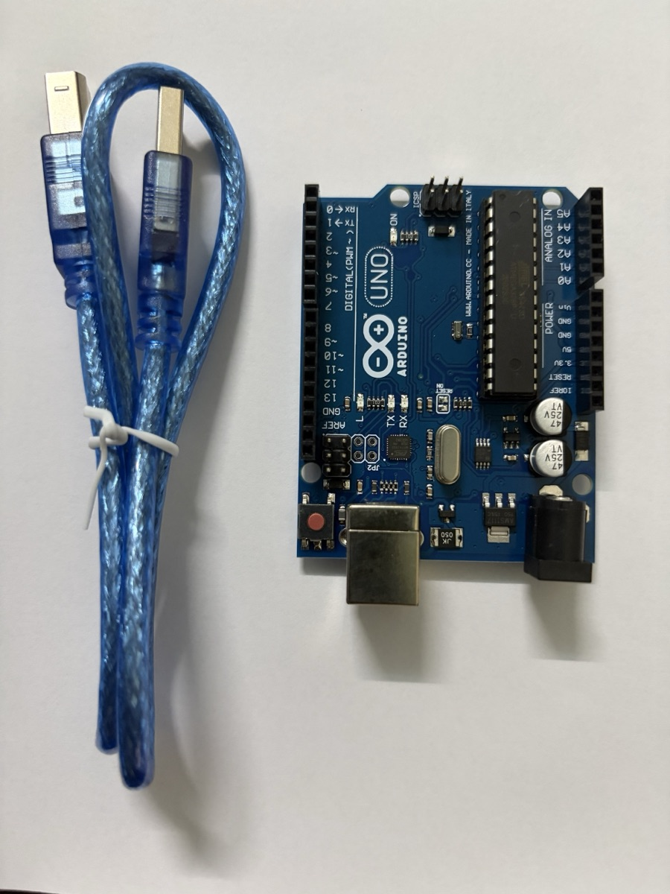
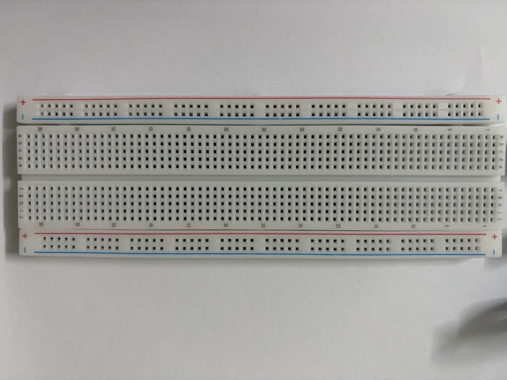
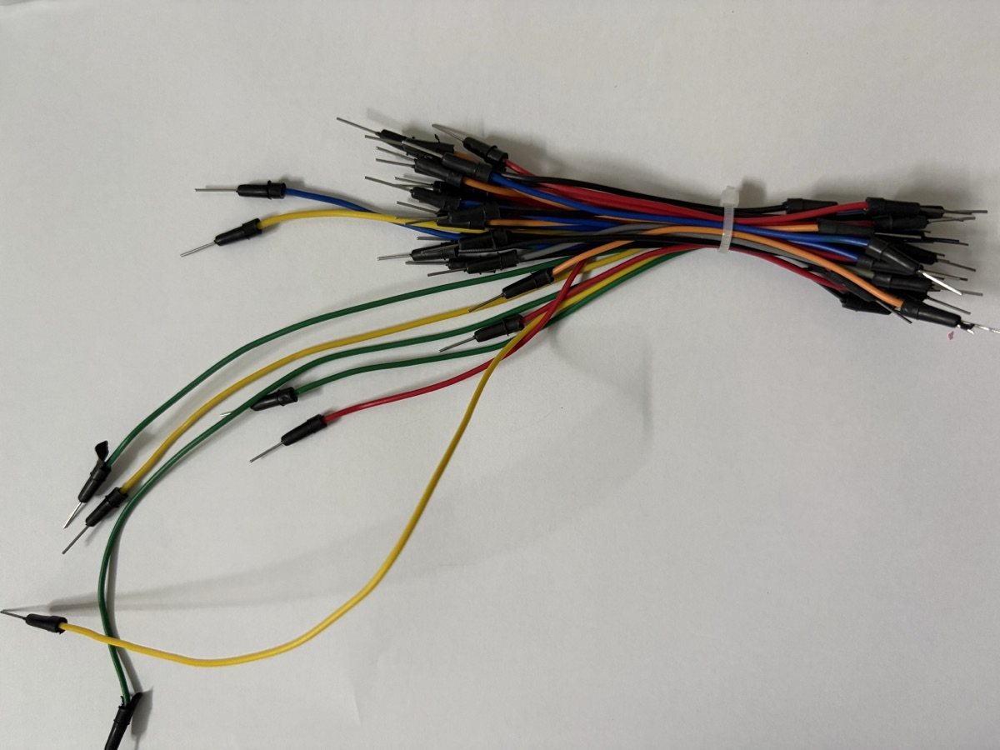
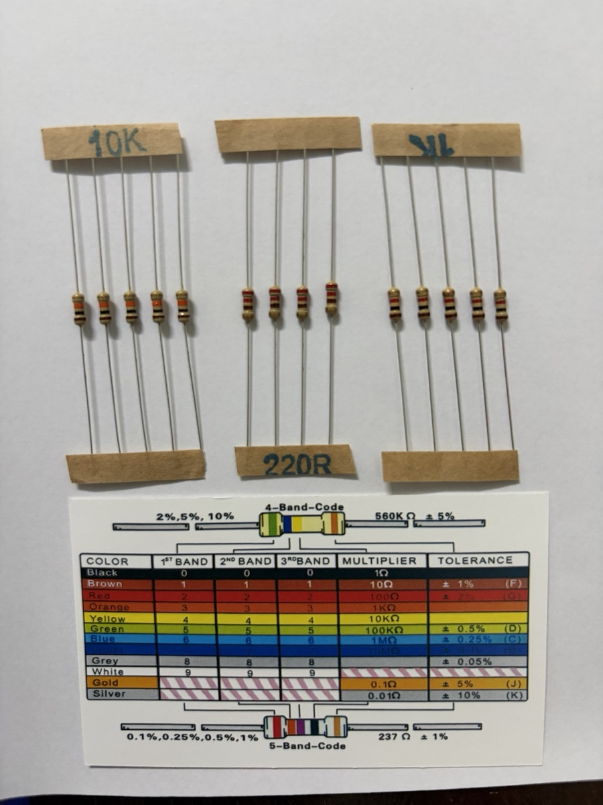
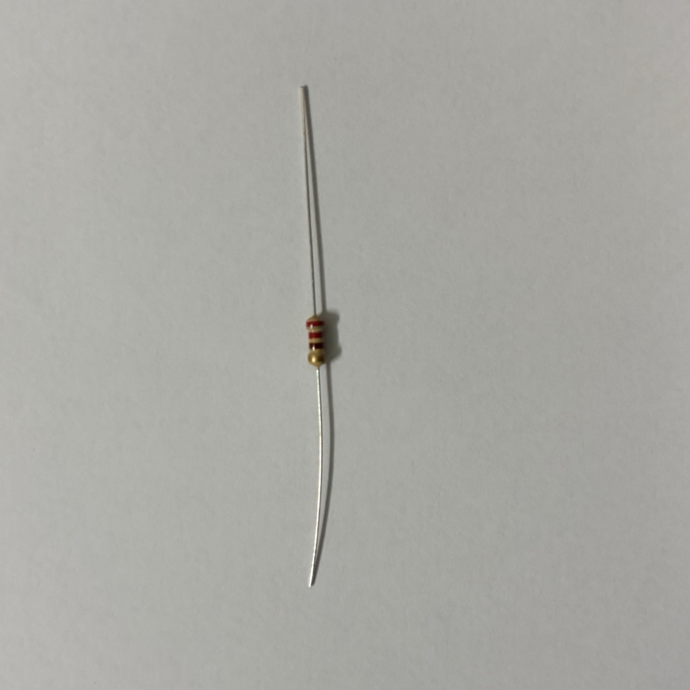
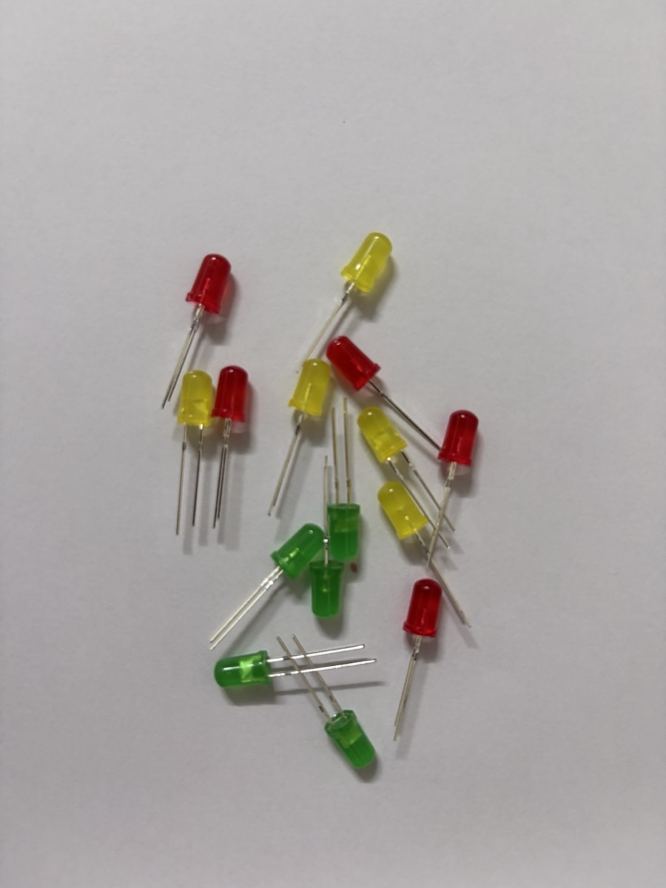
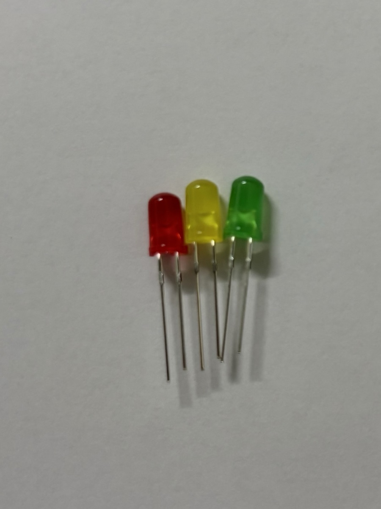
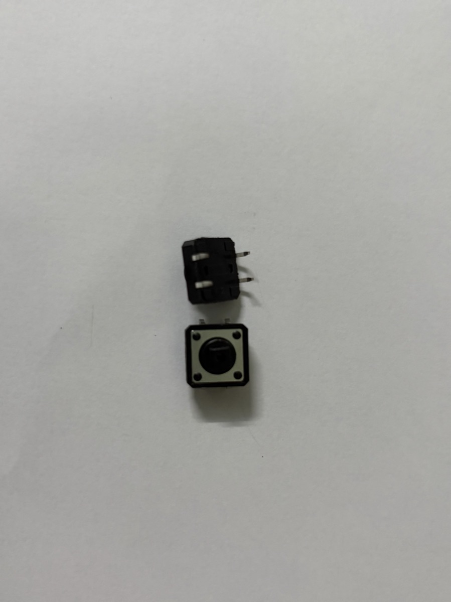

# Giới thiệu Arduino & linh kiện cơ bản

> Note tham khảo về board Arduino Uno và các linh kiện trong bộ kit dùng cho các lab. Ảnh thực tế sẽ được bổ sung dần cho từng linh kiện.

## Arduino là gì

**Arduino** là một nền tảng phần cứng/phần mềm mã nguồn mở gồm hai phần:

- **Board vi điều khiển** — mạch in có sẵn vi điều khiển, mạch nguồn, cổng USB và các chân I/O cắm được dây trực tiếp. Board phổ biến nhất là **Arduino Uno**.
- **Arduino IDE** — môi trường viết code C/C++ (gọi là *sketch*), biên dịch và nạp xuống board qua USB.

Trong kiến trúc IoT, Arduino nằm ở **tầng thiết bị (perception)**: đọc cảm biến, điều khiển cơ cấu chấp hành. Bản thân Uno không có Wi-Fi/Bluetooth — muốn kết nối mạng phải gắn thêm module (ESP8266, HC-05…) hoặc dùng board có sẵn kết nối như **ESP32**, **Arduino Uno R4 WiFi**, **Nano 33 IoT**.

### Cấu trúc một sketch

```cpp
void setup() {
  // chạy 1 lần khi cấp điện hoặc nhấn reset:
  // cấu hình chân, khởi tạo Serial, cảm biến...
  pinMode(13, OUTPUT);
  Serial.begin(9600);
}

void loop() {
  // chạy lặp vô hạn sau setup()
  digitalWrite(13, HIGH);
  delay(500);
  digitalWrite(13, LOW);
  delay(500);
}
```

Các hàm dùng nhiều nhất:

| Hàm | Ý nghĩa |
|---|---|
| `pinMode(pin, mode)` | Đặt chân là `OUTPUT`, `INPUT` hoặc `INPUT_PULLUP` |
| `digitalWrite(pin, HIGH/LOW)` | Xuất mức 5 V / 0 V |
| `digitalRead(pin)` | Đọc mức logic (`HIGH`/`LOW`) |
| `analogRead(pin)` | Đọc điện áp chân A0–A5, trả về 0–1023 (ADC 10 bit) |
| `analogWrite(pin, 0–255)` | Xuất PWM trên các chân có dấu `~` |
| `delay(ms)` / `millis()` | Dừng chương trình / đọc số ms từ lúc khởi động |
| `Serial.print()` | Gửi dữ liệu lên máy tính qua Serial Monitor |

## Board Arduino Uno

### Thông số chính

| Thông số | Giá trị |
|---|---|
| Vi điều khiển | ATmega328P, 16 MHz |
| Mức logic | 5 V |
| Bộ nhớ | Flash 32 KB (0,5 KB bootloader), SRAM 2 KB, EEPROM 1 KB |
| Chân digital | 14 chân (D0–D13), trong đó 6 chân PWM: 3, 5, 6, 9, 10, 11 |
| Chân analog | 6 chân (A0–A5), ADC 10 bit |
| Dòng mỗi chân I/O | Khuyến nghị ≤ 20 mA, tối đa tuyệt đối 40 mA |
| Nguồn cấp | USB 5 V, hoặc jack DC / chân `VIN` 7–12 V |

### Các khu vực trên board

| Khu vực | Mô tả |
|---|---|
| **Cổng USB-B** | Cấp nguồn 5 V và nạp code, đồng thời là kênh Serial với máy tính |
| **Jack nguồn DC** | Cấp nguồn ngoài 7–12 V qua bộ ổn áp trên board |
| **Nút RESET** | Khởi động lại chương trình (chạy lại `setup()`) |
| **Header digital (D0–D13)** | I/O số; D0/D1 là RX/TX của Serial — tránh dùng khi đang nạp code/Serial |
| **Header analog (A0–A5)** | Đọc tín hiệu analog; cũng dùng được như chân digital. A4/A5 là SDA/SCL (I²C) |
| **Header nguồn** | `5V`, `3.3V`, `GND` (nhiều chân), `VIN`, `IOREF`, `RESET` |
| **Header ICSP** | Nạp trực tiếp cho chip, cũng là đường SPI (MISO/MOSI/SCK) |
| **LED trên board** | `ON` (có nguồn), `L` (nối với D13), `TX`/`RX` (nháy khi truyền dữ liệu Serial) |

### Ảnh thực tế

{width=60%}

Board trong kit là bản **Uno R3 tương thích (clone)**. Một số điểm nhìn thấy trên ảnh:

- **Chip ATmega328P dạng DIP 28 chân** (con chip đen dài bên phải), cắm trên đế nên tháo thay được nếu lỡ làm hỏng chip.
- Header digital bên trái in sẵn `0 RX`, `1 TX` và dấu `~` cạnh các chân PWM `3, 5, 6, 9, 10, 11`. Hai chân `GND` và `AREF` nằm ngay sau chân 13.
- Bên phải là header **ANALOG IN** (`A0`–`A5`) và **POWER** (`IOREF`, `RESET`, `3.3V`, `5V`, `GND`, `GND`, `Vin`).
- Bốn LED nhỏ `ON`, `L`, `TX`, `RX` nằm giữa board. Nút **RESET** màu đỏ ở góc dưới bên trái.
- Phía dưới có **cổng USB-B** (dùng với cáp xanh đi kèm: một đầu USB-A cắm máy tính, một đầu USB-B cắm board) và **jack DC**. Cạnh jack DC là IC ổn áp **AMS1117** hạ áp từ nguồn ngoài xuống 5 V.

## Breadboard & dây nối

### Breadboard

Bảng cắm thử, không cần hàn. Cấu trúc nối bên trong:

- **Hai rail nguồn** chạy dọc hai mép (vạch đỏ `+`, vạch xanh `−`): các lỗ trong cùng một rail nối với nhau theo **chiều dọc**. Thường nối rail `+` về `5V`, rail `−` về `GND`.
- **Vùng giữa**: mỗi **cột 5 lỗ** (a–e hoặc f–j) nối với nhau; hai nửa trên/dưới **tách nhau** bởi rãnh giữa — rãnh này để cắm IC/nút nhấn bắc ngang.
- Lỗi hay gặp: một số breadboard dài có rail nguồn **bị ngắt ở giữa** — cần nối cầu nếu dùng cả hai nửa.

### Dây nối (jumper wire)

| Loại | Dùng cho |
|---|---|
| Đực – đực (male–male) | Breadboard ↔ header Arduino |
| Đực – cái (male–female) | Module cảm biến có chân header đực ↔ breadboard |
| Cái – cái (female–female) | Module ↔ module, hoặc module ↔ chân header đực |

Quy ước màu để dễ dò mạch: **đỏ = 5V**, **đen = GND**, các màu khác cho tín hiệu.

### Ảnh thực tế

{width=90%}

Breadboard trong kit là loại **full-size (~830 lỗ)**. Các cột được đánh số 1 → 60 dọc mép, các hàng được đánh chữ `a b c d e` (nửa trên) và `f g h i j` (nửa dưới). Mỗi mép có một cặp rail `+` (vạch đỏ) / `−` (vạch xanh). Lỗ trên rail xếp thành từng cụm 5 lỗ để dễ đếm, nhưng vẫn thông nhau theo chiều dài rail. Nên dùng đồng hồ đo kiểm tra lại xem rail có bị ngắt ở giữa board không.

{width=70%}

Dây trong kit là loại **đực – đực**, đủ để nối breadboard với header Arduino. Muốn cắm module cảm biến có chân đực (DHT11, HC-SR04…) trực tiếp bằng dây thì cần mua thêm dây **đực – cái**. Nếu không, cắm module lên breadboard rồi nối bằng dây đực – đực.

## Linh kiện thụ động

### Điện trở

Hạn dòng, chia áp, kéo lên/kéo xuống (pull-up/pull-down). Giá trị đọc theo **vạch màu**:

| Màu | Đen | Nâu | Đỏ | Cam | Vàng | Lục | Lam | Tím | Xám | Trắng |
|---|---|---|---|---|---|---|---|---|---|---|
| Số | 0 | 1 | 2 | 3 | 4 | 5 | 6 | 7 | 8 | 9 |

Với điện trở 4 vạch: *vạch 1, vạch 2* = hai chữ số, *vạch 3* = số mũ ×10ⁿ, *vạch 4* = sai số (nhũ vàng ±5%, nhũ bạc ±10%). Ví dụ: đỏ – đỏ – nâu = 22 × 10¹ = **220 Ω**; nâu – đen – đỏ = 10 × 10² = **1 kΩ**; nâu – đen – cam = **10 kΩ**.

Điện trở **không phân cực** — cắm chiều nào cũng được.

### Biến trở (potentiometer)

Điện trở xoay được, 3 chân: hai chân ngoài nối `5V` và `GND`, **chân giữa** (wiper) cho điện áp thay đổi 0–5 V → đọc bằng `analogRead()`. Dùng làm núm chỉnh độ sáng, tốc độ, ngưỡng…

### Ảnh thực tế

{width=65%}

Kit có ba giá trị điện trở, dán băng giấy ghi sẵn giá trị:

| Nhãn | Vạch màu | Giá trị | Dùng cho |
|---|---|---|---|
| **220R** | đỏ – đỏ – nâu – nhũ vàng | 22 × 10¹ = **220 Ω** ±5% | Hạn dòng LED, LED sáng rõ (~14 mA) |
| **1K** | nâu – đen – đỏ – nhũ vàng | 10 × 10² = **1 kΩ** ±5% | Hạn dòng LED, LED sáng dịu (~3 mA), dùng trong Lab 1 |
| **10K** | nâu – đen – cam – nhũ vàng | 10 × 10³ = **10 kΩ** ±5% | Điện trở kéo cho nút nhấn, cầu chia áp với quang trở |

Thẻ đi kèm vừa có bảng mã **4 vạch** (sai số 2%, 5%, 10%), vừa có bảng mã **5 vạch** dành cho điện trở chính xác (sai số 0,1–1%). Với loại 5 vạch, *ba* vạch đầu là chữ số, vạch thứ 4 là hệ số nhân, vạch thứ 5 là sai số. Ví dụ in trên thẻ: đỏ – cam – tím – đen – nâu = 237 × 10⁰ = **237 Ω ±1%**.

{width=35%}

**Mẹo xác định chiều đọc**: vạch nhũ vàng/bạc (sai số) luôn nằm ở **cuối**. Cầm điện trở sao cho vạch nhũ ở bên phải (hoặc phía dưới, như trong ảnh) rồi đọc từ đầu kia.

## Linh kiện hiển thị & tín hiệu ra

### LED

Diode phát quang, **có phân cực**: chân **dài = anode (+)**, chân ngắn / mép vát = cathode (−). Luôn mắc nối tiếp **điện trở hạn dòng** (220 Ω – 1 kΩ với 5 V). Chi tiết tính dòng xem [Lab 1](../labs/led-basics.md).

### LED RGB

Ba LED đỏ/lục/lam trong một vỏ, 4 chân. Loại **cathode chung** nối chân dài về GND; loại **anode chung** nối chân dài về 5V (khi đó logic bị đảo). Mỗi màu cần một điện trở riêng và một chân PWM để trộn màu.

### Buzzer (còi)

- **Active buzzer** — có mạch dao động bên trong, chỉ cần cấp `HIGH` là kêu (một tần số cố định).
- **Passive buzzer** — cần tín hiệu dao động, dùng `tone(pin, freq)` để phát nốt nhạc.

Phân biệt nhanh: active buzzer thường có tem dán và đáy bịt kín; passive lộ mạch xanh ở đáy.

### LCD 16×2 (I²C)

Màn hình 2 dòng × 16 ký tự. Bản gắn module **I²C (PCF8574)** chỉ cần 4 dây: `VCC`, `GND`, `SDA → A4`, `SCL → A5`. Dùng thư viện `LiquidCrystal_I2C`; địa chỉ thường là `0x27` hoặc `0x3F`. Biến trở xanh trên module chỉnh độ tương phản.

### Ảnh thực tế

{width=50%}

{width=40%}

Kit có LED **5 mm, vỏ mờ (diffused)**, ba màu đỏ, vàng, xanh lá — đủ để làm mạch đèn giao thông. Điện áp thuận tham khảo: **đỏ ~1,8–2,0 V**, **vàng ~2,0–2,1 V**, **xanh lá ~2,0–2,2 V** (LED xanh lá loại lục vàng như trong ảnh; loại xanh lá sáng thuần có thể lên ~3 V). Vì chênh lệch không nhiều nên dùng chung điện trở 220 Ω hoặc 1 kΩ cho cả ba màu là được.

Khi LED còn mới, chân **dài hơn là anode (+)**. Nếu chân đã bị cắt bằng nhau, nhìn vào trong vỏ: miếng kim loại **nhỏ** là anode, miếng **to hình lá cờ** là cathode. Hoặc tìm mép **vát phẳng** trên vành đế — phía đó là cathode.

> 📷 *Chờ ảnh buzzer / LCD (nếu có trong kit).*

## Linh kiện đầu vào

### Nút nhấn (push button)

Công tắc nhấn nhả, 4 chân: hai cặp chân **đối diện theo chiều dài** nối sẵn với nhau, nhấn thì nối hai cặp. Cắm **bắc ngang rãnh giữa** breadboard.

Khi đọc bằng `digitalRead()` phải có điện trở kéo để chân không bị "thả nổi":

- **Pull-down** 10 kΩ xuống GND → không nhấn = `LOW`, nhấn = `HIGH`.
- **`INPUT_PULLUP`** dùng điện trở kéo lên có sẵn trong chip → không cần điện trở ngoài, nhưng logic đảo: nhấn = `LOW`.

Nút cơ học bị **dội phím (bounce)** vài ms — cần chống dội bằng phần mềm (`millis()`) nếu đếm số lần nhấn.

### Ảnh thực tế

{width=40%}

Nút trong kit là loại **tactile 12 × 12 mm**, 4 chân. Nhìn từ cạnh (con phía trên trong ảnh) thấy hai chân ló ra cùng một phía. **Hai chân cùng một mặt bên là hai chân được nối bằng công tắc** (chỉ thông khi nhấn). Hai chân **nằm đối diện nhau qua thân nút**, trên cùng một dải kim loại, thì luôn thông với nhau.

Cách kiểm tra chắc chắn nhất: dùng đồng hồ đo thông mạch. Hoặc cắm nút bắc ngang rãnh giữa breadboard và lấy hai chân **chéo nhau** — cặp chéo luôn là cặp đi qua công tắc, cắm kiểu gì cũng đúng.

## Cảm biến

| Cảm biến | Đo gì | Kiểu tín hiệu | Ghi chú nối dây |
|---|---|---|---|
| **Quang trở (LDR)** | Cường độ ánh sáng | Analog | Mắc cầu chia áp với điện trở 10 kΩ, điểm giữa vào A0 |
| **DHT11 / DHT22** | Nhiệt độ, độ ẩm | Digital (giao thức 1 dây riêng) | Chân DATA vào chân digital, cần pull-up 10 kΩ (module thường có sẵn); thư viện `DHT` |
| **HC-SR04** | Khoảng cách (siêu âm, 2–400 cm) | Digital (độ rộng xung) | `TRIG` phát xung 10 µs, đo thời gian xung `ECHO` bằng `pulseIn()`; khoảng cách = t × 0,034 / 2 (cm) |
| **PIR HC-SR501** | Chuyển động người/động vật | Digital | Có 2 biến trở chỉnh độ nhạy và thời gian giữ |
| **Cảm biến độ ẩm đất** | Độ ẩm đất | Analog / Digital | Module có cả `AO` và `DO` (ngưỡng chỉnh bằng biến trở) |
| **LM35 / TMP36** | Nhiệt độ | Analog | LM35: 10 mV/°C |

### Ảnh thực tế

> 📷 *Chờ ảnh các cảm biến trong kit.*

## Cơ cấu chấp hành

### Servo SG90

Động cơ quay đến **góc 0–180°**. 3 dây: **nâu = GND**, **đỏ = 5V**, **cam = tín hiệu** (chân PWM). Dùng thư viện `Servo`: `myServo.attach(9); myServo.write(90);`.

### Động cơ DC & driver

Động cơ DC kéo dòng lớn (vài trăm mA) — **không nối trực tiếp vào chân Arduino**. Cần mạch driver như **L298N** hoặc **L293D** (đảo chiều bằng 2 chân, chỉnh tốc độ bằng PWM), nguồn động cơ tách riêng, **chung GND** với Arduino.

### Relay module

Công tắc điện từ cho phép Arduino đóng/ngắt thiết bị công suất lớn (đèn, quạt 220 V). Đầu điều khiển: `VCC`, `GND`, `IN`; đầu tải: `COM`, `NO` (thường hở), `NC` (thường đóng). Nhiều module kích ở mức **LOW**. ⚠️ Làm việc với điện 220 V cần hết sức cẩn thận.

### Ảnh thực tế

> 📷 *Chờ ảnh servo / relay / motor.*

## Lưu ý an toàn khi lắp mạch

- **Rút USB trước khi thay đổi dây.** Cắm nhầm 5V–GND gây ngắn mạch có thể làm hỏng cổng USB máy tính.
- Không kéo quá **20 mA mỗi chân** và **~200 mA tổng** từ các chân I/O; tải lớn (motor, nhiều LED, servo nhiều cái) dùng nguồn ngoài.
- Mọi thiết bị trong mạch phải **chung GND**.
- Không cấp quá 5 V vào chân I/O; module 3,3 V (ESP8266, một số cảm biến) cần chuyển mức logic.
