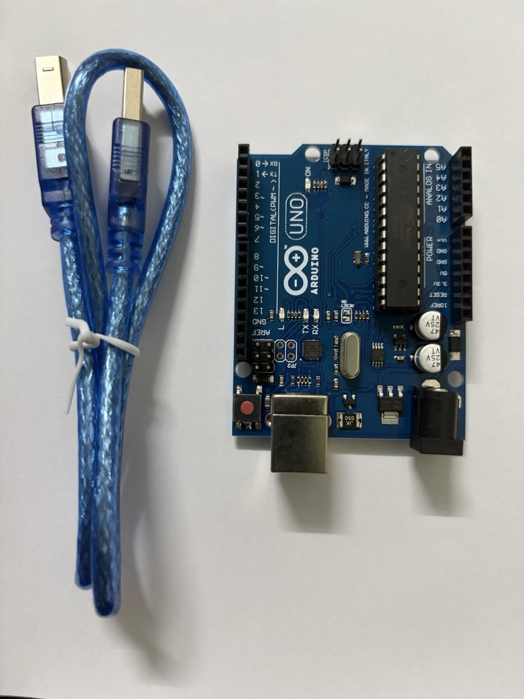

# Giới thiệu Arduino & board Arduino Uno

> Note tham khảo về nền tảng Arduino và board Arduino Uno dùng cho các lab. Các linh kiện trong bộ kit xem ở bài [Linh kiện cơ bản trong kit Arduino](arduino-components.md).

## Arduino là gì

**Arduino** là một nền tảng phần cứng/phần mềm mã nguồn mở gồm hai phần:

- **Board vi điều khiển** — mạch in có sẵn vi điều khiển, mạch nguồn, cổng USB và các chân I/O cắm được dây trực tiếp. Board phổ biến nhất là **Arduino Uno**.
- **Arduino IDE** — môi trường viết code C/C++ (gọi là *sketch*), biên dịch và nạp xuống board qua USB.

Trong kiến trúc IoT, Arduino nằm ở **tầng thiết bị (perception)**: đọc cảm biến, điều khiển cơ cấu chấp hành. Bản thân Uno không có Wi-Fi/Bluetooth — muốn kết nối mạng phải gắn thêm module (ESP8266, HC-05…) hoặc dùng board có sẵn kết nối như **ESP32**, **Arduino Uno R4 WiFi**, **Nano 33 IoT**.

### Cấu trúc một sketch

```cpp
void setup() {
  // chạy 1 lần khi cấp điện hoặc nhấn reset:
  // cấu hình chân, khởi tạo Serial, cảm biến...
  pinMode(13, OUTPUT);
  Serial.begin(9600);
}

void loop() {
  // chạy lặp vô hạn sau setup()
  digitalWrite(13, HIGH);
  delay(500);
  digitalWrite(13, LOW);
  delay(500);
}
```

Các hàm dùng nhiều nhất:

| Hàm | Ý nghĩa |
|---|---|
| `pinMode(pin, mode)` | Đặt chân là `OUTPUT`, `INPUT` hoặc `INPUT_PULLUP` |
| `digitalWrite(pin, HIGH/LOW)` | Xuất mức 5 V / 0 V |
| `digitalRead(pin)` | Đọc mức logic (`HIGH`/`LOW`) |
| `analogRead(pin)` | Đọc điện áp chân A0–A5, trả về 0–1023 (ADC 10 bit) |
| `analogWrite(pin, 0–255)` | Xuất PWM trên các chân có dấu `~` |
| `delay(ms)` / `millis()` | Dừng chương trình / đọc số ms từ lúc khởi động |
| `Serial.print()` | Gửi dữ liệu lên máy tính qua Serial Monitor |

## Board Arduino Uno

### Thông số chính

| Thông số | Giá trị |
|---|---|
| Vi điều khiển | ATmega328P, 16 MHz |
| Mức logic | 5 V |
| Bộ nhớ | Flash 32 KB (0,5 KB bootloader), SRAM 2 KB, EEPROM 1 KB |
| Chân digital | 14 chân (D0–D13), trong đó 6 chân PWM: 3, 5, 6, 9, 10, 11 |
| Chân analog | 6 chân (A0–A5), ADC 10 bit |
| Dòng mỗi chân I/O | Khuyến nghị ≤ 20 mA, tối đa tuyệt đối 40 mA |
| Nguồn cấp | USB 5 V, hoặc jack DC / chân `VIN` 7–12 V |

### Các khu vực trên board

| Khu vực | Mô tả |
|---|---|
| **Cổng USB-B** | Cấp nguồn 5 V và nạp code, đồng thời là kênh Serial với máy tính |
| **Jack nguồn DC** | Cấp nguồn ngoài 7–12 V qua bộ ổn áp trên board |
| **Nút RESET** | Khởi động lại chương trình (chạy lại `setup()`) |
| **Header digital (D0–D13)** | I/O số; D0/D1 là RX/TX của Serial — tránh dùng khi đang nạp code/Serial |
| **Header analog (A0–A5)** | Đọc tín hiệu analog; cũng dùng được như chân digital. A4/A5 là SDA/SCL (I²C) |
| **Header nguồn** | `5V`, `3.3V`, `GND` (nhiều chân), `VIN`, `IOREF`, `RESET` |
| **Header ICSP** | Nạp trực tiếp cho chip, cũng là đường SPI (MISO/MOSI/SCK) |
| **LED trên board** | `ON` (có nguồn), `L` (nối với D13), `TX`/`RX` (nháy khi truyền dữ liệu Serial) |

### Ảnh thực tế

{width=60%}

Board trong kit là bản **Uno R3 tương thích (clone)**. Một số điểm nhìn thấy trên ảnh:

- **Chip ATmega328P dạng DIP 28 chân** (con chip đen dài bên phải), cắm trên đế nên tháo thay được nếu lỡ làm hỏng chip.
- Header digital bên trái in sẵn `0 RX`, `1 TX` và dấu `~` cạnh các chân PWM `3, 5, 6, 9, 10, 11`. Hai chân `GND` và `AREF` nằm ngay sau chân 13.
- Bên phải là header **ANALOG IN** (`A0`–`A5`) và **POWER** (`IOREF`, `RESET`, `3.3V`, `5V`, `GND`, `GND`, `Vin`).
- Bốn LED nhỏ `ON`, `L`, `TX`, `RX` nằm giữa board. Nút **RESET** màu đỏ ở góc dưới bên trái.
- Phía dưới có **cổng USB-B** (dùng với cáp xanh đi kèm: một đầu USB-A cắm máy tính, một đầu USB-B cắm board) và **jack DC**. Cạnh jack DC là IC ổn áp **AMS1117** hạ áp từ nguồn ngoài xuống 5 V.

## Lưu ý an toàn khi lắp mạch

- **Rút USB trước khi thay đổi dây.** Cắm nhầm 5V–GND gây ngắn mạch có thể làm hỏng cổng USB máy tính.
- Không kéo quá **20 mA mỗi chân** và **~200 mA tổng** từ các chân I/O; tải lớn (motor, nhiều LED, servo nhiều cái) dùng nguồn ngoài.
- Mọi thiết bị trong mạch phải **chung GND**.
- Không cấp quá 5 V vào chân I/O; module 3,3 V (ESP8266, một số cảm biến) cần chuyển mức logic.
