# Linh kiện điện tử cơ bản

> Note tham khảo về các linh kiện trong bộ kit dùng cho các lab. Đây là linh kiện điện tử phổ thông, không riêng cho Arduino: dùng được với ESP32, Raspberry Pi… hoặc mạch không có vi điều khiển; khi chuyển sang board logic 3,3 V cần chú ý mức điện áp tín hiệu. Ảnh thực tế sẽ được bổ sung dần cho từng linh kiện. Board Arduino Uno và cấu trúc sketch xem ở bài [Giới thiệu Arduino & board Arduino Uno](arduino-intro.md); lưu ý an toàn khi lắp mạch xem ở [cuối bài đó](arduino-intro.md#lưu-ý-an-toàn-khi-lắp-mạch).

## Breadboard & dây nối

### Breadboard

Bảng cắm thử, không cần hàn. Cấu trúc nối bên trong:

- **Hai rail nguồn** chạy dọc hai mép (vạch đỏ `+`, vạch xanh `−`): các lỗ trong cùng một rail nối với nhau theo **chiều dọc**. Thường nối rail `+` về `5V`, rail `−` về `GND`.
- **Vùng giữa**: mỗi **cột 5 lỗ** (a–e hoặc f–j) nối với nhau; hai nửa trên/dưới **tách nhau** bởi rãnh giữa — rãnh này để cắm IC/nút nhấn bắc ngang.
- Lỗi hay gặp: một số breadboard dài có rail nguồn **bị ngắt ở giữa** — cần nối cầu nếu dùng cả hai nửa.

### Dây nối (jumper wire)

| Loại | Dùng cho |
|---|---|
| Đực – đực (male–male) | Breadboard ↔ header Arduino |
| Đực – cái (male–female) | Module có chân header đực ↔ header Arduino / breadboard |
| Cái – cái (female–female) | Module ↔ module, hoặc module ↔ chân header đực |

Quy ước màu để dễ dò mạch: **đỏ = 5V**, **đen = GND**, các màu khác cho tín hiệu.

### Ảnh thực tế

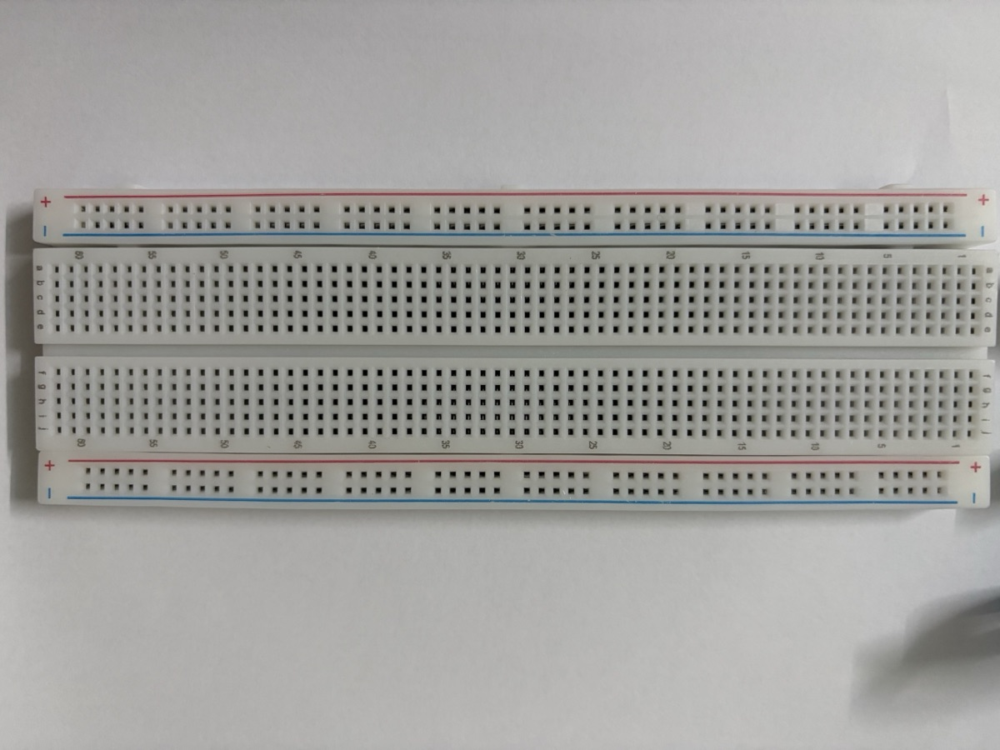{width=90%}

Breadboard trong kit là loại **full-size (~830 lỗ)**. Các cột được đánh số 1 → 60 dọc mép, các hàng được đánh chữ `a b c d e` (nửa trên) và `f g h i j` (nửa dưới). Mỗi mép có một cặp rail `+` (vạch đỏ) / `−` (vạch xanh). Lỗ trên rail xếp thành từng cụm 5 lỗ để dễ đếm, nhưng vẫn thông nhau theo chiều dài rail. Nên dùng đồng hồ đo kiểm tra lại xem rail có bị ngắt ở giữa board không.

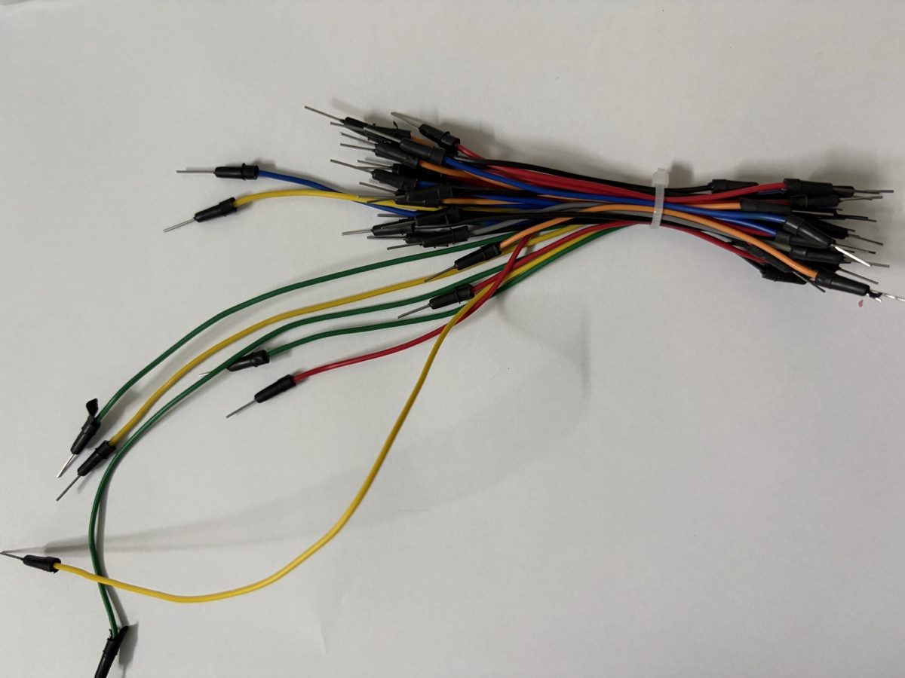{width=70%}

Bó dây trên là loại **đực – đực**, dây mềm và rời từng sợi, dùng để nối breadboard với header Arduino.

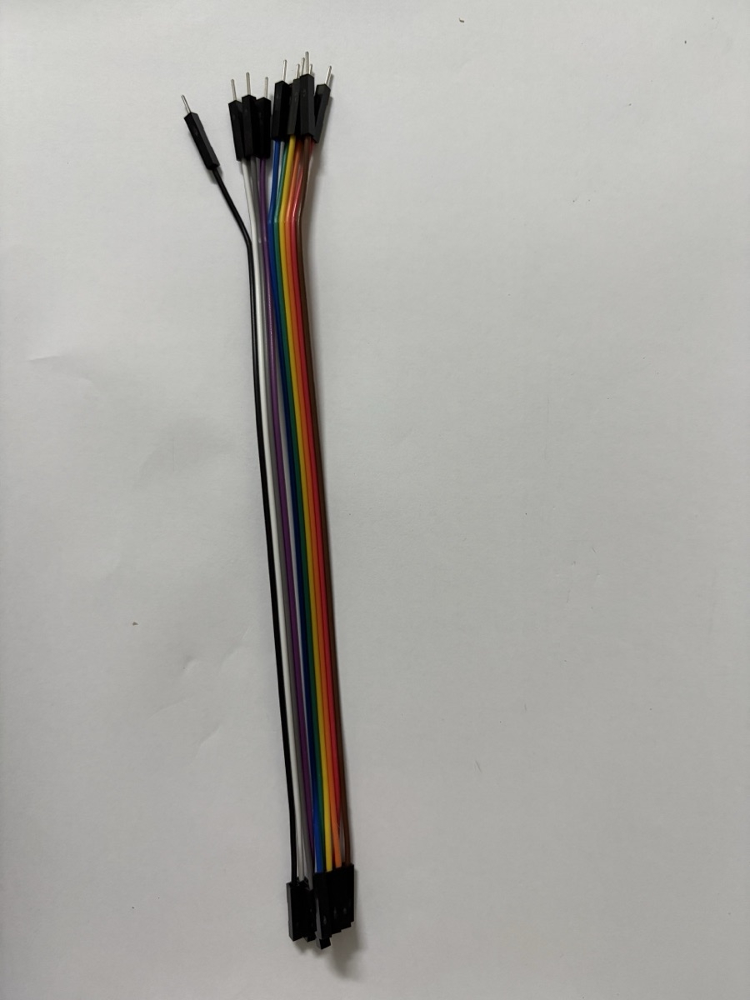{width=40%}

Kit còn có một bộ **10 dây đực – cái** dính liền nhau thành cáp dẹt (ribbon), mỗi sợi một màu theo thứ tự đen – trắng – xám – tím – lam – lục – vàng – cam – đỏ – nâu. Đầu **cái** (lỗ, phía dưới ảnh) chụp thẳng vào chân header đực của module: chân I²C của LCD, chân của DHT11, HC-SR04… Đầu **đực** (kim, phía trên ảnh) cắm vào header Arduino hoặc breadboard. Nhờ đó module không cần cắm lên breadboard.

Các sợi xé rời ra được. Thường chỉ tách đúng số sợi cần (ví dụ 4 sợi cho LCD I²C), để dây không bị rối mà vẫn giữ được quy ước màu.

## Linh kiện thụ động

### Điện trở

Hạn dòng, chia áp, kéo lên/kéo xuống (pull-up/pull-down). Giá trị đọc theo **vạch màu**:

| Màu | Đen | Nâu | Đỏ | Cam | Vàng | Lục | Lam | Tím | Xám | Trắng |
|---|---|---|---|---|---|---|---|---|---|---|
| Số | 0 | 1 | 2 | 3 | 4 | 5 | 6 | 7 | 8 | 9 |

Với điện trở 4 vạch: *vạch 1, vạch 2* = hai chữ số, *vạch 3* = số mũ ×10ⁿ, *vạch 4* = sai số (nhũ vàng ±5%, nhũ bạc ±10%). Ví dụ: đỏ – đỏ – nâu = 22 × 10¹ = **220 Ω**; nâu – đen – đỏ = 10 × 10² = **1 kΩ**; nâu – đen – cam = **10 kΩ**.

Điện trở **không phân cực** — cắm chiều nào cũng được.

### Biến trở (potentiometer)

Điện trở xoay được, 3 chân: hai chân ngoài nối `5V` và `GND`, **chân giữa** (wiper) cho điện áp thay đổi 0–5 V → đọc bằng `analogRead()`. Dùng làm núm chỉnh độ sáng, tốc độ, ngưỡng…

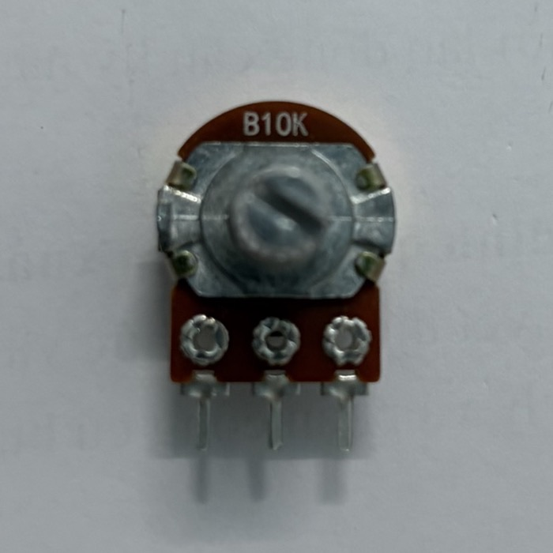{width=35%}

Biến trở trong kit in mã **`B10K`**:

- **`10K`**: điện trở toàn phần giữa hai chân ngoài là **10 kΩ**. Giá trị này không đổi khi xoay; chỉ điện trở từ chân giữa tới mỗi chân ngoài thay đổi, và tổng hai phần luôn bằng 10 kΩ.
- **`B`**: kiểu **tuyến tính (linear)**. Xoay được nửa hành trình thì chân giữa ở đúng 50% điện áp, nên `analogRead()` tăng đều từ 0 đến 1023. Loại **`A`** là kiểu logarit, dùng cho núm âm lượng; với Arduino nên dùng loại `B`.
- Trục ngắn có **rãnh**: xoay bằng tay, hoặc dùng tua vít dẹt. Có thể gắn thêm núm nhựa.
- Góc xoay khoảng **300°**, có điểm dừng ở hai đầu.

Khi nối: chân **giữa** vào `A0`, hai chân ngoài vào `5V` và `GND`. Nếu đảo hai chân ngoài thì chiều xoay bị đảo (xoay phải giảm thay vì tăng), nhưng mạch không hỏng.

```cpp
void setup() {
  Serial.begin(9600);
}

void loop() {
  int raw = analogRead(A0);              // 0–1023
  float volt = raw * 5.0 / 1023.0;       // đổi ra 0–5 V
  int pwm = map(raw, 0, 1023, 0, 255);   // dùng cho analogWrite()
  Serial.print(raw); Serial.print("  ");
  Serial.print(volt); Serial.print(" V  PWM=");
  Serial.println(pwm);
  delay(200);
}
```

### Ảnh thực tế

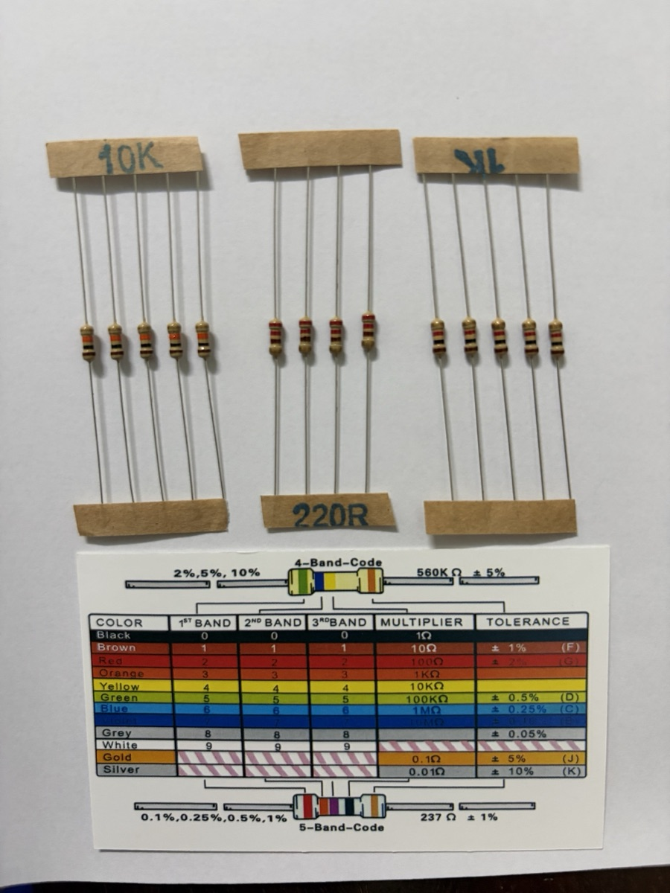{width=65%}

Kit có ba giá trị điện trở, dán băng giấy ghi sẵn giá trị:

| Nhãn | Vạch màu | Giá trị | Dùng cho |
|---|---|---|---|
| **220R** | đỏ – đỏ – nâu – nhũ vàng | 22 × 10¹ = **220 Ω** ±5% | Hạn dòng LED, LED sáng rõ (~14 mA) |
| **1K** | nâu – đen – đỏ – nhũ vàng | 10 × 10² = **1 kΩ** ±5% | Hạn dòng LED, LED sáng dịu (~3 mA), dùng trong Lab 1 |
| **10K** | nâu – đen – cam – nhũ vàng | 10 × 10³ = **10 kΩ** ±5% | Điện trở kéo cho nút nhấn, cầu chia áp với quang trở |

Thẻ đi kèm vừa có bảng mã **4 vạch** (sai số 2%, 5%, 10%), vừa có bảng mã **5 vạch** dành cho điện trở chính xác (sai số 0,1–1%). Với loại 5 vạch, *ba* vạch đầu là chữ số, vạch thứ 4 là hệ số nhân, vạch thứ 5 là sai số. Ví dụ in trên thẻ: đỏ – cam – tím – đen – nâu = 237 × 10⁰ = **237 Ω ±1%**.

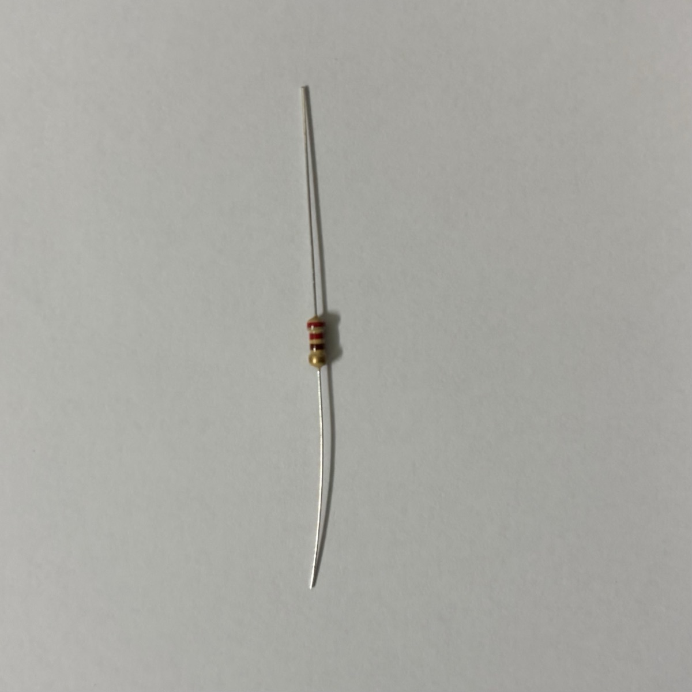{width=35%}

**Mẹo xác định chiều đọc**: vạch nhũ vàng/bạc (sai số) luôn nằm ở **cuối**. Cầm điện trở sao cho vạch nhũ ở bên phải (hoặc phía dưới, như trong ảnh) rồi đọc từ đầu kia.

## Linh kiện hiển thị & tín hiệu ra

### LED

Diode phát quang, **có phân cực**: chân **dài = anode (+)**, chân ngắn / mép vát = cathode (−). Luôn mắc nối tiếp **điện trở hạn dòng** (220 Ω – 1 kΩ với 5 V). Chi tiết tính dòng xem [Lab 1](../labs/led-basics.md).

### LED RGB

Ba LED đỏ/lục/lam trong một vỏ, 4 chân. Loại **cathode chung** nối chân dài về GND; loại **anode chung** nối chân dài về 5V (khi đó logic bị đảo). Mỗi màu cần một điện trở riêng và một chân PWM để trộn màu.

### Buzzer (còi)

- **Active buzzer** — có mạch dao động bên trong, chỉ cần cấp `HIGH` là kêu (một tần số cố định).
- **Passive buzzer** — cần tín hiệu dao động, dùng `tone(pin, freq)` để phát nốt nhạc.

Phân biệt nhanh: active buzzer thường có tem dán và đáy bịt kín; passive lộ mạch xanh ở đáy.

### LCD 16×2 (I²C)

Màn hình **2 dòng × 16 ký tự**, mỗi ký tự là một ô 5×8 điểm. Màn hình dùng chip điều khiển **HD44780** (hoặc chip tương thích) và có đèn nền.

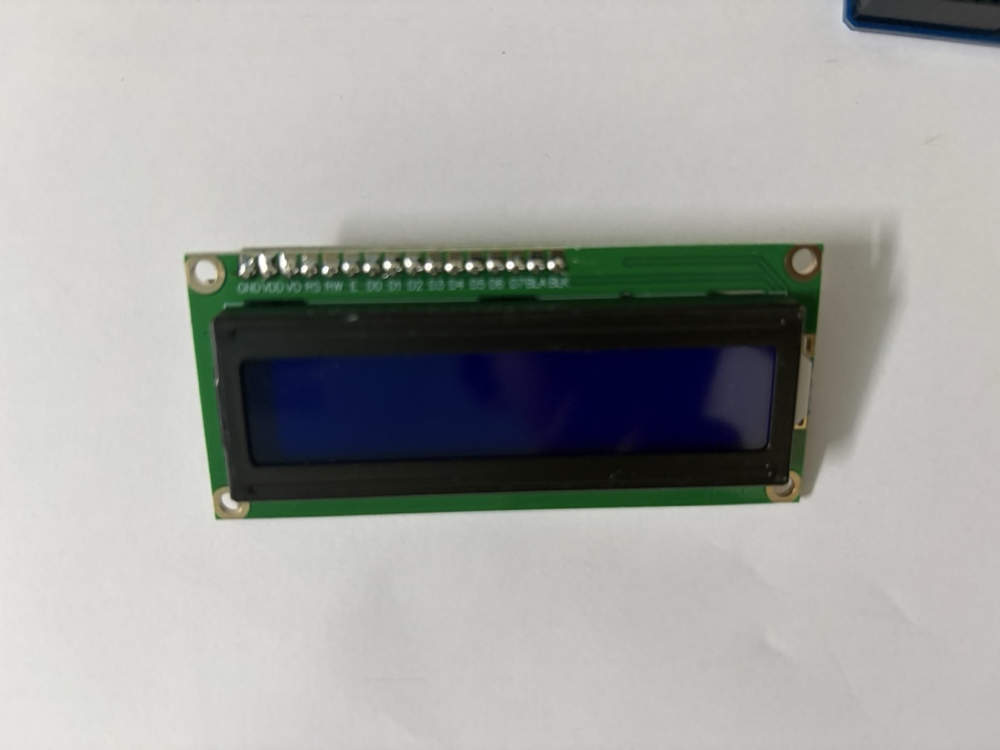{width=60%}

**16 chân gốc** (in ở mép trên mặt trước, từ trái sang):

| Chân | Tên | Chức năng |
|---|---|---|
| 1 | `GND` (VSS) | Mass |
| 2 | `VDD` | Nguồn 5 V |
| 3 | `VO` | Chỉnh độ tương phản (nối chân giữa biến trở) |
| 4 | `RS` | Chọn thanh ghi: 0 = lệnh, 1 = dữ liệu ký tự |
| 5 | `RW` | Đọc/ghi — thường nối GND (chỉ ghi) |
| 6 | `E` | Enable — xung chốt dữ liệu |
| 7–14 | `D0`–`D7` | Bus dữ liệu 8 bit (chế độ 4 bit chỉ dùng `D4`–`D7`) |
| 15 | `BLA` | Anode đèn nền (+) |
| 16 | `BLK` | Cathode đèn nền (−) |

Nếu nối trực tiếp (thư viện `LiquidCrystal`) thì tốn ít nhất 6 chân Arduino (`RS`, `E`, `D4`–`D7`), chưa kể biến trở chỉnh tương phản.

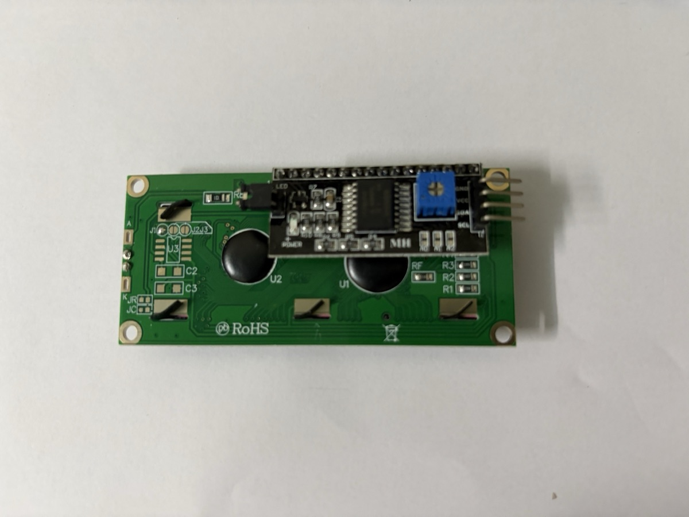{width=60%}

LCD trong kit đã được **hàn sẵn module chuyển đổi I²C** (mạch đen ở mặt sau, dùng chip **PCF8574**). Module này chuyển 16 chân thành **4 chân**:

| Chân module | Nối Arduino Uno |
|---|---|
| `GND` | `GND` |
| `VCC` | `5V` |
| `SDA` | `A4` (hoặc chân `SDA` gần `AREF` trên Uno R3) |
| `SCL` | `A5` (hoặc chân `SCL`) |

Các chi tiết khác trên module:

- **Biến trở xanh** — chỉnh độ tương phản. Cấp điện mà màn chỉ sáng nền, không thấy chữ (hoặc chỉ thấy một hàng ô vuông đen) thì vặn biến trở này trước khi nghĩ đến lỗi code.
- **Jumper `LED`** — cắm thì đèn nền sáng, rút ra thì tắt hẳn đèn nền. Code cũng bật/tắt đèn nền được bằng `lcd.backlight()` / `lcd.noBacklight()`.
- **Ba pad `A0` `A1` `A2`** — chọn địa chỉ I²C. Để trống (như trong ảnh) thì địa chỉ là **`0x27`** với chip PCF8574T, hoặc **`0x3F`** với PCF8574AT. Nối tắt pad để đổi địa chỉ, khi cần gắn nhiều LCD trên cùng bus. Nếu không chắc địa chỉ, chạy sketch **I²C Scanner** để dò.

```cpp
#include <Wire.h>
#include <LiquidCrystal_I2C.h>

LiquidCrystal_I2C lcd(0x27, 16, 2);  // địa chỉ, số cột, số dòng

void setup() {
  lcd.init();
  lcd.backlight();
  lcd.setCursor(0, 0);   // cột 0, dòng 0
  lcd.print("Hello IoT!");
  lcd.setCursor(0, 1);   // cột 0, dòng 1
  lcd.print("Arduino Uno");
}

void loop() {}
```

### LED 7 đoạn 4 số (5641AS)

Bốn chữ số LED 7 đoạn chung một vỏ, cỡ chữ **0,56 inch**, mỗi chữ số có 7 đoạn `A`–`G` và một dấu chấm `DP`. Hậu tố trong mã cho biết kiểu chung chân:

- **5641AS** — **cathode chung (common cathode)**: mỗi chữ số có một chân chung nối về phía âm. Đoạn sáng khi chân đoạn `HIGH` **và** chân chữ số `LOW`.
- **5641BS** — anode chung: logic ngược lại. Hai mã trông giống hệt nhau, chỉ khác chữ `A`/`B` in ở cạnh vỏ.

```
      A
     ───
  F │   │ B
     ─G─
  E │   │ C
     ───   • DP
      D
```

**12 chân**, chia hai hàng 6 chân. Đặt module sao cho dấu chấm `DP` ở phía dưới, nhìn mặt trước: chân **1** ở góc **dưới bên trái**, đánh số **ngược chiều kim đồng hồ** (1 → 6 hàng dưới từ trái sang phải, 7 → 12 hàng trên từ phải sang trái).

| Hàng trên (12 → 7) | 12 `D1` | 11 `A` | 10 `F` | 9 `D2` | 8 `D3` | 7 `B` |
|---|---|---|---|---|---|---|
| **Hàng dưới (1 → 6)** | **1 `E`** | **2 `D`** | **3 `DP`** | **4 `C`** | **5 `G`** | **6 `D4`** |

`D1`–`D4` là 4 chân chung của 4 chữ số (D1 = chữ số bên trái). 8 chân còn lại là chân đoạn, **dùng chung cho cả 4 chữ số**: chân `A` nối với đoạn A của cả 4 số.

**Quét (multiplexing).** Vì chân đoạn dùng chung, tại một thời điểm chỉ bật được **một chữ số**. Chương trình bật lần lượt D1 → D2 → D3 → D4, mỗi số khoảng 2–5 ms, lặp liên tục. Mắt không kịp thấy nhấp nháy nên cả 4 số trông như sáng cùng lúc. Hệ quả:

- Không được dùng `delay()` dài trong `loop()`, nếu không màn sẽ chỉ hiện một số hoặc nhấp nháy. Đo thời gian bằng `millis()`.
- Mỗi chữ số chỉ sáng ~1/4 thời gian, nên trông mờ hơn LED đơn dùng cùng điện trở.

**Nối dây với Arduino Uno** (tốn 12 chân):

| Chân 5641AS | Nối Arduino |
|---|---|
| `A` `B` `C` `D` `E` `F` `G` `DP` | `2` `3` `4` `5` `6` `7` `8` `9`, **mỗi chân qua một điện trở 220 Ω – 1 kΩ** |
| `D1` `D2` `D3` `D4` | `10` `11` `12` `13`, nối thẳng |

Đặt điện trở ở **chân đoạn**, không đặt ở chân chữ số: nếu chỉ có một điện trở trên chân chung thì số "1" (2 đoạn) sẽ sáng hơn hẳn số "8" (7 đoạn). Chân chữ số phải hút dòng của tối đa 8 đoạn cùng lúc; với 1 kΩ (~3 mA/đoạn) là ~24 mA, vẫn trong giới hạn chân Uno. Nếu dùng 220 Ω cho sáng hơn thì nên đệm chân chữ số bằng transistor NPN (ví dụ 2N2222).

**Kiểm tra kiểu chung chân** bằng đồng hồ ở thang đo diode: que **đỏ** vào chân 11 (`A`), que **đen** vào chân 12 (`D1`). Đoạn A của số đầu tiên sáng mờ → cathode chung (5641AS). Phải đảo que mới sáng → anode chung.

Code dùng thư viện **`SevSeg`** (cài từ Library Manager). Thư viện tự lo việc quét; chỉ cần gọi `refreshDisplay()` thật thường xuyên trong `loop()`:

```cpp
#include <SevSeg.h>

SevSeg sevseg;

void setup() {
  byte numDigits = 4;
  byte digitPins[]   = {10, 11, 12, 13};          // D1 D2 D3 D4
  byte segmentPins[] = {2, 3, 4, 5, 6, 7, 8, 9};  // A B C D E F G DP
  bool resistorsOnSegments = true;                // điện trở đặt ở chân đoạn
  sevseg.begin(COMMON_CATHODE, numDigits, digitPins, segmentPins,
               resistorsOnSegments);
  sevseg.setBrightness(90);
}

void loop() {
  static unsigned long last = 0;
  static int tenths = 0;                          // đếm 0,1 giây

  if (millis() - last >= 100) {                   // không dùng delay()
    last += 100;
    tenths = (tenths + 1) % 10000;
    sevseg.setNumber(tenths, 1);                  // 1 chữ số thập phân: 123.4
  }
  sevseg.refreshDisplay();                        // gọi mỗi vòng loop
}
```

Với loại 5641BS chỉ cần đổi `COMMON_CATHODE` thành `COMMON_ANODE`. Muốn tiết kiệm chân Arduino thì dùng IC dịch **74HC595** cho 8 chân đoạn (xem [video mạch thật](#anh-5641as) ở phần ảnh bên dưới), hoặc module có sẵn chip **TM1637** (chỉ 2 dây tín hiệu).

### Ảnh thực tế

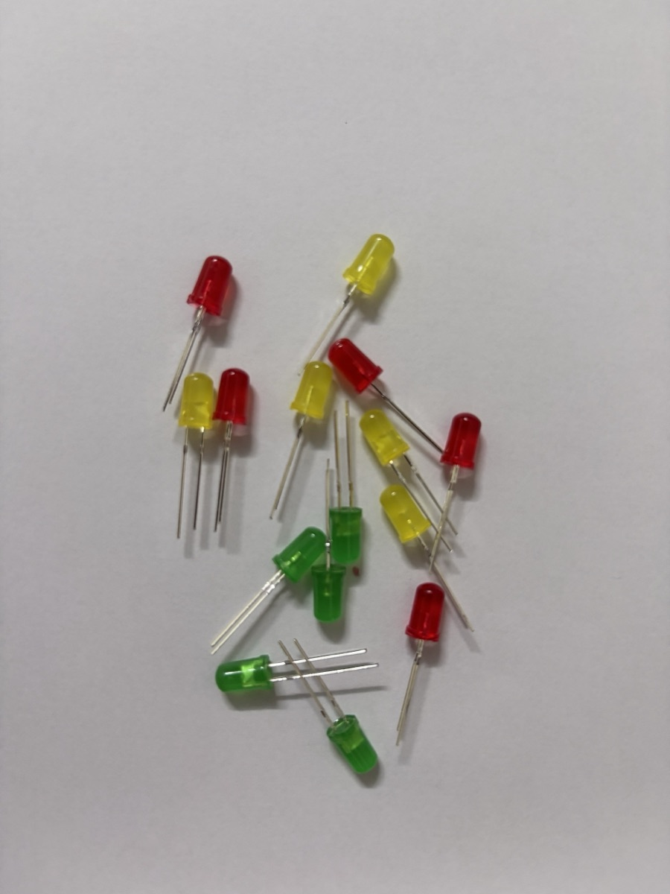{width=50%}

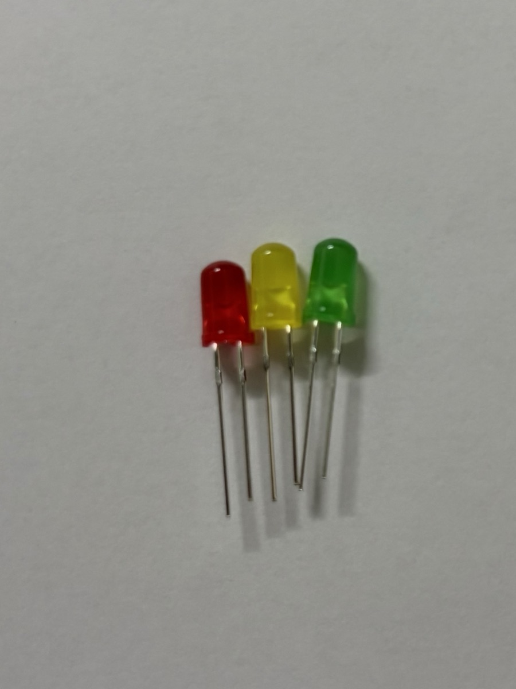{width=40%}

Kit có LED **5 mm, vỏ mờ (diffused)**, ba màu đỏ, vàng, xanh lá — đủ để làm mạch đèn giao thông. Điện áp thuận tham khảo: **đỏ ~1,8–2,0 V**, **vàng ~2,0–2,1 V**, **xanh lá ~2,0–2,2 V** (LED xanh lá loại lục vàng như trong ảnh; loại xanh lá sáng thuần có thể lên ~3 V). Vì chênh lệch không nhiều nên dùng chung điện trở 220 Ω hoặc 1 kΩ cho cả ba màu là được.

Khi LED còn mới, chân **dài hơn là anode (+)**. Nếu chân đã bị cắt bằng nhau, nhìn vào trong vỏ: miếng kim loại **nhỏ** là anode, miếng **to hình lá cờ** là cathode. Hoặc tìm mép **vát phẳng** trên vành đế — phía đó là cathode.

#### Buzzer

::: {layout-ncol=2}
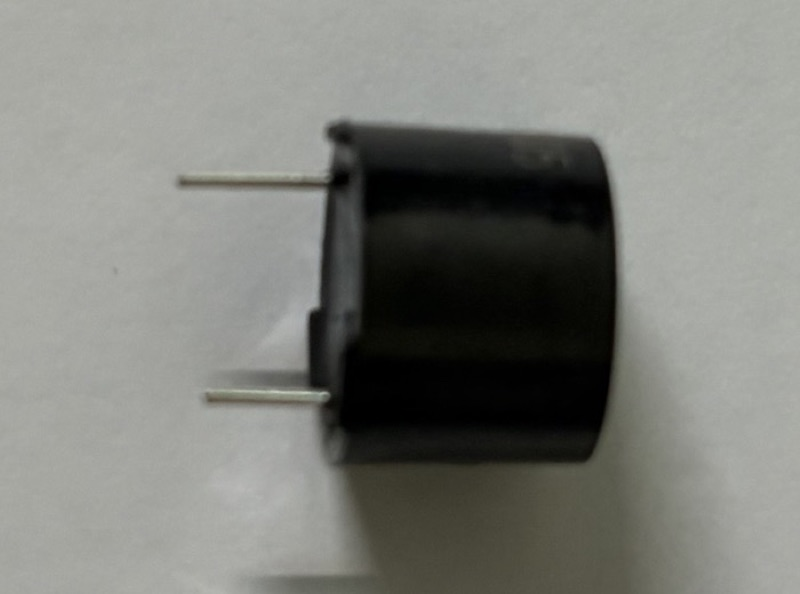


:::

Buzzer trong kit là loại **tròn khoảng 12 mm**, vỏ nhựa đen, hai chân cắm thẳng xuống:

- **Mặt trên** có dấu **`+`** in nổi để đánh dấu chân dương, và một **lỗ thoát âm** ở giữa.
- **Hai chân dài ngắn khác nhau** (ảnh trái): **chân dài là `+`**, nằm cùng phía với dấu `+` trên mặt. Chân này nối vào chân điều khiển của Arduino, chân ngắn nối `GND`. Giống LED, nên xem dấu `+` trước khi cắt chân.
- Khoảng cách hai chân khoảng 7,5 mm, tức **3 lỗ breadboard**. Thân buzzer to nên che mất vài lỗ xung quanh (ảnh phải), cần chừa chỗ khi bố trí mạch.

**Chủ động hay thụ động?** Hai loại nhìn ngoài rất giống nhau. Cách thử chắc chắn nhất là cấp điện trực tiếp: chân `+` vào `5V`, chân `−` vào `GND`.

- **Kêu "tít" liên tục** → buzzer **chủ động**. Chỉ cần `digitalWrite(pin, HIGH)` là kêu.
- **Chỉ nghe "tách" một cái rồi im** → buzzer **thụ động**. Phải dùng `tone(pin, tanSo)` mới kêu.

Code ở [Lab 6](../labs/ultrasonic-hc-sr04.md) dùng `tone()`, chạy được với cả hai loại, nên không cần biết trước buzzer là loại nào.

#### LED 7 đoạn 4 số 5641AS {#anh-5641as}

{width=70%}

::: {layout-ncol=2}


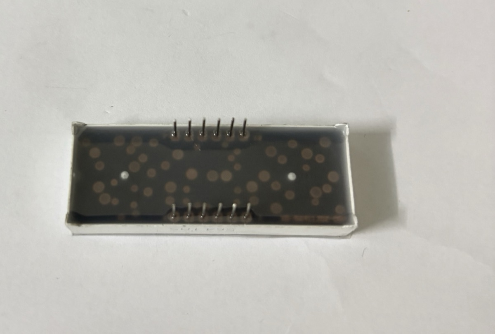
:::

Module trong kit in mã **`5641AS`** trên một cạnh dài, nên đây là loại **cathode chung**. Chữ số màu đỏ, vỏ trắng, mặt hiển thị đen.

- **Cạnh có in mã** nằm cùng phía với các dấu chấm `DP` (nhìn ảnh mặt trước, mã in ngay dưới hàng chấm). Phía này là **hàng chân 1 → 6**. Hàng chân sát cạnh còn lại là 7 → 12.
- 12 chân nằm gọn ở **giữa thân**, hai hàng cách nhau khá xa. Cắm module **bắc ngang rãnh giữa breadboard**, mỗi hàng chân nằm ở một nửa board, để 12 chân không bị chập vào nhau.
- Thân module rộng, che mất khá nhiều lỗ breadboard. Nên cắm dây vào các lỗ còn trống ở hai đầu cột chân trước rồi mới ấn module xuống.

##### Mạch thử với IC 74HC595

Mạch thật dùng **IC dịch 74HC595** để cấp tín hiệu cho 8 chân đoạn. Arduino chỉ cần **3 dây** (dữ liệu, xung clock, chốt) thay vì 8. Bản thử này mới bật **chữ số đầu tiên**:

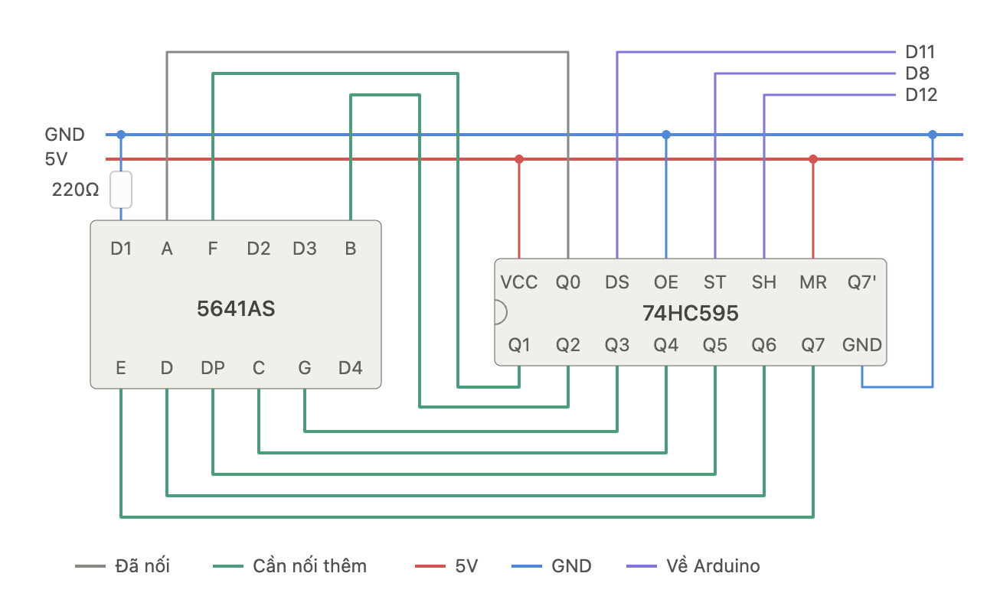{width=100%}

**74HC595 ↔ nguồn và Arduino:**

| Chân 74HC595 | Tên khác | Nối | Vai trò |
|---|---|---|---|
| `VCC` (16) | | `5V` | Nguồn |
| `GND` (8) | | `GND` | Mass |
| `DS` (14) | `SER`, data | Arduino `11` | Dữ liệu nối tiếp, từng bit một |
| `SH` (11) | `SH_CP`, `SRCLK`, clock | Arduino `12` | Mỗi cạnh lên đẩy một bit vào thanh ghi dịch |
| `ST` (12) | `ST_CP`, `RCLK`, latch | Arduino `8` | Cạnh lên chép 8 bit ra các chân `Q0`–`Q7` cùng lúc |
| `OE` (13) | | `GND` | Luôn bật ngõ ra (kích mức thấp) |
| `MR` (10) | `SRCLR` | `5V` | Không xoá thanh ghi (kích mức thấp) |
| `Q7'` (9) | | để trống | Dùng để nối tiếp sang một 74HC595 thứ hai |

**74HC595 ↔ 5641AS.** Thứ tự chân Q được chọn sao cho dây trên breadboard đi gọn, không theo thứ tự A → G:

| `Q0` | `Q1` | `Q2` | `Q3` | `Q4` | `Q5` | `Q6` | `Q7` |
|---|---|---|---|---|---|---|---|
| `A` | `F` | `B` | `G` | `C` | `DP` | `D` | `E` |

Chân chữ số `D1` nối xuống `GND` qua **một điện trở 220 Ω**, nên chữ số đầu luôn được bật. `D2`–`D4` để trống nên ba số còn lại tắt. Vì chỉ có một điện trở chung cho cả 8 đoạn, số nào ít đoạn sáng (số `1`) sẽ sáng hơn số nhiều đoạn (số `8`). Như vậy đủ để thử mạch. Khi làm hoàn chỉnh thì chuyển sang 8 điện trở đặt giữa các chân `Q` và chân đoạn, rồi nối `D1`–`D4` vào Arduino để quét.

Vì thứ tự chân không theo A → G, bảng mã số phải tính theo đúng cách nối: bit 0 = `Q0` = `A`, bit 1 = `Q1` = `F`, … Ví dụ số `5` sáng `A F G C D` = bit 0, 1, 3, 4, 6 = `0b01011011`. Code dưới đây đếm 0 → 9 trên chữ số đầu tiên, mỗi số 1 giây:

```cpp
const int DATA_PIN  = 11;  // DS
const int LATCH_PIN = 8;   // ST
const int CLOCK_PIN = 12;  // SH

// bit:  7 6 5  4 3 2 1 0
// đoạn: E D DP C G B F A   (theo cách nối Q0–Q7 ở trên)
const byte DIGITS[10] = {
  0b11010111,  // 0
  0b00010100,  // 1
  0b11001101,  // 2
  0b01011101,  // 3
  0b00011110,  // 4
  0b01011011,  // 5
  0b11011011,  // 6
  0b00010101,  // 7
  0b11011111,  // 8
  0b01011111,  // 9
};

void show(byte pattern) {
  digitalWrite(LATCH_PIN, LOW);
  shiftOut(DATA_PIN, CLOCK_PIN, MSBFIRST, pattern);  // bit 7 đi trước, cuối cùng nằm ở Q7
  digitalWrite(LATCH_PIN, HIGH);                     // chốt: 8 chân Q đổi cùng lúc
}

void setup() {
  pinMode(DATA_PIN, OUTPUT);
  pinMode(LATCH_PIN, OUTPUT);
  pinMode(CLOCK_PIN, OUTPUT);
}

void loop() {
  for (int n = 0; n <= 9; n++) {
    show(DIGITS[n]);
    delay(1000);   // chỉ có 1 chữ số, không cần quét nên dùng delay() được
  }
}
```

Muốn bật dấu chấm thì thêm bit 5: `show(DIGITS[n] | 0b00100000);`.

Mạch thật, chữ số đầu tiên đã sáng và hiển thị số `5`:

<video controls playsinline preload="metadata" poster="../assets/7seg-595-real-poster.jpg" style="display:block; max-width:640px; width:100%; margin:0 auto; border-radius:8px;">
  <source src="../assets/7seg-595-real.mp4" type="video/mp4">
</video>

## Linh kiện đầu vào

### Nút nhấn (push button)

Công tắc nhấn nhả, 4 chân: hai cặp chân **đối diện theo chiều dài** nối sẵn với nhau, nhấn thì nối hai cặp. Cắm **bắc ngang rãnh giữa** breadboard.

Khi đọc bằng `digitalRead()` phải có điện trở kéo để chân không bị "thả nổi":

- **Pull-down** 10 kΩ xuống GND → không nhấn = `LOW`, nhấn = `HIGH`.
- **`INPUT_PULLUP`** dùng điện trở kéo lên có sẵn trong chip → không cần điện trở ngoài, nhưng logic đảo: nhấn = `LOW`.

Nút cơ học bị **dội phím (bounce)** vài ms — cần chống dội bằng phần mềm (`millis()`) nếu đếm số lần nhấn.

### Ảnh thực tế

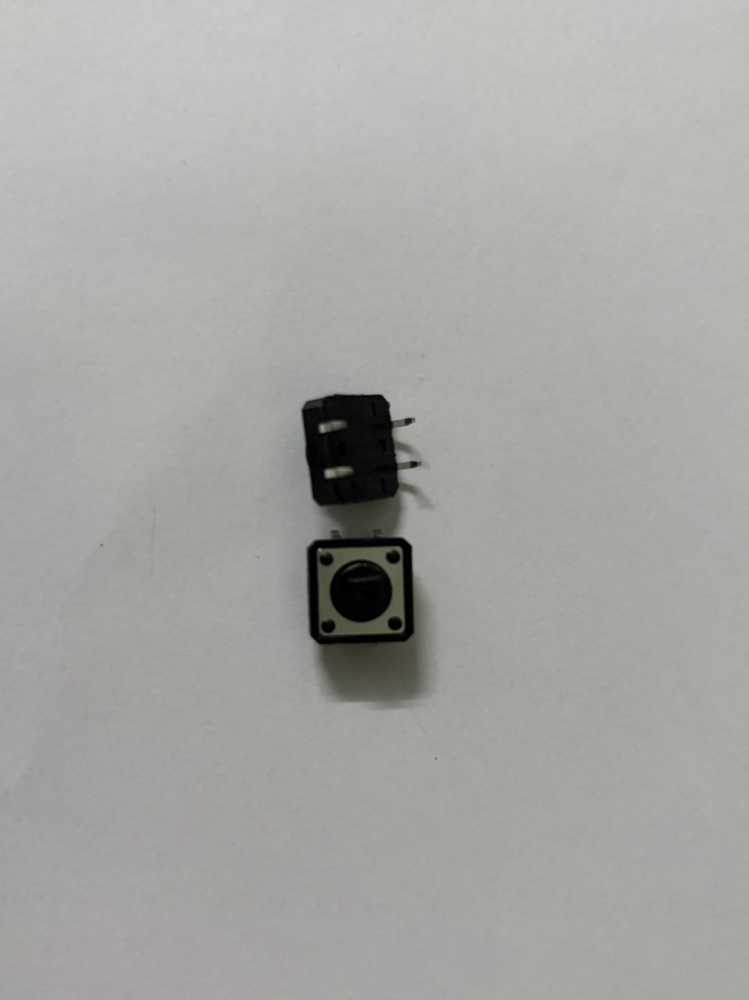{width=40%}

Nút trong kit là loại **tactile 12 × 12 mm**, 4 chân. Nhìn từ cạnh (con phía trên trong ảnh) thấy hai chân ló ra cùng một phía. **Hai chân cùng một mặt bên là hai chân được nối bằng công tắc** (chỉ thông khi nhấn). Hai chân **nằm đối diện nhau qua thân nút**, trên cùng một dải kim loại, thì luôn thông với nhau.

Cách kiểm tra chắc chắn nhất: dùng đồng hồ đo thông mạch. Hoặc cắm nút bắc ngang rãnh giữa breadboard và lấy hai chân **chéo nhau** — cặp chéo luôn là cặp đi qua công tắc, cắm kiểu gì cũng đúng.

## Cảm biến

| Cảm biến | Đo gì | Kiểu tín hiệu | Ghi chú nối dây |
|---|---|---|---|
| **Quang trở (LDR)** | Cường độ ánh sáng | Analog | Mắc cầu chia áp với điện trở 10 kΩ, điểm giữa vào A0 |
| **DHT11 / DHT22** | Nhiệt độ, độ ẩm | Digital (giao thức 1 dây riêng) | Chân DATA vào chân digital, cần pull-up 10 kΩ (module thường có sẵn); thư viện `DHT` |
| **HC-SR04 / HC-SR05** | Khoảng cách (siêu âm, 2–400/450 cm) | Digital (độ rộng xung) | `TRIG` phát xung 10 µs, đo thời gian xung `ECHO` bằng `pulseIn()`; khoảng cách = t × 0,034 / 2 (cm). Xem [Lab 6](../labs/ultrasonic-hc-sr04.md) |
| **PIR HC-SR501** | Chuyển động người/động vật | Digital | Có 2 biến trở chỉnh độ nhạy và thời gian giữ |
| **Cảm biến độ ẩm đất** | Độ ẩm đất | Analog / Digital | Module có cả `AO` và `DO` (ngưỡng chỉnh bằng biến trở) |
| **LM35 / TMP36** | Nhiệt độ | Analog | LM35: 10 mV/°C |

### Ảnh thực tế

#### Module DHT11

{width=50%}

Cảm biến hàn sẵn trên mạch, đã có điện trở kéo lên. Cách nối dây và code xem ở [Lab 3](../labs/dht11.md).

#### Quang trở (LDR)

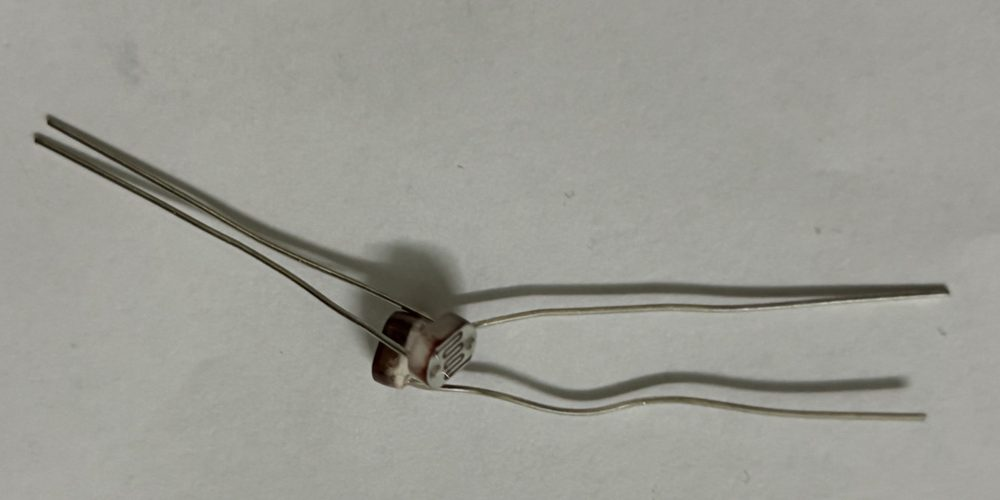{width=50%}

Quang trở trần 2 chân, không phân cực, phải tự mắc cầu chia áp với điện trở 10 kΩ. Cách nối dây và code xem ở [Lab 5](../labs/photoresistor.md).

#### Cảm biến siêu âm HC-SR05

{width=50%}

Bản 5 chân của HC-SR04, đo xa tới ~450 cm. Chân `OUT` để trống, nối 4 chân còn lại như HC-SR04. Cách nối dây và code xem ở [Lab 6](../labs/ultrasonic-hc-sr04.md).

> 📷 *Chờ ảnh các cảm biến còn lại trong kit.*

## Cơ cấu chấp hành

### Servo SG90

Động cơ quay đến **góc 0–180°**. 3 dây: **nâu = GND**, **đỏ = 5V**, **cam = tín hiệu** (chân PWM). Dùng thư viện `Servo`: `myServo.attach(9); myServo.write(90);`.

### Động cơ DC & driver

Động cơ DC kéo dòng lớn (vài trăm mA) — **không nối trực tiếp vào chân Arduino**. Cần mạch driver như **L298N** hoặc **L293D** (đảo chiều bằng 2 chân, chỉnh tốc độ bằng PWM), nguồn động cơ tách riêng, **chung GND** với Arduino.

### Relay module

Công tắc điện từ cho phép Arduino đóng/ngắt thiết bị công suất lớn (đèn, quạt 220 V). Đầu điều khiển: `VCC`, `GND`, `IN`; đầu tải: `COM`, `NO` (thường hở), `NC` (thường đóng). Nhiều module kích ở mức **LOW**. ⚠️ Làm việc với điện 220 V cần hết sức cẩn thận.

### Ảnh thực tế

](../assets/kit-servo-sg90.jpg){width=60%}

> 📷 *Chờ ảnh relay / motor.*
