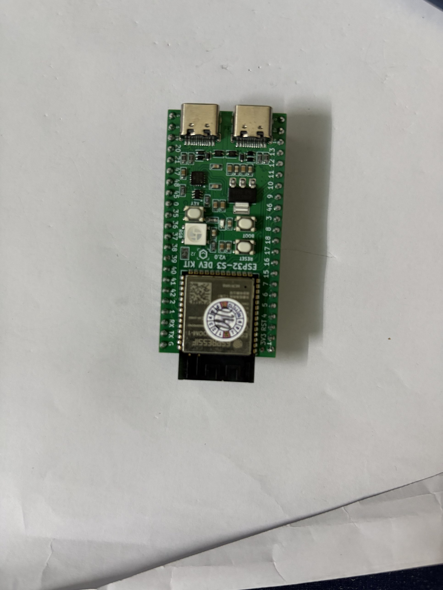
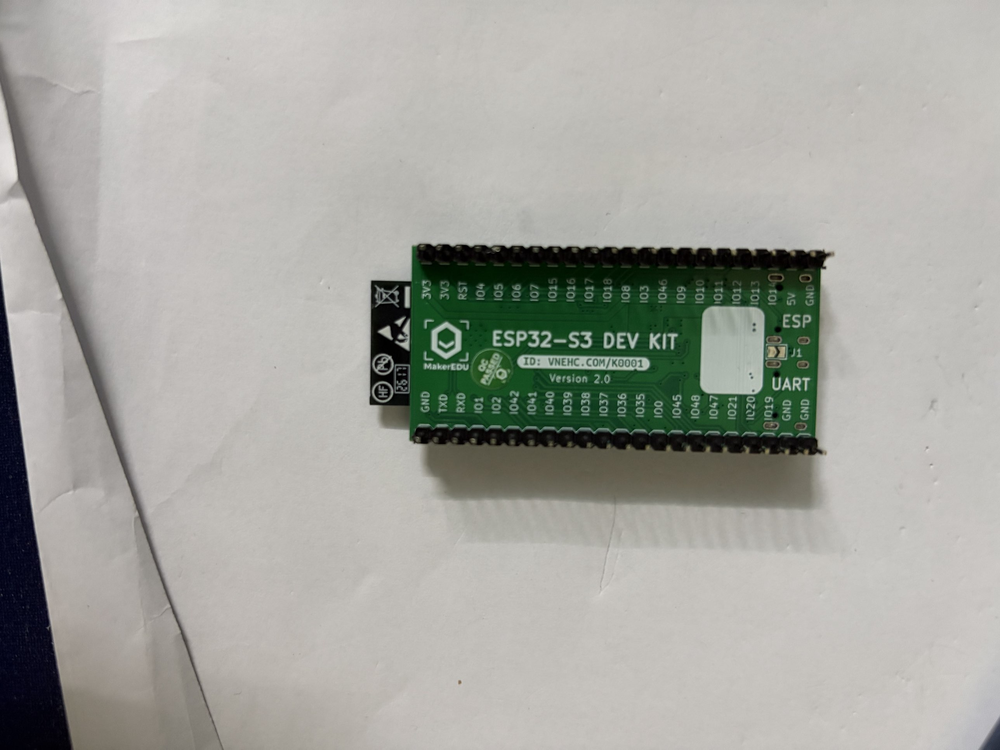
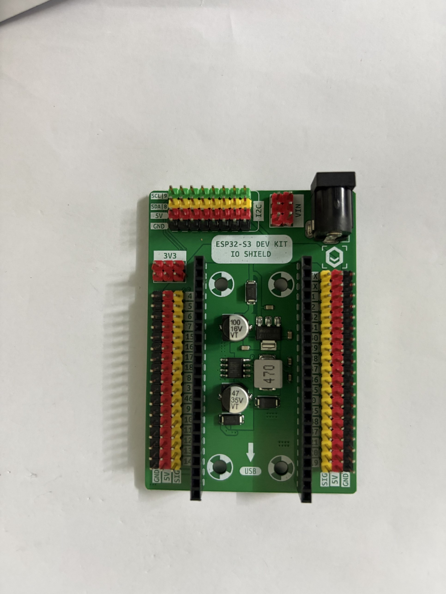
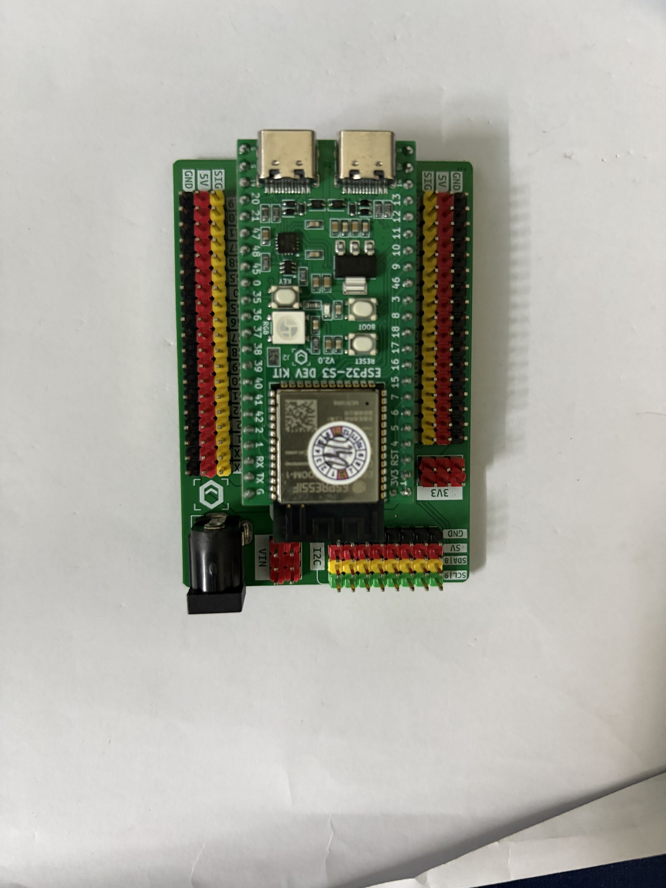

# Giới thiệu ESP32-S3

> Note tham khảo về vi điều khiển **ESP32-S3** và board phát triển ESP32-S3 DevKit dùng cho các lab có kết nối mạng. Phần nền tảng Arduino xem ở bài [Giới thiệu Arduino & board Arduino Uno](arduino-intro.md).

## ESP32-S3 là gì

**ESP32-S3** là dòng vi điều khiển (SoC) của hãng **Espressif**, tích hợp sẵn **Wi-Fi** và **Bluetooth Low Energy** trên cùng một chip. Khác với Arduino Uno (không có mạng, phải gắn thêm module), ESP32-S3 tự kết nối được Internet, nên phù hợp làm **thiết bị tầng cảm biến + kết nối** trong kiến trúc IoT: đọc cảm biến rồi gửi dữ liệu lên broker MQTT, server hoặc cloud (xem [MQTT](mqtt.md)).

Chip **S3** là thế hệ mới trong họ ESP32, bổ sung so với ESP32 gốc:

- Lõi **Xtensa LX7** (thay LX6), có thêm tập lệnh vector giúp chạy mô hình AI/ML nhỏ (nhận dạng giọng nói, hình ảnh) nhanh hơn.
- **USB OTG** gốc trên chip: có thể làm USB device (giả lập bàn phím, chuột, ổ đĩa…).
- Hỗ trợ camera (giao diện DVP) và màn hình LCD song song.
- Chỉ có **Bluetooth LE 5**, **không có Bluetooth Classic** (ESP32 gốc có cả hai).

## Thông số chính

| Thông số | Giá trị |
|---|---|
| Lõi xử lý | 2 lõi Xtensa LX7 32 bit, tối đa **240 MHz** |
| SRAM | 512 KB (trên chip) |
| Flash / PSRAM | Nằm ngoài chip, tùy module (ví dụ 8 MB flash, 8 MB PSRAM) |
| Wi-Fi | 802.11 b/g/n, băng tần **2,4 GHz** |
| Bluetooth | Bluetooth LE 5 |
| Mức logic | **3,3 V** (chân I/O **không chịu được 5 V**) |
| GPIO | Tối đa 45 chân, hỗ trợ PWM, ADC, I²C, SPI, UART, I²S, touch… |
| ADC | 12 bit (0–4095), 2 bộ ADC |
| Nguồn cấp | USB 5 V (board hạ xuống 3,3 V qua bộ ổn áp) |

So sánh nhanh với Arduino Uno:

| | Arduino Uno R3 | ESP32-S3 |
|---|---|---|
| Vi điều khiển | ATmega328P, 8 bit, 16 MHz | Xtensa LX7, 32 bit, 2 lõi, tới 240 MHz |
| RAM | 2 KB | 512 KB (+ PSRAM nếu có) |
| Mức logic | 5 V | **3,3 V** |
| ADC | 10 bit (0–1023) | 12 bit (0–4095) |
| Kết nối mạng | Không | Wi-Fi + Bluetooth LE |
| Cổng USB | USB-B | USB-C |

## Board ESP32-S3 DevKit trong kit

Kit gồm **hai phần** ghép với nhau:

- **ESP32-S3 DEV KIT V2.0** (hãng MakerEDU): board chính gắn module **ESP32-S3-WROOM-1** của Espressif, có sẵn mạch nguồn, hai cổng USB-C, nút bấm, LED RGB và hai hàng chân đánh số GPIO.
- **IO Shield**: board mở rộng cắm khớp bên dưới, kéo mỗi chân GPIO ra **bộ 3 chân `GND – 5V – SIG`** để cắm thẳng cảm biến/servo bằng dây 3 sợi, không cần breadboard.

### Board chính

{width=45%}

| Khu vực | Mô tả |
|---|---|
| **Module ESP32-S3-WROOM-1** | Khối kim loại có tem ở nửa dưới board; phần **anten PCB** (vân đen) nhô ra ngoài mép board: **không che bằng tay/vật kim loại** khi dùng Wi-Fi |
| **Hai cổng USB-C** | Phía trên board. Một cổng qua chip cầu nối USB–UART (nạp code + Serial Monitor), một cổng là **USB gốc** của chip (USB OTG/JTAG) |
| **Nút `BOOT`** | Nối GPIO0; giữ khi cấp điện hoặc nhấn `RESET` để vào chế độ nạp firmware |
| **Nút `RESET`** | Khởi động lại chương trình |
| **Nút `KEY`** | Nút bấm người dùng, đọc được bằng code (dùng thử `digitalRead`) |
| **LED `RGB`** | Đèn RGB trên board để thử nhanh |
| **Hai hàng chân hai bên** | Số in trên board là **số GPIO**; ngoài ra có `3V3`, `5V`, `GND`, `RST`, `TX`, `RX` |

Mặt sau in nhãn đầy đủ `IOxx` cho từng chân, cùng chân `3V3`, `5V`, `GND`. Có hai cụm pad **`ESP`** và **`UART`** (kèm `J1`) ở cạnh chân `5V`/`GND`.

{width=45%}

### IO Shield

{width=45%}

| Khu vực | Mô tả |
|---|---|
| **Hai khe cắm (socket) giữa board** | Cắm ESP32-S3 vào, **đầu USB-C hướng về phía mũi tên `USB`** in trên shield |
| **Hai cột chân bên trái/phải** | Mỗi GPIO một bộ 3 chân: `SIG` (vàng, tín hiệu GPIO), `5V` (đỏ), `GND` (đen). Số bên cạnh là số GPIO |
| **Cụm `I2C`** | 8 bộ `SCL` (xanh lá, **GPIO9**), `SDA` (vàng, **GPIO8**), `5V`, `GND` song song, cắm được nhiều module I²C |
| **Cụm `3V3`** | Các chân 3,3 V cho module cần 3,3 V |
| **Jack DC + cụm `VIN`** | Cấp nguồn ngoài qua jack DC; mạch giảm áp (cuộn 470, tụ 100 µF/16 V và 47 µF/35 V, IC ổn áp) tạo ra nguồn 5 V cho cả board |

{width=55%}

> [!NOTE]
> Chân `SIG` trên shield là **GPIO nối thẳng, mức logic 3,3 V**, dù hàng bên cạnh có chân `5V`. Cấp 5 V cho cảm biến thì được, nhưng tín hiệu **đưa ngược vào `SIG` phải ≤ 3,3 V** (xem phần lưu ý bên dưới). Tên chân là **số GPIO** (ví dụ `GPIO4`), không có `D`/`A` như Uno; chân nào đọc analog được là do ADC gắn với chân đó.

## Lập trình

Có thể dùng **Arduino IDE** với gói board **esp32 by Espressif Systems** (Boards Manager), viết sketch với `setup()`/`loop()` quen thuộc, nên các hàm như `pinMode`, `digitalWrite`, `Serial.print` dùng như trên Uno. Ngoài ra còn có **ESP-IDF** (framework chính hãng, C/C++) và **MicroPython**.

Các điểm khác Uno khi viết code:

- `analogRead()` trả về **0–4095** (12 bit), không phải 0–1023.
- `analogWrite()` dùng được trên mọi chân (PWM do phần cứng LEDC cấp).
- Kết nối Wi-Fi bằng thư viện `WiFi.h` đi kèm gói board:

```cpp
#include <WiFi.h>

void setup() {
  Serial.begin(115200);
  WiFi.begin("TEN_WIFI", "MAT_KHAU");
  while (WiFi.status() != WL_CONNECTED) {
    delay(500);
    Serial.print(".");
  }
  Serial.println(WiFi.localIP());
}

void loop() {}
```

- Chọn board trong Arduino IDE: `Tools → Board → esp32 → ESP32S3 Dev Module`; nếu dùng cổng USB gốc cần bật `USB CDC On Boot: Enabled` để Serial Monitor hoạt động.

## Lưu ý khi lắp mạch

- **Logic 3,3 V**: không đưa tín hiệu 5 V vào chân GPIO. Cảm biến/module 5 V (ví dụ HC-SR04 chân `ECHO`) cần **chia áp hoặc chuyển mức logic**.
- Chân `3V3` cấp được dòng nhỏ; module tải lớn (servo, motor, dải LED) dùng chân `5V` hoặc **nguồn ngoài**, và phải **chung GND**.
- Mỗi chân GPIO nên giữ **≤ 20 mA**.
- Một số chân có vai trò riêng khi khởi động (strapping, như GPIO0, GPIO3, GPIO45, GPIO46) hoặc dành cho flash/PSRAM nội bộ (khoảng GPIO26–37 tùy module): **tránh dùng** cho cảm biến/nút bấm nếu không cần thiết.
- Rút USB trước khi đổi dây, như với Uno.
- Nếu không nạp được code: giữ nút `BOOT`, nhấn `RST` rồi thả `BOOT`, sau đó nạp lại.
