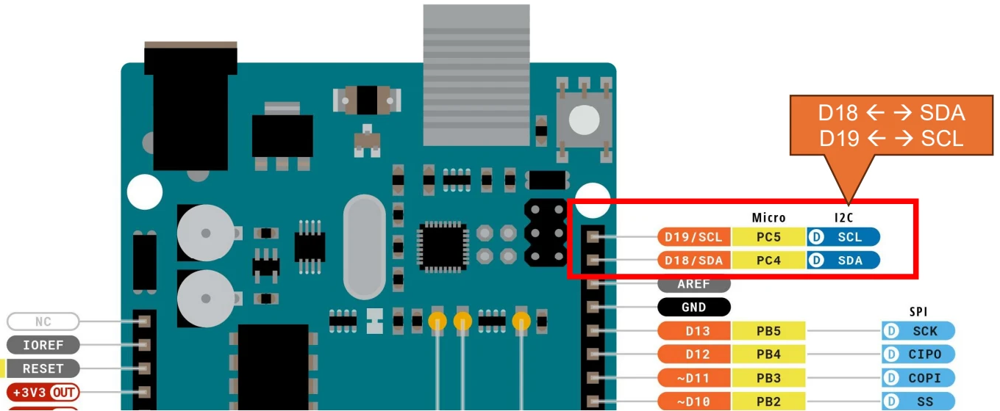
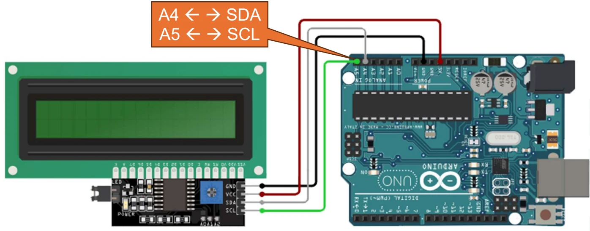
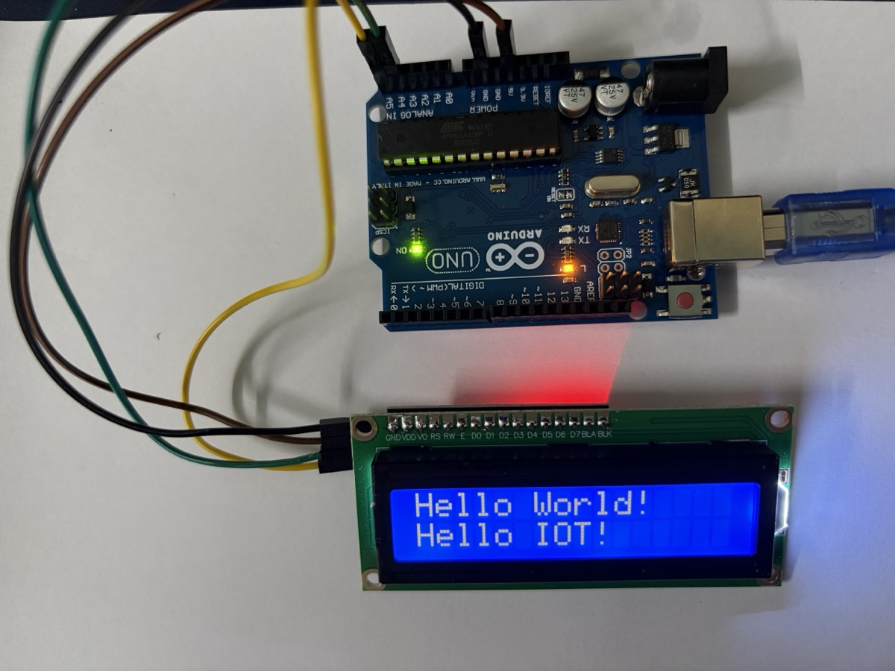

# Màn hình LCD 1602 + I²C

> Cách nối màn hình LCD 16×2 có gắn module I²C vào Arduino Uno và hiển thị chữ bằng thư viện `LiquidCrystal_I2C`.

## LCD 1602 là gì

**LCD 1602** là màn hình tinh thể lỏng hiển thị **2 dòng × 16 ký tự**, dùng chip điều khiển **HD44780** (hoặc tương thích). Mỗi ký tự là một ô 5×8 điểm. Màn có đèn nền (thường xanh lá hoặc xanh dương) và hiển thị được chữ, số, ký hiệu ASCII cùng tối đa 8 ký tự tự định nghĩa.

LCD gốc có **16 chân**: `VSS`, `VDD`, `V0` (độ tương phản), `RS`, `RW`, `E`, `D0`–`D7` (8 chân dữ liệu), `A`/`K` (đèn nền). Nối trực tiếp vào Arduino tốn ít nhất **6 chân digital** (chế độ 4 bit: `RS`, `E`, `D4`–`D7`) cộng một biến trở chỉnh tương phản — chiếm gần hết chân của Uno.

## Module I²C (PCF8574)

Để tiết kiệm chân, LCD thường được hàn sẵn một **module chuyển đổi I²C** ở mặt sau. Module dùng chip **PCF8574** (bộ mở rộng 8 chân I/O qua I²C): Arduino gửi lệnh qua 2 dây I²C, chip PCF8574 tự xuất ra các chân `RS`, `E`, `D4`–`D7` và đèn nền của LCD.

Bảng 16 chân gốc, ảnh thật của LCD trong kit và các chi tiết trên module (biến trở tương phản, jumper `LED`, pad địa chỉ `A0`–`A2`) xem ở [note linh kiện](arduino-components.md#lcd-162-i²c).

**Địa chỉ I²C** mặc định thường là `0x27` (chip PCF8574) hoặc `0x3F` (chip PCF8574A). Nếu không chắc, chạy sketch quét I²C ở dưới để tìm.

### I²C hoạt động thế nào

**I²C** (Inter-Integrated Circuit) là bus nối tiếp **2 dây**, nhiều thiết bị dùng chung:

- **SDA** (Serial Data) — dùng để **gửi và nhận dữ liệu**, truyền hai chiều trên cùng một dây.
- **SCL** (Serial Clock) — dùng để **đồng bộ hoá (điều phối thời gian)** cho việc truyền dữ liệu. Thiết bị chủ (master, ở đây là Arduino) phát xung nhịp; mỗi xung trên SCL đánh dấu thời điểm đọc một bit trên SDA. Slide bài giảng gọi tắt là *Control*, tên chuẩn là *Clock*.

Mỗi thiết bị tớ (slave) có một **địa chỉ 7 bit** riêng; master gọi đúng địa chỉ thì thiết bị đó mới trả lời. Nhờ vậy có thể treo LCD, cảm biến, RTC… lên cùng 2 dây SDA/SCL. Hai đường này cần điện trở kéo lên (pull-up) — module LCD I²C thường có sẵn.

Trên **Arduino Uno**, I²C nằm cố định ở chân **A4 = SDA** và **A5 = SCL** — tương ứng chân **PC4/PC5** của chip ATmega328P. Bản R3 nối thêm hai chân này ra đầu header digital, ngay sau `AREF`, in nhãn `SDA`/`SCL` (sơ đồ pinout ghi là **D18/SDA** và **D19/SCL**, vì A4/A5 dùng như chân digital thì có số 18/19). Hai cặp chân này **thông nhau bên trong board**, nối vào cặp nào cũng được — nhưng chỉ là một bus, không phải hai.

{width=90%}

Board khác dùng chân khác: Mega là 20/21, ESP32 mặc định GPIO 21/22.

## Sơ đồ kết nối

{width=100%}

| Chân module I²C | Chân Arduino Uno | Màu dây trong hình |
|---|---|---|
| `GND` | `GND` | đen |
| `VCC` | `5V` | đỏ |
| `SDA` | `A4` | xám |
| `SCL` | `A5` | xanh lá |

Chỉ 4 dây, trong đó 2 dây là nguồn. Các chân digital D0–D13 vẫn còn trống để dùng cho LED, nút nhấn, cảm biến.

Lưu ý: khi đã dùng I²C thì **A4/A5 không dùng được làm chân analog** nữa.

## Cài thư viện

Mở Library Manager trong Arduino IDE: **Tools → Manage Libraries…** (`Ctrl+Shift+I`), gõ tên vào ô tìm kiếm rồi bấm **Install**.

| Header | Tìm trong Library Manager | Ghi chú |
|---|---|---|
| `Wire.h` | — | Thư viện I²C, **có sẵn** trong Arduino IDE |
| `LiquidCrystal_I2C.h` | `liquid i2c` → **LiquidCrystal I2C** by Frank de Brabander | Cũ nhưng ổn định, phổ biến nhất; code trong note này dùng thư viện này |
| `LCDI2C_Multilingual.h` | `liquid i2c` → **LiquidCrystal I2C Multilingual** by Loc P. | In chuỗi UTF-8 có dấu — dùng khi cần **tiếng Việt** |
| `LCD-I2C.h` | `lcd-i2c` → **LCD-I2C** by Frank Häfele | Thư viện mới, API gọn |

Chỉ cần cài một thư viện LCD (thường là `LiquidCrystal_I2C`); `Wire.h` luôn đi kèm vì mọi thư viện LCD I²C đều dựa trên nó.

**Tiếng Việt có dấu.** ROM ký tự của chip HD44780 chỉ có ASCII (và một ít ký tự Nhật), không có chữ có dấu. `LCDI2C_Multilingual` vẽ các chữ có dấu bằng **ký tự tự định nghĩa** (`createChar`) — mà LCD chỉ có **8 ô** ký tự tự định nghĩa, nên mỗi lúc màn chỉ hiện được tối đa 8 chữ có dấu *khác nhau*. Câu ngắn thì ổn, câu dài nhiều dấu sẽ bị sai ký tự.

```cpp
#include <LCDI2C_Multilingual.h>

LCDI2C_Vietnamese lcd(0x27, 16, 2);

void setup() {
  lcd.init();
  lcd.backlight();
  lcd.print("Xin chào!");
}

void loop() {}
```

Trên **Tinkercad**, linh kiện là *LCD 16 x 2 (I2C)*; Tinkercad có sẵn thư viện `Adafruit_LiquidCrystal` thay vì `LiquidCrystal_I2C` (xem đoạn code riêng bên dưới).

## Code

### Quét địa chỉ I²C

Chạy sketch này trước nếu LCD không hiện chữ, mở **Serial Monitor** (9600 baud) để xem địa chỉ:

```cpp
#include <Wire.h>

void setup() {
  Wire.begin();
  Serial.begin(9600);
  Serial.println("Dang quet I2C...");

  for (byte addr = 1; addr < 127; addr++) {
    Wire.beginTransmission(addr);
    if (Wire.endTransmission() == 0) {   // 0 = thiết bị có trả lời (ACK)
      Serial.print("Tim thay thiet bi o dia chi 0x");
      Serial.println(addr, HEX);
    }
  }
}

void loop() {}
```

### Hiển thị chữ

```cpp
#include <Wire.h>
#include <LiquidCrystal_I2C.h>

// địa chỉ 0x27, màn 16 cột × 2 dòng
LiquidCrystal_I2C lcd(0x27, 16, 2);

void setup() {
  lcd.init();          // khởi tạo LCD
  lcd.backlight();     // bật đèn nền

  lcd.setCursor(0, 0); // cột 0, dòng 0
  lcd.print("Hello, IoT!");
  lcd.setCursor(0, 1); // cột 0, dòng 1
  lcd.print("LCD 1602 + I2C");
}

void loop() {}
```

### Hiển thị giá trị thay đổi

Ví dụ đếm số giây từ lúc khởi động — mẫu chung để hiển thị dữ liệu cảm biến:

```cpp
#include <Wire.h>
#include <LiquidCrystal_I2C.h>

LiquidCrystal_I2C lcd(0x27, 16, 2);

void setup() {
  lcd.init();
  lcd.backlight();
  lcd.print("Thoi gian:");
}

void loop() {
  lcd.setCursor(0, 1);
  lcd.print(millis() / 1000);
  lcd.print(" s   ");   // dấu cách để xoá ký tự thừa khi số ngắn lại
  delay(200);
}
```

Không gọi `lcd.clear()` trong `loop()`: lệnh này chậm (~2 ms) và làm màn nhấp nháy. Thay vào đó, ghi đè lên vị trí cũ và in thêm khoảng trắng để xoá phần dư.

### Bản cho Tinkercad

```cpp
#include <Adafruit_LiquidCrystal.h>

Adafruit_LiquidCrystal lcd(0);  // 0 = địa chỉ I2C 0x20 trong Tinkercad

void setup() {
  lcd.begin(16, 2);
  lcd.setBacklight(1);
  lcd.print("Hello, IoT!");
}

void loop() {}
```

## Ảnh thực tế

{width=80%}

Mạch lắp thật dùng 4 dây **đực – cái** tách từ bộ cáp dẹt. Đầu cái chụp vào header 4 chân của module I²C, đầu đực cắm thẳng vào header Arduino, không cần breadboard:

| Chân module I²C | Chân Arduino Uno | Màu dây trong ảnh |
|---|---|---|
| `GND` | `GND` | đen |
| `VCC` | `5V` | nâu |
| `SDA` | `A4` | xanh lá |
| `SCL` | `A5` | vàng |

Màu dây không giống trong hình sơ đồ. Đó chỉ là màu có sẵn trong bộ cáp; điều quan trọng là thứ tự chân.

Quá trình chạy thật đi qua các bước sau:

1. **Serial Monitor báo `Not connected. Select a board and a port`.** IDE chưa chọn board và cổng. Chọn **Arduino UNO** và cổng `/dev/cu.usbmodem…` (macOS) là được.
2. **Quét I²C ra `0x27`.** Ba pad `A0`–`A2` để trống nên dùng địa chỉ mặc định. Đầu Serial Monitor in một chuỗi ký tự rác `DDDD…` do board reset khi mở cổng, không phải lỗi. Dòng `Dang quet I2C...` in hai lần cũng là vì board reset hai lần.
3. **Upload code hiển thị → đèn nền xanh sáng nhưng không có chữ.** Nguyên nhân là chưa chỉnh tương phản. Vặn **biến trở xanh** ở mặt sau module (loại một vòng, chỉ xoay khoảng 3/4 vòng). Chữ hiện ra trong một khoảng vặn rất hẹp, nên phải vặn từng chút một. Mạch chỉ chạy 5 V từ USB nên chạm vào không bị giật, chỉ cần tránh để tua vít quẹt chập các chân linh kiện.

## Các hàm hay dùng

| Hàm | Ý nghĩa |
|---|---|
| `lcd.init()` | Khởi tạo LCD (gọi một lần trong `setup()`) |
| `lcd.backlight()` / `lcd.noBacklight()` | Bật / tắt đèn nền |
| `lcd.setCursor(col, row)` | Đặt con trỏ; cột 0–15, dòng 0–1 |
| `lcd.print(x)` | In chuỗi hoặc số tại vị trí con trỏ |
| `lcd.clear()` | Xoá màn, đưa con trỏ về (0, 0) |
| `lcd.scrollDisplayLeft()` / `Right()` | Dịch toàn bộ nội dung sang trái/phải một ô |
| `lcd.createChar(n, bytes)` | Định nghĩa ký tự riêng thứ `n` (0–7), in bằng `lcd.write(n)` |

## Lỗi hay gặp

| Hiện tượng | Nguyên nhân / cách xử lý |
|---|---|
| Đèn nền sáng nhưng không có chữ, hoặc dòng 1 toàn ô vuông đen | **Chưa chỉnh tương phản** — xoay biến trở xanh trên module đến khi thấy chữ. Đây là lỗi phổ biến nhất |
| Đèn nền sáng, ô vuông đã chỉnh vẫn không hiện chữ | Sai địa chỉ I²C — chạy sketch quét, thử `0x3F` thay vì `0x27` |
| Không có đèn nền | Thiếu jumper `LED` trên module, hoặc chưa gọi `lcd.backlight()` |
| Quét I²C không thấy thiết bị nào | Đảo nhầm SDA/SCL, lỏng dây, hoặc chưa nối GND chung |
| Chữ thừa ký tự cũ ở cuối dòng | Chuỗi mới ngắn hơn chuỗi cũ — in thêm khoảng trắng để xoá |
| Lỗi biên dịch `LiquidCrystal_I2C.h: No such file` | Chưa cài thư viện |
| Serial Monitor: `Not connected. Select a board and a port` | Chưa chọn board/cổng — chọn **Arduino UNO** và cổng `usbmodem`/`usbserial`. Board clone chip CH340 có thể cần cài driver |
| Serial Monitor in ký tự rác (`DDDD…`) trước dòng đầu tiên | Nhiễu lúc board reset khi mở cổng — bỏ qua được. Kiểm tra baud trùng `Serial.begin(9600)` |
